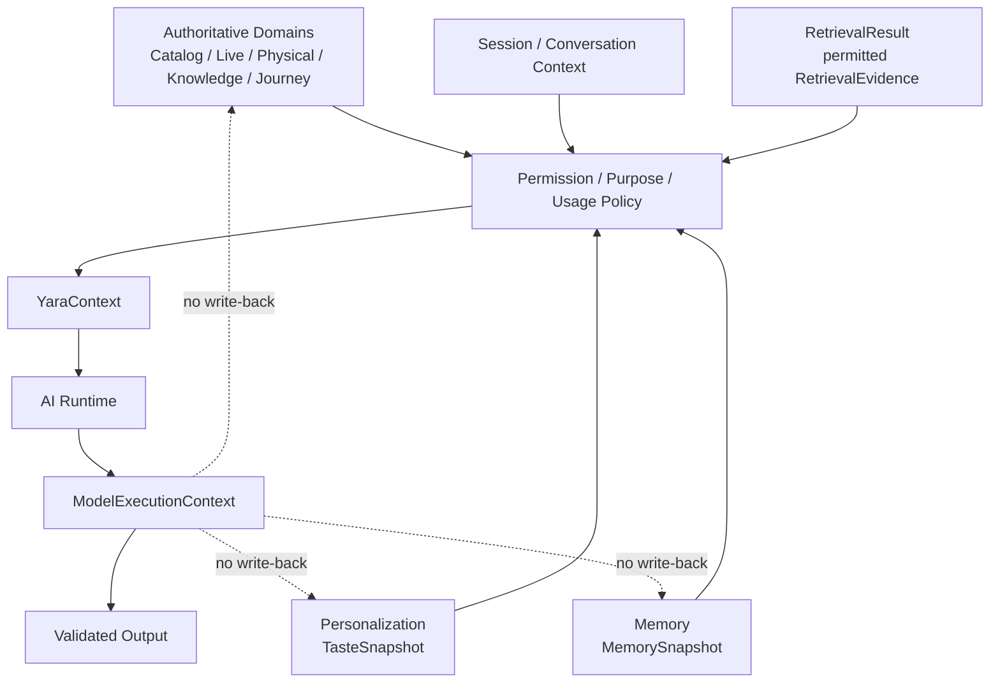
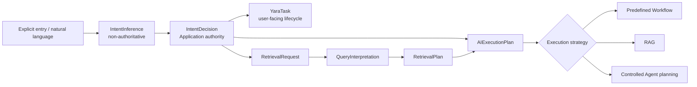
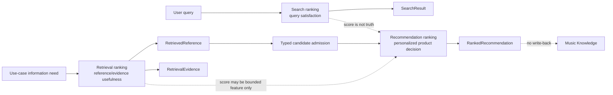
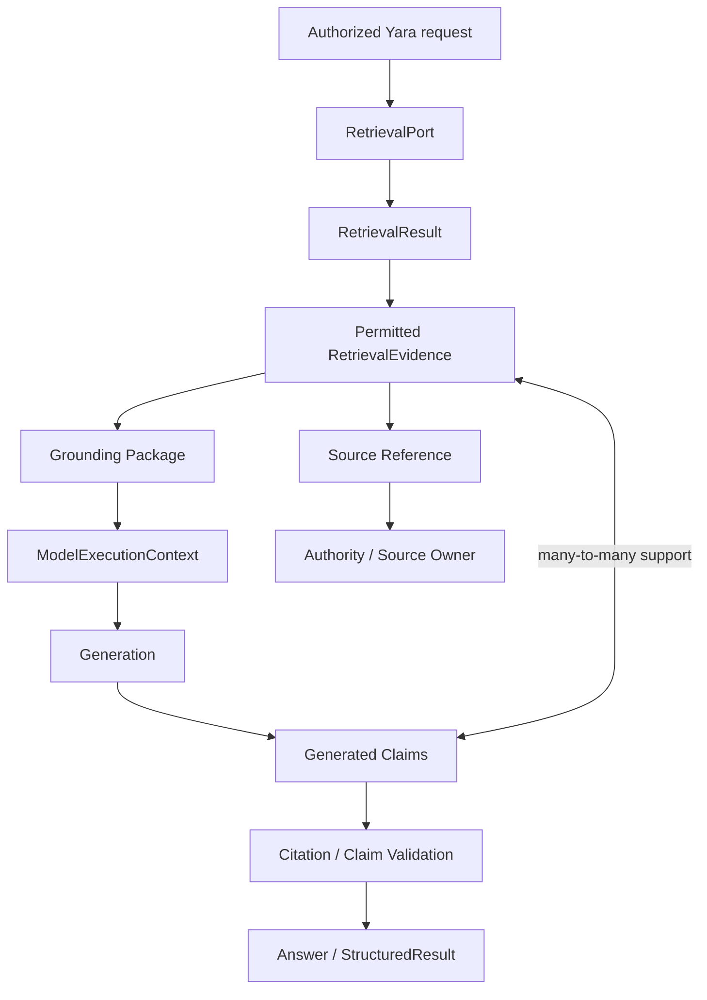
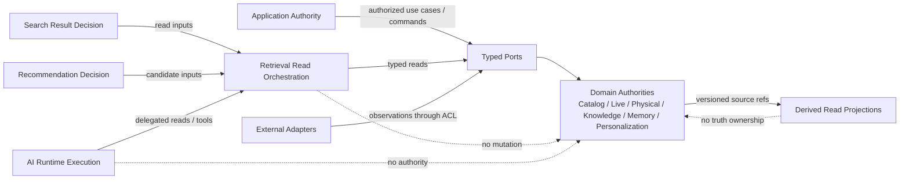
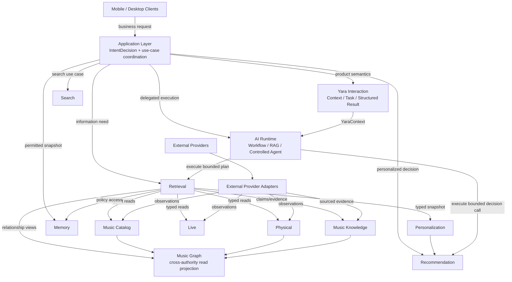

# Phase 2F — Intelligence Architecture Integration Review

> 状态：Approved / Frozen  
> 范围：Approved/Frozen Chapters 5–9 的 cross-chapter integration audit  
> 非范围：Chapter 10、physical topology、technology/vendor selection

## A. Executive Summary

Chapters 5–9 在 logical architecture 层面形成一致的 Yara Intelligence Architecture：Application拥有product intent与business/access envelope；Yara Interaction拥有user-facing context/task/result semantics；AI Runtime执行bounded Workflow/RAG/Agent mechanics；Retrieval编排permitted information access；Personalization拥有Taste并在其内部执行Recommendation decision；Memory拥有durable companion recall；Catalog/Live/Physical/Knowledge保持domain truth；Music Graph仅为cross-authority read projection。

未发现double-owner、反向write dependency或必须重开已冻结architecture的矛盾。用户已再次明确Chapters 5–9均为Approved/Frozen，因此Chapter 5与ADR-005/006/011的历史状态标签已机械同步，不改变decision内容。唯一downstream naming requirement是Chapter 11统一采用`RetrievedReference`，不继续使用`CandidateReference`别名，以免与`RecommendationCandidate`碰撞。

## B. Authority Matrix

| Semantic object/capability | Authoritative owner / write authority | Read consumers | Derived projection | Forbidden duplicate owner |
|---|---|---|---|---|
| Canonical Music Identity | Catalog；canonical resolve/merge/split commands | Search、Retrieval、Recommendation、Knowledge、AI | entity/search indexes | Provider、Graph、LLM |
| Catalog Structural Metadata | Catalog；Catalog invariants | product surfaces、Graph view、Retrieval | read/search projections | Knowledge、Retrieval |
| Live Event Truth | Live；normalized occurrence/current observation policy | Search、planning、Recommendation | availability/search projection | YaraTask、provider payload |
| Physical Release/Edition/Pressing | Physical；structural/market normalization commands | Search、comparison、Collection、Graph | record/search projection | Catalog Work、Knowledge |
| `ExplicitPreferenceState` | Personalization；validated explicit preference command | Recommendation、permitted Context | `TasteProfile`/`TasteSnapshot` | Memory、Journey |
| `DerivedTasteState` | Personalization；policy-governed interpretation | Recommendation、permitted Search/Yara | `TasteProfile`/`TasteSnapshot` | LLM、Retrieval |
| `TasteProfile` | Personalization；combined versioned view policy | Personalization consumers | `TasteSnapshot` | Memory、Yara Interaction |
| `TasteSnapshot` | Personalization-produced immutable projection；no independent write | Recommendation、Search、Context Builder | request-scoped | Retrieval、AI Runtime |
| `RecommendationCandidate` | Recommendation owns request-scoped candidate admission semantics；object identity stays source domain | ranking pipeline | candidate set | Retrieval reference、LLM |
| `RankedRecommendation` | Recommendation within Personalization；request/result decision | Application、Yara Interaction | rendered result | Search/Retrieval ranker |
| `RecommendationExplanation` | Recommendation explanation policy over actual decision evidence | Client、Yara | display projection | LLM-generated rationale |
| `MemoryCandidate` | Memory candidate lifecycle；proposal sources may vary | Memory policy/UI | pending projection | AI Runtime direct write |
| `MemoryRecord` | Memory；accept/confirm/edit/forget/access lifecycle | Context Builder、user controls | `MemorySnapshot`/index | Conversation、Taste |
| `MemorySnapshot` | Memory-produced permission/purpose-filtered projection | Application/Context Builder | request-scoped | Retrieval/AI Runtime |
| Conversation History | Yara Interaction | user/history/context use cases | session summary where permitted | Memory |
| Session Context | Yara Interaction/session state | Context Builder | request projection | Memory/Taste |
| `YaraContext` | Yara Interaction/Application semantics；assembled, not domain write | AI Runtime | request-scoped | MemoryStore、TasteProfile |
| `ModelExecutionContext` | AI Runtime execution artifact；no domain writes | model invocation only | invocation-scoped | YaraContext/domain state |
| Journey / `MusicMoment` | Journey；curation/edit/delete commands | Me、Memory reference、Yara reflection | timeline/map views | Memory、Taste |
| `KnowledgeClaim` | Music Knowledge claim lifecycle | Graph、Retrieval、AI | evidence/search projection | Graph、LLM |
| `RelationshipAssertion` | Music Knowledge；specialized KnowledgeClaim | Graph、Retrieval | `MusicRelationshipView` | Catalog structural relation |
| `MusicRelationshipView` | no truth owner；projection governance preserves source authority | Retrieval、Recommendation、AI | itself | Knowledge/Catalog proxy ownership |
| `SearchResult` | Search request-scoped presentation/rank decision；object truth stays source | Client | response projection | Catalog/Recommendation |
| `RetrievedReference` | Retrieval request-scoped reference selection；identity stays source | Search、Recommendation、Application | `RetrievalResult` member | `RecommendationCandidate` |
| `RetrievalEvidence` | Retrieval projection; source/authority owner remains upstream | AI、Search explanation、Application | grounding package | KnowledgeClaim/domain truth |
| `RetrievalResult` | Retrieval request-scoped envelope；no durable truth write | Application、Search、AI Runtime | references/evidence/status | domain entity |
| `YaraTask` | Yara Interaction/Application task lifecycle | Client、AI Runtime | progress/status views | Agent/Workflow run |
| `StructuredResult` | Yara Interaction taxonomy/lifecycle；validated composition path | Client、Saved Results | typed rendered result | generic chat/model output |
| External Provider Observation | external provider is source authority；Adapter/owning domain decides normalization | domain ingestion/query paths | normalized snapshot/candidate | raw payload as canonical truth |

结论：没有double-owner。Projection owner与underlying truth owner均已区分；所有cross-domain writes经过Application/policy/domain command path。

## C. Context Consistency

验证结果：`SessionContext != Memory`；`Taste != Memory`；`Journey != Memory`；`ConversationHistory != Memory`；`YaraContext != MemoryStore != TasteProfile != RetrievalResult`；`ModelExecutionContext != YaraContext`。只有permission-filtered projections进入`YaraContext`；Runtime可进一步缩减并加入permitted evidence形成`ModelExecutionContext`，不能扩大权限或回写domain truth。

## D. Intent / Planning Consistency

- `IntentInference`：Runtime classification candidate。
- `IntentDecision`：Application authoritative product/use-case decision。
- `QueryInterpretation`：fulfillment interpretation，不重定义intent。
- `RetrievalPlan`：bounded information-access plan。
- `AIExecutionPlan`：bounded runtime execution plan，可引用retrieval need，但不取代business plan。
- Workflow：known predefined strategy；Agent：受控dynamic strategy。
- `YaraTask`：user-facing lifecycle，不等于plan或runtime run。

不存在generic `Plan`替换上述语义的路径。

## E. Application / Retrieval / AI Runtime

| Layer/capability | Owns | Must not own |
|---|---|---|
| Application | business goal、`IntentDecision`、use-case coordination、constraints、allowed capabilities/sources、expected outcome | lexical/vector/graph mechanics、model/runtime strategy |
| Retrieval | retrieval interpretation、source/mode plan、invocation、fusion/dedup、hard-filter cooperation、retrieval ranking/reranking、result packaging、partial source semantics | authorization creation、source truth、product outcome |
| AI Runtime | Workflow/RAG/Agent execution、permitted tool/model calls、`ModelExecutionContext` | business intent、access authority、domain truth |

MVP physical colocation不改变logical separation。Application不实现retrieval mechanics；AI Runtime只能在delegated envelope中选择subset/order和执行。

## F. Search / Retrieval / Recommendation

`SearchResult != RetrievedReference != RecommendationCandidate`。从`RetrievedReference`进入Recommendation必须经过typed candidate admission、canonical/eligibility checks；retrieval score最多是明确标注、校准并policy允许的input feature，不是final rank。Reranking只优化already-allowed subset。

### Retrieval Result Semantics

`RetrievalResult`明确包含`RetrievedReference[]`、`RetrievalEvidence[]`、limitations、source statuses与必要execution metadata。Integration canonical term采用`RetrievedReference`；`CandidateReference`仅视为Phase 2E历史别名，Chapter 11不得固化该别名，以免与`RecommendationCandidate`冲突。Reference不是grounding evidence；Evidence也不会自动变为KnowledgeClaim。

## G. Taste / Memory / Context

| Example | Correct classification | Duplicate truth prohibited |
|---|---|---|
| “I like shoegaze.” | `ExplicitPreferenceState` | MemoryRecord作为偏好owner |
| “I keep listening to shoegaze.” | permitted `TasteEvidence` → `DerivedTasteState` | raw playback直接成为Taste truth |
| “I want calm music tonight.” | Session/`YaraContext` temporary preference | automatic durable Taste/Memory write |
| “Remember that I prefer aisle seats.” | `MemoryCandidate` → policy → `MemoryRecord` | Session Context作为durable truth |
| “My first Green Day concert was in 2019.” | Journey/`MusicMoment` when curated | Memory复制Journey truth；可仅保留typed reference |
| “Recommend something energetic right now.” | current Context + Recommendation | durable preference inference without policy |

## H. Knowledge / Graph / Retrieval

Catalog拥有canonical identity/structural relations；Knowledge拥有`KnowledgeClaim` lifecycle；Music Graph是cross-authority read projection；`MusicRelationshipView`非权威。Retrieval通过`MusicGraphQueryPort`做cross-authority traversal，通过`MusicKnowledgePort`取得Knowledge-specific claims/evidence。Graph inclusion不转移ownership，`RetrievalEvidence`也不自动形成`KnowledgeClaim`。

## I. Memory / Personalization Access

唯一允许路径：`Retrieval/Application → MemoryAccessRequest → MemoryAccessPort → MemorySnapshot`。AI Runtime和generic vector retrieval不得读取raw MemoryStore。`FORGOTTEN`、`SUPERSEDED`、`EXPIRED`与purpose-denied records必须从derived indexes和ordinary read path失效；denied与empty需保持不同status，避免privacy side-channel与错误语义。

### Personalization Access

Personalization只提供permitted `TasteSnapshot`；不存在generic private Taste vector search。Recommendation组合TasteSnapshot、Context、eligible candidates与surface objective。Search personalization仅用于bounded boost/tie-break/scope ordering，不隐藏strong exact/canonical matches。

## J. RAG / Grounding

RAG = Retrieval + Grounding + Generation。Generated text永远不是evidence。Claim–Evidence是many-to-many；packaging和validation保留provenance、freshness、limitations、assertion/source class、`EvidenceUsagePolicy`和citation metadata。

## K. Evidence Usage / Privacy

End-to-end policy保持：`retrievable != model-context allowed != derivative/summarization allowed != quote/display allowed != citation allowed`。Licensed editorial、Memory、Taste、Social/private data与current provider observations分别保留purpose、region、expiry/withdrawal和attribution限制。Private Memory/Taste provenance默认不进入user-visible citations；permission withdrawal必须传播至context、indexes、evidence package和future outputs。

## L. Use-Case Walkthroughs

| Use case | Main flow and authorities | Result/write authority |
|---|---|---|
| Global Search “Purple Rain” | Search interpretation → Catalog resolution → lexical/semantic candidates → disambiguation Album/Track/other → hard filters/rank | `SearchResult`; no domain write |
| “Who influenced My Bloody Valentine?” | Application `IntentDecision` → Retrieval → Catalog ref + `MusicKnowledgePort`/Graph + editorial evidence → RAG validation | answer/`StructuredResult`; Knowledge claim remains source authority |
| Hidden 90s shoegaze album | Application intent/context → Retrieval references/Knowledge evidence → Recommendation candidate admission → TasteSnapshot + eligibility/diversity ranking → explanation | `RankedRecommendation`; Personalization/Recommendation decision only |
| MCR Seoul concert plan | YaraTask/Workflow → Live current occurrence + provider observations + optional Retrieval → AI synthesis/validation | Concert Plan `StructuredResult`; Live/provider truth unchanged |
| Vinyl pressing choice | Physical canonical edition/pressing + market observations + Knowledge/context evidence → bounded comparison Workflow | Vinyl Comparison; save/purchase external action separate |
| “What music defined my last year?” | Journey refs + permitted MemorySnapshot + listening/TasteSnapshot + RetrievalEvidence → reflection synthesis | Journey Reflection; no automatic Journey/Memory/Taste write |
| Save recommended Track | Client/Application command → Collection validates canonical TrackRef → Collection membership write；feedback event → Personalization policy interpretation | Collection owns save；Personalization may derive TasteEvidence, not direct Taste overwrite |

No circular owner or unnecessary mandatory hop found. Retrieval is skipped for direct authoritative queries when no evidence orchestration is needed.

## M. Port Inventory

| Port/contract | Provider/owner | Consumer | Logical input → output | Access/authority |
|---|---|---|---|---|
| `SearchPort` | Search capability | Clients/Application | `SearchQuery → SearchResult[]` | read/projection；Search rank only |
| `RetrievalPort` | Retrieval capability | Application/Search/AI Runtime | `RetrievalRequest → RetrievalResult` | read orchestration；no source truth |
| `RecommendationPort` | Recommendation within Personalization | Application/AI Runtime | `RecommendationRequest → RankedRecommendation[]` | request decision；no object truth |
| `MemoryAccessPort` | Memory | Application/Retrieval | `MemoryAccessRequest → MemorySnapshot` | permission-filtered read；Memory policy authority |
| `MusicKnowledgePort` | Music Knowledge | Retrieval/Application | Knowledge query → claims/evidence/concepts | Knowledge lifecycle read |
| `MusicGraphQueryPort` | MUSIC graph facade | Retrieval/Recommendation | `MusicGraphQuery → MusicRelationshipView[]` | cross-authority projection read |
| Taste access contract | Personalization | Application/Search/Recommendation | scoped request → `TasteSnapshot` | permission-filtered projection |
| Catalog query ports | Catalog | Search/Retrieval/domains | canonical lookup/query → typed refs/metadata | Catalog authoritative read |
| Live query ports | Live | Search/planning/Retrieval | event/occurrence query → current observation | Live authoritative normalized read |
| Physical query ports | Physical | Search/comparison/Retrieval | release/edition/pressing query → typed refs/snapshots | Physical authoritative read |
| `ModelGateway` | AI Runtime | Workflow/RAG/Agent runtime | bounded model request → normalized model output | execution only, non-authoritative |
| Tool capability ports | Domain/Application contracts + adapters | AI Runtime via guard | typed query/proposed command → observation/result | permissioned；writes require domain command path |

Final API/schema仍deferred。

## N. Query Understanding Reuse

Search interpretation与Retrieval `QueryInterpretation`可共享language detection、normalization、tokenization、entity mention extraction和typo/spelling primitives，但不能共享decision ownership。`SearchInterpretation != QueryInterpretation != IntentDecision`。Chapter 15应把primitives实现为无authority的reusable components，contracts和policy gates分别保留。

## O. Dependency Review

允许方向：business/application contracts → ports ← adapters；Application → Retrieval/Recommendation/AI Runtime；Retrieval → typed read ports；AI Runtime → guarded ports；projections → source references。

明确禁止：Knowledge → Recommendation → Knowledge feedback loop；Retrieval → source mutation；AI Runtime → Memory write authority；Search → Recommendation ownership；Graph → Catalog mutation；Personalization → unrestricted private retrieval；domain core → provider SDK。当前Chapters 5–9未发现这些反向依赖。

## P. BC / Capability Classification

| Classification | Members |
|---|---|
| Business/domain logical BC candidates | Personalization、Memory、Music Knowledge，以及既有MUSIC/PERSON/YARA candidate contexts |
| Product/domain semantics | Yara Interaction（Conversation/Context、Task、Structured Result） |
| Logical/shared capabilities | Recommendation inside Personalization、Search、Retrieval、Music Graph read projection、AI Runtime |

没有把technical capability提升为BC；所有BC candidate均具备独立business language、invariants与write authority evidence。

## Q. ADR Compatibility

| ADR | Current status | Decision/dependencies | Conflict | Amendment |
|---|---|---|---|---|
| ADR-005 Intent Router | Accepted | Hybrid inference；Application owns `IntentDecision` | none | no |
| ADR-006 Workflow vs Agent | Accepted | Workflow-first；bounded Agent；depends permission/budgets | none | no |
| ADR-007 Retrieval | Accepted | Application-authorized shared Retrieval；refs/evidence split | none | Chapter 11 canonicalize `RetrievedReference` |
| ADR-008 Personalization | Accepted | Personalization owns Taste；Recommendation internal capability | none | no |
| ADR-009 Knowledge/Graph | Accepted | Knowledge claim lifecycle；cross-authority Graph view | none | no |
| ADR-010 Memory | Accepted | independent Memory boundary；conservative write policy | none | no |
| ADR-011 Structured Result | Accepted | versioned envelope + typed schemas | none | no |

ADR-005–011全部Accepted且相互兼容；没有ADR需要reopen或semantic amendment。

## R. Integrated Phase 2 Architecture

图中业务authority flow由Clients/Application进入domain commands；information read flow经typed ports；AI execution flow由Application delegated constraints进入Runtime。所有boxes是logical responsibilities，不是services/deployments。

## S. Downstream Readiness

| Chapter | Readiness / remaining input |
|---|---|
| 10 External Data | ready；需provider contracts、source authority、rights/usage、freshness/quota/fallback |
| 11 Data | ready；需canonical objects、snapshots、claims、`RetrievedReference`、evidence/result/citation lineage、lifecycle |
| 12 State & Permission | ready；需command confirmation、access envelopes、visibility/purpose/denial states |
| 14 API & Realtime | ready；需typed ports、task/result/search/retrieval partial/stream events |
| 15 Components | ready；需Context/Router/Planner/Retrieval/Recommendation/Memory/Graph adapters与shared query primitives |
| 16 Storage | ready；authority stores与rebuildable search/vector/graph/cache projections明确 |
| 17 Reliability | ready；需SLO、budgets、timeouts、recovery、partial degradation |
| 18 Security & Privacy | ready；需classification、usage policy、retention/training/residency/delete propagation |
| 19 Evaluation | ready；需intent、RAG、retrieval、recommendation、memory、grounding metrics/thresholds |
| 22 Technology | ready but evidence-gated；logical requirements不选择vendor/model |
| 24 MVP | blocked for finalization by OQ-002；logical Full Vision不受阻 |

没有新增会阻止Chapter 10 logical design的输入缺口。

## T. Open Questions

| OQ | Remains open; integration impact |
|---|---|
| OQ-002 | MVP scope；阻塞ADR-003/final MVP topology，不阻塞Full Vision logical design |
| OQ-004 | compliance/data classification/region；影响permissions、evidence/model exposure |
| OQ-006 | editorial/lyrics licensing；影响source availability与usage rights |
| OQ-008 | SLO/workload；影响sync/async、budgets、topology |
| OQ-009 | retention/export/delete；影响Memory/Conversation/Evidence/index lifecycle |
| OQ-011 | Taste Match signal permission；影响Community↔Personalization |
| OQ-012 | AI training use；影响Model Gateway、trace/evidence policy |
| OQ-014 | Recommendation explanation coverage；影响result/evidence contracts |

不创建新OQ。

## U. Cross-Chapter Issues

1. **Resolved governance metadata mismatch**：用户再次确认Chapters 5–9均Approved/Frozen；Chapter 5与ADR-005/006/011状态已同步为Accepted/Frozen，未改变architecture semantics。
2. **Retrieval naming ambiguity（non-blocking, downstream）**：`CandidateReference`可能与`RecommendationCandidate`混淆；canonical term应为`RetrievedReference`。
3. **No architectural contradiction**：Context、intent/planning、ranking、Graph、Memory、Taste、RAG与write boundaries一致。

## V. Required Amendments

- Completed before Phase 2 freeze：依据用户明确的Chapters 5–9 Approved/Frozen基线，同步ADR-005、ADR-006、ADR-011与Chapter 5 status；只修正governance metadata。
- Required in Chapter 11：采用`RetrievedReference`作为唯一canonical logical name；不得建立`CandidateReference`与`RecommendationCandidate`双义。
- Required in Chapters 10/18：落实`EvidenceUsagePolicy`，不能把retrievable等同model/display/citation permission。
- No semantic changes required to ADR-005–011。

## W. Files Changed

- `docs/technical/PHASE_2F_INTELLIGENCE_ARCHITECTURE_INTEGRATION_REVIEW.md`：新增本集成审查。
- `docs/technical/Yara-Technical-Design.md`：更新Phase 2F、Chapter 5与ADR registry governance status；不重写Chapters 5–9 decisions。
- `docs/technical/adr/ADR-005-hybrid-intent-router.md`、`ADR-006-workflow-and-agent-orchestration.md`、`ADR-011-structured-result-schema-versioning.md`：状态同步为Accepted，decision语义未变。

## X. Recommendation

**Approve / Freeze Phase 2**。Chapters 5–9形成一致的Yara Intelligence Architecture；governance status已收敛，没有remaining architecture blocker。Open Questions继续约束later chapters与MVP，但不阻塞Full Vision logical architecture freeze。

本审查在Phase 2F停止，不开始Chapter 10。
