# Yara / 雅乐 — Technical Design

> 文档状态：Yara Technical Design v1.0 — Approved / Frozen  
> 技术设计阶段：Phases 0–8C Complete  
> MVP 技术架构：Chapter 24 — Approved / Frozen  
> 下一阶段：MVP-0 Implementation  
> 产品设计基线：Cross-platform Design Freeze v1.0 — Approved  
> 结构基线：[TECHNICAL_DESIGN_TOC.md](TECHNICAL_DESIGN_TOC.md)  
> `TECHNICAL_DESIGN_TOC.md` 是 Chapters 0–26 的完整权威结构；Chapters 0–4 作为 Phase 2A 输入基线保持稳定，除非 Chapter 5 揭示不可局部解决的直接矛盾

# 0. 文档说明与设计基线

## 0.1 文档目标

本文档把冻结的 Yara 产品设计逐步推导为可实现、可验证、可演进的 Technical Design，而不是从技术偏好反推产品。它需要回答：冻结语义要求哪些系统能力；确定性逻辑、Workflow、Retrieval、Recommendation 与 Agent 如何分工；canonical objects、provider、Context、Memory 与 Structured Result 如何保持边界；Full Vision 与 MVP 如何分别表达；系统如何被测试、观测、保护和交付。

工作方式为：`Read → Analyze → Options → ADR → Recommendation → Write → Review → Stop`。未批准的 proposed decision 不得成为 implementation contract。文档以简体中文为主，标准 Technical Terminology 和 code identifiers 保留 English，如 `YaraContext`、`MusicObject`、`StructuredResult`、`ProviderAdapter`、`RecommendationCandidate`、`MemoryCandidate`。

## 0.2 Product Design Freeze v1.0

| Frozen Product Fact | 状态 | Technical Design 含义 |
|---|---|---|
| Mobile / Desktop Product Design | Approved | capability、behavior 与 cross-platform semantics 基线，不直接等同 deployable architecture |
| 39 个 canonical Product Page IDs | Frozen | 保留 page responsibility，不机械映射为 backend services |
| Navigation semantics | Frozen | client navigation 不决定 domain/service boundary |
| `Ask Yara about THIS` | Frozen | 支持显式 object/session context 和 contextual result routing |
| Structured Result types | Frozen | AI result 不得统一退化为 generic chat bubble |
| Context / Memory 可见区分 | Frozen | Session Context 不得静默成为 long-term Memory |
| Human / Yara Conversation | Frozen separation | semantic、permission、lifecycle 必须可区分 |
| Music First / quiet AI | Frozen principle | AI 服务于 music experience |
| Technology stack | Undecided | Phase 0 不做技术选型 |
| MVP capability scope | Undecided | OQ-002；完整 Figma 不自动等于 MVP |

冻结设计是产品 contract，不是 physical schema、service topology、deployment unit 或 vendor selection。

## 0.3 技术方案输入文档

冲突处理优先级：

1. Product Architecture、Page Architecture、Navigation Specification；
2. User Flows、Business Flows、Messaging Amendment；
3. Signature UI / Signature Interaction；
4. Mobile/Desktop production design 与 Design Freeze conclusions；
5. 已批准 ADR；
6. 本文档的 proposed decision；
7. 实现便利性或技术偏好。

已核对 `AGENTS.md`、`docs/product/YARA_MASTER_CONTEXT.md`、`docs/product/DECISIONS.md`、`docs/project/CURRENT_TASK.md`、全部 `docs/product/baselines/`、High-fi/Desktop/Design Freeze 材料、Technical Design Master Instruction、Language & Terminology instruction，以及权威 [Technical Design TOC](TECHNICAL_DESIGN_TOC.md)。历史文件中的 “Do not design technical architecture yet” 已被之后明确进入 Technical Design 的用户批准取代；其中产品结构约束继续有效。

## 0.4 技术设计原则

### A. Frozen Product Facts

- Music First. AI Everywhere, but Quiet；Music Object First。
- Product Navigation != Backend Domains。
- Context != Memory；Taste Profile != Memory != Journey != Conversation History。
- Human Conversation != Yara Conversation。
- Structured AI Results 是 first-class typed objects。

### B. Technical Requirements

- canonical music identity 与 provider identity 必须可区分。
- LLM 不得成为权限、库存、票价、订单或 canonical metadata 的 source of truth。
- 外部事实需要 provenance、freshness 与 rights/capability 表达。
- 用户可见 AI result 必须可验证其结构并支持安全失败。
- Personalization / Inferred Profile Data、Memory、Community、Messaging 需要 permission boundary 与 user control。

### C. Architecture Principles

- AI != Agent；确定性规则或 Workflow 足够时不使用开放式 Agent。
- Recommendation != LLM-generated song lists。
- 外部 provider 需要 abstraction boundary；`ProviderAdapter` interface、routing 与 fallback mechanism 留给后续 ADR。
- 采用满足已确认需求的最低复杂度；不提前引入 specialized infrastructure。

### D. Architecture Decisions

- 单一 canonical Technical Design，按 Phase 增量维护并以 ADR 记录 major decisions：ADR-001。
- 同一文档维护 Full Vision 与 MVP Implementation 两个 views：ADR-002。

两者均已在 Phase 0 Review 后 **Accepted**。

### E. Open Questions

MVP scope、provider/rights、fallback/recovery、retention、explainability coverage、SLO、privacy 与 commerce boundary 仍待回答，见 0.6。

## 0.5 技术决策记录 ADR

| ADR | 分类 | 状态 | Decision |
|---|---|---|---|
| [ADR-001](adr/ADR-001-phased-canonical-technical-design.md) | Architecture Governance | Accepted | canonical 文档按 Phase 增量维护，major decisions 独立记录 |
| [ADR-002](adr/ADR-002-full-vision-and-mvp-views.md) | Architecture Strategy | Accepted | 同一文档维护 Full Vision 与 MVP Implementation views |

ADR registry（未链接者尚未创建独立ADR文件）：

| ADR | Phase | 状态 | Decision question |
|---|---:|---|---|
| [ADR-003](adr/ADR-003-mvp-backend-deployment-topology.md) | 8C | Accepted | Containerized Modular Monolith API + separate Worker + managed PostgreSQL；Redis/Object Storage conditional |
| [ADR-004](adr/ADR-004-domain-boundaries-and-ownership.md) | 1 | Accepted | Capability-aligned、deployment-neutral bounded-context decomposition |
| [ADR-005](adr/ADR-005-hybrid-intent-router.md) | 2 | Accepted | Intent Router：hybrid rules + model-assisted classification；Application owns IntentDecision |
| [ADR-006](adr/ADR-006-workflow-and-agent-orchestration.md) | 2 | Accepted | Workflow-first，按受控边界选择性使用 Agent planning |
| [ADR-007](adr/ADR-007-retrieval-and-reranking-positioning.md) | 2 | Accepted | Application-authorized shared Retrieval；reference/evidence separation；hybrid retrieval、reranking 与 source-truth boundaries |
| [ADR-008](adr/ADR-008-personalization-taste-recommendation-ownership.md) | 2 | Accepted | Personalization owns explicit/derived Taste semantics；Recommendation is an internal capability/module；LLM boundary |
| [ADR-009](adr/ADR-009-music-knowledge-graph-boundary-materialization.md) | 2 | Accepted | Catalog/Physical/Knowledge authority-preserving Music Graph view；relational-first MVP |
| [ADR-010](adr/ADR-010-memory-ownership-write-confirmation.md) | 2 | Accepted | Independent Memory logical boundary；candidate/record lifecycle；explicit-direct / inferred-confirmation；AI non-authority |
| [ADR-011](adr/ADR-011-structured-result-schema-versioning.md) | 2 | Accepted | Structured Result 使用 versioned envelope + typed validated schemas |
| [ADR-012](adr/ADR-012-external-provider-integration-acl.md) | 3 | Accepted — logical architecture only | Semantic capability ports + Adapter/ACL；observation/execution archetypes、mapping、authority、normalization、freshness、rights与failure propagation；不含vendor或physical topology |
| [ADR-013](adr/ADR-013-relational-first-owner-separated-storage.md) | 5 | Accepted — logical storage strategy only | Relational-first Authoritative Storage Strategy with Specialized Derived Stores; primarily authoritative transactional state and owner-local operational records; no vendor/topology decision |
| ADR-014 | 3 | Planned | Human Messaging state/delivery/retention boundary |

Canonical status rule：本registry记录当前ADR状态。后续章节中较早Phase所写的`Planned / Conditional`只保留为当时的historical decision snapshot；若与本registry不同，以本registry及较晚的approved chapter final review为准。

## 0.6 Open Questions

| ID | 状态 | Question | Blocks |
|---|---|---|---|
| OQ-001 | Closed | Authoritative Technical Design TOC 在哪里？ | 已由 `TECHNICAL_DESIGN_TOC.md` 关闭 |
| OQ-002 | Closed by Chapter 24 for MVP architecture | MVP 首发 capability、platform、market/region assumption 与 success criteria 是什么？ | capability、platform、scale、team、eligible-single-region assumption与success criteria已冻结；exact launch country/region仍受OQ-004及production eligibility gate约束 |
| OQ-003 | Open | Playback rights、provider、preview/full-playback、region、provider failure 与 fallback expectation 是什么？ | Playback / Provider Architecture |
| OQ-004 | Open | 首发地区的数据保护、年龄、账号与社交合规要求是什么？ | Permission、retention、security |
| OQ-005 | Open | Ticket/travel/hotel/record commerce 是 deep link、affiliate、orchestration 还是 in-product purchase？ | External Integration、task lifecycle |
| OQ-006 | Open | Lyrics、review、editorial、citation 的授权来源与展示范围是什么？ | Retrieval、Knowledge、rendering |
| OQ-007 | Open | Community moderation、report/block、spam 与 group governance policy 是什么？ | Community/Messaging |
| OQ-008 | Open | Availability、latency、task completion、provider freshness 的目标 SLO 是什么？ | Reliability、capacity、observability |
| OQ-009 | Open | Conversation、tool trace、Memory、Journey、Human Message 的 retention/export/delete policy 是什么？ | Data lifecycle；Phase 0 不预设期限 |
| OQ-010 | Open | Mobile/Desktop delivery form 与 offline capability requirement 是什么？ | Client architecture、sync |
| OQ-011 | Open | Taste Match 可使用哪些 private/public/authorized signals？ | Taste Match 与 Public Profile contract |
| OQ-012 | Open | AI 输出是否用于训练或质量改进，需要何种 opt-in/opt-out？ | Data classification、evaluation |
| OQ-013 | Open | 除 navigation 内 session continuity 外，Playback 需要何种跨设备恢复、provider failure recovery 与 queue persistence？ | Playback state/recovery |
| OQ-014 | Open | 哪些 Recommendation surfaces 必须显示 explanation，深度和控制要求是什么？ | Recommendation contract |

# 1. 需求概述

## 1.1 术语解释

| Term | 本文定义 |
|---|---|
| `MusicObject` | 具有 Yara canonical identity 的 Track、Album、Artist、Playlist、Release/Record；不等同 provider payload |
| Canonical identity | Yara 内稳定引用业务对象的 identity；resolution、merge 与 schema 后定 |
| Provider identity | 外部 provider 对对象、event 或 offer 的 identifier |
| `YaraContext` | user-facing contextual Yara Intelligence request 所需的标准化 object、session、intent 与 permitted signals 上下文；内部离线 ML、batch evaluation 或非用户请求不必携带完整 `YaraContext` |
| Session Context | 当前 request/conversation 的临时上下文，不自动成为 long-term Memory |
| Memory | 用户可理解、可控制的长期事实或偏好；write policy 尚未决定 |
| Taste Profile | permitted behavior 和 explicit feedback 的音乐偏好表达，不等同 Memory/Journey |
| Journey | 用户可见、可编辑的音乐人生时间线，不等同 raw listening log |
| Yara Conversation | 人与 AI 的 contextual conversation/task carrier |
| Human Conversation | 人与人或 group 的 message carrier，与 Yara Conversation 分离 |
| `StructuredResult` | 具有 `resultType`、结构与 lifecycle 的 AI result，不等同普通 message |
| Workflow | 预定义、可观测的任务步骤；是否采用 engine 未定 |
| Agent | 可动态分解目标或选择工具的执行模式，不是所有 AI intent 的默认实现 |
| Provider abstraction | 隔离 provider-specific contract 的技术边界；interface/fallback 未定 |
| Full Vision Architecture | 覆盖冻结完整产品语义的 logical target view |
| MVP Implementation Architecture | 覆盖已批准 MVP slice 的交付视图；OQ-002 关闭前不能最终批准 |

## 1.2 技术需求整理

### Music Object 与 Discovery

| ID | 分类 | Requirement |
|---|---|---|
| FR-MUS-001 | Technical Requirement | 系统必须能以 canonical identity 表示 Track、Album、Artist、Playlist、Release/Record，并关联 provider identities；ID strategy 后定。 |
| FR-MUS-002 | Technical Requirement | Search/Discover 返回 typed music objects，不以原始 provider payload 作为 product contract。 |
| FR-MUS-003 | Frozen Product Fact | 同一 canonical detail 可从 Home、Explore、Community、Journey、Collection 等 origin 打开。 |
| FR-MUS-004 | Technical Requirement | origin/return continuity 不得改变 canonical identity；state mechanism 后定。 |
| FR-MUS-005 | Technical Requirement | Lyrics、Story、History、Review、Influence 保留 source/provenance。 |

### Playback

| ID | 分类 | Requirement |
|---|---|---|
| FR-PLY-001 | Frozen Product Fact | Mini/Persistent Player 与 Full Player 表达同一 playback experience。 |
| FR-PLY-002 | Technical Requirement | playback state 在 primary navigation 与 canonical detail 切换时保持用户可感知的 continuity。 |
| FR-PLY-003 | Technical Requirement | unavailable capability、rights 或 regional availability 必须可明确表达。 |
| FR-PLY-004 | Open Requirement | 跨设备恢复、queue persistence、provider failure recovery/fallback 待 OQ-003/OQ-013；Phase 0 不规定 retry/fallback/persistence mechanism。 |

### Yara Intelligence

| ID | 分类 | Requirement |
|---|---|---|
| FR-AI-001 | Technical Requirement | user-facing contextual Yara Intelligence request 必须能接收标准化 `YaraContext`，不能只依赖无结构自由文本；内部 ML/AI operation 使用与用途匹配的 typed input contract。 |
| FR-AI-002 | Architecture Principle | 区分 intent classification、Workflow、Retrieval、Recommendation、Agent；routing 后定。 |
| FR-AI-003 | Frozen Product Fact | Find Music / Understand Music conversation-first，仅在必要信息缺失时追问。 |
| FR-AI-004 | Frozen Product Fact | Concert、Vinyl、Playlist 复用 conditional clarification system。 |
| FR-AI-005 | Technical Requirement | `StructuredResult` 以 typed、version-identifiable contract 表达并接受 validation；strategy 后定。 |
| FR-AI-006 | Technical Requirement | Tool Progress 不暴露 private chain-of-thought。 |
| FR-AI-007 | Technical Requirement | citation 关联可核验 source 与相应 claim/block。 |
| FR-AI-008 | Frozen Product Fact | Result 支持 Save、Continue、Follow-up 并保持 Structured Result semantics。 |

### Recommendation 与 Taste

| ID | 分类 | Requirement |
|---|---|---|
| FR-REC-001 | Technical Requirement | `RecommendationCandidate<TCanonicalReference>` 来自可追踪 domain/Retrieval/provider source，解析到适用 canonical reference，不由 LLM 凭空生成。 |
| FR-REC-002 | Capability Requirement | Recommendation 能考虑 Taste Profile、Context、constraints、freshness；ranking ownership/algorithm 后定。 |
| FR-REC-003 | Technical Requirement | 展示 explanation 时，必须基于实际使用且允许披露的 signals；是否所有 surface 强制解释由 OQ-014 决定。 |
| FR-REC-004 | Capability Requirement | 用户反馈可进入 personalization consideration 并保留 source/time；更新策略后定。 |

### Memory 与 Journey

| ID | 分类 | Requirement |
|---|---|---|
| FR-MEM-001 | Frozen Product Fact | Session Context 不得静默成为 long-term Memory。 |
| FR-MEM-002 | Technical Requirement | `MemoryCandidate` 持久化前经过明确、可审计的 policy decision；ADR-010 要求 inferred durable candidate 必须确认，clear explicit remember command 可在 policy validation 后接受。 |
| FR-MEM-003 | Frozen Product Fact | 用户可理解 Why This，并可执行适用的 Confirmation、Edit、Forget。 |
| FR-JNY-001 | Technical Requirement | Journey 与 raw listening history 保持语义区分；qualification/confirmation policy 后定。 |
| FR-JNY-002 | Frozen Product Fact | Music Moment 可编辑；provenance/change-history 范围后定。 |

### Community 与 Human Messaging

| ID | 分类 | Requirement |
|---|---|---|
| FR-COM-001 | Frozen Product Fact | Feed unit 围绕 music object/shared experience。 |
| FR-COM-002 | Frozen Product Fact | Taste Match 呈现可理解的 shared/complementary signals。 |
| FR-COM-003 | Technical Requirement | Public Profile 只暴露用户授权公开的 signals。 |
| FR-MSG-001 | Frozen Product Fact | C-08 支持 All / People / Groups states。 |
| FR-MSG-002 | Frozen Product Fact | C-09 支持 Direct / Group variants 与 origin-preserving return。 |
| FR-MSG-003 | Technical Requirement | shared music message 引用 canonical music object。 |
| FR-MSG-004 | Technical Requirement | Human/Yara Conversation 保持 semantic、permission、policy boundary；底层 infrastructure 是否共享后定。 |
| FR-MSG-005 | Scope Fact | Activity Conversation / Participant Messaging 不在当前 scope。 |

### External Experience 与 Records

| ID | 分类 | Requirement |
|---|---|---|
| FR-EXP-001 | Technical Requirement | Concert、Festival、Venue、event occurrence 支持 source、timezone、freshness、availability。 |
| FR-EXP-002 | Frozen Product Fact | Concert Plan 能表达 event、ticket、travel、stay、route、budget、timeline typed blocks。 |
| FR-RCD-001 | Technical Requirement | Release/pressing identity 可区别于 Album work identity。 |
| FR-RCD-002 | Technical Requirement | Vinyl Comparison 保留 edition、condition、price、market、currency、timestamp、source。 |
| FR-EXT-001 | Frozen Product Fact | external purchase/ticket/travel/hotel action 保留返回 Yara task 的 continuity。 |

## 1.3 非功能需求

| ID | 分类 | Requirement | 状态 |
|---|---|---|---|
| NFR-001 | Technical Requirement | Mobile/Desktop 保持同一 capability semantics；是否使用相同 API/BFF/schema 后定。 | Required |
| NFR-002 | Technical Requirement | 核心 entity/result contract 支持版本识别与兼容演进；mechanism 后定。 | Required |
| NFR-003 | Capability Requirement | AI/tool/provider lifecycle 可观测并定义 timeout、failure、partial-result、recovery behavior；retry/fallback 后定。 | 目标值 TBD |
| NFR-004 | Technical Requirement | 外部事实携带 provenance 与 freshness/observed-at。 | Required |
| NFR-005 | Technical Requirement | Personal、Memory、Community、Messaging 执行 least privilege。 | Required |
| NFR-006 | Technical Requirement | 用户可见生成内容接受 safety/contract validation，并定义失败呈现。 | Required |
| NFR-007 | Capability Requirement | 可观测 request、workflow、tool、provider、result lifecycle。 | 指标 TBD |
| NFR-008 | Open Requirement | Conversation/task/result recovery 范围、时效、跨设备要求待 OQ-008/OQ-010；不预设全部状态跨进程恢复。 | TBD |
| NFR-009 | Technical Requirement | provider failure 时 saved canonical reference 仍可识别解释；不等同自动 fallback/继续播放。 | Required |
| NFR-010 | Technical Requirement | Accessibility、localization、timezone、currency 是 cross-platform concerns。 | 目标值 TBD |
| NFR-011 | Open Requirement | retention/export/delete/legal hold/audit window 待 OQ-004/OQ-009；Phase 0 不设期限。 | TBD |

Data Classification Baseline（只定义分类要求，不预设 storage 或 retention implementation）：

| Class | Examples | Baseline handling |
|---|---|---|
| Public catalog | music metadata、public event data | provenance、rights、freshness |
| User-private | listening history、Collection、Saved Results、Journey | authenticated access、least privilege |
| Personalization / Inferred Profile Data | Taste Profile、mood、Memory、Taste Match | purpose limitation、transparency、user control；具体法律分类由 OQ-004 与后续 privacy review 决定 |
| Social/public | Public Profile、posts、groups、activities | explicit visibility、moderation policy |
| Human communication | direct/group messages | separate access、retention、abuse controls；期限未定 |
| AI execution | prompts、context snapshots、tool traces | secret redaction；retention/training-use policy 未定 |

### System Design Input Baseline

System Design 使用以下推导顺序：

`Product Requirements → MVP / Full Vision Scope → Workload & Capacity Assumptions → NFR / SLO → System Context → Domain Architecture → High-Level System Architecture → AI / Data / Flow / API / Infrastructure → Technology Selection → Deployment / MVP Architecture`

Clean Architecture 只定义 dependency direction，不替代 workload、capacity、SLO、failure、cost 与 topology 分析。以下三档仅是 architecture stress-test scenarios，不是 business forecast、expected Yara scale、launch commitment，也不与 MVP / V1 / Full Vision capability scope 直接映射。

#### Workload / Capacity Planning Scenarios

| Dimension | Small-scale scenario | Medium-scale scenario | Large-scale scenario | Derivation / status |
|---|---|---|---|---|
| DAU / MAU | 单一区域、有限用户群 | 多区域或显著增长用户群 | 大规模、多区域用户群 | Scenario variable；business forecast TBD |
| Peak concurrent users | consolidated runtime 可承载的低并发 | 需要 horizontal scaling 与热点隔离 | 需要分区、多区域与独立 scaling paths | `DAU × concurrency ratio × peak factor`；factors TBD |
| API requests / active user / day | 低交互频率 | 中等交互与 aggregation fan-out | 高频交互、跨域组合与 feed/message load | Behavior assumption；telemetry TBD |
| Average / peak API QPS | consolidated topology 压测 | 验证 cache、read model 与 async paths | 验证 partitioning、regional routing 与 failure isolation | `DAU × requests/user/day ÷ 86,400 × peak factor` |
| Search requests / day | 有限 catalog/query load | query 与 indexing load 增长 | 高并发 query + 大规模 index refresh | `DAU × searches/user/day`；behavior TBD |
| AI requests / day | 低频 contextual requests | AI adoption 与 task fan-out 增长 | 高并发、多步骤、provider-heavy workload | `DAU × AI requests/user/day`；adoption TBD |
| Recommendation requests / day | 基础推荐入口 | 多入口 personalization | 高频 realtime/contextual ranking | `DAU × recommendation surfaces × refresh frequency` |
| Human messages / day | 低到中等 social activity | delivery/read-state load 增长 | 高并发 realtime messaging | `Messaging DAU × messages/sender/day`；adoption TBD |
| Community feed reads / day | 低频 feed sessions | 高 read amplification | 大规模 ranking/fan-out pressure | `Community DAU × sessions/day × page loads/session` |
| Provider calls / AI task | 少量、短链路 | 多 provider/tool orchestration | fan-out、quota 与 partial failure 成为主要约束 | Task mix/provider-dependent；TBD |
| Background jobs / day | 小规模 refresh/index/evaluation | batch 与 incremental jobs 并存 | continuous ingestion、reindex、evaluation、retention | `changed objects + scheduled work + retries` |

每个 scenario 的 numeric threshold 必须由 launch plan、telemetry、provider contract 和 load testing 填充。当前只用它们检查 architecture evolution：何时需要 horizontal scaling、async execution、derived indexes、partitioning、regional isolation 或独立 failure domain。

#### Data Scale Baseline

在缺少 catalog、retention 与 adoption evidence 时，不给出 record-count range。下表保留 scale dimensions、增长公式与需要压力测试的 architecture concern。

| Data family | Growth formula / dominant variables | Stress-test concern | Status / Notes |
|---|---|---|---|
| Artists / Tracks / Albums | provider coverage × canonicalization/deduplication policy | identity resolution、index refresh、provenance | Catalog scope TBD |
| Concert / EventOccurrences | regions × sources × history/future window × refresh versions | freshness、timezone、dedupe、volatile observations | Provider-dependent |
| Release / Edition / Pressing | marketplace/catalog coverage × editions per work | identity hierarchy、offer snapshot growth | Physical scope TBD |
| Music Graph nodes / edges | included entities × relationship density × provenance versions | traversal/query pressure、incremental rebuild | Chapter 8 / ADR-009 defines relational-first MVP materialization；specialized graph engine deferred |
| Users | acquired users × retention | identity lifecycle、regional placement | Business input TBD |
| CollectionItems | active users × items/user | user partitioning、import/export、hot libraries | Behavior TBD |
| Journey moments | participating users × qualified moments/user × retention | privacy、timeline query、deletion | Qualification/retention TBD |
| Posts / Groups | Community adoption × creation rate × retention | moderation、feed projection、hot groups | Product policy TBD |
| Messages | Messaging DAU × messages/sender/day × retention | realtime delivery、partitioning、retention/deletion | OQ-007/OQ-009 |
| Yara Conversations / Tasks / StructuredResults | AI-active users × sessions/tasks/results × retention | task recovery、versioning、history access | MVP/retention TBD |
| MemoryCandidates / Records | eligible interactions × candidate rate × confirmation/retention policy | consent、audit、forget、consolidation | Chapter 7 / ADR-010 defines logical ownership/write policy；retention/physical topology deferred |
| Embeddings | embedded object versions + user-derived artifacts + refresh policy | backfill、staleness、cost、deletion propagation | Materialization not approved |
| Tool traces | AI tasks × tool calls/task × sampling/retention | redaction、observability cost、privacy | Policy TBD |

#### NFR / SLO Planning Baseline

| Concern | Initial planning target | Classification | Validation dependency |
|---|---|---|---|
| Standard API latency | p95 ≤ 400 ms read；p95 ≤ 600 ms command acknowledgement（excluding provider/AI completion） | Target | workload、region、payload |
| Home aggregation latency | server p95 ≤ 1.2 s；支持 partial module fallback | Target | composition/cache strategy |
| Search latency | p95 ≤ 800 ms for standard query | Target | catalog/index scale、ranking |
| AI time-to-first-response | p95 ≤ 2.5 s when streaming available | Target / Provider-dependent | model/provider/network |
| Simple AI task completion | p95 ≤ 15 s | Target / Provider-dependent | intent、retrieval/tool mix |
| Long-running planning task | asynchronous-capable；durable task ID；progress ≤ 5 s cadence；cancel/resume policy TBD | Required + Target | Chapter 5/12/13 |
| Message acknowledgement | p95 ≤ 500 ms for accepted/rejected response | Target | region、abuse checks |
| Message delivery | p95 ≤ 2 s when recipient online | Target | Realtime topology/SLO |
| Availability | capability-specific SLO 与 degradation policy TBD | TBD | OQ-008、business impact、operating model |
| Provider freshness | expose observed-at/source；event/price/inventory TTL per provider/capability | Required / Provider-dependent | provider contracts |
| Data durability | authoritative committed state must define loss objective；provisional target RPO ≤ 5 min | Required + Target | data class/topology |
| Recovery | provisional critical-service RTO ≤ 60 min；task/session/provider recovery behavior separately defined | Target / TBD | OQ-008/010/013 |

#### AI Cost / Token Planning Baseline

| Cost driver | Planning expression | Current status |
|---|---|---|
| AI request volume | `AI-active users × requests/user/day` | TBD；needs product telemetry/forecast |
| Input tokens | `requests × context/input tokens/request` | TBD；depends on Chapter 5 Context strategy |
| Output tokens | `requests × output tokens/request` | TBD；depends on result type/model behavior |
| Model calls | `requests × model calls/request` | TBD；depends on Workflow/Agent design |
| Tool/provider calls | `tasks × tool calls/task × unit cost` | TBD / Provider-dependent |
| Retrieval | `tasks × retrieval executions/task × retrieval unit cost` | TBD；Chapter 5/9 |
| Embeddings | `new or changed items × embedding generations/item × unit cost` | TBD；materialization not approved |
| Evaluation/observability | `sampled executions × evaluation/trace cost` | TBD；quality/retention policy dependent |

`AI Cost = request volume × model calls/request × token/tool cost + retrieval/embedding/evaluation cost`

Budget envelope：**TBD**。AI cost modelling 在 Chapter 5 architecture 与 Chapter 22 technology/model selection inputs 形成后完成；当前不得从 workload scenario 推导预算或 vendor。

#### Provider Constraint Baseline

| Provider class | Rate limit | Latency | Freshness | Availability / regional | Licensing | Status |
|---|---|---|---|---|---|---|
| Music metadata | quota/burst TBD；可能按 app/user | p50/p95 TBD | catalog/update SLA TBD | territory coverage TBD | display/cache/derivative rights TBD | Requires contract validation |
| Playback | SDK/API quota TBD | control/startup/provider dependent | rights/capability near-live | device/region/account tier constrained | playback rights mandatory | Provider-dependent / OQ-003 |
| Concert / Ticket | quota/affiliate policy TBD | provider dependent | inventory/schedule TTL critical | market/venue coverage variable | redistribution/commerce terms TBD | Provider-dependent / OQ-005 |
| Marketplace | quota TBD | provider dependent | price/stock/listing highly volatile | market/currency/region variable | caching/display/affiliate terms TBD | Provider-dependent / OQ-005 |
| Maps / Travel | quota and cost tier TBD | provider dependent | route/hotel freshness capability-specific | regional data/booking coverage variable | map display/storage restrictions | Provider-dependent |
| LLM / Embedding | token/request/rate/concurrency limits TBD | model/context dependent | model version lifecycle | region/data residency/availability TBD | training/use/data-processing terms TBD | Requires validation / OQ-012 |

所有 provider integrations 必须支持 capability/rights/region mapping、rate-limit visibility、timeout/failure semantics、provenance 与 observed-at。Fallback 不作为既定要求，必须由 provider contracts 和 product behavior 决定。

# 2. 功能范围与技术边界

## 2.1 本方案实现的功能

Full Vision logical scope 覆盖：Mobile/Desktop semantics；Home、Explore、Yara、Community、Me、Player 的连续性；canonical music objects、Search、Discover、Experience、Records；playback；Contextual Ask Yara、Conversation、Task、Tool Calling、Retrieval、Structured Result；Recommendation、Taste、Memory、Journey；Community、Groups、Activities、Human Messaging；Collection、Saved Results、settings/privacy；external integrations；state、security、observability、testing、delivery。

“实现”表示 Chapters 3–26 必须给出 logical ownership、contract、flow 或 future placement，不表示所有能力均进入 MVP。

## 2.2 本方案不实现的功能

- 新增第六个 primary navigation；将 Messaging 变成一级模块；Activity Conversation / Participant Messaging。
- 为 Suggested Task 创建独立 Agent tab/Page ID；复制 canonical detail；把 Structured Result 简化为 chat message。
- 未经批准的新交易、社交或 AI capability。
- Phase 0 不决定 language、framework、database、specialized stores、cloud、Agent framework、provider vendor、最终 API/event/schema、SLO 或 MVP scope。

## 2.3 本方案涉及的模块

以下是 capability inventory，不是 deployment/service boundary：

| Module family | 代表能力 |
|---|---|
| Client Experience | Mobile/Desktop、navigation continuity、Mini/Full Player、UI state |
| Music & Knowledge | music objects、Release/Record、Lyrics、Story、History、Review、Influence |
| Discovery & Search | Search、Discover、Mood、Genre、related music |
| Playback | session、queue、capability、availability、continuity |
| Live Experience | Concert、Festival、Venue、event、planning inputs |
| Yara Intelligence | Context、Intent、Workflow/Agent、Retrieval、Tools、Recommendation、Structured Result、Evaluation |
| Personalization | Taste、feedback、Memory、Journey、Music Moment |
| Community | Feed、Activities、People、Taste Match、Groups、Public Profile |
| Human Messaging | Inbox、Direct/Group、shared music object |
| Personal Library | Collection、Saved Results、settings、privacy |
| External Integration | music/playback、content、event/ticket、location/travel、commerce、notification |
| Platform Concerns | identity、permission、data lifecycle、security、observability、testing、delivery |

Domain boundary 后续按 invariant、ownership、lifecycle、transaction、consistency 推导，不按 navigation/Page ID 拆分。

## 2.4 本方案不涉及的模块

Phase 0 不把以下设为既定模块：39 个 page services；五个一级导航对应五个 backend domains；默认独立 Vector DB/Graph DB/Kafka/Redis/Elasticsearch；默认 Microservices；通用 autonomous Agent platform；Yara 自营 streaming catalog、ticket/travel/hotel inventory 或 record marketplace；未被需求证明的 realtime/offline/cross-device subsystem。

Unsupported Assumptions Registry：

| ID | Unsupported assumption | 处理 |
|---|---|---|
| UA-001 | 单一 provider 能覆盖全部音乐和完整播放 | OQ-003；不得作为设计输入 |
| UA-002 | 39-page Full Vision 全部属于 MVP | OQ-002 |
| UA-003 | Day 1 必须采用 Microservices | ADR-003 比较前不成立 |
| UA-004 | Day 1 必须独立部署 Vector DB、Graph DB、Kafka、Redis、Elasticsearch | 后续按 capability requirement 推导 |
| UA-005 | 所有 AI intent 都需要 Agent | ADR-005/006 比较前不成立 |
| UA-006 | LLM 可作为 music catalog、票价、库存或 pressing truth | 不允许；事实必须 grounded |
| UA-007 | Session Context 可默认写入 Memory | 不允许静默写入；ADR-010 要求 inferred durable candidate confirmation |
| UA-008 | Human Messaging 与 Yara Conversation 可直接共用完整数据模型 | 未决定；只能先确认 semantic/policy boundary |
| UA-009 | 所有 provider、内容与 social capability 可在所有地区合法上线 | OQ-004/005/006 |
| UA-010 | Desktop 与 Mobile 必须使用不同 backend contracts | 未获支持；NFR-001 只冻结语义一致性，不预判 physical API |

## 2.5 MVP / V1 / Future Capability Matrix

OQ-002 未关闭，因此只能表达 classification status，不能伪造 MVP scope。

| Capability group | MVP | V1 | Future | 当前状态 |
|---|---|---|---|---|
| Cross-platform product semantics | TBD | TBD | Full Vision baseline | 完整设计不自动进入 MVP |
| Canonical music identity | Candidate invariant | TBD | Full Vision required | materialization 后定 |
| Contextual Ask Yara | TBD | TBD | Full Vision required | launch slice 未批准 |
| Structured Results | TBD | TBD | Full Vision required | MVP subset 未批准 |
| Playback | TBD | TBD | Full Vision required | rights/provider/recovery 未确认 |
| Recommendation / Taste | TBD | TBD | Full Vision required | explainability/privacy 未确认 |
| Memory / Journey | TBD | TBD | Full Vision required | write/confirmation/retention 未批准 |
| Community / Messaging | TBD | TBD | Full Vision required | moderation/retention/slice 未确认 |
| Experience / Records | TBD | TBD | Full Vision required | commerce/provider boundary 未确认 |
| Music/Knowledge Graph materialization | Not assumed | TBD | Logical dependency | 不自动引入 dedicated Graph DB |

OQ-002 不阻塞 Phase 1 Full Vision logical architecture，只阻塞 MVP Implementation Architecture 最终批准。

### Architecture Scale View

Capability scope 与 workload scale 是两个独立 dimensions：某 capability 可以在 MVP scope 内但流量很低，也可以功能不变而随用户量扩展；反之 Full Vision capability breadth 不自动意味着所有能力同时达到最大 scale。

| Scale view | Capability interpretation | Workload stress | Architecture question | Status |
|---|---|---|---|---|
| Small-scale | 可运行任意已批准 capability slice；不等同 MVP | 低并发、低 provider fan-out、有限 data growth | consolidated topology 是否满足隔离、恢复与观测要求？ | Stress-test scenario；threshold TBD |
| Medium-scale | capability breadth 与 scale 独立变化 | horizontal scaling、derived indexes、async work 开始重要 | 哪些 capability 需要独立 scaling path 或 failure isolation？ | Stress-test scenario；threshold TBD |
| Large-scale | 可覆盖部分或全部 Full Vision semantics；不等同 Full Vision | 多区域、高并发、大规模 data growth 与 provider constraints | partitioning、regional isolation、cost controls 如何演进？ | Stress-test scenario；threshold TBD |

本表只检查 architecture evolution，不批准 MVP capabilities、expected scale、business forecast 或 deployment topology。

## 2.6 Build vs Buy Boundary

Phase 0 只定义 boundary criteria，不选 vendor。

| Capability | 初步边界 | Yara 必须拥有的责任 | 后续输入 |
|---|---|---|---|
| Canonical product semantics | Build/own | identity、product contract、mapping semantics | coverage、merge quality、cost |
| Context/task/result semantics | Build/own | `YaraContext`、task lifecycle、`StructuredResult`、visible state | model/tool capability、evaluation |
| Recommendation product logic | Build/own orchestration | constraints、Taste、grounded explanation、feedback semantics | candidate/ranking options |
| Music metadata/playback | Buy/integrate likely | rights/capability handling、mapping、client-safe contract | OQ-003、coverage、terms |
| Lyrics/editorial/knowledge | Buy/license/integrate likely | provenance、citation、rights-aware rendering | OQ-006 |
| Event/ticket/location/travel | Buy/integrate likely | plan semantics、freshness、source、return continuity | OQ-005 |
| Record market data | Buy/integrate likely | pressing identity、comparison semantics | OQ-005 |
| Foundation models/Embeddings | Buy/host/hybrid — undecided | policies、evaluation、data controls、validation | privacy、quality、latency、cost |
| Identity/messaging/notification infra | Build/buy/hybrid — undecided | product permission、semantics、user controls | compliance、scale、moderation、SLO |

最终 Build vs Buy 必须比较 capability fit、rights、privacy、regional availability、vendor lock-in、failure modes、cost、operability 与 exit strategy，并通过相应 ADR。

---

## Phase 0 Decision Summary

1. 冻结 Product Design 是 capability/behavior contract，不是 deployable architecture。
2. Backend domain 不按 navigation/Page ID 拆分。
3. Canonical identity 与 provider identity 可区分；具体 model 未决定。
4. Yara Intelligence logical design 覆盖 Context、Intent、Workflow/Agent、Retrieval、Recommendation、Tools、Memory、Structured Result、Evaluation。
5. Human Conversation 与 Yara Conversation 保持 semantic、permission、lifecycle boundary。
6. Full Vision/MVP 分别表达；ADR-002 不预先决定相同 physical API/schema/deployment。
7. Memory confirmation、provider fallback、playback recovery、retention、recommendation explanation coverage 等保持 requirement/question 状态。
8. Phase 0 不做 technology selection。

## Phase 0 Exit Criteria

- [x] Chapters 0–26 的 authoritative TOC 已确认且保持不变；Phase 0 仅填充并冻结 Chapters 0–2。
- [x] Frozen Facts、Requirements、Principles、Proposed Decisions、Open Questions 已区分。
- [x] 产品语义已转化为 Technical Baseline。
- [x] 39 Page IDs 未被误用为 service boundary。
- [x] Full Vision/MVP 已分离，未伪造 MVP scope。
- [x] Requirement IDs 已保留并校正。
- [x] ADR-001/002 已保留，其余仅 registry entries。
- [x] OQ-001 已关闭，OQ-002 保持 Open。
- [x] Phase 0 Corrected Review 已批准；Technical Baseline v1.0 已冻结。

Phase 0 已冻结。OQ-002 在Phase 0时不阻塞Phase 1 Full Vision logical architecture，但当时阻塞ADR-003与MVP Implementation Architecture的最终批准；该gating已由Chapter 24 / Phase 8C完成闭环，当前ADR-003状态以canonical registry与Chapter 24 final review为准。

# 3. System Architecture

> Phase 1 / 1.5 状态：Approved / Frozen。  
> 本章已作为后续Chapters 5–24的稳定logical architecture baseline；除出现不可局部解决的直接architecture contradiction外，不重新打开已冻结ownership与dependency decisions。文档展示顺序为Chapter 3 → Chapter 4；设计依赖采用迭代顺序：3.1 System Context → Chapter 4 Domain Analysis → Chapter 3 High-Level Architecture refinement → 4.10 Domain Dependency validation → 3.8 Deployment constraints。

### Architecture Mental Model / 架构阅读指南

对产品负责人而言，五个 Product Areas 回答“用户从哪里进入”；对工程团队而言，Domain Areas 组织业务版图，bounded contexts 才回答“谁拥有业务语言、规则与 state”。System Architecture 负责 use-case execution 与 supporting axes，不能把这些概念混成一个层级。

| Taxonomy | 定义 | Yara 示例 | 明确不等于 |
|---|---|---|---|
| Product Area | 用户体验与 navigation grouping | Home / Explore / Yara / Community / Me | Domain Area 或 backend ownership |
| Domain Area | conceptual business landscape grouping | MUSIC / PERSON / YARA / AI COMPANION | bounded context、service、database、parent owner |
| Subdomain | 一个业务问题空间及能力集合 | Taste、Memory、Collection、Messaging | 自动成立的 bounded context |
| Bounded Context | 一套一致语言、invariants、lifecycle 与 write authority 的 model boundary | Music Catalog、Records；其余候选见 Chapter 4 | service、database、deployment unit |
| Application Use Case | 协调 command/query、跨域 sequencing 与 long-running business flow | `PlanConcertTripUseCase` | Business Domain 或 AI/Agent runtime |
| Shared Platform Capability | 可复用 technical cross-cutting support | Permission、Async/Eventing、Observability、Contract/version、Data/Persistence、Audit/Lifecycle | business truth owner |
| AI Runtime Capability | 执行模型、prompt/workflow/agent/tool/retrieval 的 technical mechanics | Model Gateway、Tool Runtime、Evaluation hooks | Yara Interaction 或 business orchestration |
| External Integration | Yara 与外部 provider 间的 anti-corruption boundary | adapters、normalization、rights/capability mapping | Infrastructure |
| Infrastructure | 运行与存储资源 | compute、database、queue、object storage、cache、index、network | External Integration 或 domain owner |
| Deployment Unit | 可独立发布/扩缩/隔离的 runtime unit | 尚未决定 | bounded context |

规范关系：Product Area != Domain Area；Domain Area != Bounded Context；Bounded Context != Service/Database/Deployment Unit；Application Layer != Business Domain；Yara Interaction != AI Runtime；External Integration != Infrastructure。

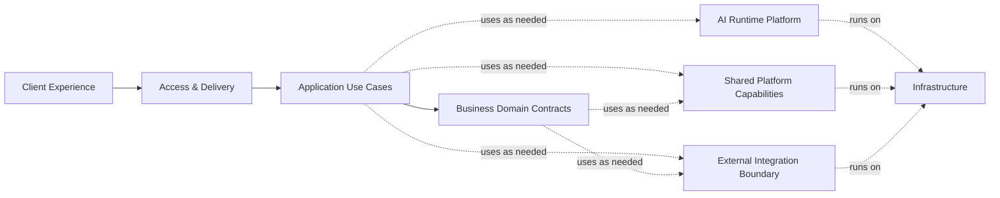

实线是 primary business execution path；虚线是 supporting axes，不是位于 Business Domains 下方的固定层，也不要求每个 request 穿过所有节点。

产品语言示例：

| Product example | Application Use Case | Authoritative Domain(s) | Supporting capability / infrastructure |
|---|---|---|---|
| Home | 汇总 today-oriented modules、continue state 与 insights | Music、Collection、Journey、Yara 等按内容分别拥有事实 | query composition、cache/index（若后续需要）；Home 本身不是 backend domain |
| Explore | 搜索/浏览 music、experience、records | Music、Experience、Record | Search/indexing 与 Provider Integration；Search 不自动拥有对象 |
| Ask Yara about a Track | 建立 contextual request，检索事实并生成 result | Yara Interaction 拥有 conversation/task/result；Music Catalog 拥有 Track truth | Retrieval、AI Runtime、citation/validation、async progress |
| Concert Planning | 协调 context、event facts、constraints、task 和 result | Live Experience 拥有 event representation；Yara Interaction 拥有 task/result semantics | External Integration、Retrieval、async execution；Application Layer 协调流程 |
| Community Messaging | 校验身份/group 权限，发送带 music reference 的 message | Messaging 拥有 message；Community 拥有 group membership；Music 拥有 object truth | permission enforcement、delivery/realtime capability |

## 3.1 System Context Diagram

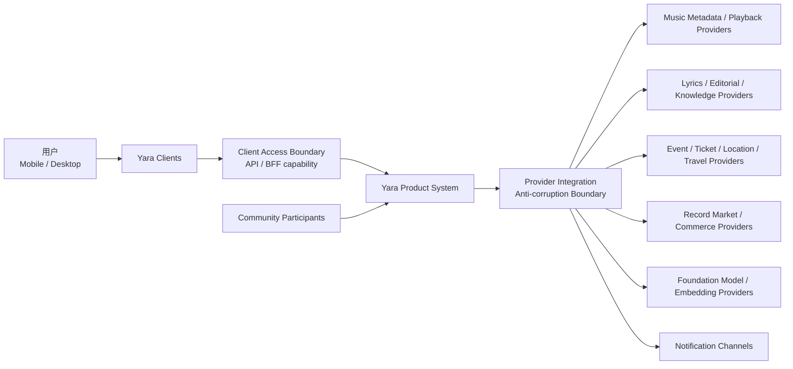

System boundary 包含 Yara 拥有的 product semantics、canonical references、permission decisions、task/result lifecycle 和 provider normalization。第三方 provider 拥有其 catalog、rights、inventory、model 或 delivery capability；其 payload 不能直接成为 Yara client contract。

## 3.2 High-Level Architecture

本方案采用 **Domain-Driven Clean Architecture with Ports & Adapters**：DDD 设计 Yara 的 business boundaries；Clean Architecture 约束 dependency direction；Ports & Adapters 隔离 provider 与 infrastructure；System Design 根据 Yara 的 capacity、SLO、provider failure 与 cost trade-offs 决定 topology。

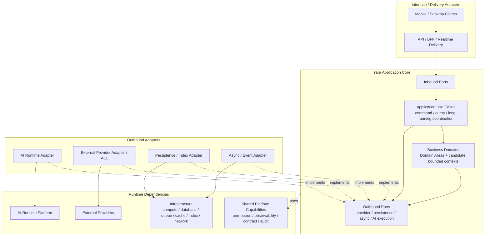

实线同时展示 logical invocation path；虚线 `implements` 表示 adapter 对 inward-facing port 的 dependency。具体 code dependency rule 在 Chapter 15 定义。图不表示每个 component 是独立 service/process/database。

关键责任分层：

- Clients：presentation、local interaction state、navigation origin 与可恢复 UI state；不拥有业务 truth。
- Client Access Boundary：authentication context、client-appropriate composition、contract/version/error envelope；是否为一个或多个 BFF 后定。
- Application Layer：协调跨 domain use case，但不吸收 domain invariants。
- Business Domains：按 Domain Area 与 candidate bounded-context analysis 管理语言、invariant 与 ownership。
- Ports：由 Application/Core 定义所需 capability contract；adapter 依赖 port，而不是 core 依赖 vendor SDK。
- AI Runtime、Shared Platform、External Integration、Infrastructure：提供 execution/support/runtime 能力，不成为 business ownership dumping ground。

Workload/NFR revalidation：

| Input signal | Architecture consequence now | Explicitly not decided |
|---|---|---|
| API load 从 small 向 large scenario 演进 | 保留 stateless access、query composition、horizontal-scale option | numeric threshold、service count、cloud、autoscaling product |
| AI adoption、task complexity 与 provider fan-out 增长 | AI execution port、async-capable task、cost/trace controls | volume、model/vendor、Agent framework、worker topology |
| Search load 与 catalog/index growth 增长 | Search port 与 canonical truth separation；允许 derived index | numeric threshold、search product、index topology |
| Messaging adoption 与 delivery load 增长 | acknowledgement/delivery state separation、async/realtime option | volume、broker、WebSocket vendor、separate Messaging service |
| Long task、provider latency/failure | durable task identity、progress/partial failure contract | persistence product、retry/fallback policy |
| RPO/RTO/availability targets | trust boundaries、observability、backup/recovery capability required | final HA/DR topology |

Capability classification：

| 分组 | Capabilities | Phase 1 interpretation |
|---|---|---|
| Shared Platform | Permission、Async/Eventing、Observability、Contract/versioning、Data/Persistence、Audit/Lifecycle | technical cross-cutting support，不拥有业务 truth |
| AI Runtime | Model、Prompt/Workflow、Agent、Tool、Retrieval Execution、Streaming、Evaluation | execution mechanics，不拥有 Yara Interaction 或 use-case orchestration |
| Cross-domain Personal Intelligence | Taste、Personalization、Recommendation、Memory | ADR-008 已确定 Personalization ownership；ADR-010 已确定 Memory 为独立 logical bounded-context candidate；均不锚定在 Yara Interaction |
| Search | user/system query capability | query contract 与 derived index 不拥有 source truth |
| Retrieval | AI/Search 使用的信息访问与执行 capability | 不等同 Search，也不拥有 retrieved business truth |
| Music Graph | MUSIC-area cross-authority logical relationship view / projection | Chapter 8 / ADR-009 preserves each source domain/claim authority and defines relational-first MVP materialization；Graph DB deferred |
| Playback | candidate capability boundary | 不固定归属 MUSIC 或 YARA；由 provider/session/queue/entitlement/device model 决定 |

## 3.3 Client Architecture

Mobile 与 Desktop 共享 capability semantics，但可有不同 presentation composition。Client 逻辑分为：

1. Presentation：screen、panel、overlay、responsive composition；
2. Feature orchestration：发起 use case、管理 optimistic/async UI、处理 result envelope；
3. Session state：navigation origin、active context、player presentation、draft input；
4. Contract adapters：将 transport DTO 转换为 client model；
5. Local platform adapters：media session、notification、secure credential、share/deep link。

约束：

- Page ID 不成为 network API namespace 的强制一一映射。
- Mini Player 与 Full Player 读取同一 logical playback session。
- overlay dismiss 与 back navigation 保留 origin/state，但具体 persistence scope 由 OQ-010/OQ-013。
- Yara contextual entry 创建或引用 `YaraContext`；普通离线 ML/batch operation 不使用完整 user-request context。
- client 不直接拼接 provider payload、执行 permission decision 或将 LLM text 转换为权威 domain state。

## 3.4 Backend Architecture

Application Layer 拥有 use-case coordination、command orchestration、query composition、cross-domain sequencing 与 long-running business-flow coordination，但不拥有 business truth 或 domain invariants。对于 AI-assisted use case，Application Layer 仍拥有业务 sequencing，AI Runtime 只执行被委派的 mechanics。

例如 `PlanConcertTripUseCase` 定义并协调业务步骤；Yara Interaction 管理 `YaraTask`/`StructuredResult` semantics；Live Experience 提供 canonical event facts；AI Runtime 可执行 workflow/agent/model/tool steps。任何 LangGraph、Agent loop、LLM invocation 或 Tool Runtime 都不能静默成为 cross-domain business orchestration owner。

Backend topology 的候选方案：

| Option | 优点 | 缺点 | Phase 1 结论 |
|---|---|---|---|
| A. Navigation-aligned services | UI ownership 直观 | 错误耦合页面与 domain；同一 MusicObject 被重复拥有；跨导航流程产生循环依赖 | Reject |
| B. Fine-grained Microservices per capability | 独立部署与隔离潜力 | 在 scale/SLO/team 边界未知时增加 distributed transaction、observability、schema evolution 成本 | Not justified |
| C. Capability-aligned modules with deployment-neutral boundaries | 保持 ownership；可在一个或多个 process 中落地；支持后续抽取 | 需要严格 module API、dependency rule 和 architecture tests | Recommend as logical structure |

ADR-003 保持 **Planned / Conditional**：Phase 1 只记录 Modular Monolith 与 Microservices 的约束和评价标准，不 Accept MVP topology。最终决策至少需要 OQ-002、traffic/concurrency、availability/SLO、team ownership、data consistency 与 operational maturity 输入。

无论最终 topology 如何，backend 必须保持：

- domain write authority 单一明确；
- 跨 domain interaction 通过 application use case、published contract 或 event，而非直接写他域存储；
- provider-specific models 停留在 integration boundary；
- long-running task 可拥有 durable identity/status，但 durability mechanism 后定；
- query composition 可组合多域 read data，但不因此转移 source-of-truth ownership。

## 3.5 AI Platform Positioning

本节受 authoritative TOC 标题约束；Phase 1 taxonomy 使用 **AI Runtime Platform**。它是 technical execution capability，与 Yara Interaction 的 business semantics 明确分离。不得建模为 `Yara Interaction = AI Runtime`，也不得退化为 `UI → Yara Interaction → raw LLM API`。

Yara Interaction 拥有 `YaraConversation`、`YaraTask`、`YaraContext`、`StructuredResult`、`SavedResult`、clarification/progress 与 citation/result lifecycle 等产品语义。AI Runtime 不拥有这些语义；它提供 Model Gateway/Invocation、Prompt Execution、Workflow Runtime、Agent Runtime、Tool Runtime、Retrieval Execution、Streaming Support、Evaluation Hooks 与 model/provider abstraction。

AI Runtime 也不拥有 Music Catalog、Live Experience、Records、Identity & Access、permission 或其他业务 truth。其内部结构属于 Chapter 5；Phase 1 只确认 capability boundary，不选择 framework 或 topology。

## 3.6 Data Platform Positioning

本节受 authoritative TOC 标题约束；Phase 1 taxonomy 将其规范名称定义为 **Data & Persistence Capabilities**，而不是预设独立 Data Platform。Domain/candidate bounded context 始终拥有 authoritative business state 与 invariants；physical persistence 不转移 ownership。它提供：

- persistence support，不转移 domain write authority；
- read/query composition；
- search/retrieval access；
- event/outbox 或等价可靠传播能力；
- provenance、freshness、audit 与 lifecycle controls；
- analytics/evaluation data pipelines，并与 operational data 隔离。

Phase 1 不决定 relational、document、search、vector、graph、cache 或 queue technology。Domain ownership 先于 storage selection；不同 domain 可共享 physical store，但必须保持 logical ownership 与 migration boundary。

### External Integration Boundary

External Integration 与 Infrastructure 是两个不同 architecture dimensions。External Integration 包括 Provider Adapters、Anti-corruption Layer、normalization、provider identity mapping、capability/rights mapping、routing/fallback boundary 与 external observation handling。External providers 位于 Yara system boundary 外，并保持 current inventory、schedule、price、stock、rights/capability 等 external observation 的 source。

### Infrastructure

Infrastructure 指 compute/runtime、database、queue/event infrastructure、object storage、cache、index 与 networking。它承载 application、domain、platform、AI runtime 或 integration components，但不取得它们的 semantic ownership。具体 technology/topology 后定。

## 3.7 Synchronous / Asynchronous Architecture

选择依据是 interaction semantics，而非技术偏好：

| Interaction | 首选语义 | 原因 |
|---|---|---|
| 用户读取详情、权限检查、短 command acknowledgement | Synchronous | 用户需要即时确定结果 |
| AI generation、multi-provider planning、large retrieval | Asynchronous-capable | 时延与部分失败不可控，需要 status/progress/cancel/recovery contract |
| 跨域事实传播、index/update、notification | Asynchronous-capable | 降低 write-path 耦合；一致性窗口必须显式 |
| Human message send acknowledgement | Synchronous acknowledgement + asynchronous delivery | 区分 accepted、delivered、read states |
| Playback control | Provider/capability dependent | 控制与状态更新可能混合 sync/realtime；OQ-003/OQ-013 未决 |

系统必须定义 idempotency、ordering、duplication、timeout 与 partial failure semantics；具体 broker、WebSocket 或 streaming protocol 留到后续章节。

## 3.8 Deployment Architecture

Phase 1 只冻结 logical deployment constraints：

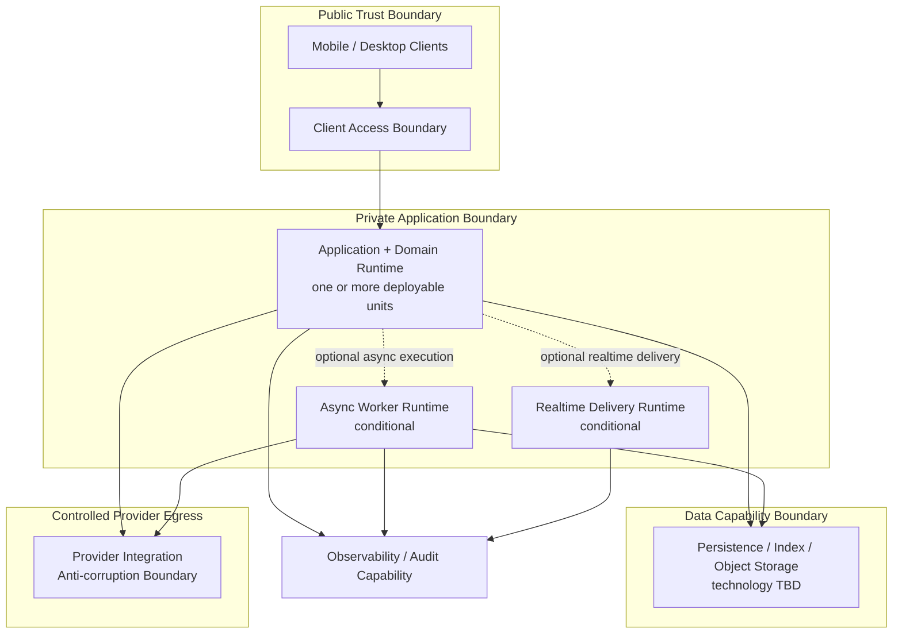

- public ingress、provider egress、private data access 与 operational telemetry 需要不同 trust boundaries；
- runtime 必须允许 domain modules 保持隔离，即使 MVP 最终部署为一个 unit；
- worker、realtime gateway、search/vector/graph 等只有 requirement 证明时才单独 materialize；
- regional deployment、HA、DR、autoscaling 与 tenancy 在 Phase 5 决定；
- 本图不是 ADR-003 的答案。

# 4. Domain Architecture

> 设计顺序说明：本章先完成 analysis，再用于约束 Chapter 3。Domain boundary 基于 invariants、ownership、lifecycle、consistency 与 language，而不是 navigation、team preference 或 Page ID。

Domain decomposition options：

| Option | Pros | Cons | 决策 |
|---|---|---|---|
| A. Nine flat bounded contexts | ownership 看似直接；与当前 TOC sections 接近 | 把尚未验证的 Collection/Journey/Messaging 等提前冻结；缺少 Domain Area 语义；易被误读为 services | Reject as final model |
| B. Three giant bounded contexts | 初始边界少；跨子域 transaction 直接 | MUSIC/PERSON/YARA 内部语言、privacy、lifecycle、scale 差异过大；形成巨型 model 和 release coupling | Reject |
| C. Three Domain Areas with nested candidate bounded contexts | 先稳定 problem-space taxonomy，再按 evidence 拆 ownership；避免过早 flat count；保持 deployment neutrality | 需要持续维护 candidate status 与显式 ports/contracts | Recommend / revise ADR-004 wording |

推荐 Option C。MUSIC、PERSON、YARA 是 Domain Areas，不是 services/databases/deployment units；其 subdomains 只有在 language、lifecycle、invariant、write authority、consistency、change、privacy 与 scale evidence 充分时才成为 bounded contexts。

### Domain Landscape / 领域全景

Domain Area 只用于理解业务问题空间，不是 parent bounded context、service、database、deployment unit，也不产生 ownership inheritance。Domain Area membership 不自动使 leaf capability 成为 bounded context。

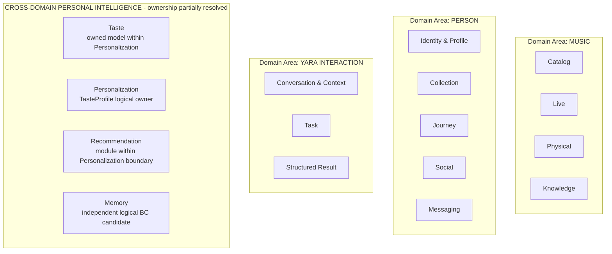

当前 taxonomy：

- MUSIC：Catalog、Live、Physical、Knowledge。
- PERSON：Identity & Profile、Collection、Journey、Social、Messaging。
- YARA INTERACTION：Conversation & Context、Task、Structured Result。
- CROSS-DOMAIN PERSONAL INTELLIGENCE：ADR-008 已确定 Personalization 及其 Recommendation module；ADR-010 已确定 Memory 作为独立 logical bounded-context candidate。两者 physical materialization 仍 deferred。
- Search：user/system query capability。
- Retrieval：供 AI 与 Search 使用的 information-access/execution capability。
- Music Graph：MUSIC-area cross-authority logical relationship view / projection；Graph inclusion 不转移 Catalog、Physical 或 Knowledge authority；Chapter 8 / ADR-009 已确定 relational-first MVP materialization，specialized graph engine deferred。
- Playback：ownership-neutral candidate capability boundary；不固定归属 MUSIC 或 YARA。

### Candidate Bounded Context Map

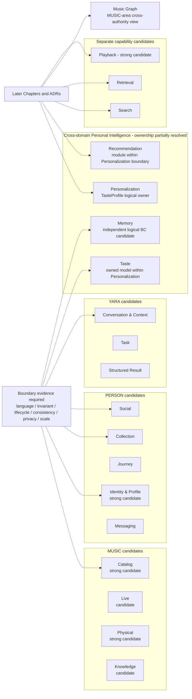

虚线表示 evaluation path，不表示 dependency 或已决定的 ownership。

### Candidate Domain / Capability Boundary

| Capability | Phase 1 status | 当前 logical position | 当前 owner | 暂不升格原因 | 后续决定 |
|---|---|---|---|---|---|
| Playback | Strong candidate bounded context | Cross-domain playback capability | Authoritative `PlaybackSession` owner 未定；Music 不默认拥有 | rights、entitlement、device/session、recovery、provider selection 尚待分析 | OQ-003/OQ-013；Ch.10–13；future ADR |
| Recommendation | Personalization 内部 decision capability/module | consumes permitted TasteSnapshot + Context + typed canonical candidates | owns request-scoped candidate/ranking/explanation decisions；不得拥有 source-domain truth | 是否因后续 lifecycle/SLO/scale 独立成 BC 未定 | Ch.6；ADR-008 |
| Taste / Personalization | Strong logical bounded-context candidate | 用户明确偏好、derived Taste、signals 与 contextual personalization | Personalization owns `ExplicitPreferenceState`、`DerivedTasteState` 与 combined `TasteProfile` semantics | physical topology、storage 与 operational isolation 未定 | Ch.6；ADR-008；OQ-011 |
| Memory | Strong independent logical bounded-context candidate | 与 interaction、Journey、personalization 集成但保持语义独立 | authoritative owner of memory acceptance/scope/provenance/validity/access lifecycle；referenced domain fact authority 保持在 source domain | physical topology、retention duration 与 policy detail 未定 | Ch.7；ADR-010；OQ-004/009/012 |
| Search | Product/application query capability, not a business BC | user-facing query contract、search ranking、grouping/blending 与 derived indexing | source domains 保持 truth；Search owns request-scoped result decision, not object truth | physical engine、index topology、SLO/scale deferred | Ch.9；ADR-007 |
| Retrieval | Shared logical information-access capability, not a business BC | policy-aware source orchestration、evidence normalization/fusion/reranking/packaging | 不拥有 retrieved business truth、Memory/Taste/Knowledge/Catalog authority | MVP may be Application/shared module；physical topology deferred | Ch.5/9；ADR-007 |
| Music Graph | MUSIC-area cross-authority logical relationship view / projection | spans typed references from Catalog、Physical and Knowledge | each relationship retains underlying source-domain/claim authority；Knowledge governs graph query/exposure and derived-policy | physical graph store/query engine deferred | Ch.8；ADR-009 |
| Knowledge | Strong MUSIC logical bounded-context candidate | sourced/editorial/inferred music-world claims and relationships | owner of normalized non-structural claim lifecycle/provenance；not underlying real-world fact authority | physical topology and licensed source contracts deferred | Ch.8/9/10；ADR-009；OQ-006 |

### Collection / Journey / Taste / Memory Boundary Evaluation

| Candidate | Ubiquitous language | Lifecycle | Invariants / write authority | Consistency boundary | Change drivers | Privacy/compliance | Scale/operations | Phase 1 assessment |
|---|---|---|---|---|---|---|---|---|
| Collection | CollectionItem、Saved Music、Physical Collection | save/unsave、organize、remove | membership owner 清晰；与 object truth 分离 | membership mutation 需一致 | library UX、import/export | user-private collection | read-heavy、user-partitionable | Strong BC candidate；standalone status deferred |
| Journey | Journey、MusicMoment、reflection、timeline | create/edit/curate/delete narrative | Journey != raw history/Memory；write authority 可独立 | moment/timeline consistency | storytelling、timeline/map evolution | personal narrative 可敏感 | timeline/query characteristics | Strong BC candidate；standalone status deferred |
| Taste | ExplicitPreferenceState、DerivedTasteState、TasteProfile、signal、evolution | ingest/derive/update/explain/reset | explicit user authority 与 inferred state 明确分离；Personalization 为共同 logical owner | profile consistency 由 Personalization boundary 管理；physical mode deferred | model iteration、feedback policy | inferred profile、purpose limitation | feature/embedding workloads possible | Strong logical BC candidate；ADR-008 Accepted |
| Memory | MemoryRecord、MemoryCandidate、confirm/edit/forget/consolidate | candidate → decision → record → update/forget/expire | user control、retention 与 transparency 自成 invariants | privacy-sensitive lifecycle boundary | policy、memory quality、legal change | high sensitivity、deletion/audit | retrieval/consolidation workloads | Strong independent logical BC candidate；ADR-010 Accepted |

四者使用同一评价标准。Collection/Journey 位于 PERSON problem space；Chapter 6 将 Taste model 归入 Personalization authoritative logical boundary，并将 Recommendation 定义为该 boundary 内部 capability/module；Memory 继续保持 ownership-neutral candidate。这不把 logical boundary 等同于 standalone service/database，也不因 UI 页面或 module 名称宣布 physical boundary。

### Social Boundary Options

| Option | Structure | Strengths | Risks | Current status |
|---|---|---|---|---|
| A | Social bounded context，内含 Community + Messaging modules | 边界较少；shared moderation/membership coordination 简单 | message retention/realtime/SLO 可能污染 social content lifecycle | Viable；not selected |
| B | Separate Community and Messaging bounded contexts | 独立 message lifecycle、delivery、retention 与 scaling | 增加 contract、authorization query 与 operational boundary | Viable；not selected |

无论 A/B，Community social graph/group truth 与 Human Message lifecycle 的 semantic ownership 必须分离。最终选择需要 OQ-007/OQ-009、Realtime/SLO、scale 与 team ownership evidence。

## 4.1 Identity Domain

> Taxonomy：PERSON — Identity & Profile；strong bounded-context candidate。以下为 ownership hypothesis，不表示 deployment unit。

**Purpose**：管理账号身份、principal 与授权可见性来源。  
**Owns**：`UserAccount`、authentication linkage、account status、consent/visibility policy source、public/private identity boundary。  
**Does Not Own**：Taste Profile、Collection、Journey、social graph、Public Profile social projection、message content。  
**Authoritative Truth**：account identity/status、principal linkage、consent/visibility policy。  
**Invariants**：user-scoped command 有可验证 principal；Community 不成为 consent truth；disabled/deleted account policy 一致。  
**Provides**：principal、account/consent status、allowed public identity、identity lifecycle notification。  
**Consumes**：external authentication/consent input。  
**Write Authority**：仅 Identity state。  
**Cross-domain References**：其他 domain 只引用 `userId` 与受限 public identity contract。  
**Deferred Decisions**：auth provider、regional identity/privacy rules，见 OQ-004。

## 4.2 Music Domain

> Taxonomy：MUSIC — Catalog；work-level 与 Physical manifestation-level separation 已证明。以下为 candidate bounded-context responsibility。

**Purpose**：提供稳定的 work/music-level canonical identity 与关系。  
**Owns**：Artist、Recording/Track、Album/work identity、music relationships、identity-resolution provider mappings。  
**Does Not Own**：Release/Edition/Pressing、Collection membership、Playback Session/entitlement、AI explanation、search index truth。  
**Authoritative Truth**：work-level canonical music identity 与 normalized music metadata；外部 provider 仍是其外部 observation 的 source。  
**Invariants**：`Album / Work != Release != Edition != Pressing`；Music 不与 Record 共享 Release ownership；provenance 可追踪。  
**Provides**：canonical lookup、music relationships、identity resolution、searchable source representation。  
**Consumes**：Provider Integration observations；必要时读取 Record release reference。  
**Write Authority**：仅 Music entities/relationships/mappings。  
**Cross-domain References**：`artistId`、`trackId`、`albumId`；可引用但不拥有 `releaseId`。  
**Deferred Decisions**：canonical schema、entity resolution、Music Graph，见 Chapters 8/11。

## 4.3 Experience Domain

> Taxonomy canonical name：MUSIC — **Live**。权威 TOC 保留“Experience Domain”章节标题；本节 scope 为 Live Experience。

**Purpose**：表达 Yara 内 canonical live-event world 与可用于体验决策的 observed facts。  
**Owns**：canonical Concert、Festival、Venue、`EventOccurrence` representation，以及 normalized event observations、source/freshness metadata。  
**Does Not Own**：Concert Plan semantics、YaraTask、ticket transaction、current external ticket inventory、travel/hotel availability。  
**Authoritative Truth**：Yara canonical event representation 与 observed snapshot；external provider 仍是 ticket availability、provider inventory、external schedule、travel/hotel observation 的 source。  
**Invariants**：event occurrence 有 timezone/source/freshness；venue/event identity 分离；snapshot 不冒充实时商业 truth。  
**Provides**：experience detail、event query、time-bounded planning input snapshot。  
**Consumes**：Music Artist references；Provider Integration observations。  
**Write Authority**：仅 Experience canonical state 与 normalized observations。  
**Cross-domain References**：music/provider/source IDs。  
**Deferred Decisions**：provider authority、refresh/SLO、commerce boundary，见 OQ-003/005/008 与 Chapter 10。

## 4.4 Record Domain

> Taxonomy canonical name：MUSIC — **Physical**；与 Catalog 的 work/manifestation ownership separation 已证明。

**Purpose**：管理 manifestation/release-level identity 与 comparison-ready market observations。  
**Owns**：Release、Edition、Pressing、Format、Catalog Number、condition vocabulary、normalized market/offer snapshot representation。  
**Does Not Own**：Album/work identity、Collection membership、purchase transaction、current external listing/price/stock。  
**Authoritative Truth**：Yara canonical Release/Edition/Pressing identity 与 observed snapshot；marketplace/provider 仍是 current listing、external price、stock/availability 的 source。  
**Invariants**：`Album / Work != Release != Edition != Pressing`；Release 只有 Record ownership；snapshot 携带 currency/market/time/source。  
**Provides**：record detail、edition resolution、time-bounded comparison inputs。  
**Consumes**：Music canonical IDs；Provider Integration marketplace observations。  
**Write Authority**：仅 Record canonical state 与 normalized snapshots。  
**Cross-domain References**：album/artist/track/provider/source IDs。  
**Deferred Decisions**：canonical schema、offer refresh/lifecycle，见 Chapters 8/10/11。

## 4.5 Collection Domain

> Taxonomy：PERSON — Collection；standalone bounded-context status **Under Validation**。以下是若边界成立时的 ownership hypothesis。

**Purpose**：管理用户对 digital music objects 与 physical records 的 collection membership/organization。  
**Owns**：`CollectionItem`、save/unsave membership、用户组织信息；Saved Music 和 Physical Collection item 是 Collection views/types，不等同 `SavedResult`。  
**Does Not Own**：`SavedResult`、Music/Record metadata、Journey timeline、AI result content。  
**Authoritative Truth**：collection membership 与 organization lifecycle。  
**Invariants**：`SavedResult != CollectionItem`；Saved Music/Physical Collection item 仍是 Collection membership；转换必须来自 explicit user action。  
**Provides**：membership query、idempotent save/unsave、collection view data。  
**Consumes**：Identity、Music、Experience、Record references；可接收由 Yara SavedResult 发起的 explicit collection command。  
**Write Authority**：仅 Collection state；不得修改引用对象或 Yara result。  
**Cross-domain References**：`userId` + typed canonical object/result reference。  
**Deferred Decisions**：SavedResult-to-Collection command/schema，见 Chapters 11–15。

## 4.6 Community Domain

> Taxonomy：PERSON — Social；Community 是其核心 subdomain/module candidate，与 Messaging 的 semantic split 已证明，但 separate bounded-context status **Under Validation**。

**Purpose**：支持 music-centered social discovery、relationship 与 shared experience。  
**Owns**：Follow graph、Group/membership、Activity、Post、feed eligibility、Public Profile social projection、Taste Match presentation contract。  
**Does Not Own**：account identity、consent/visibility policy source、private Taste Profile、Human Message、canonical MusicObject。  
**Authoritative Truth**：social graph/content/group membership/public social projection；Identity 保持 consent truth。  
**Invariants**：Community 不成为 identity consent source；Identity 不成为 social graph source；private signals 不因 match/profile 自动公开。  
**Provides**：feed/activity/people/group/profile use cases、group authorization facts、policy-limited match presentation。  
**Consumes**：Identity allowed-public contract、Music/Experience refs、policy-limited Taste/Recommendation output。  
**Write Authority**：仅 Community social state；不得写 Identity、Taste 或 Messaging stores。  
**Cross-domain References**：user/music/event refs。  
**Deferred Decisions**：moderation 与 Taste Match signal contract，见 OQ-007/011 与 Chapter 6。

## 4.7 Messaging Domain

> Taxonomy：PERSON — Messaging；message lifecycle 独立语言已存在，但 standalone bounded-context status **Under Validation**。

**Purpose**：管理人与人及 group 的 message lifecycle 与 delivery semantics。  
**Owns**：Human Conversation、participants、Direct/Group variant、message、delivery/read state、shared-object message reference。  
**Does Not Own**：Yara Conversation、Group/membership truth、identity consent、MusicObject metadata。  
**Authoritative Truth**：human message content 与 delivery lifecycle。  
**Invariants**：Human != Yara Conversation；发送时验证 participant/membership；shared object 使用 canonical reference。  
**Provides**：Inbox、conversation history、send/receive/delivery state。  
**Consumes**：Identity principal、Community group authorization、Music/Experience/Record refs。  
**Write Authority**：仅 Messaging state；不得改写 group membership 或 referenced object。  
**Cross-domain References**：user/group/object IDs。  
**Deferred Decisions**：retention、moderation、Realtime，见 OQ-007/009 与 Chapters 12/14。

## 4.8 Journey Domain

> Taxonomy：PERSON — Journey；与 Memory/raw history 的 semantic split 已证明，standalone bounded-context status **Under Validation**。

**Purpose**：维护用户可见、可编辑的 curated musical life narrative。  
**Owns**：Journey、MusicMoment、timeline placement、reflection、editable historical narrative、qualified source reference。  
**Does Not Own**：raw listening history、Taste Profile、`MemoryRecord`、Memory lifecycle、Conversation History、Collection。  
**Authoritative Truth**：curated timeline/moment/reflection state。  
**Invariants**：Journey != Memory/raw history/Conversation History；Journey 不静默写 Memory；Memory 不自动成为 Journey event；转换需 explicit policy-mediated action。  
**Provides**：timeline/map/moment view、moment edit、contextual reflection reference。  
**Consumes**：Identity、Music、Experience refs 与经过 policy qualification 的 inputs。  
**Write Authority**：仅 Journey state。  
**Cross-domain References**：user/music/event/source refs。  
**Deferred Decisions**：qualification、Memory transformation、history policy，见 Chapter 7 / ADR-010。

## 4.9 Yara Domain

> Taxonomy：YARA INTERACTION（位于 YARA / AI COMPANION business area）。权威 TOC 保留“Yara Domain”章节标题；本节仅覆盖 Conversation & Context、Task、Structured Result candidates。Taste/Personalization、Recommendation 与 Memory 均保持在 Cross-domain Personal Intelligence；其中 Chapter 6 已确定前两者的 logical responsibility，Memory 仍 deferred；Yara product semantics 与 AI Runtime 明确分离。

**Purpose**：组织 AI Companion 的 business problem space，而不是定义一个 giant Yara bounded context。  
**Candidate Ownership Map**：Conversation & Context 候选拥有 `YaraConversation` 与 user-facing `YaraContext`；Task 候选拥有 `YaraTask`、clarification/progress；Structured Result 候选拥有 `StructuredResult`、`SavedResult`、citation/result lifecycle。  
**Does Not Own**：Application orchestration、Catalog/Live/Physical/Collection/Journey/Identity & Profile/Social/Messaging truth、AI Runtime、未决 authoritative `MemoryRecord`。  
**Authoritative Truth**：各 candidate subdomain 只对其获批 model/write boundary 负责；Phase 1.5 不把它们合并成一个 state owner。  
**Invariants**：Context != Memory；Yara Conversation != Human Conversation；Structured Result != chat message；SavedResult != CollectionItem；Recommendation 不自动拥有 Taste Profile。  
**Provides**：contextual ask、conversation/task/result/history 与 SavedResult；可通过显式 contracts 消费 Personal Intelligence capabilities。  
**Consumes**：通过 Application Layer 获得 permitted domain facts/references，并请求显式 domain actions；通过 ports 使用 AI Runtime。  
**Write Authority**：按 candidate boundary 待验证；禁止直接写其他 Domain Area truth 或由 Agent runtime 接管。  
**Cross-domain References**：typed user/music/event/release/collection/journey/social refs 与 time-bounded snapshots。  
**Deferred Decisions**：YARA Interaction 内部 BC count、AI internals，以及 Personalization/Recommendation/Memory physical materialization，见 Chapters 5/6/7 与 ADR-005–011；Taste 与 Memory logical ownership 已分别由 ADR-008/010 确定。

Concert Planning canonical example：Application Layer 负责跨域 sequencing/orchestration；Yara Interaction 拥有 `YaraTask` 与 Concert Plan `StructuredResult` semantics；Live Experience 拥有 canonical event representation 与 normalized observations；External Integration Boundary 提供 ticket/travel/location external observations。协调不会把 Live Experience 或 provider truth 转移给 Yara Interaction。

说明：Chapter 6 / ADR-008 已确定 Personalization 是 explicit/derived Taste semantics 的 authoritative logical owner，Recommendation 初始是其内部 capability/module；它们仍不归入 Yara Interaction，且不提前决定 physical service ownership。Memory 继续由 Chapter 7 深化。

### Final Domain Ownership Review

| Boundary pair | Authoritative owner | Reference direction | Allowed commands / queries | Explicitly forbidden | Deferred question |
|---|---|---|---|---|---|
| Music Catalog ↔ Records | Music Catalog：Artist/Track/Album-work；Records：Release/Edition/Pressing/snapshot | Records → Music canonical IDs；Music 可查询/引用 `releaseId` | resolve work/release、read relationships | shared ownership of Release；Records 改写 Album work | schema/entity resolution：Ch.8/11 |
| Records ↔ Collection | Records：record facts；Collection：user membership/organization hypothesis | Collection → Record ID | save/unsave record、read record snapshot | Collection 改写 pressing/offer；Records 推断 save state | Collection standalone、snapshot policy：Ch.11/12 |
| Community ↔ Messaging | Community：Group/membership/social graph；Messaging：conversation/message/delivery | Messaging → Community group/membership | membership authorization query；send message | Messaging 改写 group membership；Community 存储 message truth | moderation/retention：OQ-007/009 |
| Journey ↔ Memory | Journey：timeline/moments；Memory：durable companion recall | 双方仅通过 qualified typed reference/event | request explicit transformation；read permitted reference | Journey 等同 Memory；任一方复制对方 authoritative fact | ADR-010；exact policy deferred |
| Yara Interaction ↔ Journey | Journey：moment/timeline hypothesis；Yara Interaction：task/context/result | Yara Interaction → Journey reference | read permitted moment；request explicit update | Yara 直接写 Journey state；Journey 拥有 Yara result | Journey standalone、qualification：Ch.7/11/12 |
| Yara Interaction ↔ Music Catalog | Music Catalog：music truth；Yara Interaction：companion semantics | Yara Interaction → Music canonical ID | query object/relationships；request domain command | Yara/LLM 生成 authoritative music fact | Ch.5/6/11 |
| Yara Interaction ↔ Live Experience | Live Experience：event representation；Yara Interaction：planning task/result | Yara Interaction → event/snapshot | query current facts；compose plan result | Yara 改写 event truth；Live Experience 接管 plan result | freshness/fallback：OQ-003/005/008 |
| Yara Interaction ↔ Records | Records：release/snapshot；Yara Interaction：comparison task/result | Yara Interaction → Record IDs/snapshots | query editions/offers；produce cited comparison | Yara 改写 pressing/price observation | Ch.5/10/11 |
| Identity ↔ Public Profile | Identity：account/public identity/visibility consent；Community：public social projection | Community → Identity public reference | query allowed identity fields；update community presentation | Community 读取私密 identity；Identity 拥有 social graph/feed | visibility policy：OQ-004/011 |
| Community ↔ Taste Match | Community：match presentation/social action；Personalization：TasteProfile logical truth | Community → policy-limited Personalization capability | request match/explanation；follow/message actions | Community 拥有 raw private Taste Profile；直接披露 private signals | ADR-008 / OQ-011 |
| Search ↔ Music Catalog | Music Catalog：canonical truth；Search：derived query/index capability | Search index → Music IDs/version/provenance | query/search；consume updates；re-resolve result | Search index 成为 Music Catalog write authority | Search ownership/SLA：Ch.9 |
| Playback ↔ Music Catalog | Music Catalog：object identity；Playback session owner 未定 | Playback → Music track ID/provider mapping | resolve playable capability；control/read session | Music metadata 充当 playback session；Playback 改写 Music truth | OQ-003/013；Ch.10–13 |

上述 pairs 在当前 ownership candidates / proven semantic boundaries 中没有 circular authoritative ownership。未决项均保持 candidate、policy 或 later physical-model decision，不被当作 final bounded-context ownership。

### Candidate Ownership Responsibility Matrix

| Domain Area | Candidate boundary | Status | Ownership hypothesis | Explicitly not owned | Write authority status | Deferred decision |
|---|---|---|---|---|---|---|
| MUSIC | Catalog | Strong candidate / proven semantic separation | Artist、Recording/Track、Album/Work、music relationships、canonical mapping | Release/Edition/Pressing、PlaybackSession、search index | candidate Catalog state | Ch.8/11 schema/entity resolution |
| MUSIC | Live | Candidate with proven event semantics | Concert、Festival、Venue、EventOccurrence、normalized observations | Concert Plan、provider inventory/travel truth | candidate Live state/snapshot | provider/refresh/commerce boundary |
| MUSIC | Physical | Strong candidate / proven semantic separation | Release、Edition、Pressing、Format、Catalog Number、normalized market snapshot | Album/Work、CollectionItem、current provider price/stock | candidate Physical state/snapshot | Ch.8/10/11 |
| MUSIC | Knowledge | Strong logical BC candidate | normalized sourced/editorial/inferred music-world claim lifecycle、provenance/conflict/rights/derived policy | Catalog structural truth、provider/real-world fact authority、generated Yara explanation | Knowledge logical state | physical materialization/source licensing deferred；ADR-009 Accepted |
| PERSON | Identity & Profile | Strong candidate | account/principal、profile/consent/visibility policy source | social graph、Taste、Collection、messages | candidate identity/profile state | provider、privacy policy |
| PERSON | Collection | Under Validation | CollectionItem、membership、organization、Saved Music/Physical Collection views | SavedResult、object truth、Journey | proposed collection state | standalone BC、schema/import/export |
| PERSON | Journey | Under Validation | Journey、MusicMoment、timeline/reflection | raw history、MemoryRecord、Conversation History | proposed journey state | standalone BC、Memory transformation |
| PERSON | Social | Under Validation | social graph、group/membership、post/activity/public projection | Human Message、identity consent、TasteProfile | proposed social module/BC state | Social Option A/B、moderation |
| PERSON | Messaging | Under Validation | HumanConversation、message、delivery/read lifecycle | group truth、YaraConversation、object truth | proposed messaging module/BC state | Social Option A/B、retention/SLO |
| YARA | Conversation & Context | Candidate with proven semantics | YaraConversation、user-facing YaraContext、history | Application orchestration、MemoryRecord | proposed interaction state | Ch.5/8/11 |
| YARA | Task | Candidate | YaraTask、clarification/progress semantics | cross-domain business truth、AI Runtime | proposed task state | Ch.5/11/12/13 |
| YARA | Structured Result | Candidate with proven semantics | StructuredResult、SavedResult、citation/result lifecycle | CollectionItem、source-domain truth | proposed result state | Ch.5/11/14 |
| Cross-domain Personal Intelligence | Taste / Personalization | Strong logical BC candidate | ExplicitPreferenceState、DerivedTasteState、TasteProfile/signals/contextual policy | Memory ownership；source-domain facts | Personalization logical state | physical topology/storage deferred；ADR-008 Accepted |
| Cross-domain Personal Intelligence | Recommendation | Internal capability/module within Personalization boundary | typed candidate coordination、eligibility、ranking、feedback/explanation decision semantics | source-domain truth；LLM-generated candidate list | request-scoped recommendation decision output under Personalization boundary | future independent BC only with lifecycle/SLO/scale evidence；ADR-008 Accepted |
| Cross-domain Personal Intelligence | Memory | Strong independent logical BC candidate | MemoryCandidate/Decision/Record/Version/Conflict、confirmation/edit/forget/access lifecycle | Journey、Conversation History、TasteProfile、referenced source-domain truth | Memory acceptance/scope/provenance/validity/access state | physical topology/retention deferred；ADR-010 Accepted |
| Cross-domain | Search | Product/application query capability, not a BC | user-facing query、request-scoped search ranking/grouping/blending、derived index | source-domain canonical truth | Search result decision only；no source writes | Ch.9；ADR-007 Accepted |
| Cross-domain | Retrieval | Shared logical information-access capability, not a BC | authorized source planning/orchestration、reference/evidence normalization、fusion、reranking、result packaging | retrieved business truth、domain access policy、Recommendation ranking | request-scoped interpretation/plan/result only | Ch.5/9；ADR-007 Accepted |
| MUSIC area | Music Graph | Cross-authority logical relationship view / projection, not a BC | typed structural references and `RelationshipAssertion` projection over canonical/concept refs | does not own Catalog/Physical truth、underlying source facts or private personal/social/memory signals | source authority preserved；Knowledge governs knowledge semantics、query/exposure and derived-policy | physical graph store deferred；ADR-009 Accepted |
| Cross-domain | Playback | Strong candidate | PlaybackSession、Queue、entitlement/device/provider selection/recovery | Catalog metadata | unresolved | OQ-003/013；Ch.10–13 |

## 4.10 Domain Dependency Diagram

```mermaid
flowchart TB
    subgraph MUSIC[MUSIC Domain Area - candidates]
      Music[Catalog]
      Experience[Live]
      Record[Physical]
      Knowledge[Knowledge]
    end

    subgraph PERSON[PERSON Domain Area - candidates]
      Identity[Identity & Profile]
      Collection[Collection]
      Journey[Journey]
      Community[Social]
      Messaging[Messaging]
    end

    subgraph YARA[YARA INTERACTION - candidates]
      Conversation[Conversation & Context]
      Task[Task]
      Result[Structured Result]
    end

    subgraph PI[CROSS-DOMAIN PERSONAL INTELLIGENCE - ownership partially resolved]
      Taste[Taste<br/>owned model within Personalization]
      Personalization[Personalization<br/>TasteProfile logical owner]
      Recommendation[Recommendation<br/>internal capability / module]
      Memory[Memory<br/>independent logical BC candidate]
    end

    Playback[Playback candidate]
    Search[Search<br/>query capability]
    Retrieval[Retrieval<br/>information-access execution]
    Graph[Music Graph<br/>MUSIC-area cross-authority view]
    Integration[External Integration Boundary<br/>Ports + Adapters / ACL]
    Providers[External Providers<br/>authoritative external observations]

    Experience -->|query/reference: artist| Music
    Record -->|query/reference: work| Music
    Knowledge -->|query/reference: canonical music| Music
    Collection -->|query/reference: principal| Identity
    Collection -->|query/reference: music| Music
    Collection -->|query/reference: physical record| Record
    Community -->|query: public identity / consent| Identity
    Community -->|query/reference: music| Music
    Community -->|query/reference: event| Experience
    Messaging -->|query: principal| Identity
    Messaging -->|query: group membership| Community
    Messaging -->|query/reference: shared object| Music
    Journey -->|query/reference: principal| Identity
    Journey -->|query/reference: music| Music
    Journey -->|query/reference: event| Experience
    Conversation -->|query: principal / permission| Identity
    Conversation -->|query: music facts| Music
    Task -->|query: event facts| Experience
    Task -->|query: physical release facts| Record
    Result -->|command request: collection membership| Collection
    Conversation -->|query: journey context| Journey
    Personalization -->|query: social/taste inputs| Community
    Personalization -->|query: music signals| Music
    Recommendation -->|query: taste/context| Personalization
    Recommendation -->|query: candidates| Music
    Conversation -->|request: personal intelligence| Personalization
    Conversation -->|request: permitted memory| Memory
    Playback -->|query: track/provider mapping| Music
    Search -->|derived-source dependency| Music
    Search -->|derived-source dependency| Knowledge
    Search -->|uses| Retrieval
    Conversation -->|uses| Retrieval
    Graph -->|derived from| Music
    Graph -->|supports| Knowledge

    Music -->|provider-observation dependency| Integration
    Experience -->|provider-observation dependency| Integration
    Record -->|provider-observation dependency| Integration
    Knowledge -->|provider-content dependency| Integration
    Playback -->|rights/capability dependency| Integration
    Integration -->|external observation query| Providers
```

箭头表示 consumer → authoritative capability dependency，不表示 direct database access。为避免循环依赖：

- MUSIC、PERSON、YARA INTERACTION 是 business-area views；Cross-domain Personal Intelligence 保持 ownership-neutral；所有内部节点仍是 candidates，不表示 final bounded-context count；
- Identity & Profile、Catalog、Physical 等提供 candidate authoritative contracts；
- Social 的 group membership 与 Messaging lifecycle 必须保持 semantic separation，不预判一个或两个 BCs；
- YARA candidates 是跨域 consumers/requesters；Application Layer 执行 cross-domain orchestration。箭头表示 query/reference/command request，不是 direct store access；
- cross-domain projection/index 可异步构建，但不能成为 command-side truth；
- Integration 是 anti-corruption boundary；external provider 保持外部 observation 的 source，Integration 不拥有 Yara domain semantics。

## Phase 1 Critique & Revision

初始 decomposition 把 Identity、Music、Experience、Record、Collection、Community、Messaging、Journey、Yara 描述为九个已确定 bounded contexts。重新审查后撤回 exact-count freeze：

- Playback 的 session/entitlement/provider ownership 尚受 OQ-003/OQ-013 影响；现在提升会预判 provider model。
- Collection/Journey/Taste/Memory 必须按同一套 language/lifecycle/invariant/write/consistency/change/privacy/scale 标准评估。
- Community/Messaging 的 semantic ownership 分离已证明，但独立 BC 还是 Social BC 内 modules 尚需 evidence。
- ADR-008 与 ADR-010 已分别确定 Personalization 和 Memory logical ownership。两者的 MVP/physical materialization 与 future deployment boundary 尚未决定。
- Search 是 user/system query capability；Retrieval 是其与 AI 可使用的 information-access/execution capability；二者不应合并或成为 authoritative data owner。Music Graph 是 MUSIC-area cross-authority logical view，关系 authority 仍属于 underlying source domain/claim；ADR-009 已确定 relational-first MVP strategy，specialized graph engine 仍未决定。

因此 Phase 1.5 建议保留 architecture taxonomy、ownership-first decomposition、已经证明的 semantic separations，以及候选边界的明确 deferred status；不冻结 exact bounded-context count。最终 Phase 1 freeze 仍需本轮 System Design inputs review 通过。

### Architecture Consistency Resolution

| Potential contradiction | Final resolution |
|---|---|
| Application Layer vs Yara orchestration | Application Layer 负责跨域 sequencing；Yara 只作为 domain consumer/requester 并拥有 Yara-specific semantics |
| Yara Interaction vs AI Runtime | Yara Interaction 是 business candidate boundary；AI Runtime Platform 是 technical execution capability |
| Domain truth vs Data Platform | Domain 拥有 state/invariants；Data capability 只提供 persistence/query/index/lifecycle tooling |
| Yara snapshot vs provider truth | Yara-owned domains 拥有 normalized representation/snapshot；provider 保持 external observation truth |
| Music Catalog vs Records | Music Catalog 拥有 work-level identity；Records 拥有 Release/Edition/Pressing identity |
| Community vs Messaging | Community 拥有 social/group truth；Messaging 拥有 human message lifecycle |
| Identity vs Public Profile | Identity 拥有 identity/consent policy；Community 拥有 public social projection |
| Journey vs Memory | Journey 拥有 curated narrative；Memory 提议拥有 durable companion recall；只允许 policy-mediated typed reference/transformation，不复制 authoritative truth |
| SavedResult vs Collection | Yara Interaction 拥有 SavedResult；Collection ownership hypothesis 管理 CollectionItem/membership |
| Search index vs Music Catalog | Search/index 是 derived capability；Music Catalog 保持 canonical truth |
| Playback vs Music Catalog | Music Catalog 只拥有 music identity；Playback Session owner 由 OQ-013/后续章节决定 |
| Domain Area vs bounded context | Domain Area 仅 conceptual grouping；只有通过 invariant/lifecycle 分析成立的 bounded context 才是 ownership boundary |

## Phase 1 Decision Summary

1. System Architecture 必须按 `scope → workload/capacity → NFR/SLO → domain ownership → logical architecture → topology/technology` 推导；不能由偏好的技术栈反推。
2. Small/Medium/Large workload stress-test scenarios 与 data-growth formulas 只用于检查 architecture evolution，不映射 MVP/Growth/Full Vision，也不是 expected scale、预测或已批准预算。
3. Product navigation 不定义 backend domains；Domain Areas 是 conceptual business groupings，不是 bounded contexts。
4. 三个 primary business areas 为 `MUSIC`、`PERSON`、`YARA / AI COMPANION`；其中 YARA INTERACTION 当前只含 Conversation & Context、Task、Structured Result candidates。
5. 不接受九个 flat bounded contexts 已全部成立，也不接受三个 giant bounded contexts；Phase 1.5 不冻结 exact bounded-context count。
6. Bounded contexts 从 ownership、ubiquitous language、invariants、lifecycle、consistency、privacy、scale 与 change drivers 推导。
7. `Domain-Driven Design` 定义 business boundaries；`Clean Architecture` 定义 dependency direction；`Ports & Adapters` 隔离 delivery、provider 与 infrastructure；System Design 负责 capacity、SLO、topology 与 operational trade-offs。
8. Music Catalog 的 Album/Work 与 Physical 的 Release/Edition/Pressing 保持分离 ownership；Live 拥有 canonical event representation/observed snapshot，不拥有 provider inventory truth。
9. Taste、Personalization、Recommendation、Memory 属于 Cross-domain Personal Intelligence；Personalization ownership 与 Memory independent logical boundary 已分别由 ADR-008/010 接受；均不锚定在 Yara Interaction。
10. Yara product/domain semantics 与 AI Runtime Platform 分离；AI Runtime 是 technical execution capability，Agent runtime 不接管 business sequence 或 authoritative write authority。
11. Application Layer 负责 cross-domain use-case sequencing，不拥有 domain truth；Shared Platform 只提供 cross-cutting support。
12. External Integration Boundary 与 Infrastructure 是不同 architecture dimensions；provider observation 的 authority、freshness、rate limit 与 fallback 仍受 provider contract 约束。
13. Memory、Playback、Search、Retrieval 与 Music Graph 保持清晰 capability semantics；Taste/Personalization、Memory 与 Knowledge ownership 已分别由 ADR-008/010/009 确定；physical materialization 和 specialized engines保持 deferred。
14. Backend architecture 保持 deployment-neutral；logical boundary 不暗示 service、database 或 deployment unit。
15. ADR-003 保持 Planned / Conditional；MVP scope、workload、SLO 与 operating constraints 未获确认前，不批准最终 backend topology。

## Phase 1 Open Questions

| ID | Question | 影响 |
|---|---|---|
| OQ-002 | MVP capability/market/platform/scale | 阻塞 ADR-003 与 MVP topology final approval |
| OQ-003/OQ-013 | Playback provider、rights、session/recovery ownership | 可能影响 Playback 是否形成独立 bounded context |
| OQ-007/OQ-009 | Messaging moderation 与 retention | Messaging lifecycle、storage/isolation |
| OQ-008 | SLO 与 workload profile | sync/async boundary、topology、capacity |
| OQ-010 | offline/cross-device requirement | client state 与 sync capability |
| OQ-011 | Taste Match signal permission | Community ↔ Personalization contract |

Phase 1.5 assumption registry（记录 future evidence，不构成当前 freeze gate）：

| Assumption / unresolved input | Current status | Future owner / evidence | Architecture effect if changed |
|---|---|---|---|
| Small/Medium/Large traffic and concurrency thresholds | Assumption / future evidence | Product、Growth、Analytics；launch plan/telemetry/load tests | topology、partitioning、cache、async boundary、cost |
| Catalog/social/conversation/memory data scale | Assumption / future evidence | Data/Product；retention/import scope/telemetry | storage model、indexing、lifecycle、migration |
| API/AI/messaging availability and latency SLO | Proposed target / future evidence | Product、Engineering、Operations | redundancy、queueing、degradation、observability |
| AI tokens、model/tool calls 与 budget envelope | TBD / future evidence | Product、Finance、AI Engineering；Chapters 5/22 | model routing、cache、budget guardrails、evaluation |
| Provider rate limit, latency, freshness, rights and regional support | Provider-dependent / TBD | Provider contracts、Legal、Partnerships | adapter contract、fallback、capability exposure、regional scope |
| Privacy, retention and user-control obligations | TBD | Legal/Privacy/Product | domain ownership、data lifecycle、audit、deletion |

没有新增重复 Open Question：Playback session ownership 由现有 OQ-013 覆盖；Recommendation/Taste ownership 由 ADR-008 与 OQ-011 覆盖；Memory ownership 由 ADR-010 与 OQ-009/012 覆盖；Search ownership在 Chapter 9 分析，若产生 major decision 再建立 ADR；Identity 与 Public Profile ownership 已在本 Phase 解决，不再新增 OQ。

Deferred boundary decisions（不是已决 ownership）：

| Candidate decision | Required evidence / decision point |
|---|---|
| Collection standalone bounded context | Chapter 11/12/15：lifecycle、consistency、import/export、team/change drivers |
| Journey standalone bounded context | Chapter 7/11/12：Memory transformation、privacy、history lifecycle |
| Taste bounded context/owner | Chapter 6 / ADR-008 / OQ-011 |
| Memory bounded context/owner | Chapter 7 / ADR-010 / OQ-009/012 |
| Social BC vs Community + Messaging BCs | OQ-007/009、Realtime/SLO、scale、moderation、team ownership |
| Playback bounded context/owner | OQ-003/013、Chapters 10–13 |
| Recommendation ownership | Chapter 6 / ADR-008 |
| Search ownership/query lifecycle | Chapter 9；必要时新增 ADR |
| Retrieval runtime/ownership boundary | Chapters 5/9 / ADR-007 |
| Music Graph model/materialization | Chapter 8 / ADR-009 |

## Phase 1 Exit Criteria

- [x] Architecture taxonomy 在 Chapters 3–4 一致。
- [x] System Architecture 不再暗示 false vertical dependency chain。
- [x] Domain Areas 与 bounded contexts 已分离。
- [x] Candidate boundaries 均明确标注，未被写成 final ownership。
- [x] Yara Interaction 与 AI Runtime Platform 已分离。
- [x] Application orchestration 与 Agent/Workflow execution 已分离。
- [x] External Integration Boundary 与 Infrastructure 已分离。
- [x] System Context、High-Level、Deployment、Domain Landscape、Candidate Map、Dependency Diagram 均为 Mermaid。
- [x] Dependency arrows 可审查并标明 consumer → owner/reference direction。
- [x] ADR-003 保持 Planned / Conditional。
- [x] ADR-004 已校正且保持 Accepted；不冻结 exact count 或 deferred candidate ownership。
- [x] Candidate ownership hypotheses 使用统一 Purpose/Ownership/Truth/Contract 模板。
- [x] AI Runtime、Data/Persistence capability、Application Layer 与 Yara Interaction 已去歧义。
- [x] external provider truth 与 Yara normalized snapshot 已区分。
- [x] 没有选择 framework、database、cloud、broker 或 Agent technology。

### Phase 1.5 Revalidation Criteria

- [x] System Design methodology 已明确，Domain Architecture 不再脱离 workload/NFR 输入单独推导。
- [x] Small/Medium/Large architecture stress-test scenarios 已建立，且未映射 MVP/Growth/Full Vision。
- [x] Data scale、NFR/SLO、AI cost/token 与 provider constraints 已建立 planning baseline。
- [x] Chapter 2.5 已加入 Architecture Scale View，区分 capability scope 与 workload scale。
- [x] Chapter 4 已比较九个 flat BCs、三个 giant BCs、三个 Domain Areas + nested candidates。
- [x] 推荐 Option C；未冻结 exact bounded-context count。
- [x] Chapter 3 已采用 Domain-Driven Clean Architecture with Ports & Adapters，并保持 technology-neutral。
- [x] YARA Interaction 与 AI Runtime Platform 已明确分离；Personal Intelligence ownership 保持 deferred。
- [x] ADR-004 已在不丢弃历史 rationale 的前提下修订；ADR-003 仍为 Planned / Conditional。
- [x] OQ-002 明确保留 Open，并只阻塞 ADR-003 与最终 MVP Implementation Architecture。
- [x] workload/data/SLO/cost/provider assumptions 均有显式标签、future evidence/owner，未作为 irreversible decision 的依据。
- [x] Phase 1.5 review 已批准并重新冻结 Phase 1。

Phase 1/1.5 已作为稳定logical baseline冻结。其当时关于OQ-002 / ADR-003的gating已由Chapter 24的MVP architecture decision完成闭环；历史rationale保留，但不再表示当前ADR-003状态。除后续证据揭示不可局部解决的直接矛盾外，不重开Chapters 3–4。

### Phase 2 Dependency Order

Phase 2 的 document order 与 working order 统一为：`AI Architecture → Personalization / Taste / Recommendation → Memory → Music Knowledge / Graph → Search / Retrieval → Intelligence Architecture Integration Review`。

Chapter 5 定义 AI execution boundaries；Chapter 6 定义 persistent Taste、personalization signals、recommendation candidate/ranking/explanation requirements；Chapter 7 在 Context 与 personalization boundary 明确后定义 Memory；Chapter 8 从 Yara、Recommendation 与 Memory use cases 推导 Music Knowledge/Graph requirements；Chapter 9 在 information sources、knowledge model、personalization 与 memory contracts 明确后设计 Search/Retrieval；Phase 2F 最后执行 integration review。

| Phase | Canonical work item |
|---|---|
| Phase 2A | Chapter 5 — AI Architecture |
| Phase 2B | Chapter 6 — Personalization, Taste & Recommendation Architecture |
| Phase 2C | Chapter 7 — Memory Architecture |
| Phase 2D | Chapter 8 — Music Knowledge & Graph Architecture |
| Phase 2E | Chapter 9 — Search & Retrieval Architecture |
| Phase 2F | [Intelligence Architecture Integration Review](PHASE_2F_INTELLIGENCE_ARCHITECTURE_INTEGRATION_REVIEW.md) |

# 5. AI Architecture

## 5.1 AI Architecture Overview

Chapter 5 设计 user-facing Yara request 如何从 product intent 变为 grounded、validated、structured output。推荐 **Hybrid AI Architecture**：确定性 application/domain logic 优先；已知步骤使用 predefined Workflow；需要知识补充时使用 Retrieval-enhanced generation；音乐推荐调用独立 Recommendation capability；只有动态规划和工具选择确有必要时才启用受控 Agent behavior。

Architecture options：

| Option | Strengths | Risks | Assessment |
|---|---|---|---|
| A. LLM-centric | 开发入口简单；free-form capability 强 | business truth、permission、tool mutation、hallucination 与可恢复性边界模糊；所有请求成本和不确定性上升 | Reject |
| B. Workflow-centric | 行为可预测、易测试、状态清晰 | 面对开放式研究或 provider variability 时僵化；workflow 数量可能膨胀 | Viable but insufficient alone |
| C. Hybrid | 为每个 intent 选择最低复杂度 execution mode；兼顾确定性与开放性 | 需要 Router、policy、schema、evaluation 与 trace governance | Recommend；ADRs 005–007/011 Proposed |

关键 ownership：

- Application Layer：business use-case selection、跨 domain sequencing、business constraints、allowed capabilities/actions 与 expected product outcome；不选择 model/runtime implementation details；
- Yara Interaction：`YaraConversation`、user-facing `YaraContext`、`YaraTask`、`StructuredResult`、`SavedResult` 及 clarification/progress/citation lifecycle semantics；
- AI Runtime：在 Application delegated constraints 内选择 Workflow、RAG 或 controlled Agent 等 AI execution strategy；`AgentRuntimePort` 是受控 Agent execution 的 Yara-owned 稳定边界，并与 `ModelProviderPort` 分离。Runtime 可执行 Intent inference、Retrieval/Tool/Model invocation 与 validation mechanics，但不拥有跨域 business orchestration、permission、domain truth 或 committed `StructuredResult`；
- Domain capabilities：通过 typed ports 提供 facts、queries 与 commands，并保持 authoritative invariants；
- External providers：通过 Ports & Adapters 提供带 provenance/freshness 的 observations。

AI capability taxonomy：

| Capability | Responsibility | Explicit boundary |
|---|---|---|
| Deterministic logic | 执行可由 inputs/invariants 唯一决定的 computation 或 domain/application behavior | 不调用模型来替代确定性判断 |
| Rules / Policy | 执行 routing、permission、eligibility、risk、budget 与 fallback gates | rules 不生成事实或自然语言 synthesis |
| Intent classification | 将自然语言映射为 typed intent candidates/confidence | 不决定 authority 或直接执行 tool |
| Workflow | 执行已知、bounded、可恢复的 step graph | 不允许任意动态扩展工具和步骤 |
| Agent | 在受控范围内动态规划和选择 tools | 不拥有 cross-domain orchestration 或 business truth |
| Retrieval | 获取、过滤、排序可用于回答的 evidence | 不等同 Search、Graph 或 Recommendation |
| Recommendation | 产生并排序 grounded typed domain candidates | 不由 LLM 凭空生成列表，不拥有 canonical domain objects |
| Tool execution | 通过 typed/permissioned port 访问 capability | 不提供 direct DB/credential access |
| Model execution | 通过 Model Gateway 完成 classification/synthesis/structured generation | model output 不是 source of truth |
| Structured result composition | 将 validated facts/claims/references 组合为 typed result | free-form text 不直接成为 durable contract |

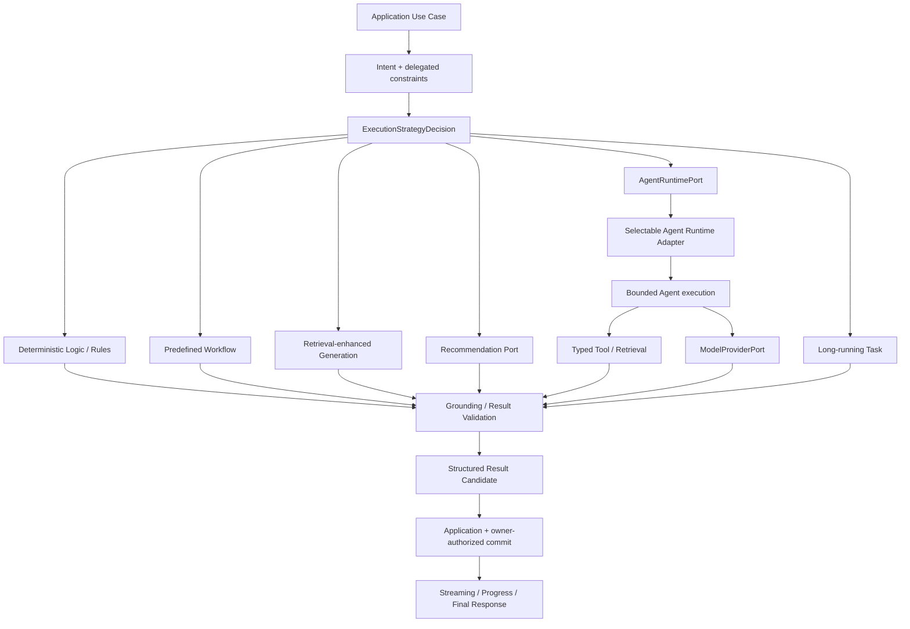

本图表示 logical responsibilities，不表示 service、process、database 或 vendor。

### AI Runtime Component Diagram

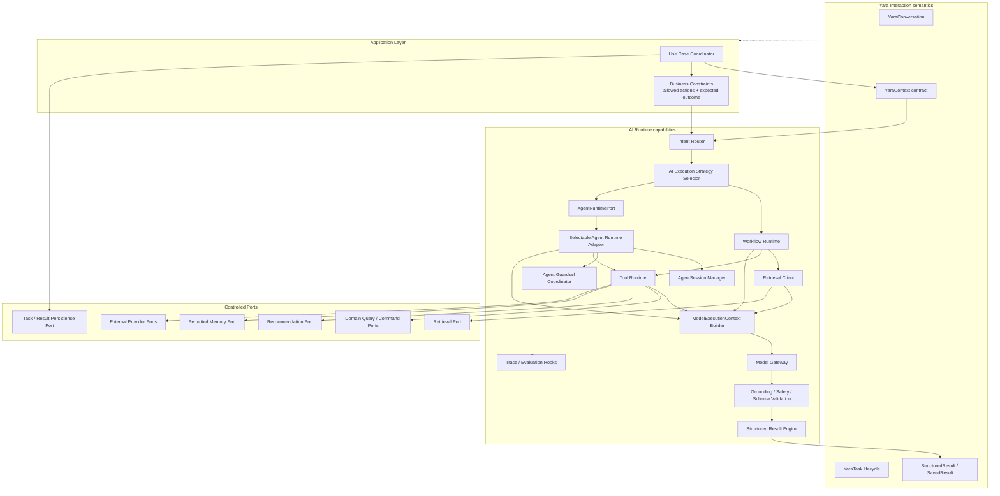

## 5.2 Request Lifecycle

### End-to-end lifecycle

1. Client 发送 typed request、session/client metadata、optional context object 与 idempotency/correlation information。
2. Application Use Case 完成 authentication、authorization、request normalization 与 coarse use-case selection。
3. Yara Interaction/Application semantics 从 authenticated、permitted domain/session data 组装 policy-filtered `YaraContext`；缺失必要业务信息时进入 clarification，而不是猜测。
4. AI Runtime 对 product-owned Intent taxonomy 执行 inference/classification，返回 candidates、confidence、required context 与 ambiguity indicators；Application 确认 business use case、constraints、allowed capabilities/actions 与 expected outcome。
5. AI Runtime 在 delegated constraints 内选择最低复杂度 AI execution strategy，例如 Workflow、RAG 或 controlled Agent；deterministic domain/application behavior 仍由 Application/Domain 执行。
6. Runtime 通过 controlled ports 执行 Domain Query、Retrieval、Tool、Recommendation 或 Model invocation。
7. Grounding/Validation 绑定 facts、references、citations、permissions、freshness 与 unsupported claims。
8. Structured Result Engine 选择 result type，验证 contract，并产生 partial/final result。
9. Yara Interaction/Application 通过 persistence port 保存允许保存的 task/result lifecycle；Session Context 不自动写入 Memory。
10. Delivery 输出 synchronous response，或 streaming/progress/partial/final events。

Synchronous variant 用于 deterministic result、低延迟 domain query、短解释与可在 request deadline 内完成的 structured result。Asynchronous variant 必须有 `taskId`，用于 clarification、多 provider planning、长 Retrieval/Tool chain、可取消/恢复任务或超出 synchronous deadline 的执行。

## 5.3 Context Builder

`YaraContext` 是 user-facing contextual Yara Intelligence request 的标准化 product/business context contract，由 Yara Interaction/Application semantics 拥有并从 authenticated、permitted domain/session data 组装。它不是每个内部 ML/AI operation 都必须携带的完整对象，也不是 final physical schema。

| Context dimension | Logical content | Authority / rule |
|---|---|---|
| Current object context | Track、Album、Artist、Playlist、Concert、Release、User、Journey/Moment references | canonical typed reference；按来源验证 |
| Conversation context | selected prior turns、resolved entities、active constraints | YaraConversation lifecycle；受 token/policy budget 限制 |
| User-permitted signals | explicit preferences、allowed Taste/Collection/Journey/Memory references | permission-filtered；purpose-limited |
| Task intent | intent、goal、constraints、clarification state | Application/YaraTask semantics |
| Client/session context | locale、timezone、entry point、device capability、navigation origin | session-scoped；不得默认为 long-term memory |
| Provenance/reference context | source、observed-at、canonical/provider IDs、citation handles | facts 必须可追踪 |
| Privacy/policy filters | visibility、consent、region、data class、tool/model eligibility | policy decision output；不得由 LLM 改写 |

AI Runtime 不得自行跨域抓取并组装 unrestricted business context。进入 Runtime 的 `YaraContext` 已经过 authentication、permission、purpose 与 policy filtering，并使用 typed references/permitted signals。

`ModelExecutionContext` / `ModelContext` 是 AI Runtime 的 execution artifact：由 `YaraContext`、permitted `RetrievalEvidence`、validated tool observations、prompt/workflow instructions 与 execution metadata 派生；它受 token budget 和具体 model capability 约束，可按 invocation 重新构造，不是 business source of truth，也不获得新的 domain authority。

`YaraContext` 必须是purpose-scoped且经过授权的上下文包，而不是全量用户数据转储。它可包含当前身份与对象引用、被允许的`MemorySnapshot` / `TasteSnapshot`、`EvidencePackage`、任务约束及tool capability envelope；不得默认注入完整Conversation、全部Memory、全部用户资料或provider raw payload。Context Builder按purpose/data-class eligibility、source priority、freshness和token budget选择材料，并可进行ephemeral summarization、compaction与分层截断。`Context Compaction != Memory creation`：压缩摘要只服务当前execution/session，不产生`MemoryCandidate`或`MemoryRecord`。

明确 invariants：

- `YaraContext != ModelExecutionContext`；
- `Session Context != Memory`；
- `ModelExecutionContext` 只能缩减、转换或补充 permitted evidence，不能扩大 `YaraContext` 的 permission scope；
- AI Runtime 可以请求 permitted Memory retrieval 或提出 `MemoryCandidate`，但不得静默创建/修改 `MemoryRecord`。

## 5.4 Intent Recognition & Routing

Yara Interaction/Application 拥有 product/business Intent taxonomy，最少覆盖：Find Music、Understand Music、Recommend Music、Concert Planning、Vinyl/Record Comparison、Playlist Building、Journey Reflection、General Music Q&A。AI Runtime 只对该 versioned taxonomy 执行 inference/classification，不得定义新的 authoritative business intent。

| Option | Advantages | Limitations |
|---|---|---|
| Rules only | deterministic、低成本、易审计 | paraphrase/ambiguity coverage 差；规则增长快 |
| Model classification | language coverage 强 | nondeterminism、latency/cost、prompt-injection 与 confidence calibration 风险 |
| Hybrid routing | 高置信显式入口/规则先行，复杂语言由 model-assisted classification；最终受 policy gate 约束 | 需要 taxonomy/version/evaluation 与 fallback |

推荐 Hybrid。Router 输出 typed `IntentInference`，至少包含 taxonomy version、candidate intent、confidence band、matched context、missing information 与 ambiguity indicators。Application 根据该 inference 和 product rules 产生 authoritative `IntentDecision`、business constraints、allowed capabilities/actions、expected outcome 与 clarification requirement。低置信、多重冲突、缺少 required context 或高风险 action 必须 clarify/fail closed；classifier 不得创建新 intent、直接调用 tool 或写 domain state。ADR-005 已 Accepted。

## 5.5 Task Planning

### Execution Strategy Matrix

| Strategy | Use when | Yara examples | Avoid when |
|---|---|---|---|
| Deterministic domain/application logic | result 可由 rules、permissions、domain facts 确定 | save/result command validation、known navigation/result routing | 需要解释性 synthesis |
| Predefined Workflow | step sequence 已知、tools 有界、状态可枚举 | Vinyl comparison、Playlist building、Concert planning 主干 | goal/steps 真正开放且无法预定义 |
| Retrieval-enhanced generation | 回答依赖 sourced knowledge 与 explanation | album/artist/story/history explanation、General Music Q&A | canonical fact 可直接查询；无可信 source |
| Recommendation pipeline | 需要 candidate generation/ranking/diversity/explanation | Find/Recommend Music、mood/contextual recommendations | 让 LLM 凭空列歌 |
| Controlled tool-using Agent | next step/tool choice 取决于中间 observation | provider coverage 不确定的多源 research；Concert planning 局部探索 | known sequence、写权限敏感、低价值简单问答 |
| Long-running task | 超出 sync deadline、需 clarification/progress/recovery/cancel | Concert Plan、复杂 Playlist、multi-provider Record comparison | 单次低延迟 query/short explanation |

Application Use Case / `YaraTask` 先声明 business goal、business constraints、allowed capabilities/actions、`expectedResultType` 或 `allowedResultTypes`。AI Runtime 在这些 delegated constraints 内产生 bounded `AIExecutionPlan`：execution steps、allowed tools subset、budgets、stop conditions 与 runtime recovery classification。它不能改变 product outcome 或扩大 permissions，也不输出/持久化 private chain-of-thought；可观测的是 user-understandable task status 与 structured execution metadata。

## 5.6 Agent Orchestration

Workflow 有 known sequence、bounded steps、predictable tools 与 observable state transitions。Agent 允许 dynamic planning、dynamic tool choice 和 variable step count，但必须受 allowlist、budget、permission、schema 与 stop conditions 约束。

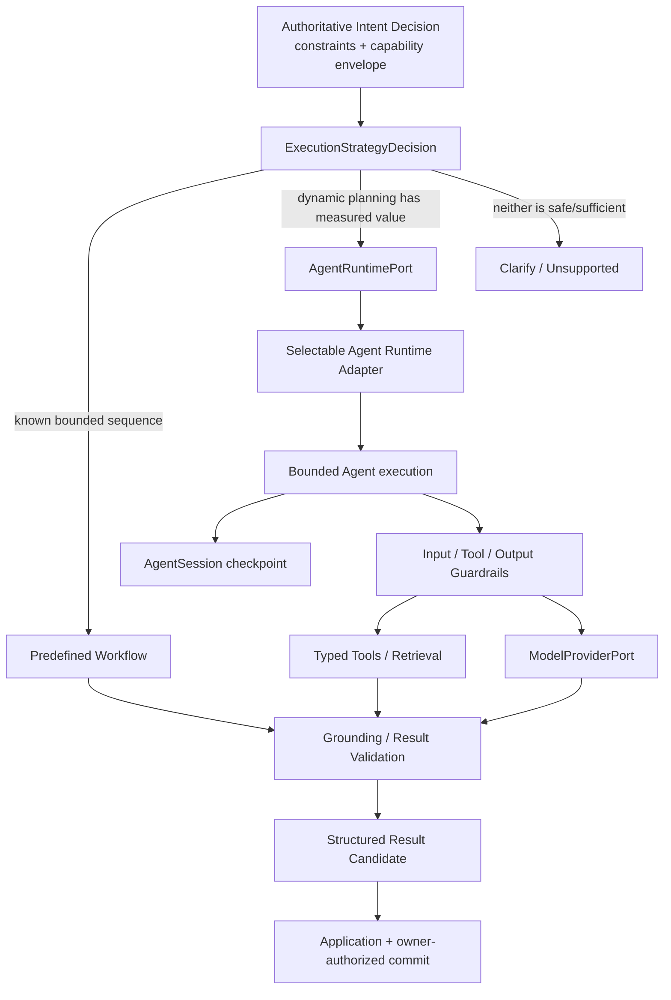

`AgentRuntimePort`由Yara拥有，是Application调用受控Agent execution的framework-neutral接口。它可协调model calls、bounded planning、typed tools、runtime session、显式handoff、Guardrails、HITL suspend/resume、runtime tracing与step/time/token/cost budgets。它不得拥有Domain truth、permission/Consent/rights、business transaction、committed `StructuredResult`或不可逆external effect；所有写操作继续经typed Application ports与owner-authorized commit。`ModelProviderPort`保持独立且更底层：Agent runtime调用它获得`ModelExecutionResult`，而不是由model provider拥有Agent session、validation或result semantics。

运行时实现分级如下：

| Implementation class | Status | Role / constraint |
|---|---|---|
| Controlled Custom Runtime | `SELECTED P0` | NestJS内的controlled TypeScript workflow，完成MVP-0 Flow A/B/C；不依赖Agent framework |
| Modern Agent SDK Adapter | `PLANNED P1 / reference` | 首选OpenAI Agents SDK for TypeScript作为adapter PoC；SDK session/tool/guardrail/handoff/trace均映射为Yara semantics，SDK result不是committed `StructuredResult` |
| China-compatible Runtime Adapter | `PLANNED P1 / CONDITIONAL` | Qwen-Agent、eligible Alibaba Cloud/AgentRun-like runtime、自研runtime或其他国内方案；必须通过mainland availability、residency、privacy、filing/registration（如适用）、security、rights、quality、cost与operations gates |

`AgentSession`表示短到中期execution continuity，逻辑上保存runtime implementation/version、provider continuation metadata、context snapshot refs、tool invocation refs、current step、budgets、checkpoints与resume state。关系为`YaraConversation → YaraTask → AIExecutionRun → may use AgentSession`。`AgentSession != YaraConversation != YaraTask != Memory != Taste != business transaction`；它不是durable user memory，provider-hosted session仅是可替换metadata，不能成为唯一product state copy。MVP的durable execution由`YaraTask + AIExecutionRun + AgentSession checkpoint`及现有PostgreSQL coordinator/pg-boss承载。

Guardrails分为三层：Input Guardrail拦截prompt injection、prohibited capability、malformed input与unsupported action；Tool Guardrail检查allowlist、schema、current AuthZ、purpose、rights、region、budget与effect class；Output Guardrail检查result schema、canonical refs、citation/grounding、hard recommendation eligibility、privacy与unsupported claims。Guardrail不是Domain policy authority；LLM-based guardrail不得覆盖AuthZ、rights、Consent、schema、Forget、hard recommendation eligibility或idempotency等deterministic hard rules。

现代Agent HITL只映射到既有`RequiredAction`、user confirmation、re-auth与`ManualReviewRequired`。SDK approval pause只是runtime suspend/resume mechanism，SDK approval object不是authority，也不得建立第二套confirmation system。

Handoff / Multi-Agent保持`P2 / CONDITIONAL`，仅在Music Research、Recommendation或Concert Planning specialist相对single-agent/tool baseline在task success、latency、cost、tool correctness、grounding与failure rate上证明收益后启用。不得为Memory、Permission、Citation或Database创建Agent来替代确定性code/tool。A2A仅保留`DEFERRED` awareness：MCP用于Agent与Tool/Context互操作，A2A用于Agent-to-Agent interoperability；当前无跨组织use case。

冻结不变量：

```text
Agent Runtime != Domain authority
AgentSession != YaraConversation != YaraTask != Memory
AIExecutionRun != YaraTask
Context / Context Compaction != Memory creation
Skill != Permission
MCP != AuthN/AuthZ
Handoff != authorization delegation
Guardrail != Domain policy authority
Agent Trace != Chain-of-Thought
ModelExecutionResult != committed StructuredResult
Provider-hosted state != Yara durable truth
LLM != Recommendation candidate authority
AI Runtime cannot directly write Memory/Taste/Knowledge/Collection
```

Use-case assessment：

- Album explanation、General factual Q&A：通常为 Domain Query/RAG + model synthesis，不需要 Agent。
- Recommendation：独立 pipeline；LLM 可解释已选 candidates，但不负责无来源 candidate generation。
- Vinyl comparison、Playlist building：Workflow-first；只在 source/provider path 动态时选择性使用 Agent。
- Concert planning：bounded Workflow 管理 clarification、event/travel comparisons 与 result composition；局部 provider research 可使用 controlled Agent。
- Journey reflection：permitted context + bounded Retrieval/synthesis；不得自主写 Journey 或 Memory。

ADR-006保持Workflow-first + selective controlled Agent，不把任何framework选为authority或orchestration backbone；具体runtime adapter只是该稳定边界后的可替换实现。

### Model Gateway / Model Port

Model Gateway 是 AI Runtime 的 vendor-neutral outbound port，负责 model invocation、streaming normalization、request/response normalization、capability metadata、timeout/error mapping、policy enforcement、data-class/region eligibility，以及 token/cost/latency telemetry。调用方声明所需 capability 与 policy constraints，而不是绑定具体 model name。

Gateway 不拥有 prompt business semantics、intent taxonomy、Workflow state、domain truth 或 `StructuredResult` validation。它不得把 provider fallback 视为天然等价；是否允许 alternate model、降级能力或 retry 由 task/policy 明确决定。本节不选择model/vendor、model-provider SDK或routing product；前述Agent runtime adapter status不属于Model Gateway selection。

## 5.7 Tool Calling Architecture

Tool 是 AI Runtime 对受控 capability port 的 typed invocation，不是给 LLM 的数据库、credential 或 arbitrary network access。

Tool形态可包括typed Function Tool、MCP Tool、Agent-as-tool / delegated specialist及external side-effect tool，但全部必须映射到typed Application/Capability ports。任何形态都不得获得arbitrary database、filesystem、secret、network或repository access；Handoff也不构成authorization delegation。

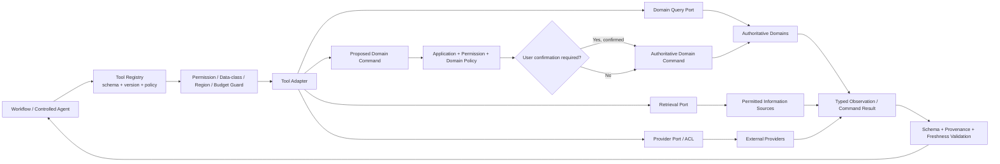

允许的 tools 可包括 Music Catalog、Live/Event、Physical Record、Search/Retrieval、Maps/Travel/provider facts，以及 Collection/Journey/Memory action proposals。每个 tool 必须声明 input/output schema、read/proposal classification、required permission、data classification、timeout、idempotency/retry safety、provenance/freshness 与 version。

在 Chapter 12 permission/state design 完成前，AI Runtime 只能提出 `ProposedDomainCommand`，不得自主提交 user-visible authoritative mutation。固定 mutation path 为：`AI Runtime → Proposed Domain Command → Application / Permission / Domain Policy → user confirmation when required → Authoritative Domain Command`。Collection save、Journey update、Memory candidate action 均遵循此路径；最终 confirmation policy deferred。

MCP是`PLANNED P1 — required portfolio Agent enhancement`，不阻塞MVP-0，但作为首个现代Agent enhancement实施。首个read-first `YaraMusicMcpServer`提供`search_music`、`get_artist`、`get_release`、`get_recording`、`get_music_knowledge`、`recommendation_candidates`，可选`get_collection`与`get_memory_explanation`；首版不提供mutation MCP。Remote user mode必须把verified subject映射到current `IdentityContext`并重新执行AuthZ；internal workload mode使用workload identity加Application显式委托且可验证的user/app context；local mode仅限dev/test。Caller自行声明的subject ID不可信。`MCP != AuthN/AuthZ != Domain authority != unrestricted provider proxy`。

Skills为`PLANNED P1`的versioned task instruction/workflow knowledge/tool guidance/constraints/examples，可覆盖find-music、music-research、album-comparison与future concert/vinyl。Skill必须有version lineage并进入trace/evaluation；`Skill != Tool != Domain policy != AuthZ`，不能授予capability，也不引入generic skill marketplace。

## 5.8 RAG Architecture

本节只定位 RAG：当答案需要 sourced knowledge 时，AI Runtime 通过 Retrieval Port 请求 permitted sources，把返回的 evidence package 注入受限 model context，再执行 claim/citation validation。RAG 不等于所有 AI request，也不绕过 canonical Domain Query。

`Search != Retrieval != Music Graph != Recommendation`：Search 是 user/system query capability；Retrieval 是 AI/Search 使用的信息访问执行 capability；Music Graph 是 MUSIC-area cross-authority relationship view/projection；Recommendation 是 candidate/ranking business capability。

## 5.9 Retrieval & Reranking

Chapter 5 只定义 AI Runtime invocation boundary；Chapter 9 将其早期 shorthand 细化为 `RetrievalRequest → RetrievalResult`，并分离 `RetrievedReference`/`CandidateReference` 与 `RetrievalEvidence`。Request 继承 Application-owned `IntentDecision`/access envelope，result保留filters、permission scope、source classes、freshness、budgets、provenance、usage rights与limitations；本次细化不改变已冻结的 AI Runtime authority。

Retrieval 与 Reranking 的 logical source fusion、hybrid stages与authority boundaries已由Chapter 9 / ADR-007 Accepted；具体algorithm、evaluation thresholds、physical index/storage technology仍deferred。

AI Runtime 通过独立 `RecommendationPort` 调用 Personalization boundary 内的 Recommendation module。`RecommendationCandidate<TCanonicalReference>` 必须来自 grounded domain/Retrieval/provider sources；AI Runtime 可提供 context、constraints、explanation request 并消费 ranked result，但不能用“请 LLM 给一组对象”替代 candidate generation/ranking。Logical ownership 由 Chapter 6 / ADR-008 确定，physical topology deferred。

Memory 通过 permission-filtered `MemoryAccessPort` 访问。Runtime 可读取允许的 memory references、观察 `MemoryCandidate` 或提出 `ProposedMemoryCommand`；Chapter 7 / ADR-010 已确定 Memory logical ownership 与 explicit-direct/inferred-confirmation policy。Retention、physical topology 与具体 edit/forget contracts 继续 deferred。

## 5.10 Citation / Source Grounding

允许的 grounding sources：canonical domain facts、带 observed-at/provenance 的 provider observations、retrieved licensed knowledge、permitted user context。LLM 不得成为 canonical music metadata、ticket availability、price/stock、permissions、Collection/Journey truth 的 source of truth。

Claim policy：

- authoritative claim 必须绑定可验证 domain/provider reference；
- volatile claim 必须携带 source、observed-at/freshness 与 limitations；
- interpretive claim 标记为 synthesis/opinion，并绑定 supporting evidence where applicable；
- evidence 缺失或冲突时，删除 claim、降低表述强度、返回 partial/uncertain result，或请求 clarification/refetch；
- model-produced identifier 不得在未经 canonical resolution 后进入 result contract。

## 5.11 Structured Result Engine

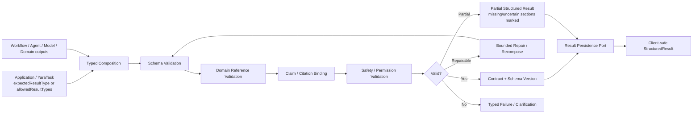

Yara Interaction/product contract 拥有 result taxonomy；Application Use Case / `YaraTask` 声明 `expectedResultType` 或 `allowedResultTypes`，例如 `PlanConcertTripUseCase → expectedResultType = ConcertPlanResult`。Structured Result Engine 不得发明或自由选择 product result type。

Engine 负责 typed composition、schema validation、canonical reference validation、citation/claim binding、safety/permission validation、bounded retry/repair、partial/failure handling 与 version-identifiable delivery。Free-form model text 只能成为待验证 input，不直接成为 authoritative `StructuredResult`。

`StructuredResult` 至少携带 result type、contract/schema version、status、validated blocks、typed references、citations/provenance、limitations、generated/observed timestamps 与 follow-up actions。最终 JSON schemas deferred to Chapters 11/14/15。ADR-011 已 Accepted。

## 5.12 AI Streaming / Tool Progress

Delivery event taxonomy 可包含 `accepted`、`clarification_required`、`progress`、`tool_status`、`partial_result`、`final_result`、`failed`、`cancelled`。不得流出 private chain-of-thought、raw secrets、provider credentials 或未经安全处理的 tool payload。

Long-running `YaraTask` logical lifecycle：

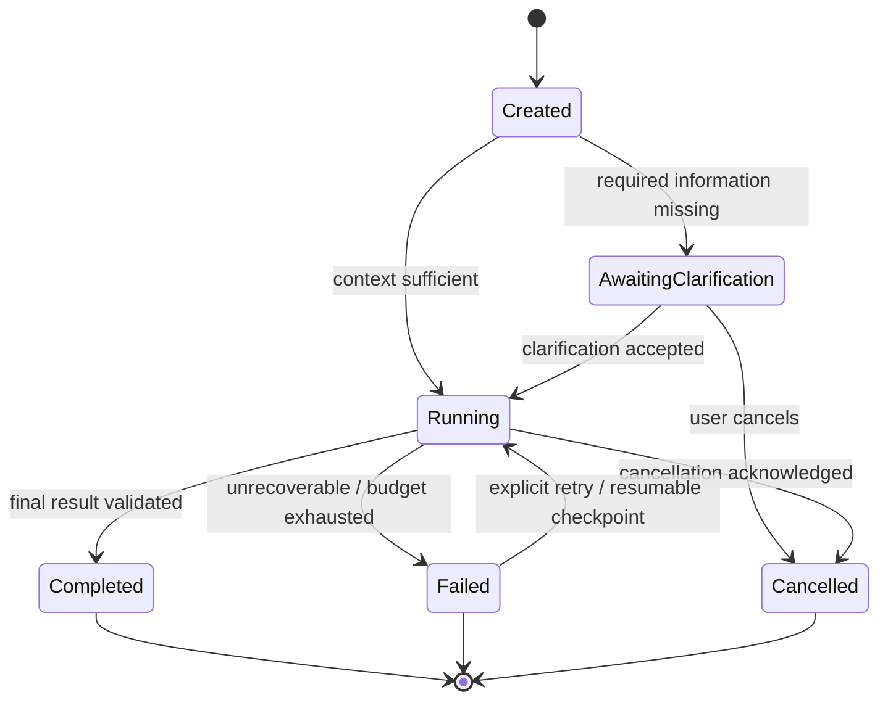

`YaraTask` 是 product/business object，以稳定 `taskId` 表达 user-visible lifecycle：Created、AwaitingClarification、Running、Completed、Failed、Cancelled。`partial_result`、`progress`、`tool_status` 是 Running 期间的 events/artifacts，不是 primary task state。Completed task 的 result 可以是 `result.status = complete` 或在产品语义允许时为 `partial / limited`。

AI Runtime 使用非产品可见的 `AIExecutionRun` / `ExecutionAttempt` 表达每次 runtime execution：

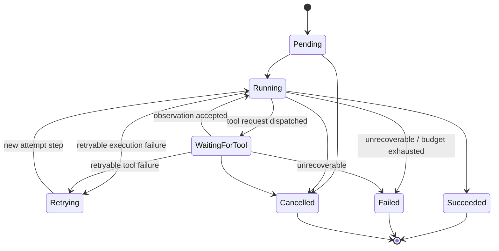

一个 `YaraTask` 可因 retry、fallback、resume 或 alternate execution strategy 关联多个 `AIExecutionRun`。ExecutionRun 使用独立 run/attempt identity，不能暴露为新的 product/domain object，也不能改变 `YaraTask` business state；Application/YaraTask lifecycle 根据 validated run outcomes 决定 user-visible transition。

Retry 区分 safe automatic execution retry、step retry 与 explicit task retry，并遵守 idempotency。Provider failure 可产生新的 run、alternate provider request、partial result artifact 或 typed failure，但 fallback 取决于 capability/provider policy。Resume/recovery 只从允许持久化的 checkpoint/result reference 恢复，不从 private reasoning 恢复；queue/workflow technology deferred。

## 5.13 AI Failure / Fallback

| Failure | Required handling |
|---|---|
| Ambiguous/low-confidence intent | clarify；不得猜测高影响 intent |
| Missing/denied context | omit、request consent/clarification，或返回 capability-limited result |
| Retrieval no evidence/conflict | unsupported/uncertain claim handling；不生成伪引用 |
| Tool/provider timeout/rate limit | bounded retry when safe；partial/degraded result；provider-aware error |
| Model timeout/refusal/invalid output | retry/alternate capability only by policy；schema repair bounded；typed failure |
| Domain reference invalid | re-resolve or reject affected block |
| Permission/safety validation failed | fail closed；记录 policy-safe audit metadata |
| Long task interruption | recover from allowed checkpoint or mark failed/resumable；保持 taskId |

Fallback 是 capability-specific policy，不假设所有 provider/model 可替换。Partial result 必须明确缺失、过期、冲突或未验证 blocks，不能伪装为 complete。

## 5.14 Prompt / Workflow Versioning

每次可评估 execution 至少关联 intent taxonomy/router version、context policy version、workflow/agent policy version、tool contract versions、prompt/template version、model capability identifier、retrieval policy version、validator version 与 Structured Result schema version。版本用于 reproducibility、rollback、evaluation segmentation 与 incident analysis，但不得存储 private chain-of-thought。

Observability hooks 使用 correlation IDs 关联 request、context summary/redaction status、intent decision、strategy、workflow/agent step metadata、retrieval references、tool calls、model usage、validation outcomes、result/task events。Raw content 与 traces 遵循未来 retention/redaction policy；详细 metrics/evaluation deferred to Chapter 19。

Security/privacy boundaries：

- 只有 permitted user signals 进入 Context Builder/AI Runtime；private social/message data 需显式 access scope；
- credentials、provider secrets、internal authorization tokens 永不进入 model context；
- Tool Registry/Guard 对 tool injection、schema abuse、exfiltration、region 与 data-class policy fail closed；
- model/provider adapter 必须执行 data classification、training-use、residency 与 retention policy；
- prompt/tool traces 默认最小化和 redacted，最终 retention 由 OQ-004/009/012 与 Chapter 18 决定。

## Phase 2A Decision Summary

1. 推荐 Hybrid AI Architecture；Application 声明 business constraints/allowed capabilities/outcome，AI Runtime 在 delegated constraints 内选择最低复杂度 AI execution strategy。
2. Product/business Intent taxonomy 由 Yara Interaction/Application 拥有；Runtime 使用 rules + model-assisted classification 推断；ADR-005 Accepted。
3. Workflow-first；Agent 仅用于确需 dynamic planning/tool choice 的 bounded subproblem；ADR-006 Accepted。
4. Tools 是 permissioned typed capability ports；side-effecting tool 只能提出 `ProposedDomainCommand`，经 Application/Permission/Domain Policy 与必要 user confirmation 后才能执行 authoritative mutation。
5. Retrieval、Search、Music Graph 与 Recommendation 保持不同 capability semantics；Recommendation 的 logical ownership 由 Chapter 6 / ADR-008 确定，ADR-007 只定位 AI invocation boundary。
6. AI Runtime 不拥有 Memory；Session Context 不静默写 Memory。
7. Model Gateway 保持 vendor-neutral，负责 invocation、streaming、normalization、capability/policy/error/usage boundary。
8. Yara Interaction 拥有 result taxonomy，Application/YaraTask 声明 expected/allowed result type；Engine 只负责 composition/validation/repair/grounding/schema conformance；ADR-011 Accepted。
9. Unsupported claims 被移除、降级、标注不确定、partial 或 fail/clarify，不能伪造 grounding。
10. `YaraTask` 与 `AIExecutionRun` 分离；partial/progress/tool status 是 Running events，一个 task 可关联多个 runtime runs；不选择 workflow/queue technology。

## Phase 2A Open Questions

| ID | Question | Impact / disposition |
|---|---|---|
| OQ-005/OQ-006 | provider/commerce mode 与 licensed knowledge scope | tool/retrieval availability、citation/rendering |
| OQ-008 | AI TTFR、completion、task-progress 与 availability SLO | sync/async threshold、budget、fallback |
| OQ-009/OQ-012 | conversation/context/trace retention 与 provider training use | Context/Trace/Model Gateway policy |
| OQ-011/OQ-014 | permitted Taste signals 与 explanation requirements | RecommendationPort input/output contract |
| Deferred Design Question | 哪些 user actions/results 必须要求 explicit confirmation，哪些 proposed commands 可执行？ | 优先由 Chapter 12 及 OQ-004 解决 |
| Deferred Design Question | 哪些 AI task classes 必须支持 durable resume，而非 restart/typed failure？ | 优先由 OQ-008/OQ-010 与 Chapters 12/17 解决 |
| Deferred Design Question | 各 data class 可发送给哪些 model/provider regions，允许何种 retention/training use？ | 优先由 OQ-004/OQ-009/OQ-012 与 Chapter 18 解决 |

以上仅为 Deferred Design Questions，未加入 canonical OQ registry，也不创建 OQ-AI 编号。

## Phase 2A Exit Criteria

- [x] AI request sync/async lifecycle 已定义。
- [x] `YaraContext` 与 `ModelExecutionContext` 已分离；Session Context/Memory boundary 已定义。
- [x] Intent options/trade-offs 与 Hybrid proposal 已记录。
- [x] deterministic logic、Workflow、RAG、Recommendation、Agent、long-running task 决策矩阵已完成。
- [x] Workflow 与 Agent 的职责、use cases、budgets 与 stop conditions 已区分。
- [x] Tool/Domain write authority 与 proposed-command/confirmation boundary 已定义。
- [x] Retrieval/Recommendation/Memory 只定义 Chapter 5 invocation boundary。
- [x] Model Gateway 保持 vendor-neutral。
- [x] Structured Result taxonomy ownership 与 grounding/validation/version/partial/repair pipeline 已定义。
- [x] `YaraTask` 与 `AIExecutionRun` state machines、events、retry/recovery relationship 已定义。
- [x] Observability/Evaluation hooks 不暴露 private chain-of-thought。
- [x] Security/privacy boundaries 已定义且无 technology selection。
- [x] 六张 required diagrams 均为 fenced Mermaid source。
- [x] ADR-005/006/007/011 已 Accepted at logical architecture level；未接受model/framework/vendor/physical topology。
- [x] Chapter 5 review 已批准并冻结。

Phase 2A — Chapter 5 已 Approved / Frozen；后续Phase不得无直接矛盾重开其authority与execution decisions。

# 6. Personalization, Taste & Recommendation Architecture

## 6.1 Taste Profile Model

### Core language

Taste 是用户允许 Yara 使用的、持久但持续演化的音乐偏好表示，不是 LLM 生成的人格摘要，也不等于 Memory、Journey、Conversation History 或 Session Context。

| Concept | Meaning / lifecycle | Authority and source | Persistence / visibility / control |
|---|---|---|---|
| `PreferenceSignal` | 经 permission/purpose gate 后可供 personalization 解释的 typed signal | 来源仍由 Collection、Journey、Playback、Search、Social、Yara Interaction 等 source domain 拥有 | 可短期保留或转化；不是 source-domain truth |
| `TasteEvidence` | Personalization 对一个或多个 signals 的可追踪解释记录 | Personalization owns interpretation；保留 source references/provenance | 仅在 signal-specific purpose/privacy/retention policy 允许时保留；支持 decay、deletion、reset、permission withdrawal 与适用时 re-derivation |
| `ExplicitPreferenceState` | 用户直接表达、确认或纠正的 personalization preference state；不是 inference | Personalization 验证并拥有 normalized state；user-authored intent 是 authority | persistent when explicitly permitted；user-visible、editable、resettable |
| `DerivedTasteState` | 从 permitted `TasteEvidence` 推导的偏好状态 | Personalization derives；必须有 confidence、provenance 与 processing/model version | policy-permitted derived state；correction/decay/reset/deletion eligible |
| `TasteDimension` | 可比较的偏好维度，例如 genre、artist、era、scene，以及 evidence 充分时的 style/energy | Personalization vocabulary；MUSIC references 必须 canonical | derived persistent concept；具体维度集/version 可演进；不包含 freshness/popularity/availability 等 request-time ranking features |
| `TasteFacet` | 某 dimension 下带方向、强度、confidence 与 provenance summary 的 profile unit | Personalization derives from permitted evidence | user-visible when safe；可纠正/reset；不是 Music fact |
| `TasteProfile` | `ExplicitPreferenceState` 与 `DerivedTasteState` 的 logical combined view；不得抹平 user-authored 与 inferred distinction | Personalization logical boundary owns semantics；各 facet/state 保留 origin | persistent、versioned、user-controllable；不拥有 source events |
| `TasteUpdate` | 对 profile/evidence 的 policy-governed update decision | Personalization owns；输入来自 permitted signal 或 explicit correction | persistent audit event/decision；可被 deletion/reset policy 影响 |
| `TasteSnapshot` | 从适用的 explicit + derived state 生成、供特定 request/surface 使用的 immutable permission-filtered projection | Personalization produces | derived/ephemeral；带 state/profile/policy version，不可反写 profile |
| `TasteExplanation` | Taste facet/evolution 的 grounded explanation package | 基于实际 evidence 与 disclosure policy | user-visible where approved；LLM 只能 verbalize validated rationale |
| `RecommendationRequest` | Application/surface 对 Recommendation capability 的 typed decision request | request owner 是 calling use case；contract由 Recommendation capability定义 | request-scoped；不等于 Taste write |
| `RecommendationCandidate<TCanonicalReference>` | 已解析至适用 canonical domain reference、进入 eligibility/ranking 的 typed candidate；specializations 可含 `MusicRecommendationCandidate`、Event/Occurrence、Physical Release/Edition/Pressing candidate | candidate source + Catalog/Live/Physical authority | derived/request-scoped；不转移对象 ownership，不能由 LLM 凭空创造 |
| `RankedRecommendation` | 经 hard filters、ranking、context/diversity policy 后的结果 | Recommendation capability owns decision output | request/result-scoped；引用 canonical objects |
| `RecommendationFeedback` | 用户对具体 recommendation/result 的 explicit 或 behavioral response | source action truth 仍由 source domain 拥有；Recommendation/Personalization消费 typed observation | 可形成 feedback record/evidence；须受 purpose/permission控制 |
| `RecommendationExplanation` | why-this result 的 validated rationale/evidence package | Recommendation produces rationale inputs；Catalog/Live/Physical 等 source domains own referenced facts | user-visible；只披露实际使用且允许披露的 signals |

不单独引入 `TemporaryPreference` durable entity；request-time preference 作为 `YaraContext`/Session Context 中的 typed constraint 表达。核心 invariant：`PersistentTaste != TemporaryContextualPreference`。

### Taste categories

- Explicit Taste：用户直接表达、选择或纠正的偏好；在 scope 清晰且允许持久化时进入 `ExplicitPreferenceState`，是 user-authored preference authority，不是 inference。
- Observed Taste Evidence：行为只说明可能的偏好证据，不自动等于用户意图。
- Derived Taste：由 permitted evidence 推导并进入 `DerivedTasteState` 的 dimensions/facets，必须记录 confidence、version 与 provenance。
- Temporary Contextual Preference：当前 session/request 的 mood、activity 或 constraint，默认 ephemeral，不自动写入 TasteProfile。

示例：“我喜欢 shoegaze”可成为 explicit persistent preference；多次偏好 90s alternative 可形成 reinforced derived Taste；“今晚想听安静的音乐”与“跑步时要 upbeat”仅是 request-time context，除非用户明确要求长期保存或后续 policy 产生需确认的 candidate。

## 6.2 Explicit Signals

Taste signal taxonomy：

| Signal class | Examples | Source truth owner | Default persistence interpretation |
|---|---|---|---|
| Explicit user | like/dislike、favorite artist、genre selection、more/less like this、明确对话偏好 | 发起 action 的 domain；显式偏好 command 由 Personalization 验证 | eligible for durable Taste after permission/scope validation |
| Collection/library | save/remove Track/Album、physical ownership | Collection | source event persistent；Taste interpretation separately governed |
| Journey | curated Music Moment、explicit reflection、meaningful association | Journey | source persistent；仅 permitted semantic evidence 可进入 Taste |
| Yara interaction | accepted/rejected recommendation、explicit preference、follow-up refinement | Yara Interaction / Recommendation result lifecycle | explicit feedback eligible；conversation text 不自动成为 Taste |
| Social | follow、group participation、shared-music interaction | Social/Messaging as applicable | off by default unless explicit policy/permission；private messaging不得默认使用 |

Explicit correction 的 authority 高于弱 implicit inference，但仍应有 scope：对单一 track 的 dislike 不自动变成对 artist/genre 的永久否定。Reset 可以是 facet、source class、time range 或 full profile scope；最终 UX/permission flow 在 Chapters 12/18。

## 6.3 Implicit Signals

| Signal class | Examples | Interpretation caution |
|---|---|---|
| Listening behavior | play、completion、replay、skip、early skip、duration、repeat | playback context、autoplay、device/background state 可能造成噪声；单次行为弱证据 |
| Search/discovery | repeated artist search、detail exploration、genre/scene browsing | curiosity 不等于 preference；需区分 information intent 与 liking |
| Behavioral recommendation feedback | play、skip、save、dismiss、follow-up exploration | 必须绑定 recommendation exposure/request，避免把一般行为错误归因 |
| Contextual signals | mood、activity、time、location、session intent、current task | 默认 ephemeral；用于 request-time adjustment，不自动 durable write |
| Social observations | follow/group/shared music | permission 和 purpose 必须明确；social proximity 不等于 musical preference |

每个 signal/evidence 在被处理期间至少逻辑携带：source domain、source reference、user reference、timestamp、explicit/implicit class、confidence、purpose、permission scope、freshness/decay eligibility、explanation eligibility、processing/policy version。`TasteEvidence` 不是默认永久记录；是否及保留多久由 signal-specific purpose/privacy/retention policy 决定，并必须支持 decay、source deletion propagation、reset、permission withdrawal 与适用时 re-derivation。该 provenance 支持 grounded explanation、privacy enforcement、debugging 与 bad inference correction；最终 retention 由 Chapter 18 / OQ-009 决定，本章不定义 physical schema。

```mermaid
flowchart LR
    Action[Product Action] --> Source[Authoritative Source Domain<br/>Collection / Journey / Playback / Search / Social / Yara]
    Source --> Event[Typed Event / Observation<br/>source reference + timestamp]
    Event --> Gate[Permission + Purpose + Eligibility Gate]
    Gate -->|Denied / irrelevant| Drop[Do not use]
    Gate -->|Allowed| Signal[PreferenceSignal]
    Signal -->|User-authored explicit| Normalize[Explicit Preference Normalization]
    Normalize --> Explicit[ExplicitPreferenceState]
    Signal -->|Observed / inferential| Interpret[Personalization Interpretation]
    Interpret --> Evidence[TasteEvidence<br/>policy-retained + provenance + decay]
    Evidence --> Update[TasteUpdate Policy]
    Update --> Derived[DerivedTasteState]
    Explicit --> Profile[TasteProfile<br/>combined view preserving origin]
    Derived --> Profile
```

Source truth 与 signal interpretation 明确分离：Collection owns “user saved Album X”；Personalization 只拥有“该 permitted event 为 Album X 提供正向 Taste evidence”的解释。Journey owns `MusicMoment`；Messaging owns message；MUSIC owns Artist/Track/Album；Personalization 不复制或改写这些事实。

## 6.4 Taste Embedding

本节不批准 embedding implementation。`TasteProfile` 是可解释、versioned 的 logical profile；未来 embedding 只能作为 derived projection/feature，并必须可追溯到 permitted evidence、profile/policy version，支持删除/reset propagation，且不能取代 authoritative TasteProfile。

### Taste ownership options

| Option | Semantic/lifecycle fit | Privacy/write authority | Reuse/change cadence | MVP/operational consequence | Assessment |
|---|---|---|---|---|---|
| A. PERSON owns Taste | 音乐身份语义合理 | 容易把 Identity/Profile 与 inference lifecycle 混合 | 跨 Home/Explore/Yara 可复用 | 模块简单，但 PERSON 过宽 | Viable, not preferred |
| B. YARA Interaction owns Taste | 对 conversation personalization 直接 | AI interaction 与 durable preference/permission 过度耦合 | 非 Yara surfaces 依赖不自然 | 初期方便，长期边界腐化 | Reject |
| C. Independent Personalization logical boundary | 独立 language：signals/evidence/profile/update/snapshot | 单一 derived-write authority；便于 purpose/reset/deletion | 模型/policy迭代独立，服务所有 surfaces | MVP 可为隔离 module，无需独立 service/DB | Recommend |
| D. PERSON owns explicit, Personalization owns derived | 区分 explicit/derived 看似清晰 | 同一 facet 可能双 owner、冲突/merge/reset复杂 | consumers 需组合两个 authorities | 增加一致性与同步成本 | Reject unless future legal/product evidence requires split |

结论：Personalization 具备独立 ubiquitous language、derived lifecycle、permission/provenance invariants、write authority 与 model/policy change cadence，足以成为 **logical bounded-context candidate**。它同时拥有 `ExplicitPreferenceState` 与 `DerivedTasteState` semantics，并通过保留 origin 的 `TasteProfile` combined view 和 permission-filtered `TasteSnapshot` 对外提供偏好；这不是两个 domain owners。Recommendation 初始作为该 logical boundary 内部 capability/module。source domains 继续拥有原始 actions/facts。MVP 可作为强隔离 module 落地，不推导独立 service、database、team 或 deployment。

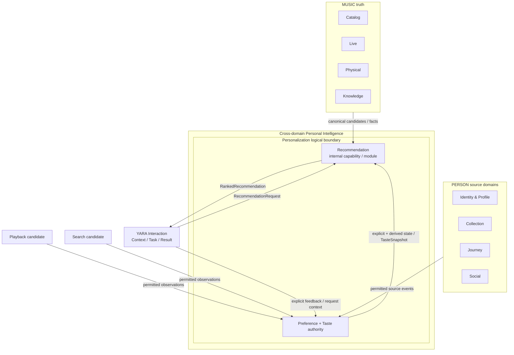

## 6.5 Candidate Generation

Recommendation 是 Personalization logical boundary 内部的 decision capability/module：把 eligible candidate space + permitted Taste + current Context + constraints 转换为 ranked results。它不拥有 canonical domain objects，也不创建任意 Track、Album、Event、Occurrence、Release、Edition 或 Pressing；输出必须使用 `RecommendationCandidate<TCanonicalReference>` 引用 Catalog、Live 或 Physical authoritative identities。共享 pipeline semantics 不意味着共享 candidate features：每种 candidate type 可拥有独立 eligibility、ranking feature set 与 explanation evidence contract。

Candidate sources 可以按 candidate type 组合：Music Catalog、curated/editorial sets、popularity/trending、similarity capability、Taste-neighbor pools、permitted listening-history-derived pools、Knowledge relationships、Retrieval results、contextual pools与未来 Music Graph relationships；Concert/Event 使用 Live canonical observations；Physical/Vinyl 使用 Physical Release/Edition/Pressing 与 permitted market observations。每个 source 必须提供 source/provenance、canonical-resolution inputs、适用的 freshness/rights/region/market metadata 与 candidate-generation version。

Chapter 6 不依赖 Music Graph。Recommendation 对 Chapter 8 的输入需求为：similar artist、genre/subgenre、influence、collaboration、credits、scene、era、sample relationship，以及关系 provenance/confidence/rights/freshness；缺少 Graph 时可使用其他 grounded sources。

### Recommendation pipeline


Stages：Candidate Generation 扩展有来源的 typed candidate space；Canonical Resolution 去重并绑定对应 Catalog/Live/Physical identity；Eligibility 执行当前 candidate type 与 surface 不可违反的 constraints；Ranking 比较允许候选；Contextual Adjustment 应用 request-time intent/context；Diversity/Novelty/Repeat policy 调整集合质量；Explanation Inputs 保存实际决策依据；Presentation 由调用 surface/result contract 决定；Feedback 与 exposure/request 绑定后进入解释流程。

## 6.6 Ranking

### Eligibility vs ranking

Eligibility 回答“在当前 use case/surface 中能否推荐”，其 hard constraints 由 candidate type、surface 与 request 共同决定。Playable-now surface 可将 playback availability 设为 hard constraint；Music discovery 可把 unavailable playback 表达为 limitation 而非 exclusion；Concert recommendation 可强制 event region/time/availability；Physical recommendation 可强制 market/format/condition constraints，而 playback availability 通常无关。explicit block、excluded content、hard task constraint、mandatory duplicate rule 与适用 rights restriction 同样在对应 surface 生效。Ranking 回答“当前允许候选中谁优先”；Ranking、LLM、surface objective 或 popularity 永远不能覆盖本次 request 的 hard eligibility。

Taste dimensions/features 与 Recommendation/ranking features 必须分离。Taste 只表达较稳定的 preference semantics，例如 artist affinity、genre/subgenre、era、scene，以及在 evidence 充分时的 stylistic/energy preference；它不成为所有 ranking inputs 的仓库。Recommendation features 可包含 Taste affinity、Context/Intent relevance、familiarity、freshness、availability、novelty、diversity、exploration value、appropriate popularity、repeat count/penalty、negative feedback、confidence、candidate quality 与 surface objective，并可按 candidate type/surface 不同。本章只定义 factor semantics 和 evidence requirement，不选择 collaborative filtering、matrix factorization、embeddings、transformer/GBDT/neural ranker、vendor 或 ML framework。

Diversity/novelty 可分布在三层：eligibility/policy 保证不可违反的安全与最低集合约束；ranking 计算相关性与探索价值；post-ranking 在不破坏 hard constraints 的前提下控制 artist、album、genre、scene、era、geography、familiarity、popularity 与重复度。Novelty 是相对已知 Taste 的受控距离，不是随机。

## 6.7 Contextual Recommendation

`Personalization = permitted TasteSnapshot + permitted current Context + surface/task constraints`。Personalization 是适配过程/capability；Taste 是 persistent preference representation，两者不能混用。

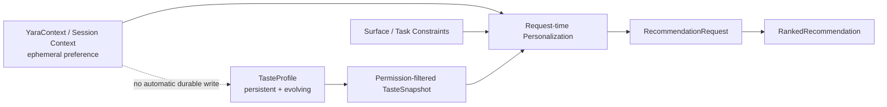

例如长期 Taste 为 punk/emo/alternative rock，而今晚 context 要求 quiet late-night listening：系统可在相关 musical space 内提高 slower/atmospheric candidates，但不得由此写成“用户长期偏好安静音乐”。Request-time adjustment 只影响本次 decision；持久化必须经过 signal eligibility 与 TasteUpdate policy。

### Surface objectives

| Surface | Shared capability objective/constraints |
|---|---|
| Home | 在熟悉度、discoverability、diversity 与今天 context 间取得平衡 |
| Explore | 更广 discovery、novelty 与 adjacent taste exploration |
| Yara conversation/task | explicit request、constraints 与 context alignment 优先 |
| Artist/Album related | object-centered relationship/similarity，Taste 仅作可选调整 |
| Concert | Taste + location/time/region/availability hard constraints |
| Vinyl/Physical | Taste + Collection state + release/format/market relevance；不拥有 price/stock truth |

这些是同一个 Recommendation capability 的 versioned objectives/constraints，不是每个页面一套 recommendation system。

## 6.8 Mood-aware Recommendation

Mood、activity、time、location 和 current task 默认属于 ephemeral Context。Mood-aware request 必须明确 source、freshness、permission 与 expiration，并与 durable TasteSnapshot 分开输入。自动 context 可在产品允许范围内支持 recommendation，但不能在没有 persistence policy/confirmation 的情况下形成长期 Taste 或 Memory。

## 6.9 Diversity / Novelty / Exploration

Yara 的产品目标不是只优化历史点击或重复熟悉内容。Exploitation 提供高可信偏好匹配；Exploration 引入与现有 Taste 有可解释邻接关系、但不确定性更高的音乐。系统应支持 discovery、serendipity、adjacent taste、repeat suppression 和 controlled novelty，同时保留用户可理解的 why-this rationale。

Exploration 强度是 request/surface policy input；不得绕过 negative feedback、hard exclusions 或 rights。低 confidence 时优先提供多样、可反馈的集合，而不是把单一偶然行为固化为 profile。

## 6.10 Cold Start

| Cold-start type | Logical strategies | Guardrail |
|---|---|---|
| New user | onboarding artist/genre choice、explicit preference、editorial/popularity baseline、contextual request、broad diversity、quick feedback | 不从单次 action 过拟合 |
| Sparse user | request-time context、少量 high-confidence explicit signals、transparent baseline | 标明 limited personalization |
| New music item | canonical metadata、editorial/Knowledge relations、contextual eligibility、controlled exploration | 不因无行为历史永久降权 |
| New surface | shared Recommendation capability + explicit surface objective/constraints | 不复制新 recommendation system |

Cold-start output 应携带 confidence/limitations，允许用户快速纠正并逐步建立 evidence。

## 6.11 Explainable Recommendation

`RecommendationExplanation` / `WhyThisRecommendation` 由三部分组成：实际使用的 decision factors/signals、允许披露的 signals、grounded Catalog/Live/Physical facts 或 relationships。Explanation package 先由 deterministic validation 生成 rationale/evidence references，再可由 LLM 转写为自然语言。

禁止披露 hidden sensitive inference、private social/messaging data、disallowed behavior、未实际使用的 signals、fabricated reasoning 或 private chain-of-thought。LLM 不得发明 rationale。OQ-014 继续决定哪些 surfaces 强制展示 explanation 及深度。

LLM MAY：解析 free-form preference constraints、normalize explicit feedback proposal、assist semantic labeling、summarize permitted patterns、verbalize validated rationale、理解 conversational request。

LLM MUST NOT：发明 candidates、成为 candidate/domain truth、拥有或直接写 TasteProfile、覆盖 permission/eligibility/hard constraints、虚构 evidence，或以 unsupported free-form reasoning 单独完成 ranking。任何 LLM-derived signal 都必须经过 provenance、permission、confidence 与 policy validation。

## 6.12 Feedback Loop

```mermaid
flowchart LR
    Product[Product Action / Recommendation Feedback] --> Source[Source Domain Event / Observation]
    Source --> Gate[Permission + Purpose + Signal Eligibility]
    Gate --> Signal[PreferenceSignal]
    Signal -->|explicit| Normalize[Explicit Preference Normalization]
    Normalize --> Explicit[ExplicitPreferenceState]
    Signal -->|observed / inferential| Interpret[Personalization Interpretation]
    Interpret --> Evidence[TasteEvidence]
    Evidence --> Update[TasteUpdate]
    Update --> Derived[DerivedTasteState]
    Explicit --> Profile[TasteProfile Version<br/>origin preserved]
    Derived --> Profile
    Profile --> Future[Future RecommendationRequest]
    Future --> Decision[RankedRecommendation]
    Decision --> Product
```

Explicit feedback 包括 like/dislike、more/less like this、not relevant、explanation feedback；behavioral feedback 包括 play、skip、replay、save、dismiss、follow-up exploration。Business event 与 interpretation 必须分离：`CollectionSaveEvent` 是 Collection truth，Personalization 只在 policy 允许时将其解释为 evidence。

Taste update modes：Batch 更新 slow-moving aggregates/decay/reconciliation；Near-real-time 处理高置信 explicit feedback 或需要快速生效的 permitted evidence；Request-time 只构造 contextual adjustment/TasteSnapshot，不写 durable profile。具体 event/ML pipeline technology deferred。

Recency、confidence、reinforcement、contradiction、decay 与 explicit override 是 policy concepts，不是已选公式。单次 accidental play 保持弱证据；重复一致行为可强化；近期阶段可衰减；明确 correction 通常覆盖较弱 inference；删除/reset 必须传播至 evidence、derived profile 和 future projections。

## 6.13 Recommendation Evaluation

本章不定义最终 offline/online metrics 或实验平台；Chapter 19 完成 evaluation design。当前要求至少按 surface、intent、user state 与 policy version 评估：eligibility violation、canonical resolution、relevance、diversity、novelty、repeat rate、negative feedback、explanation faithfulness、coverage、cold-start quality、latency 与 source/permission compliance。

### RecommendationPort logical contract

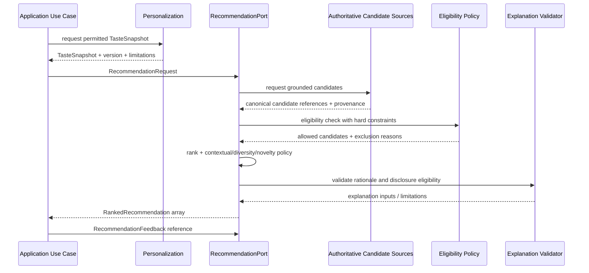

`RecommendationRequest` logical inputs：user reference、permitted TasteSnapshot/reference、allowed `YaraContext` subset、surface、candidate type、target object/context、hard constraints、candidate scope、result count、novelty/diversity preference、explanation/freshness requirements。`RankedRecommendation` outputs：typed canonical reference（例如 `MusicObjectRef`、`EventOccurrenceRef`、`PhysicalReleaseRef`/`EditionRef`/`PressingRef`）、rank、allowed score metadata、reason/evidence references、policy/model version、freshness、limitations、explanation inputs。本节不定义 transport API/JSON schema。

### Privacy / user control

- Signal consent 与 purpose limitation 在 ingestion 和 consumption 两处执行；
- explicit/inferred status、profile explanation、correction 与 reset 对用户可理解；
- source deletion/permission withdrawal 传播到 evidence、profile projections 与 future recommendation；
- cross-domain access 只使用 typed permitted references/events；
- social signals 默认不作为 personalization input，除非 OQ-011/product policy 明确允许；private messaging 不默认使用；
- model/provider exposure 使用最小化、permission-filtered snapshots，不发送 source-domain raw datasets；
- legal/retention/training-use requirements 继续由 OQ-004/009/011/012 与 Chapter 18 决定，不在本章虚构。

### Downstream requirements

| Destination | Inputs produced by Chapter 6 |
|---|---|
| Chapter 7 — Memory | Taste authoritative boundary owns durable music preference state；Memory 不复制 `ExplicitPreferenceState`、`DerivedTasteState` 或 authoritative `TasteProfile`。长期 companion recall 需要偏好时，应优先保存 typed reference 或通过 policy-aware retrieval 访问 Taste semantics；只有具有跨任务长期召回价值且符合 Memory policy 的非重复陈述才可成为 `MemoryCandidate`。contextual mood/activity 默认两者都不写；exact candidate/write policy 由 Chapter 7 决定 |
| Chapter 8 — Music Knowledge & Graph | similar artist、genre/subgenre、influence、collaboration、credits、scene、era、sample relations；需要 canonical IDs、provenance、confidence、rights、freshness；Recommendation 不强制 Graph materialization |
| Chapter 9 — Search & Retrieval | grounded candidate-source retrieval、canonical resolution evidence、filterable eligibility metadata、relationship/evidence retrieval、permission-filtered searchable Taste facets、ranking/explanation evidence；Search result ranking 与 Recommendation decision contract 保持区分 |

## Phase 2B Decision Summary

1. Personalization 分别维护 user-authored `ExplicitPreferenceState` 与 inferred `DerivedTasteState`；`TasteProfile` 是保留二者 origin 的 logical combined view，不是 LLM summary。
2. Personalization logical boundary owns explicit preference normalization、permitted `TasteEvidence` interpretation、derived Taste lifecycle、TasteProfile/Update/Snapshot 与 recommendation feedback interpretation；source domains 保留原始事实。
3. Personalization 足以成为 logical bounded-context candidate；MVP 可为隔离 module，不要求 service/database。
4. Recommendation 初始为 Personalization logical boundary 内部 capability/module，拥有 typed candidate coordination 到 ranked-decision lifecycle，但不拥有 canonical domain objects 或 Taste state；仅当后续 lifecycle、invariants、scale、SLO、change cadence 或 ownership evidence 足够时才重新评估独立 BC。
5. 不采用 PERSON/Yara Interaction ownership，也不拆分 explicit/derived Taste authoritative ownership。
6. Eligibility precedes ranking and cannot be overridden；candidate 必须 canonical/grounded。
7. Persistent Taste 与 ephemeral Context 分离；request-time adjustment 不自动 durable write。
8. LLM 仅解析/标注/verbalize validated rationale，不生成 candidate truth、profile truth 或 unsupported ranking。

## Phase 2B Open / Deferred Questions

| Question | Status / destination |
|---|---|
| 哪些 signals/uses 需要何种 consent、retention、deletion propagation？ | OQ-004/OQ-009；Chapters 12/18 |
| Social/Taste Match 可使用哪些 signals？ | OQ-011 Open |
| 哪些 surfaces 强制 explanation，展示深度如何？ | OQ-014 Open |
| Recommendation 是否因未来独立 lifecycle、invariants、scale、SLO、change cadence 或 team ownership 需要从 Personalization 抽离？ | 当前确定为 Personalization 内部 capability/module；仅在出现证据时重开；physical materialization deferred to Chapters 11/15/24 |
| Explicit preference command 的 confirmation/reset UX 与 mutation policy？ | Chapters 12/18；不新增 OQ |
| Ranking/decay/exploration formulas、model/features 与 evaluation thresholds？ | Chapters 19/22；technology/model selection deferred |

## Phase 2B Exit Criteria

- [x] Taste、Personalization、Recommendation 核心语言与 invariants 已定义。
- [x] PersistentTaste 与 TemporaryContextualPreference 已分离。
- [x] signal taxonomy、source truth、provenance、permission 与 update lifecycle 已定义。
- [x] 四种 ownership options 已按 semantic/lifecycle/privacy/change/MVP consequence 比较。
- [x] Personalization logical owner、explicit/inferred state separation 与 Recommendation internal capability/module placement 已形成。
- [x] Candidate generation、canonical resolution、eligibility、ranking、context、diversity/novelty、explanation、feedback pipeline 已定义。
- [x] surface objectives、cold start、update/decay、exploration 与 LLM boundary 已定义。
- [x] RecommendationPort logical contract 已细化。
- [x] Privacy/user control 与 Chapters 7–9 downstream inputs 已记录。
- [x] 六张 required diagrams 均为 fenced Mermaid source。
- [x] ADR-008 已 Accepted；未接受任何 algorithm/model/storage/topology 决策。
- [x] Chapter 6 final review 已批准并冻结。

Phase 2B 当前为 Approved / Frozen；本轮不得进入 Chapters 7–9。

# 7. Memory Architecture

## 7.1 Memory Principles

Memory 是具有跨 session、跨 conversation 或跨 task-family 持续效用的、user-relevant、policy-governed companion fact、constraint、relationship context 或 commitment。它不是模型“记住的一切”，也不是任意信息的长期缓存。一个 durable `MemoryRecord` 必须具有明确 owner、scope、temporal validity、provenance、write decision、access policy 与 user control。

核心 invariants：

- `Taste != Memory != Journey != ConversationHistory != SessionContext`；`MemoryStore != YaraContext != ModelExecutionContext`。
- Personalization 保持 durable music-preference authority；Memory 不复制 `TasteProfile`。
- Journey 保持 curated music-life narrative 与 `MusicMoment` authority；Memory 只可保存 typed reference 或经显式 policy 接受的不同 companion semantics。
- `MemoryRecord` authority 只表示“该信息已按此 scope、provenance、validity 与 access policy 被接受为 durable companion memory”，不自动成为其描述对象的 authoritative domain fact。核心 invariant：`MemoryRecord authority != Referenced domain fact authority`。
- 当 Identity/Profile、Taste、Journey、Live、Collection 等 source domain 已拥有事实时，Memory 优先保存 typed reference + companion-specific semantics；只有不存在其他 authoritative owner 的 companion-specific fact/constraint 才由 Memory 拥有其 normalized proposition。
- Conversation History 记录“说过什么”；Memory 记录“未来 companion use case 应继续使用什么”。
- Raw listening/search/click telemetry、transient task progress、hidden model state 与 arbitrary conversation summary 都不是 Memory。
- AI Runtime 可以提出 candidate、读取 permitted snapshot，但不能创建 authoritative `MemoryRecord`、覆盖 policy 或访问 unrestricted store。

### Accepted language

| Concept | Meaning / owner | Source and lifecycle | Persistence / user control |
|---|---|---|---|
| `MemoryCandidate` | 尚未成为 truth 的 typed proposal；Memory boundary owns candidate evaluation semantics | 来自 permitted observation、explicit command 或 AI-assisted extraction | temporary/pending；可 accept/reject/defer/expire |
| `MemoryRecord` | 已通过 policy decision 的 authoritative durable companion-memory acceptance | Memory owns acceptance、scope、provenance、validity 与 access semantics；不取代 referenced fact owner | durable but not timeless；visible、editable/forgetable where permitted |
| `MemoryType` | 受控 semantic classification，不等同 storage table | personal fact、non-musical preference、constraint、relationship context、commitment 等最小必要集合 | versioned vocabulary；不得为对称性无限扩展 |
| `MemoryScope` | memory 的适用边界 | global、domain、task-family、time-bounded、object-related；relationship-specific 仅在产品明确支持时 | 影响 access、conflict 与 expiry，不表示 physical partition |
| `MemoryEvidence` | 支持 candidate/record decision 的 permitted evidence references | source domain owns facts；Memory owns qualified references/interpretation | 按 purpose/privacy/retention policy 保留 |
| `MemorySource` | typed source descriptor | source domain/ref、timestamp、actor、capture mode、permission/purpose | provenance projection，不接管 source truth |
| `MemoryDecision` | accept/reject/defer/prohibit/update/forget 的可审计 policy decision | Memory policy/application authority；LLM 不拥有 | durable audit semantics；physical audit storage deferred |
| `MemoryConfidence` | 仅表达 inferred candidate/proposition 的 uncertainty | policy/validated model output | explicit statement 使用 source authority、scope 与 validity，不映射为任意 model confidence |
| `MemoryCandidateStatus` | proposal/confirmation lifecycle | Memory boundary | `PROPOSED`、`AWAITING_CONFIRMATION`、`ACCEPTED`、`REJECTED`、`PROHIBITED`、`EXPIRED` |
| `MemoryRecordStatus` | durable record lifecycle | Memory boundary | `ACTIVE`、`SUPERSEDED`、`EXPIRED`、`FORGOTTEN` |
| `MemoryVersion` | record correction/supersession history | Memory boundary | immutable lineage concept；不可静默抹除 provenance |
| `MemoryReference` | 指向 Memory 或外部 authoritative object 的 typed reference | reference owner 不等于 referenced truth owner | request-safe；可随 permission/validity失效 |
| `MemorySnapshot` | 为一次 use case 生成的 immutable、permission-filtered relevant projection | Memory boundary produces | ephemeral；进入 `YaraContext`，不可反写 store |
| `MemoryExplanation` | why remembered / why used 的 grounded explanation package | Memory boundary validates，LLM 可 verbalize | user-visible where required；无 private chain-of-thought |
| `MemoryAccessPolicy` | purpose、scope、classification、time、assertion mode、inferred-only confidence 与 disclosure gate | policy authority deferred to Chapters 12/18；Memory enforces contract | versioned；applied at write and read |
| `MemoryConflict` | 两个 propositions 针对相同 semantic subject/key、applicable conditions/qualifiers 与 overlapping validity，且不能同时成立 | Memory boundary detects/records | mutually exclusive propositions 在同一适用条件/窗口下不得保持等权 active |
| `MemoryConsolidation` | 在不增强语义的前提下合并 related records 的 proposal/decision | Memory boundary owns acceptance；LLM仅提议 | 保留 source lineage、assertion mode、inferred-only confidence 与 reversible references |

Memory categories 不是强制一一对应的 physical types：personal durable facts、long-term non-musical preferences、durable constraints、explicit relationship/meaningful context，以及具有明确 lifecycle 的 commitments 可以成为 Memory。Music preference 默认属于 Taste；curated life event 默认属于 Journey；calendar/task state 默认属于 owning task/calendar capability。Companion preference（如“不要给我过度主流的选择”）只有在不属于 Taste 且具有跨任务效用时才进入 Memory。

## 7.2 Memory Types

### Non-memory classification and authority

| Observation | Default classification | Possible Memory treatment |
|---|---|---|
| “今晚很累” | Session Context | 默认不创建 candidate；明确长期模式陈述才重新评价 |
| “我喜欢 shoegaze” | `ExplicitPreferenceState` in Personalization | Memory 只通过 typed Taste reference 访问，不复制 |
| “2019 年第一次看 Green Day” | Journey / `MusicMoment` when curated | 需要跨任务 recall 时保存 `JourneyReference`，不复制 timeline fact |
| prior Yara message | Conversation History | 仅 durable utility + policy 合格时产生 candidate |
| plays/skips/searches/clicks | source telemetry / Taste evidence input | 不作为 MemoryRecord |
| current planning progress | `YaraTask` state | 不作为 Memory；只有独立长期 constraint/commitment 可候选 |
| model summary/hidden state | AI Runtime artifact | prohibited as authoritative Memory |

### Memory vs neighboring authorities

```mermaid
flowchart LR
    Taste[Personalization<br/>ExplicitPreferenceState + DerivedTasteState]
    Journey[Journey<br/>MusicMoment + curated timeline]
    History[Yara Interaction<br/>Conversation History]
    Session[Session Context]
    Memory[Memory logical boundary<br/>durable companion recall]

    Taste -->|typed Taste reference / permitted retrieval| Memory
    Journey -->|JourneyReference / explicit transformation request| Memory
    History -->|permitted observation -> candidate only| Memory
    Session -.->|not durable by default| Memory
    Memory -.->|never rewrites| Taste
    Memory -.->|never rewrites| Journey
    Memory -.->|does not replace| History
```

No circular authoritative ownership：Memory 可以引用 Taste/Journey；Taste 和 Journey 可引用一个 Memory decision 作为来源说明，但不得把它当作改写自身 truth 的隐式 command。跨 boundary transformation 必须由 Application Layer 发起 typed command，并经过目标 boundary policy。

## 7.3 Short-term Context

Session Context、task-local constraints 与当前 object focus 由 `YaraContext` semantics 管理，默认随 request/conversation/task 生命周期结束或失效。它们只有满足 durable utility、source permission、Memory eligibility，并完成规定 write decision 时，才能产生 `MemoryCandidate`；“可用于当前回答”不等于“可长期记住”。

Explicit 与 inferred 分流：

- Explicit Memory：用户清晰说“记住……”且 subject、scope、meaning 与 permission 可验证时，可在 policy validation 后直接接受；仍需显示可撤销结果。
- Suggested Memory：系统提出具有长期效用的 candidate，等待用户确认。
- Inferred Memory：默认必须确认；不得因为 confidence 高而静默 durable write。
- Prohibited inference：private messaging、未经允许的 social inference、high-impact/sensitive inference、无 provenance 或超出 purpose 的 candidate 直接拒绝，不得通过确认 UI 规避基础禁止规则。

初始 policy 不启用“low-risk inferred automatic durable Memory”。未来若要启用，必须有单独产品、privacy、trust 与 quality evidence，并重开 ADR-010。

## 7.4 Long-term Memory

### Scope and temporal model

`MemoryScope` 支持 global、domain、task-family、time-bounded、object-related；surface-specific scope 默认避免，因为 UI surface 不是稳定 business semantic boundary。每条 active memory 至少需要逻辑表达 `observedAt`、`validFrom`、可选 `expiresAt`、`lastConfirmedAt`、freshness、assertion mode、仅 inferred 时适用的 confidence、scope/qualifiers、source、policy version，以及可选 `supersededBy`。

例子：居住城市是可变化 fact；“下周在首尔”是 time-bounded context/commitment；历史事件可不自然过期但由 Journey authoritative；“本月不要早班机”是 time-bounded constraint。无 `expiresAt` 不表示永恒有效，read policy 仍需评估 freshness。

### Ownership options

| Option | Semantic/lifecycle fit | Privacy/write authority | Coupling / reuse | MVP consequence | Assessment |
|---|---|---|---|---|---|
| A. Yara Interaction owns Memory | conversation source接近 | interaction 与 durable private state 混合 | Home/Explore/other tasks 反向依赖 conversation | 初期简单、长期边界腐化 | Reject |
| B. PERSON owns Memory | 用户资料语义相邻 | Identity/Profile scope 过宽，retention/control 混合 | reuse 可行但 model cadence 不同 | 少 module，但 privacy responsibility模糊 | Viable, not preferred |
| C. Independent Memory logical boundary | 独立 candidate/decision/conflict/expiry/forget language | 单一 write/read policy authority | 跨 Yara、Journey、Personalization 以 typed refs 协作 | MVP 可为隔离 module | Recommend |
| D. Module inside Personalization | 同属 Personal Intelligence | 容易复制 Taste 或让 preference policy吞并 companion facts | 非 Taste memory 不自然 | module 少但概念耦合高 | Reject |

结论：Memory 的 lifecycle、write/confirmation policy、conflict/supersession、time validity、privacy、retention、user edit/forget 与 access control 形成独立 invariants，支持 **independent logical bounded-context candidate**。它 owns `MemoryCandidate` evaluation、`MemoryDecision`、`MemoryRecord`、versions/conflicts/consolidation、access projection 与 forget semantics；不 owns Taste、Journey、Conversation、Task、Collection、Music facts、raw telemetry 或 AI Runtime state。MVP 可在 consolidated runtime/store 中实现为强隔离 module，不推导 microservice/database/team。

```mermaid
flowchart TB
    subgraph Sources[Authoritative source domains]
      Personalization[Personalization / Taste]
      Journey[Journey]
      Interaction[Yara Interaction]
      Profile[Identity & Profile]
      Task[Task / Structured Result]
    end
    subgraph PI[Cross-domain Personal Intelligence]
      Memory[Memory BC candidate<br/>record + decision + access authority]
      PersonalizationModule[Personalization BC candidate]
    end
    App[Application Layer]
    AI[AI Runtime]

    Sources -->|typed permitted observation/reference| App
    AI -->|ProposedMemoryCommand only| App
    App -->|candidate / authoritative command| Memory
    Memory -->|MemorySnapshot / reference| App
    Memory -.->|does not own or rewrite| PersonalizationModule
```

## 7.5 Memory Candidate Extraction

Candidate sources 包括 explicit remember command、permitted Yara conversation observation、task completion、Journey interaction、Collection interaction、profile/settings、typed Taste reference、structured correction，以及 policy 允许的 external action。Private Messaging 不是默认 source；Social content 不得静默形成 private Memory。所有 source domains 保留 truth，candidate 必须保存 typed source/provenance。

```mermaid
flowchart LR
    Source[Permitted Source Observation] --> Extract[Memory Candidate Extraction]
    Extract --> Classify[Candidate Classification]
    Classify --> Assess[Utility + Durability Assessment]
    Assess --> Dedup[Conflict + Duplicate Check]
    Dedup --> Gate[Permission + Policy Gate]
    Gate --> Confirm[Confirmation Decision]
    Confirm -->|Accept| Accepted[MemoryCandidate<br/>ACCEPTED]
    Confirm -->|Reject| Rejected[Rejected]
    Confirm -->|Defer| Pending[Awaiting Confirmation / Deferred]
    Accepted --> Command[Authoritative create/update command]
    Command --> Record[MemoryRecord<br/>ACTIVE or new version]
    Record --> Future[Future Access / Update / Forget]
```

Candidate extraction 可由 deterministic rules、structured product input 或 LLM-assisted proposal 完成。Extraction 不产生 write authority；Application/Memory policy 必须提交显式 `ProposedMemoryCommand`，执行 dedup/conflict、permission 和 confirmation decision。`MemoryCandidateStatus=ACCEPTED` 后，才按 policy 创建新 `MemoryRecord` 或生成 existing record update；`MemoryCandidate != MemoryRecord`。

## 7.6 Importance / Confidence

Durability assessment 至少考虑：跨 session utility、scope clarity、temporal validity、source authority/reliability、assertion mode（explicit/inferred）、inferred candidate 的 `MemoryConfidence`、contradiction、privacy impact、用户预期、existing authoritative owner 与 retention burden。Explicit statement 依据 user-authored source authority、scope 和 validity 判断，不被转换为任意 model confidence。Importance 不是单一 model score，也不能覆盖 prohibition 或 confirmation requirement。

Write policy options：

| Policy | Trust / surprise | Utility / friction | Risk / burden | Assessment |
|---|---|---|---|---|
| A. Explicit-only | 最高可预期 | companion usefulness受限；用户负担高 | inference risk最低 | Viable fallback |
| B. Explicit + all inferred confirmation | 高可控 | 可获得推断价值但有确认摩擦 | 清晰、易审计 | Strong baseline |
| C. Risk-tiered automatic inferred writes | 低摩擦 | usefulness高 | taxonomy/legal/false inference/retention burden大 | Premature |
| D. Context-specific hybrid | explicit command direct；inferred confirm；prohibited reject | 平衡信任与 usefulness | 需要明确 policy matrix | Recommend |

推荐 D，但初始行为等同 B 的保守核心：明确 remember command 在 permission/scope 明确时无需二次确认；所有 inferred durable candidate 默认进入 `AWAITING_CONFIRMATION`；prohibited candidate 永不写入。Sensitive/high-impact categories、financial/health/identity/private-social/relationship inference 的最终 classification 不在本章法律定性，由 Chapters 12/18 与 OQ-004/009/012 决定。

## 7.7 Memory Storage

本节的 “Storage” 仅定义 authoritative semantic state，不选择 database。`MemoryCandidate` 与 `MemoryRecord` 是不同 entities，各自使用 `MemoryCandidateStatus` 与 `MemoryRecordStatus`。Record 应逻辑包含 stable ID、user、type、scope、applicable conditions/qualifiers、normalized proposition/reference、record status、source/evidence refs、assertion mode、仅 inferred 时适用的 confidence、temporal fields、decision/policy version、version lineage、classification 与 explanation metadata。是否保留原始 evidence、保留多久、加密/region/backup/export 实现留给 Chapters 11/16/18。

### Lifecycle state machine

```mermaid
stateDiagram-v2
    state CandidateLifecycle {
      state "PROPOSED" as C_PROPOSED
      state "AWAITING_CONFIRMATION" as C_AWAITING
      state "ACCEPTED" as C_ACCEPTED
      state "REJECTED" as C_REJECTED
      state "PROHIBITED" as C_PROHIBITED
      state "EXPIRED" as C_EXPIRED
      [*] --> C_PROPOSED
      C_PROPOSED --> C_PROHIBITED: policy denies
      C_PROPOSED --> C_REJECTED: not useful / duplicate
      C_PROPOSED --> C_AWAITING: inferred durable candidate
      C_PROPOSED --> C_ACCEPTED: explicit command + policy valid
      C_AWAITING --> C_ACCEPTED: user confirms
      C_AWAITING --> C_REJECTED: user rejects
      C_AWAITING --> C_EXPIRED: confirmation validity ends
    }
    state RecordLifecycle {
      state "ACTIVE" as R_ACTIVE
      state "SUPERSEDED" as R_SUPERSEDED
      state "EXPIRED" as R_EXPIRED
      state "FORGOTTEN" as R_FORGOTTEN
      R_ACTIVE --> R_ACTIVE: correction / scope narrowing / new version
      R_ACTIVE --> R_SUPERSEDED: replacement accepted
      R_ACTIVE --> R_EXPIRED: temporal validity ends
      R_ACTIVE --> R_FORGOTTEN: removed from companion recall
    }
    C_ACCEPTED --> R_ACTIVE: authoritative policy command
```

Updates 包括 append、correct、supersede、narrow scope、justified scope expansion、expire、merge/consolidate 与 forget。Explicit correction 通常覆盖 weaker inference；scope expansion 需要新 justification/permission。所有变更创建 version/decision lineage，不静默篡改 provenance。

## 7.8 Memory Retrieval

`MemoryAccessPort` 提供 semantic access contract：

- `MemoryAccessRequest` inputs：user reference、purpose/use case、allowed scopes、time constraints、data-class restrictions、allowed assertion modes（explicit/inferred）、`minimumDerivedConfidence` when applicable、limit、explanation requirement、caller identity/policy version。
- Outputs：immutable `MemorySnapshot` 或 `MemoryReference[]`，包含 record/version reference、permitted proposition/reference、assertion mode、scope、applicable qualifiers、validity、inferred-only confidence/limitations 与 explanation provenance。
- read path 必须按 permission、purpose、scope/qualifiers、classification、time validity、supersession/conflict、assertion mode、inferred-only confidence 与 relevance 过滤；不得向 LLM 暴露 full store。
- detailed keyword/semantic/vector/hybrid retrieval、ranking 与 index design 留给 Chapter 9。

```mermaid
sequenceDiagram
    participant A as Application Use Case
    participant M as MemoryAccessPort
    participant P as Permission / Purpose Policy
    participant S as Authoritative Memory State
    participant C as Context Builder
    participant R as AI Runtime

    A->>M: MemoryAccessRequest
    M->>P: caller + purpose + scope + classification
    P-->>M: allowed policy envelope
    M->>S: retrieve active/relevant versions
    S-->>M: candidate references + temporal/provenance metadata
    M->>M: filter validity/qualifiers/conflict/assertion mode/relevance
    M-->>A: MemorySnapshot / references
    A->>C: build YaraContext with permitted projection
    C-->>R: YaraContext subset
    R->>R: build ModelExecutionContext
```

`MemoryStore != YaraContext`：只有 request-relevant、permission-filtered snapshot 进入 `YaraContext`；AI Runtime 再按 model/tool need-to-know 构建更小的 `ModelExecutionContext`。Memory snapshot 不能反向成为 durable write。

Embedding 仅可作为 rebuildable derived retrieval index/similarity feature：必须引用 authoritative Memory ID/version、支持 delete/forget/permission propagation、可重建且不得成为 truth。vector database、embedding model 与 physical vector store deferred to Chapters 9/16/22。

## 7.9 Memory Consolidation

Consolidation 将多个相关 records 形成更稳定的 semantic proposal，但不得把“偶尔选择 hostel”“预算低于 ¥300”和“偏好便宜住宿”自动强化成超出 evidence 的结论。LLM 可提出 normalized proposition、candidate grouping 与 summary；policy/validation 检查 scope/qualifiers、temporal overlap、contradiction、assertion mode、inferred-only confidence、permission 与 semantic entailment，最终由 Memory authority 接受。

Consolidated record 保留所有 contributing references、各自状态与可逆 lineage；source deletion、forget 或 correction 必须能触发 re-evaluation/re-derivation。Consolidation 不把 Journey/Taste facts复制为 Memory，也不删除 source records。

## 7.10 Memory Update Flow

Conflict 只在以下条件同时成立时存在：相同 semantic subject/key；applicable scopes、conditions 或 qualifiers overlap；temporal validity overlap；propositions 无法同时成立。条件不同的 memories 可以共存，例如“独自旅行偏好 hostel”和“与朋友旅行偏好 hotel”都可保持 `ACTIVE`。只有在相同适用条件与 validity window 下 mutually exclusive 的 propositions，才不得保持 equally active。

```mermaid
flowchart TD
    New[New explicit statement / permitted candidate] --> Find[Find same semantic key]
    Find --> Conditions{Scope + conditions + qualifiers + time overlap?}
    Conditions -->|No| Coexist[Allow conditional coexistence]
    Conditions -->|Yes| Compare[Compare assertion mode + source authority<br/>derived confidence + recency + validity]
    Compare --> Compatible{Propositions mutually compatible?}
    Compatible -->|Yes| Append[Append / narrow / consolidate proposal]
    Compatible -->|No| Conflict[MemoryConflict]
    Conflict --> Explicit{Explicit correction clear?}
    Explicit -->|Yes| Supersede[Create new version<br/>supersede old]
    Explicit -->|No| Confirm[Require user confirmation or defer]
    Supersede --> Active[No equally-active mutually exclusive propositions<br/>under same applicable conditions/window]
    Confirm --> Active
```

Temporal supersession 不等于物理删除：旧 record 可保持 `SUPERSEDED` lineage，但不得被普通 retrieval 当作当前事实。历史 question 可在 purpose 允许时读取旧版本。Stale record 可 expire、降低 read eligibility 或要求 reconfirm；具体 thresholds deferred。

Write-side contract：`ProposedMemoryCommand → Application/Memory Policy → confirmation when required → authoritative Memory command`。支持 create、confirm、reject、correct、supersede、expire、consolidate、forget；需要 idempotency/version precondition 的具体 contract 留给 Chapters 12/14。

## 7.11 Why This?

`MemoryExplanation` 回答“为什么 Yara 记得/使用这个”，至少可包含 permitted source type/reference、captured time、explicit/inferred、confirmation status、purpose/scope、last update、current validity，以及在当前 use case 中为何相关。示例：“你在 8 月 20 日要求 Yara 记住你偏好靠过道座位。”

Explanation 只能使用真实 decision/provenance metadata，不能暴露 private chain-of-thought、prohibited source、其他人的私密数据或超出 disclosure policy 的 inference。LLM 可以把 validated explanation package 转为自然语言，不能生成理由。

## 7.12 Edit / Forget

- Forget one memory：将目标 active version 标记为 `FORGOTTEN` 并从 future access/index 排除。
- Forget category/scope/source-derived memories：按明确 scope 产生批量 policy command；需要 preview/authorization 的 UX 后定。
- Reset inferred memories：移除或停用 inferred records，不影响 explicit memories，除非用户明确选择。
- Account deletion：触发 Memory state、derived indexes、pending candidates 与 permitted audit artifacts 的 lifecycle；精确法律保留例外 deferred。
- Source deletion：按 provenance 对 dependent memory 进行 delete、invalidate 或 re-derivation；不能继续使用失去合法 source 的 proposition。

Forget 表示从未来 companion recall/use 中移除 Memory；Delete 表示依据 retention/privacy/legal policy 进行数据移除。`MemoryRecordStatus=FORGOTTEN` 不自动规定立即物理删除，最终 deletion semantics 由 Chapter 18 / OQ-009 决定。

`Forget != source-domain delete`。忘记 `JourneyReference` 不删除 `MusicMoment`；忘记 Taste reference 不改写 `TasteProfile`。反方向，authoritative source 删除/permission withdrawal 可能要求 Memory reference失效或删除传播。所有 derived embedding/index 必须同步失效。

## 7.13 Memory Privacy

Write 与 read 两端均执行 data classification、purpose limitation、explicit/inferred distinction、source visibility、scope、temporal validity、regional policy、provider/model minimization、training-use policy、retention、deletion propagation 与 auditability。Private Messaging 不是默认 Memory source；Social content 不静默形成 private Memory。未经许可不得把其他用户信息写成当前用户的 private Memory。

LLM MAY：提出 `MemoryCandidate`、分类、normalize explicit command、summarize permitted evidence、检测潜在 contradiction、提出 consolidation、verbalize validated explanation。

LLM MUST NOT：决定全部 durable writes、覆盖 permission/confirmation、伪造 evidence、静默把 Session Context 变成 Memory、复制 Taste/Journey truth、访问 unrestricted store、改写 authoritative record、决定 retention/legal policy。

### Downstream requirements

| Destination | Inputs produced by Chapter 7 |
|---|---|
| Chapter 8 — Music Knowledge & Graph | 不要求 Memory graph materialization；若 Memory 引用 music relationship，只使用 canonical MUSIC refs 与 sourced relationship provenance，不创建个人事实 Knowledge Graph truth |
| Chapter 9 — Search & Retrieval | permission/purpose/scope/qualifier/class/time filters；active version、supersession/conflict、recency、assertion mode、inferred-only confidence、semantic matching、result limit、explanation refs；delete/forget/index invalidation；authoritative record resolution |
| Chapter 11 — Data Architecture | logical Candidate/Record/Decision/Version/Source/Evidence/Scope/Conflict/Consolidation/Reference/Snapshot entities；temporal validity、lineage、status、idempotent command 与 deletion propagation requirements |
| Chapter 12 — State & Permission | explicit-direct vs inferred-confirmation state machine；confirm/reject/edit/forget/reset authority；caller purpose/scope access policy；version preconditions |
| Chapter 18 — Security & Privacy | final classification、sensitive/high-impact rules、retention/export/delete、regional constraints、provider/model exposure、training use、audit requirements；OQ-004/009/012 |

### Phase 2C decision summary

1. Memory 是跨 session 有持续 companion utility 的 policy-governed semantic state，不是 raw history、context、telemetry、summary 或 hidden model state。
2. Memory 是 independent logical bounded-context candidate，拥有 durable companion-memory acceptance、scope/provenance/validity/access，以及 candidate/decision/record/version/conflict/consolidation/forget semantics；不取代 referenced domain fact authority，也不推导独立 service/database。
3. 初始 write policy：clear explicit remember command 经 policy validation 可直接写；所有 inferred durable candidate 必须确认；prohibited candidate 不写；不启用 silent low-risk inference。
4. Taste/Journey/Conversation/Task/source domains 保持 authority；Memory 通过 typed reference 协作且不复制 truth。
5. `MemoryStore != YaraContext`；仅 permitted, relevant snapshot 进入 Context/AI Runtime。
6. LLM 只 propose/classify/normalize/explain，不拥有 durable write、policy、record 或 unrestricted access。

### Phase 2C Open / Deferred Questions

| Question | Status / destination |
|---|---|
| Memory/data classification、regional/age requirements | OQ-004；Chapters 12/18 |
| Record/evidence/conversation retention、export/delete期限 | OQ-009；Chapters 11/18 |
| AI output/traces 是否用于 training/quality improvement | OQ-012；Chapters 18/19 |
| Confirmation UI、batch forget preview、reconfirmation interaction | Chapters 12/14；不改变本章 logical policy |
| Confidence/importance/staleness thresholds | Chapters 19/22；不选择公式/model |
| Physical store/index/encryption/partition/topology | Chapters 11/16/18/22/24 |
| 是否未来允许 low-risk inferred automatic durable writes | Disabled by current recommendation；需新 evidence 并重开 ADR-010 |

### Phase 2C Exit Criteria

- [x] Memory 与所有 non-memory authorities 已明确分离。
- [x] concepts、categories、scope、temporal model 与 provenance 已定义。
- [x] candidate/write/confirmation/update/conflict/consolidation/forget lifecycle 已定义。
- [x] read policy、Memory → YaraContext、retrieval/embedding boundary 已定义。
- [x] 四种 ownership 与四种 write-policy options 已比较。
- [x] independent logical Memory boundary 与 conservative hybrid policy recommendation 已形成。
- [x] 六张 required Mermaid diagrams 已提供。
- [x] downstream requirements 已记录。
- [x] Candidate/Record statuses、explicit/inferred confidence 与 conditional conflict semantics 已分离。
- [x] Forget 与 Delete 的语义边界已明确。
- [x] ADR-010 已 Accepted；未接受 storage/vector/index/retention/topology 决策。
- [x] Chapter 7 final review 已批准并冻结。

Phase 2C 当前为 Approved / Frozen；本轮不得进入 Chapters 8–9。

# 8. Music Knowledge & Graph Architecture

## 8.1 Business & AI Objective

Music Knowledge 是对音乐世界中超出基础 canonical identity/catalog metadata 的事实、关系、claims 与 contextual knowledge 进行 sourced、structured、explainable 表达的 logical capability。Catalog 回答“这是什么对象以及稳定结构是什么”；Knowledge 回答“它与什么相关、在什么语境/时间下成立、依据是什么、允许如何使用”。

主要产品/AI用途：音乐理解与故事、genre/scene/era discovery、influence/sample/collaboration explanation、related-object exploration、Recommendation candidate features、Search/Retrieval expansion、grounded Yara Q&A 和 Structured Result evidence。Knowledge 不等于生成内容仓库，也不允许 LLM 把未经验证的关系写成事实。

核心 invariants：

- Catalog owns canonical MUSIC identity 与被指定为 canonical 的 structural truth；Provider IDs 只作为 mapping/provenance。
- Knowledge owns normalized non-structural knowledge claim/relationship semantics、provenance、conflict/dispute 与 derived projection policy。
- 当某个关系是 canonical identity、composition、membership、version lineage、release structure 或 domain invariant 下 normalized primary structural metadata 的必要组成时，它属于 Catalog/Physical structural truth；当其主要是 sourced/disputable、editorial/interpretive、contextual、explanatory/discovery-oriented、超出 canonical structure 的 temporal qualification、model-derived 或 provenance-heavy 信息时，它属于 Knowledge。
- `KnowledgeClaim authority != Underlying real-world fact authority`。Knowledge 只对 normalized claim 的 acceptance、classification、provenance、qualifiers、conflict、rights 与 derived policy 具有 authority；provider、editorial 或 licensed source 仍可能是 underlying fact 的 source authority。
- `Knowledge ownership != absolute factual certainty`；claim 可以是 sourced、editorial、inferred、confidence-bearing 或 disputed。
- `Music Graph != Graph DB != Retrieval != Recommendation != AI Runtime`。
- Music Graph 是 MUSIC-area cross-authority logical relationship view/projection。Graph inclusion 不转移 domain ownership；`Graph relationship authority = authority of the underlying source domain / claim`。Knowledge 不拥有被投影的 Catalog 或 Physical truth。
- `Graph projection authority != domain conflict-resolution authority`；Catalog、Physical 与 Knowledge 分别解决自身 authoritative state/claim conflicts，Graph 只反映决定或披露 unresolved inconsistency。
- Music Knowledge derived relationships 只能使用 permitted music-world inputs 或 explicitly approved、privacy-safe aggregate signals；private/user-specific behavioral signals 留在 Personalization / Recommendation，不能因可表达为 graph edge 而进入 Music Graph。
- Graph 只表达 public/licensed/sourced music-world relationships；不得混入 private Memory、Taste、Journey 或 Social graph authority。

```mermaid
flowchart LR
    Provider[External Provider Observations]
    Catalog[Music Catalog<br/>canonical identity + structural truth]
    Knowledge[Music Knowledge<br/>normalized claims + provenance]
    Physical[Physical<br/>release / edition structure]
    Graph[Logical Music Graph<br/>cross-authority view / projection]
    Consumers[Recommendation / Retrieval / AI Runtime]

    Provider -->|Adapter / ACL| Catalog
    Provider -->|sourced observations| Knowledge
    Catalog -->|canonical references| Knowledge
    Catalog -->|owned structural relationships| Graph
    Physical -->|owned structural relationships| Graph
    Knowledge -->|owned claims + derived policy| Graph
    Catalog -->|identity / structural facts| Consumers
    Graph -->|typed evidence / relationships| Consumers
    Knowledge -.->|does not rewrite| Catalog
```

## 8.2 Graph Scope

Music Graph 是以 canonical MUSIC/Physical references 和 controlled knowledge concepts 为 nodes/subjects、同时暴露 source-owned structural relationships 与 typed `RelationshipAssertion` 的 MUSIC-area cross-authority logical relationship view/projection。Knowledge 治理 knowledge relationship semantics、claim/provenance exposure、graph-oriented query contract 与 derived relationship projection policy，但不接管 Catalog/Physical truth。它可以通过 relational rows、derived graph projection、search index 或未来 dedicated graph engine materialize；logical model 本身不选择 store 或 query language。

### In-scope nodes and concepts

| Class | Initial treatment | Yara use |
|---|---|---|
| Artist、Person、Group/Band | canonical Catalog references | credits、membership、influence、collaboration |
| Track/Recording、Composition/Work、Album/Work | canonical Catalog references where modeled | version/sample/credit/genre/story relationships |
| Release/Edition/Pressing | typed Physical references，非 Knowledge-owned identity | edition context、production/label/reference traversal |
| Label | unresolved classification remains pending under Chapter 8 Catalog-vs-Knowledge ownership rule | Chapter 11 可 materialize resolved model，但不得决定 semantic ownership |
| Genre、Subgenre、Scene、Era、Movement | versioned `KnowledgeConcept` + `ProviderConceptMapping` | discovery、explanation、recommendation features；provider labels 不自动成为 canonical concepts |
| Style、Technique、Instrument | defer unless approved explanation/retrieval use case requires | selective understanding |
| Mood | only as music-level descriptor claim；user mood remains Context | contextual discovery without personal-state ownership |
| Venue/Event | default defer from Music Knowledge graph；Live owns canonical truth | only typed reference when a music-history claim requires it |
| Geographic/music-cultural concept | controlled concept when scene/history use requires | scene and cultural-context explanation |

不建立 giant ontology。每个新增 type 必须由 explanation、discovery、recommendation、retrieval 或 story use case证明，并定义 authority/provenance/rights。

### Graph separation

```mermaid
flowchart TB
    subgraph MKG[MUSIC-area cross-authority logical graph view]
      Artist[ArtistRef]
      Track[TrackRef]
      Album[AlbumRef]
      Genre[Genre Concept]
      Scene[Scene Concept]
      Claim[RelationshipAssertion]
      Artist --- Claim
      Claim --- Track
      Claim --- Album
      Claim --- Genre
      Claim --- Scene
    end
    Taste[Personalization / Taste projections]
    Memory[Memory companion recall]
    Social[Social graph]
    Journey[Journey narrative]

    Taste -.->|shared canonical refs; no private edges| MKG
    Memory -.->|typed refs only; no private recall| MKG
    Social -.->|shared canonical refs; no social edges| MKG
    Journey -.->|shared canonical refs; no private narrative| MKG
```

上述边界明确拒绝 everything graph。共享 canonical IDs 或被同一 Graph 暴露，不意味着共享 domain ownership、privacy boundary 或 physical store；每条关系必须保留 underlying source domain/claim authority。

## 8.3 Entity Model

Knowledge 不创建已有 canonical entity 的第二 identity。`CanonicalEntityRef` 指向 Catalog；`PhysicalEntityRef` 指向 Physical；少数 Knowledge-only concepts 使用 Yara-controlled、versioned `KnowledgeConceptRef`。`ProviderConceptMapping` 将 provider terms 显式映射为 exact、ambiguous、one-to-many 或 unresolved 状态并独立 version；provider labels 不得自动升级为 canonical concepts。Provider entity IDs 保存在 `ProviderMapping`/provenance 中，并在 canonical resolution 失败时保持 unresolved observation，不得冒充 product ID。

### Logical claim concepts

| Concept | Meaning / authority | Lifecycle characteristics |
|---|---|---|
| `KnowledgeClaim` | generic normalized claim envelope；可表达 subject–predicate–object/value，不限定为 graph edge | candidate/accepted/disputed/superseded/withdrawn；具体 enum/schema deferred |
| `RelationshipAssertion` | graph-facing specialization of `KnowledgeClaim`；object 为 canonical/concept reference | directed/symmetric、temporal、source-aware；可多源共存 |
| `KnowledgeEvidence` | 支持 claim 的 source/document/observation reference | rights/display controlled；可被 corrected/withdrawn |
| `KnowledgeProvenance` | provider/document/object/capture/extraction/normalization lineage | immutable logical lineage；可追加新版本 |
| `SimilarityAssertion` | 带 method/source/score/confidence/version/scope/freshness 的 similarity signal | editorial、metadata、graph、embedding、collaborative 等方法不得合并为一个 truth edge |
| `DerivedRelationship` | 从 canonical facts或 accepted claims 可重建的 projection | non-authoritative、versioned、invalidatable |
| `KnowledgeConflict` | 同 semantic key/scope/time 且无法同时成立的 claims 集合 | coexist/resolved/preferred/disputed/time-sliced |
| `KnowledgeConcept` | Genre/Scene/Era/Movement 等 controlled concept | mappings/hierarchy/version independently governed |
| `ProviderConceptMapping` | provider term 到 `KnowledgeConcept` 的受控映射 | exact/ambiguous/one-to-many/unresolved；versioned，且不自动 canonicalize provider label |

每个 assertion 至少逻辑携带 subject ref、predicate、object ref/value、direction、assertion class、source/provenance、`observedAt`、可选 `validFrom/validTo`、confidence where applicable、rights/display restrictions、freshness、version/status、applicable qualifiers 与 conflict references。本章不定义 final schema。

上述 lifecycle authority 只说明 Yara 如何治理 claim，不声明 Yara 对 claim 所描述的 underlying real-world fact 拥有事实 authority。未来可在有批准用例时增加 non-relational `KnowledgeClaim` specialization，但本 Phase 不增加新的 claim types。

### Cross-authority read projection

`MusicRelationshipView` 是供 MUSIC-area relationship traversal 使用的 logical read projection，不是 authoritative domain entity，也不形成新的 write authority。它组合 Catalog structural relationships、Physical structural relationships、Knowledge `RelationshipAssertion` 与 approved `DerivedRelationship`；Catalog/Physical structural relationships 不得为了进入 Graph 而转换成 `KnowledgeClaim`。

`MusicRelationshipView` 在适用时可逻辑包含 subject canonical reference、relationship type、object canonical/concept reference、`authorityOwner`、`relationshipClass`、structural source reference、Knowledge assertion reference、derivation reference、provenance、validity/qualifiers、rights/display limitations 与 conflict/dispute indication。本章不定义 final schema。

## 8.4 Relationship Model

Ownership 首先按关系对 canonical structure 是否必要来判断，而不是按关系名称机械归类：identity/composition/membership/version lineage/release structure/normalized primary structural metadata 属于 Catalog/Physical；sourced、disputable、editorial、contextual、temporally qualified、model-derived 或 provenance-heavy 关系属于 Knowledge。

### Minimal relationship taxonomy

| Relationship | Direction / temporal | Recommended authority/class |
|---|---|---|
| `performed_by`、`written_by`、`produced_by`、`features` | directed；credit may be version-specific | canonical normalized credits 属于 Catalog structural truth；Knowledge only references；非 canonical observations 保持 sourced candidate |
| `part_of`、`release_of`、`version_of` | directed | Catalog/Physical structural fact；Knowledge only references |
| `member_of` | directed、time-sensitive | canonical membership structure 属于 Catalog；额外 sourced/disputed/temporally qualified interpretation 属于 Knowledge |
| `released_by` | directed、often temporal | Catalog/Physical structural or sourced claim based on entity model |
| `sampled`、`interpolates` | directed、track-level | normalized sourced factual claim；segment metadata deferred |
| `recorded_at` | directed、contextual | sourced factual claim when use case justified |
| `collaborated_with` | symmetric/context-bearing | preferably derived from canonical credits；independent sourced claim only when credits insufficient |
| `influenced_by`、`inspired_by` | directed | sourced editorial/historical claim；never assumed canonical fact |
| `associated_with_genre/scene`、`part_of_movement` | directed、multi-label、possibly temporal | normalized sourced/editorial claim |
| `stylistically_related_to` | normally symmetric signal but method-scoped | editorial or model-derived assertion |
| `contemporary_of` | symmetric and time-derived | derived projection from temporal facts |
| `similar_to` | method-scoped；symmetry not assumed across all methods | `SimilarityAssertion`, never one universal authoritative edge |

### Assertion classes

- Canonical structural：stable identity/membership/credit facts accepted under Catalog/Physical invariants。
- Sourced factual：provider/document-supported、可验证但需要 provenance 的 claim，例如 sampled、recorded_at 或 time-bound membership。
- Editorial / interpretive：influence、scene、style 等具有解释空间的 sourced claim。
- Model-derived：embedding、clustering、graph-neighborhood 等产生的 rebuildable signal。

Sample、Influence、Collaboration 必须保持不同 semantics。Sample 通常是 sourced factual且 directed；Influence 是 sourced editorial/historical且 directed。`performed_by`、`written_by`、`produced_by`、`features` 等 canonical normalized credits 由 Catalog 持有，Knowledge 只引用；`collaborated_with` 优先作为由 credits 可重建的 `DerivedRelationship`，仅当 credits 不足以表达该事实时才允许独立 sourced claim，避免复制 credit truth。

Genre/Scene/Era 使用 many-to-many assertions，不使用 “Artist exactly one Genre”。Genre/Subgenre 可以有轻量 hierarchy；所有 provider terms 经 versioned `ProviderConceptMapping` 映射，允许 exact、ambiguous、one-to-many 与 unresolved，绝不自动成为 Yara canonical concept。Scene/Movement/Era 允许 temporal/applicable context。超出当前 use cases 的完整 ontology deferred。

## 8.5 Entity Resolution & Canonical ID

所有指向已存在 MUSIC/Physical object 的 relationship 都必须先解析到 canonical reference。Resolution 使用 provider mapping、identifier/metadata evidence 与 versioned decision；ambiguous/unresolved observation 不进入 canonical edge，只保留为待解决 claim/candidate。Canonical merge/split 必须传播到 claims、projections、indexes 与 explanation references。

Relationship write authority 分离：

- Catalog command → canonical identity/structural relationship。
- Physical command → Release/Edition/Pressing truth。
- Knowledge decision → normalized non-structural claim/relationship status。
- Editorial workflow → sourced editorial claim proposal/acceptance。
- Derivation process → rebuildable graph projection。
- LLM → `LLMRelationshipCandidate` only。

任何 component 不得直接 mutate 另一 domain authority。

## 8.6 Knowledge Sources

可能来源包括 MusicBrainz、Discogs、Spotify、licensed/editorial providers、ticket/live providers、internal curated data；这些仅为 source classes/examples，不是已选 provider。External observation 保持 provider-specific authority，经过 Adapter/ACL、canonical resolution、normalization 与 policy decision 后才形成 Yara claim。

```mermaid
flowchart LR
    Provider[External Provider / Licensed Source] --> Adapter[Provider Adapter / ACL]
    Adapter --> Observation[Provider Observation / Raw Claim]
    Observation --> Resolve[Canonical Resolution]
    Resolve -->|Unresolved| Pending[Unresolved / Review Candidate]
    Resolve -->|Resolved| Normalize[Normalize Predicate + Qualifiers]
    Normalize --> Rights[Rights + Display + Attribution Gate]
    Rights --> Validate[Claim Validation / Classification]
    Validate --> Decision[KnowledgeClaim Decision]
    Decision --> Claim[KnowledgeClaim / RelationshipAssertion]
    Claim --> Projection[Derived Graph Projection]
```

Raw payload 不直接 merge into canonical truth。Provenance 至少包括 source provider、document/reference、source object ID、capture/observed time、original assertion type、normalization/extraction method/version、human/editorial/model marker，以及 rights/display eligibility。

## 8.7 Graph Construction

Construction 是 cross-authority relationship projection + logical claim normalization，不是数据库导入脚本。Canonical structural relationships 从 Catalog/Physical reference且 authority 不变；Knowledge relationships 从 accepted claims；derived edges 从 versioned derivation rules 产生并保持 inputs/algorithm-policy version。Graph inclusion 不产生新的 authoritative write path。

Conflicts 只在 claims 指向相同 semantic relation/key、applicable qualifiers/time overlap 且不能同时成立时存在。`genre=post-punk` 与 `genre=alternative rock` 通常可作为 non-exclusive labels共存；member-of end date 2003 vs 2005 可能进入 dispute。处理方式包括 coexist、source-priority preference、higher-confidence preference、editorial decision、`DISPUTED` 或 time-sliced coexistence；不得静默覆盖。

Graph projection 可以暴露 conflict、dispute、limitation 或尚未解决的 cross-authority inconsistency，但不是 universal conflict-resolution authority。Knowledge 解决 `KnowledgeClaim` conflicts；Catalog 按 Catalog invariants 解决 canonical structural conflicts；Physical 解决 Release/Edition/Pressing structural conflicts。`Graph projection authority != domain conflict-resolution authority`；projection 只反映 authoritative decisions 与 unresolved status。

```mermaid
flowchart TD
    New[New normalized claim] --> Match[Find same semantic key]
    Match --> Overlap{Qualifiers + validity overlap?}
    Overlap -->|No| Coexist[Time-sliced / conditional coexistence]
    Overlap -->|Yes| Compatible{Can propositions coexist?}
    Compatible -->|Yes| Multi[Non-exclusive multi-source claims]
    Compatible -->|No| Conflict[KnowledgeConflict]
    Conflict --> Resolve{Resolution policy / editorial decision?}
    Resolve -->|Preferred| Preferred[Preferred claim + retained alternatives]
    Resolve -->|Insufficient| Disputed[DISPUTED]
    Preferred --> Project[Refresh projection]
    Disputed --> Limited[Expose limitations / evidence only]
```

Temporal relationships必须支持 `validFrom`、`validTo`、`observedAt` 和 historical status。无日期不表示 timeless；query/explanation 需披露 temporal limitation。

## 8.8 Graph Retrieval

Chapter 8 定义 semantic query contracts，不设计 Chapter 9 的 retrieval orchestration 或 implementation：

- `MusicKnowledgePort` 提供 Knowledge-owned `KnowledgeClaim`、`RelationshipAssertion`、`KnowledgeEvidence` 与 `KnowledgeConcept` 的 semantic access；它不代理 Catalog/Physical structural truth。
- `MusicGraphQueryPort` 提供 cross-authority relationship traversal，接受 logical `MusicGraphQuery`：canonical subject ref、relationship/target types、direction、traversal depth/budget、time filter、authority/relationship classes、class-specific quality requirements、provenance/rights/display/conflict requirements 与 limit。它返回 `MusicRelationshipView[]`，不创建 write path 或新的 ownership。

`MusicRelationshipView` 让 Retrieval / AI Runtime 区分 canonical structural fact、sourced factual claim、editorial claim 与 model-derived relationship。需要 Knowledge-specific claim/evidence 时使用 `MusicKnowledgePort`；需要跨 Catalog/Physical/Knowledge/derived traversal 时使用 `MusicGraphQueryPort`。AI Runtime 可通过相应 port 获取 permitted evidence，用于 Q&A、explanation、planning、Structured Result composition；LLM 不得绕过 source-domain contracts，也不能把 retrieved view/claim 自动升级为 canonical fact。

```mermaid
flowchart LR
    Recommendation[Personalization / Recommendation]
    Retrieval[Search / Retrieval capability]
    AI[AI Runtime / RAG]
    GraphPort[MusicGraphQueryPort]
    KnowledgePort[MusicKnowledgePort]
    Policy[Rights + Provenance + Temporal Filter]
    Knowledge[Knowledge Claims]
    Graph[Logical Graph Projection]
    Catalog[Catalog Canonical Truth]

    Recommendation -->|cross-authority relationship needs| GraphPort
    Retrieval -->|relationship traversal| GraphPort
    Retrieval -->|Knowledge claim / evidence| KnowledgePort
    AI -->|grounded relationship query| GraphPort
    AI -->|Knowledge-specific evidence| KnowledgePort
    GraphPort --> Policy
    KnowledgePort --> Policy
    Policy --> Knowledge
    Policy --> Graph
    Knowledge -->|canonical refs| Catalog
    GraphPort -->|MusicRelationshipView| Recommendation
    GraphPort -->|views + authority metadata| Retrieval
    KnowledgePort -->|claims + evidence| Retrieval
    GraphPort -->|grounded views only| AI
    KnowledgePort -->|grounded claims only| AI
```

Recommendation consumes relationships as candidate/feature/evidence inputs while remaining ranking authority：credits/part-of/version are canonical structural references；sample/influence/scene are normalized claims；collaboration/contemporary/some similarity are derived projections；complex ontology and unsupported relations deferred。

## 8.9 Graph + Vector Hybrid Retrieval

Graph traversal、keyword/semantic retrieval 与 vector similarity 是不同 mechanisms。Chapter 8 only requires that derived embedding/similarity indexes reference claim/entity/version/provenance, carry method/version/scope/freshness, respect rights, and rebuild/invalidate from authoritative state。Hybrid retrieval pipeline、reranking、query planning 与 vector store 属于 Chapter 9/16/22。

`SimilarityAssertion` 必须区分 editorial、metadata、graph-neighborhood、embedding、collaborative-listening 与 recommendation-derived signals；不同 method 的 score 不可直接视为同量纲或一个 authoritative `similar_to` edge。User-specific behavioral 或 personalization-derived similarity 始终留在 Personalization / Recommendation。只有 sufficiently aggregated、privacy-safe、non-user-identifying、purpose-approved、versioned、rebuildable 且经 evaluation 认定为 music-world derived relationship 的 aggregate signal，才可进入 Knowledge-governed derived projection。Recommendation ranking/output 不得自动回写为 Knowledge similarity，以防止 self-reinforcing feedback loop；任何例外都需要独立的 approved derived-claim decision，而非沿用 recommendation output authority。

## 8.10 Confidence / Provenance

Canonical structural fact 使用 owner/decision authority 与 source lineage，不被任意 model confidence替代。Sourced factual、editorial 与 inferred assertions 可以使用 class-appropriate confidence/quality indicators；confidence 不能覆盖 rights、canonical resolution 或 dispute。不同 assertion class 的 quality/confidence 不保证同量纲：editorial confidence、embedding similarity score 与 provider factual quality score 不得直接比较或用统一 threshold 解释。`MusicKnowledgePort` 可保留 class-specific quality requirements；详细 calibration、ranking 与 evaluation policy deferred to Chapters 9/19。

Provenance 支持 explanation、correction、conflict、takedown、provider refresh、licensing、debugging 与 trust。User-visible explanation 只使用真实、允许展示的 evidence，不泄露 restricted source text 或 private reasoning。

LLM MAY：从 permitted source text 提取 relationship candidate、normalize wording、classify type、summarize evidence、识别 conflict、提出 editorial/inferred relation、verbalize validated explanation。

LLM MUST NOT：静默创建 canonical structural truth、发明 source/ID、覆盖 Catalog、绕过 provenance/rights/validation、把 unsupported interpretation 升级为事实或直接写 authoritative graph。Flow 必须是 `LLMRelationshipCandidate → provenance/canonical resolution/validation → KnowledgeClaim decision`。

Rights model logically supports source rights、display permission、derivative-use permission、region restriction、attribution requirement、expiry/takedown、internal-only vs user-displayable evidence。具体法律规则不在本章虚构，连接 OQ-004/OQ-006 与 Chapter 18。

## 8.11 Graph Update Pipeline

Update triggers 包括 provider refresh/correction、source removal、canonical merge/split、rights withdrawal、relationship expiry、confidence/quality change 与 derivation-version change。每次变更先更新 owning claim/structural authority，再 invalidate affected projections/indexes/explanations，随后按需 re-resolve/re-derive；本章不选择 event infrastructure。

Quality dimensions：canonical resolution accuracy、provenance completeness、relationship correctness、temporal correctness、conflict/dispute rate、source freshness、confidence calibration、rights compliance、explanation faithfulness 与 derived-edge reproducibility。Thresholds、datasets 与 evaluation platform 留给 Chapter 19。

## 8.12 MVP Music Graph Scope

### Materialization options

| Option | Fit | Benefits | Risks/cost | Assessment |
|---|---|---|---|---|
| A. Relational tables only | one-hop/two-hop、moderate relationship set | lowest operations、strong provenance/temporal joins | deep traversal less natural | Viable MVP baseline |
| B. Relational authoritative claims + derived graph projection | mixed queries、rebuildable graph view | preserves authority and future evolution | projection invalidation complexity | Recommend logical strategy；projection only when justified |
| C. Dedicated Graph DB | deep/dense traversal at scale | graph-native query | new operational/consistency/tooling burden | Deferred pending evidence |
| D. Graph + Search + Vector hybrid projections | heterogeneous retrieval at scale | flexible discovery/RAG | highest complexity and evaluation burden | Future option, not MVP default |

```mermaid
flowchart TB
    Logical[Logical Music Graph<br/>stable contract]
    Relational[Relational Claim / Relationship Tables<br/>MVP authority materialization]
    Projection[Optional Derived Graph Projection<br/>rebuildable]
    Dedicated[Dedicated Graph Engine<br/>future evidence-gated]
    SearchVector[Search / Vector Projections<br/>Chapter 9/16/22]

    Logical --> Relational
    Relational --> Projection
    Relational -.-> Dedicated
    Relational -.-> SearchVector
    Projection -.->|replaceable| Dedicated
```

MVP recommendation：使用 logical graph + relational normalized claim/relationship materialization，支持主要 one-hop/two-hop traversal、recommendation inputs、explanation 与 evidence lookup；仅对已证明 query 构建 derived projection。Dedicated Graph DB 不作为 MVP 前提。由于 OQ-002、data volume、relationship density、traversal depth、latency/SLO 与 team capacity 未确认，ADR-009 不接受具体 database/vendor。

MVP baseline 分为两类，避免把 source-domain structural inputs 误写成 Knowledge taxonomy：

- **A. MVP Graph Structural Inputs**：canonical credits、`part_of` / `version_of` 与 required Physical references；authority 始终留在 Catalog / Physical。
- **B. MVP Knowledge Claim Taxonomy**：Tier 1 candidates 为 genre/subgenre associations、basic scene/era associations、sample/interpolation；Tier 2 / evidence-dependent 为 influence、derived collaboration、method-scoped similarity、movement / deeper historical relations。

Graph 可统一暴露两类关系，但 ownership 不合并。Chapter 24 可基于 OQ-002、licensing、approved product flows 与 quality evidence缩减两组 baseline；最终 sources、licensed evidence 与 exact taxonomy 尚未冻结。

## 8.13 Future Evolution

### Ownership options and recommendation

| Option | Semantic fit | Authority/lifecycle | Consumers/queries | MVP/operations | Assessment |
|---|---|---|---|---|---|
| A. Knowledge inside Catalog BC | identity dependency直接 | provenance/editorial/inference lifecycle污染 structural invariants | simple reads | fewer modules but broad owner | Reject as final logical boundary |
| B. Independent Music Knowledge BC candidate | distinct claim/provenance/conflict/rights language | single non-structural claim authority | Recommendation/Retrieval/AI reuse | module initially, extractable later | Recommend |
| C. MUSIC-area capability, final split deferred | avoids premature boundary | authority remains ambiguous | flexible | simplest initial organization | Viable fallback, insufficient authority clarity |
| D. Graph owned by AI Runtime | execution access直接 | runtime becomes business truth owner | AI-centric coupling | superficially simple | Reject |

推荐 B：Knowledge 是 MUSIC Domain Area 内的 strong logical bounded-context candidate；Catalog owns canonical identity/structural truth，Knowledge owns normalized non-structural sourced/editorial/inferred claims、provenance、conflict/dispute、rights-aware knowledge decisions 与 derived relationship projection policy。Graph 是 MUSIC-area cross-authority logical view/projection，不是独立 BC 名称；Knowledge 治理其 knowledge semantics、claim/provenance exposure 与 graph-oriented query contract，但每条关系保留 source authority。MVP 可同一 deployable/store 内以隔离 module/relational tables实现，不推导 service/database。

未来只有在 query evidence 显示 deep traversal、relationship density、latency、scale 或 independent operations 明确超出 relational/projection能力时，才评估 dedicated graph engine。物理实现替换不得改变 canonical reference、claim authority、provenance/rights、temporal/conflict 与 port contracts。

### Downstream requirements

| Destination | Inputs produced by Chapter 8 |
|---|---|
| Chapter 9 — Search & Retrieval | 使用 `MusicGraphQueryPort` / `MusicRelationshipView` 做 cross-authority traversal；需要 Knowledge-specific claims/evidence 时使用 `MusicKnowledgePort`；由 Chapter 9 决定 retrieval orchestration、hybrid inputs、filtering、ranking 与 query planning |
| Chapter 11 — Data Architecture | materialize 已由 Chapter 8 ownership rule 分类的 KnowledgeClaim、RelationshipAssertion、structural refs、authority metadata、Evidence/Provenance、KnowledgeConcept、SimilarityAssertion、temporal/conflict/derivation/provider mappings；不得决定 semantic ownership |
| Chapter 16 — Storage & Infrastructure | relational claim baseline、projection rebuildability/indexing/invalidation、relationship volume/density/traversal/SLO evidence needed before specialized store |
| Chapter 19 — Evaluation | relationship/canonical accuracy、provenance completeness、freshness、temporal correctness、conflict handling、rights compliance、explanation faithfulness、derived reproducibility |
| Chapter 22 — Technology | relational vs graph engine、projection/query/index choice；no vendor selected by this chapter |
| Chapter 24 — MVP | Graph Structural Inputs 与 Knowledge Claim Taxonomy 分别裁剪、source rights、one/two-hop use cases、data volume/SLO、dedicated Graph DB evidence gate |

### Phase 2D decision summary

1. Catalog 与 Knowledge logical ownership 分离：canonical identity、composition、membership、version/release structure 与 primary structural metadata 属于 Catalog/Physical；sourced/disputable、editorial/contextual、temporally qualified、model-derived 或 provenance-heavy claim 属于 Knowledge。
2. Music Graph 是 MUSIC-area cross-authority logical view/projection，不是 business domain 或 database choice；Graph inclusion 不转移 Catalog、Physical、Knowledge 或 derived authority。
3. `KnowledgeClaim` 是 generic normalized envelope，`RelationshipAssertion` 是 graph-facing specialization；Knowledge 的 claim lifecycle authority 不等于 underlying real-world fact authority。
4. `MusicRelationshipView` 是 cross-authority non-authoritative read projection；`MusicGraphQueryPort` 不创建 write ownership，Catalog/Physical structural relationships 不转换为 `KnowledgeClaim`。
5. Graph 可暴露 conflict/dispute/limitation，但 conflict resolution 留在 Catalog、Physical 或 Knowledge owner；Graph projection 不成为 universal resolution authority。
6. Provider payload、LLM candidate 与 derived edges 均不自动成为 authoritative truth。
7. Private/user-specific behavioral similarity 保持在 Personalization / Recommendation；仅 approved privacy-safe aggregate music-world signals 可进入 derived projection，Recommendation output 不自动回写 Knowledge。
8. Everything graph 被拒绝；Taste、Memory、Journey 与 Social 保持独立 authorities。
9. MVP 分离 Graph Structural Inputs 与 Knowledge Claim Taxonomy，并采用 relational-first logical materialization；dedicated Graph DB 与 hybrid infrastructure deferred。

### Phase 2D Open / Deferred Questions

| Question | Status / destination |
|---|---|
| Licensed editorial/lyrics/relationship sources与 display scope | OQ-006；Chapters 10/18/24 |
| Regional/privacy/attribution/derivative-use rules | OQ-004/OQ-006；Chapter 18 |
| MVP capability、candidate tier baseline 的裁剪、source set、volume与SLO | OQ-002/OQ-008；Chapter 24 |
| 尚未解决的 relationship classification | `classification pending under Chapter 8 ownership rule`；semantic owner 先按 Chapter 8 解决，Chapter 11 之后只定义 logical/physical representation |
| Search/graph/vector hybrid retrieval and reranking | Chapter 9；not designed here |
| Dedicated graph engine trigger thresholds/vendor | Chapters 16/22；evidence required |
| Claim status enums、physical schema、event/update transport | Chapters 11/14/15 |

### Phase 2D Exit Criteria

- [x] Music Knowledge、Catalog 与 logical Graph 已定义并分离。
- [x] node/concept、relationship 与 assertion taxonomy 已形成。
- [x] factual/editorial/inferred、authority、provenance、temporal、conflict、similarity与rights语义已定义。
- [x] multi-source normalization、write/update/invalidation 与 quality requirements 已定义。
- [x] Recommendation、Memory、Personalization/Social/Journey 与 AI Runtime boundaries 已保持。
- [x] `MusicKnowledgePort` 与 `MusicGraphQueryPort` 已分离；`MusicRelationshipView` 与 Chapter 9 semantic requirements 已定义。
- [x] 四种 ownership/materialization options 已比较。
- [x] 六张 required Mermaid diagrams 已提供。
- [x] Catalog–Knowledge general ownership rule、claim/fact authority、claim hierarchy、concept mapping 与 credit/collaboration boundary 已收敛。
- [x] Graph cross-authority、Personalization privacy、authority metadata 与 class-specific confidence semantics 已收敛。
- [x] Chapter 11 仅 materialize 已解析的 semantic ownership；MVP structural inputs 与 Knowledge taxonomy 已分离。
- [x] ADR-009 已 Accepted；未冻结 provider、final taxonomy、physical schema 或 vendor。
- [x] Chapter 8 review 已批准。

Phase 2D — Chapter 8 已 Approved / Frozen；Phase 2E 不得无必要重开其已冻结 ownership 与 interface contracts。

# 9. Search & Retrieval Architecture

Chapter 9 定义 Yara 如何把 user-facing query 转化为 Search results，以及内部 use case 如何取得 grounded evidence/candidate references。它不选择 search/vector/graph technology、embedding/reranker model、final ranking algorithm、index schema 或 production topology。

核心 invariants：

- `Search != Retrieval != Recommendation != Music Graph`。
- Search 回答“用户应看到哪些 search results”；Retrieval 回答“当前 use case 需要哪些 permitted information/evidence”；Recommendation 回答“针对该用户和 surface 应选择并排序什么”。
- Retrieval orchestration 不转移 source-domain truth/access-policy authority；derived index、score、plan 与 evidence package 都不是新 truth。
- Permission、rights、region、source prohibition、canonical validity 与 hard task constraints 在 ranking 前执行，任何 ranker/reranker 不得复活被过滤 candidate。
- Entity mention resolution 与 evidence retrieval 分离；provider IDs 不成为 product identity，unresolved reference 不静默 canonicalize。
- Application owns authoritative `IntentDecision`、use-case goal、business constraints 与 expected product outcome；`QueryInterpretation` 只解释如何满足已授权 use case，不得覆盖 Chapter 5 intent authority。
- Application / policy authority建立不可扩大的 purpose、source/capability/tool allowlists、permission envelope、hard constraints 与 policy/business budgets。AI Runtime只能选择subset、排序和执行；LLM output不是evidence。

```mermaid
flowchart LR
    User[User query] --> Search[Search capability]
    Search -->|user-facing objective| Results[SearchResult array]
    UseCase[Application IntentDecision / authorized use case] --> Retrieval[Retrieval capability]
    Retrieval -->|references + evidence + limitations| Result[RetrievalResult]
    Search -->|optional evidence/candidate access| Retrieval
    Retrieval --> Sources[Typed source ports]
    Result --> AI[AI Runtime / other consumer]
    Result -.->|candidate references only| Recommendation[Recommendation]
    Recommendation -->|personalized decision| Ranked[RankedRecommendation]
```

## 9.1 Global Search

Search 是 product-facing query capability，用于帮助用户找到 known 或 discoverable objects/content。它不是 AI-specific capability，也不按 Figma tabs 机械拆成 backend services。Global Search 可在 approved product scope 内覆盖 Music、Albums、Artists、Concerts、Vinyl/Release、Stories，以及 policy允许的 People/Community；最终 MVP scopes 由 Chapter 24 决定。

### Search vs Retrieval

| Dimension | User-facing Search | Internal Retrieval |
|---|---|---|
| Primary consumer | end user / product surface | Application、AI Runtime、Search、Recommendation support |
| Core question | 用户应看到什么 | use case 需要什么 evidence/reference |
| Output | `SearchResult[]`，可展示、分组、导航 | `RetrievalResult`：references、evidence、limitations、source status；默认内部、可受限 |
| Ranking objective | query satisfaction、canonical correctness、scope/blending | task-specific evidence usefulness |
| Evidence | result 可只需 canonical source；解释型内容需 evidence | grounding/citation-sensitive use case 强制 lineage |
| Latency | interactive、autocomplete 更严格 | 依 task 可 interactive、streamed 或 bounded long-running |
| Rights/display | 所有结果必须 display-eligible | 可含 internal-only refs，但不得直接展示 |
| Canonical resolution | user navigation 必须使用 canonical product identity | unresolved evidence可显式保留，但不得冒充 canonical entity |
| Expansion/personalization | 受 query intent约束；exact match优先 | 依 use case/permission计划 source expansion |
| Failure | coherent empty/partial/scoped result | required/optional source语义与 partial evidence |
| Blending | 跨 result type的 product decision | 跨 evidence/source class的 normalization/fusion |

`SearchPort` 负责 user-facing `SearchQuery → SearchResult[]` logical contract。Search owns request-scoped parsing、scope selection、ranking、grouping/blending 与 suggestion decisions；Catalog/Live/Physical/Identity/Social 等 source domains仍拥有返回对象的 truth。Pure Search 可产生 search-specific scope/type interpretation，但不得创建或重定义 Chapter 5 的 Yara intent taxonomy。

Global Search pipeline：

```mermaid
flowchart LR
    Q[SearchQuery] --> U[Query Understanding]
    U --> Scope[Scope Selection]
    Scope --> Recall[Candidate Retrieval]
    Recall --> Resolve[Canonical Resolution]
    Resolve --> Filter[Hard Filtering]
    Filter --> Rank[Search Ranking]
    Rank --> Blend[Grouping / Blending]
    Blend --> Results[SearchResult array]
    Resolve -->|ambiguous| Disambiguate[Disambiguation / scoped alternatives]
```

Search personalization 可用于 tie-breaking、scope ordering、suggestions 与 result blending，但 exact query intent、canonical correctness 和 strong lexical/entity match优先。Taste mismatch 不能隐藏高度相关 exact match；个性化必须 permission-aware、可降级，并保留 non-personalized baseline。

Autocomplete、query suggestions、recent searches 与 entity suggestions 是 distinct logical outputs。候选可来自 lexical prefix、canonical entity projection、popularity、permitted recent search history，以及 policy允许的 Personalization snapshot。Recent searches不是 Memory；retention/delete/private-device semantics deferred to Chapters 11/12/18。Suggestions 不得泄漏 private Memory、Taste inference 或其他用户非公开数据。

## 9.2 Music Search

Music Search 是 Global Search 对 MUSIC object semantics 的 specialization，不是独立 business domain。它必须区分 Artist、Track/Recording、Composition/Work、Album/Release/Edition、Genre/Scene concepts、Live Event 与 Physical Record 等 object classes，并复用 canonical detail identity。

Canonical resolution 分为两个步骤：

1. Entity mention resolution：从 query 中产生 typed candidates、confidence/ambiguity 和 provider mapping evidence；不宣布新 canonical truth。
2. Evidence/result retrieval：只在已解析 reference、显式 unresolved candidate 或 disambiguation scope 下查询相关信息。

例如 “Purple Rain” 可同时映射 Album、Track、Film/other entity。Search 应返回 typed grouped alternatives或请求 disambiguation，不能把最高 lexical score 静默当成唯一 canonical entity。Provider object ID 只作为 mapping/provenance；product navigation必须使用 Catalog/相应 domain canonical ID。

`SearchQuery` logical inputs 可包含 query text、requested scopes/types、locale/language、region、time/geographic filters、permission envelope、surface、result limit、suggestion mode 与 optional permitted personalization reference。`SearchResult` 可包含 canonical typed ref、display projection、scope/type、rank、match rationale category、freshness/availability limitation 与 permitted highlight；final API/JSON deferred。

Search hard filters 包括 permission、visibility、rights/display、region、withdrawn/invalid object、task-specific constraints 和 safety。Ranking 不得覆盖这些 filters。Search ranking可考虑 exactness、lexical/semantic relevance、canonical confidence、object type intent、freshness、popularity、quality、context 与 limited personalization；公式和模型 deferred。

## 9.3 Keyword Search

Keyword/lexical retrieval 面向 names、titles、metadata、editorial text、exact phrase、prefix、identifier 与 spelling variants。它适合高 precision exact match、autocomplete 和 explainable term match，但对 paraphrase/concept intent覆盖有限。

语义 modes 分离如下：

| Mode | Best fit | Output/authority constraint |
|---|---|---|
| Exact / canonical lookup | canonical ID、exact entity/object | owner-confirmed reference；不由 fuzzy score创造 identity |
| Keyword / lexical | names、titles、phrases、metadata、documents | derived index result，需回查 authority/version |
| Semantic retrieval | natural-language meaning、related passages/concepts | semantic candidate，不等于事实或 recommendation |
| Vector retrieval | semantic retrieval 的一种 implementation | embedding/index 可重建，不拥有 source truth |
| Graph traversal | typed neighbors、paths、scene/influence/sample | 通过 `MusicGraphQueryPort` 返回 `MusicRelationshipView` |
| Structured/domain query | date、region、format、availability、rights | domain port执行 hard constraints/freshness semantics |
| Memory retrieval | relevant permitted companion recall | 只通过 `MemoryAccessPort` 返回 `MemorySnapshot` |

Typo/fuzzy handling 可提出 candidate spelling/entity alternatives，但必须保留 ambiguity，不能降低 canonical resolution要求。Exact phrase或identifier匹配也不能绕过 visibility、rights 或 withdrawn status。

## 9.4 Semantic Search

Semantic Search 用于 conceptual match、natural-language meaning、related passages 与 vocabulary mismatch。Vector retrieval是可能实现方式，不等于 Semantic Search，更不等于整个 Retrieval capability。任何 embedding/vector index 必须引用 authoritative source object/version、data class 与 rights/permission scope，支持 invalidation、forget/delete、withdrawal和 rebuild。

### Query understanding

Chapter 5 的 Application-owned `IntentDecision` 是 authoritative product/use-case intent；Chapter 9 的 `QueryInterpretation` 是 retrieval/search-specific fulfillment artifact。标准流为 `Application IntentDecision / Search Use Case → RetrievalRequest → QueryInterpretation → RetrievalPlan`。`QueryInterpretation` 可包含 normalized query、entity mentions/canonical candidates、relation need、filters、temporal/geographic constraints、source/mode hints、language/locale、ambiguity 和 clarification signals，但不得覆盖、替换或重新分类 authoritative `IntentDecision`。Catalog resolver、domain owner或 explicit user choice才完成 authoritative entity resolution。

例：“Who influenced My Bloody Valentine?” 可产生 `MusicKnowledgeQuestion`、Artist candidate、`influenced_by` relation、Knowledge/Graph source hints 与 citation-required flag。LLM 可辅助 normalization、entity/relation candidate extraction 和 plan proposal，但不得创建 canonical ID、权限、rights 或 factual relation。

### External sourced content

Editorial articles、biographies、interviews、liner/release notes 与 provider descriptions 只能通过 provider/content adapters访问。每个 document/chunk reference 必须携带 source identity、provenance、language/region、observed/freshness time、attribution、withdrawal status、citation-safe reference 与 logical `EvidenceUsagePolicy`。后者按intended downstream use区分 retrieval/index use、model-context exposure、derivative/summarization、direct quote/display、citation allowed/required、attribution、region restrictions与expiry/withdrawal；内部可检索不推导可送入模型或可逐字展示。不得假设 unrestricted web content。

## 9.5 Graph Search

Graph Search 是一种 retrieval mode，不是 Music Graph ownership。跨 Catalog/Physical/Knowledge/approved derived relationships 的 traversal 使用 `MusicGraphQueryPort → MusicRelationshipView[]`；Knowledge-specific claim、evidence 或 concept retrieval 使用 `MusicKnowledgePort`。Retrieval 决定是否以及如何将 graph traversal 与其他 modes组合，但不能改写 relationship authority或解决 domain conflicts。

Graph query 可表达 subject、relationship/target types、direction、time/qualifiers、authority/relationship classes、rights/display、conflict policy、depth、fan-out 和 budget。Graph projection可以暴露 unresolved inconsistency；Catalog、Physical、Knowledge仍各自解决 authoritative conflicts。Traversal depth与path explanation不自动等于 relevance或 causality。

### Retrieval source landscape

| Source | Authority owner | Retrieval purpose | Constraints / freshness | Display / citation |
|---|---|---|---|---|
| Catalog | Catalog | canonical identity、structural metadata/relations | mapping/version/validity；provider ID非product ID | canonical source通常可展示；按字段rights |
| Music Graph | underlying Catalog/Physical/Knowledge/derived owner | cross-authority traversal/path/neighbors | `authorityOwner`、class、validity、rights、conflict、budget | view不是truth；解释需保留source refs |
| Music Knowledge | Knowledge claim lifecycle；source may own underlying fact | claims、evidence、concepts | provenance、rights、temporal、dispute、class quality | editorial/influence等通常需要citation |
| Memory | Memory | permitted companion recall | purpose/scope/validity/assertion mode/forget/delete | 默认不暴露private provenance；按policy解释 |
| Personalization/Taste | Personalization | permitted `TasteSnapshot`/preference projection | purpose/consent、explicit/inferred、version | 不是generic searchable corpus |
| External documents | external source + adapter contract | licensed/editorial grounding | rights、region、language、freshness、withdrawal、quota | only citation/display-eligible payload |
| Live / Physical | respective domain | current event/availability/market/release observations | time/market/region/provider freshness | current claims需source + observed time |
| Search/derived indexes | no business truth owner | high-recall lookup/semantic candidates | version/invalidation/deletion/rebuild | 必须回指 authoritative source |

```mermaid
flowchart TB
    R[Retrieval orchestration]
    Catalog[Catalog Port]
    Graph[MusicGraphQueryPort]
    Knowledge[MusicKnowledgePort]
    Memory[MemoryAccessPort]
    Taste[Personalization / Taste Contract]
    External[Provider / Content Adapters]
    Live[Live / Physical Ports]
    Index[Derived Search / Vector Indexes]
    R --> Catalog
    R --> Graph
    R --> Knowledge
    R --> Memory
    R --> Taste
    R --> External
    R --> Live
    R --> Index
    Catalog -.->|truth retained| R
    Memory -.->|policy retained| R
    Taste -.->|interpretation retained| R
```

Memory retrieval固定为 `MemoryAccessRequest → MemoryAccessPort → permission/purpose/scope/validity filtering → MemorySnapshot`。Retrieval/AI Runtime不得直查 MemoryStore或其 vector index，不得返回 forgotten、superseded、expired 或 policy-denied records。Memory source failure/denial可以是 optional partial result，但不能伪装为“没有相关记忆”。

Taste 不是 generic retrieval data。Retrieval只能请求 typed、permission-filtered `TasteSnapshot`，不能提供“search all Taste vectors”接口，也不拥有 Taste interpretation。Recommendation和Search可以在各自政策内消费 snapshot，但需保持 exact relevance与Personalization authority。

## 9.6 Hybrid Retrieval

Hybrid Retrieval 是按 use case 组合多种 modes/sources的 logical pipeline，不预设 weighted fusion、RRF、learned ranker或任何 engine。`RetrievalRequest` 至少逻辑表达 caller、authoritative `IntentDecision`/Search Use Case reference、query text、target refs、requested reference/evidence types、Application/policy-established allowed/required sources、source priorities、time/language/locale/region、permission envelope、intended evidence use、freshness、max results、traversal/source/tool/latency/token budgets、citation requirement 与 structured-result expectation。

`RetrievalPlan` 将 request转化为 bounded steps：resolved/ambiguous entities、source/mode calls、required vs optional、parallel/dependency groups、hard filters、normalization/fusion、reranking objective、reference/evidence budget、fallback/stop conditions。Application / policy authority 提供不可扩大的 purpose、source/capability/tool allowlists、permission envelope、hard constraints 与 policy/business budgets；AI Runtime可选择subset、安排调用顺序并在委托范围内执行。Deterministic/rule/intent-driven planning优先，LLM只能提出受限plan，不能创建authorization、扩大source access或把denied capability重新解释为allowed。

Application Layer与Retrieval的logical responsibilities保持分离：

| Owner | Owns | Explicitly not owned |
|---|---|---|
| Application Layer | why retrieval is needed、use-case goal、authoritative `IntentDecision`、business constraints、allowed capabilities/sources、expected product outcome | lexical/vector/graph mechanics、fusion/reranking implementation |
| Retrieval capability | retrieval-specific `QueryInterpretation`、bounded source/mode planning、typed invocation orchestration、normalization、canonical dedup/fusion、policy-cooperative hard filtering、retrieval ranking/reranking、result packaging、partial-source semantics | source-domain truth、product intent、authorization creation、business outcome |
| AI Runtime | 在delegated envelope内选择subset/order、执行plan、构造model context | access authority、IntentDecision、source truth |

MVP可把Retrieval实现为shared Application-support module，但logical responsibility不得被Application use-case code吸收；Application也不得实现lexical/vector/graph retrieval mechanics。

```mermaid
flowchart TD
    A[Application IntentDecision / Search Use Case] --> Q[RetrievalRequest]
    Q --> U[QueryInterpretation]
    U --> P[Bounded RetrievalPlan]
    P --> L[Lexical]
    P --> S[Semantic / Vector]
    P --> G[Graph]
    P --> D[Structured Domain]
    P --> M[Memory / Knowledge]
    L --> N[Normalization]
    S --> N
    G --> N
    D --> N
    M --> N
    N --> C[Canonical Resolution + Dedup / Fusion]
    C --> F[Hard Filtering]
    F --> R[Reranking]
    R --> E[RetrievalResult Packaging]
```

Normalization保留source/method尺度，不把 lexical score、embedding distance、graph relationship quality和provider confidence当作同量纲。Canonical dedup合并同一 object identity的candidate references；evidence-level dedup去除同源/同版本重复；source fusion保留互补证据和各自 provenance；矛盾 evidence进入 limitation/conflict handling，不压成不可追踪summary。

### Filtering、ranking 与 reranking

Hard filtering先于 ranking：permission、purpose、`EvidenceUsagePolicy`（retrieval/index、model exposure、derivative/summarization、quote/display、citation/attribution）、region、source prohibition/withdrawal、invalid canonical ref、forbidden stale state、safety和task hard constraints不得被分数覆盖。Filtering必须按intended downstream use执行，不能只检查user-visible display eligibility。

Initial retrieval优化 high recall。Retrieval ranking回答“哪些 permitted evidence/candidate references最有助于当前 retrieval task”，可考虑 semantic/lexical relevance、canonical confidence、source authority/provenance quality、freshness、temporal/relationship relevance、citation suitability、duplication/diversity和policy允许的context relevance。Reranking在较小 allowed set上提升precision；inputs可包含 query、evidence content/ref、source/provenance、canonical status、rights、time、context与relation type。Heuristic、cross-encoder或LLM reranker都是deferred options；reranker不得复活filtered items、改变provenance或把score变成fact。

Retrieval 与 Recommendation 的分界：Retrieval可取得“与shoegaze相关的500个 grounded candidates/evidence”；Recommendation根据特定用户的Taste、Context、constraints、diversity和surface objective选择20个并排序。Retrieval/Search score不成为Recommendation truth，Recommendation output也不回写Retrieval/Knowledge truth。

### Partial failure、budgets 与 derived projections

每个 source call标记required或optional，并返回 success、empty、denied、stale、unavailable、budget-exhausted或partial。`RetrievalResult` 汇总references、evidence、limitations、source statuses和适用的plan/execution metadata。Required source失败且无法安全降级时，use case fail/clarify；optional source失败则保留已有result并披露limitations。Graph不可用时可退化到Catalog；editorial provider不可用时可返回canonical metadata但不能生成unsupported explanation；Memory denied时可在不需要personal recall的task中继续。

Budgets 包括 latency、source-call、provider quota、graph depth/fan-out、tool-call、candidate/evidence和token budget。Planner必须有stop conditions，AI Runtime不得无限扩展。具体数值与timeout/SLO deferred。

Lexical、vector、autocomplete、entity lookup indexes、cache与graph projection都是derived projections：引用 authority/source version，支持invalidation、rights/permission removal、forget/delete/withdrawal传播、region partition where required和rebuild；projection lag/staleness必须可观察并作为limitation返回。

## 9.7 Ranking

Search ranking、Retrieval ranking、Reranking与Recommendation ranking使用不同objective和evaluation，不共享未经校准的score semantics。

| Decision | Owner | Objective | Must not do |
|---|---|---|---|
| Search ranking | Search capability | user query satisfaction + canonical relevance | 隐藏强exact match、越过display filter |
| Retrieval ranking | Retrieval capability | evidence/candidate usefulness for use case | 宣布domain truth或personalized final choice |
| Reranking | configured Retrieval/Search stage | improve precision on allowed subset | resurrect filtered item、erase lineage |
| Recommendation ranking | Recommendation within Personalization | personalized surface decision | 把retrieval/search score当final truth |

Search result blending在scope/type之间保持product可读性；不能用单一global score无解释地压制某一object class。Canonical confidence与match relevance分离：canonical resolution不确定时应disambiguate，而不是靠ranking掩盖。

Evaluation inputs deferred to Chapter 19，但本章要求按use case/source/language/region评估 recall、precision、NDCG/appropriate ranking measures、canonical resolution accuracy、dedup correctness、citation faithfulness、freshness/rights compliance、partial-success rate、latency和cost。具体metrics/thresholds不在本章冻结。

## 9.8 Search Suggestions

Suggestion families：

- Autocomplete：当前prefix下的canonical/entity/term completions；
- Query suggestions：相关或可执行的query reformulation；
- Recent searches：用户历史query的policy-governed projection；
- Entity suggestions：typed canonical objects；
- Contextual suggestions：仅在surface/purpose和permission允许时使用Context/Taste。

Suggestion pipeline仍执行visibility、rights、region、safety和canonical validity filters。Popularity不能成为事实authority；Personalization只作有限boost/tie-break，不能暴露 inferred private labels。Empty/error/fallback必须区分，避免把provider/index failure显示为“没有结果”。

## 9.9 AI Retrieval

Retrieval 是 shared logical information-access capability。AI Runtime是consumer/executor，不拥有Retrieval truth或source integrations；Search可以消费Retrieval但不包含它；Application/shared module负责MVP orchestration，同时通过可提取boundary避免future service lock-in。

### Retrieval ownership options

| Option | Reuse/source diversity | Authority/privacy | Complexity/MVP | Assessment |
|---|---|---|---|---|
| A. Inside AI Runtime | AI use方便，non-AI reuse弱 | 易混入model execution和unrestricted access | superficially simple | Reject |
| B. Inside Search | Search reuse好，RAG/Memory/planning受限 | evidence objective被search contract绑架 | moderate | Reject |
| C. Independent Retrieval BC/service | cross-consumer reuse强 | no business truth；可隔离 | premature ops/topology | Future option only |
| D. Shared logical capability + Application/shared module | typed ports复用、可提取 | source authority/access policy保留 | lowest justified MVP complexity | Recommend |

### Logical ports and evidence contract

- `SearchPort`：`SearchQuery → SearchResult[]`，面向user-facing search。
- `RetrievalPort`：`RetrievalRequest → RetrievalResult`；内部可形成`QueryInterpretation`与`RetrievalPlan`，负责编排而不拥有sources。
- `MusicGraphQueryPort`：cross-authority relationship traversal。
- `MusicKnowledgePort`：Knowledge-specific claims/evidence/concepts。
- `MemoryAccessPort`：permission/purpose-aware Memory access。
- Personalization/Taste contract：typed `TasteSnapshot`，不是generic retrieval。
- Catalog、Live、Physical、Identity/Social、provider/content ports：各自typed query与policy boundary。

`RetrievalResult` 是request-time envelope，不是source of truth；它可包含两类不同语义的payload以及limitations、source statuses和适用的plan/execution metadata：

- `RetrievedReference` / `CandidateReference`：canonical typed object reference，例如 `MusicObjectRef`、`EventOccurrenceRef`、`PhysicalRef`、适用时的`KnowledgeConceptRef`；用于candidate selection、expansion、Recommendation、navigation或进一步lookup，不必伪装成evidence。
- `RetrievalEvidence`：可支持factual/interpretive claim的evidence，逻辑包含evidence ID、source type/owner、canonical refs、content/reference payload、evidence class、provenance、observed/freshness time、`EvidenceUsagePolicy`、class-specific confidence/quality、relevance metadata、citation reference、relationship metadata、limitations和version。

本章不定义final schema。任何reference、evidence或envelope均不得被持久化为新domain truth。

Citation lineage必须支持 `output claim ↔ RetrievalEvidence → source reference → authoritative/source owner`：一个generated claim可以由多个evidence items共同支持，一个evidence item也可以支持多个claims，不要求一对一模型。Canonical metadata可引用canonical source；editorial influence claim通常强制citation；current availability需要provider+observed time；Memory-derived context不得在user-visible citation泄露private provenance，除非policy允许。Citation/claim validation必须保留provenance、source class、usage rights、freshness与limitations；本章不定义storage schema。

### RAG and AI Runtime boundary

RAG = Retrieval + grounded evidence packaging + generation；它不是vector database、embeddings-only、Search、或LLM Memory。

```mermaid
flowchart TD
    User[User Request] --> Intent[Application IntentDecision]
    Intent --> Request[RetrievalRequest]
    Request --> Interpret[QueryInterpretation]
    Interpret --> Plan[Bounded RetrievalPlan]
    Plan --> Retrieve[Permitted Retrieval]
    Retrieve --> Result[RetrievalResult]
    Result --> Pack[RetrievalEvidence + Grounding Package]
    Pack --> ValidateIn[Evidence / Rights Validation]
    ValidateIn --> Context[ModelExecutionContext]
    Context --> LLM[LLM Generation]
    LLM --> Output[Answer / Structured Result]
    Output --> ValidateOut[Citation + Claim Validation]
    ValidateOut --> Deliver[User-visible Result + Limitations]
```

AI Runtime MAY：normalize free-form query、提出bounded plan、从Application/policy允许的sources/tools选择subset并排序调用、构造typed requests、执行configured reranking、summarize permitted evidence、构建`ModelExecutionContext`。

AI Runtime MUST NOT：创建authorization、扩大source/capability/tool allowlist、把denied capability解释为allowed、绕过permission/usage-rights/freshness、直查unrestricted stores、发明canonical IDs或evidence、把generated text当evidence、改变provenance、把weak evidence升级为fact、决定Memory/Taste/Knowledge truth、或持久化retrieved result为domain truth。

```mermaid
flowchart LR
    App[Application IntentDecision + Access Envelope]
    Consumer[Search / AI Runtime]
    RetrievalPort[RetrievalPort]
    Planner[Query Understanding + Retrieval Planner]
    Policy[Permission / Rights / Budget Gate]
    Sources[Typed Source Ports]
    Fusion[Normalize + Resolve + Fusion]
    Rerank[Reranker]
    Package[Evidence Packager]

    App --> RetrievalPort
    Consumer --> RetrievalPort
    RetrievalPort --> Planner
    Planner --> Policy
    Policy --> Sources
    Sources --> Fusion
    Fusion --> Rerank
    Rerank --> Package
    Package -->|RetrievalResult| Consumer
    Sources -.->|source truth retained| DomainOwners[Catalog / Physical / Live / Knowledge / Memory / Personalization]
```

### Downstream requirements

| Destination | Chapter 9 output |
|---|---|
| Chapter 10 — External Data & Integration | provider/content retrieval contracts、rights、region、freshness、quota、fallback、withdrawal |
| Chapter 11 — Data Architecture | `RetrievalResult`、`RetrievedReference`/`CandidateReference`、`RetrievalEvidence`、`EvidenceUsagePolicy`、`SearchResult`、query/index projections、many-to-many citation lineage、canonical/dedup refs、invalidation/deletion requirements |
| Chapter 14 — API & Realtime | `SearchQuery` / `SearchResult` contracts、pagination、partial/streaming retrieval events where required |
| Chapter 15 — Components | Query Understanding、Retrieval Planner、Source Connectors、Fusion/Dedup、Reranker、Evidence Packager、ports |
| Chapter 16 — Storage | lexical/vector/autocomplete/entity indexes、cache、graph projection、rebuild/invalidation |
| Chapter 17 — Reliability | latency/timeout/source budgets、partial failure、fallback、degradation、quotas |
| Chapter 18 — Security/Privacy | permission/purpose、evidence usage rights、Memory/Taste isolation、prompt-injection/tool-access、deletion |
| Chapter 19 — Evaluation | recall/precision、reranking、canonical resolution、citation faithfulness、latency、freshness、rights compliance |
| Chapter 22 — Technology | search engine、vector store、embedding/reranker、indexing strategy；本章不选型 |
| Chapter 24 — MVP | minimum modes/sources、vector need、graph depth、search scopes、accepted degradation |

### Phase 2E Open / Deferred Questions

| Question | Status / destination |
|---|---|
| MVP Search scopes、minimum sources/modes、vector need与graph depth | OQ-002；Chapter 24 |
| External provider availability、rights、quota、fallback与freshness guarantees | OQ-006/OQ-008；Chapter 10 |
| Search/retrieval/citation/index logical and physical schema | Chapter 11 |
| Permission、private search history、Memory/Taste display与retention | OQ-004/OQ-009/OQ-011；Chapters 12/18 |
| Search/Retrieval API、pagination、streaming/partial event semantics | Chapter 14 |
| Physical component/service topology | Chapters 15/16/24；ADR-003 gating remains |
| Ranking/fusion/reranking algorithms、models与thresholds | Chapters 19/22 |
| Search/vector/embedding/reranker technology/vendor | Chapter 22 |
| Numeric latency/source/token/quota budgets | OQ-008；Chapters 17/24 |

### Phase 2E Exit Criteria

- [x] Search、Retrieval、Recommendation 与 Music Graph semantics 已分离。
- [x] Global/Music Search、autocomplete/suggestions 与 personalization boundary 已定义。
- [x] Retrieval source landscape、request/interpretation/plan/result models 与 source selection 已定义；candidate references 与 grounding evidence 已分离。
- [x] exact、lexical、semantic/vector、graph、structured/domain、Memory modes 已区分。
- [x] hybrid pipeline、canonical resolution、hard filtering、fusion、ranking/reranking、partial failure与budgets已定义。
- [x] MemoryAccessPort、Taste contract、MusicGraphQueryPort、MusicKnowledgePort boundaries 已保持。
- [x] RAG、many-to-many citation lineage、evidence usage policy、external content、freshness、cache/index semantics 与 AI Runtime limits已定义。
- [x] 四种 ownership options 已比较，推荐 shared logical capability + Application/shared module。
- [x] 六张 required Mermaid diagrams 已提供。
- [x] Chapter 5 `IntentDecision` authority、Application access envelope 与 Retrieval responsibility 已对齐。
- [x] ADR-007 已 Accepted at logical architecture level；未接受technology/model/vendor/topology。
- [x] Chapter 9 review 已批准并冻结。

Phase 2E — Chapter 9 已 Approved / Frozen；本次工作在此停止，不进入 Phase 2F。

## 10. External Data & Integration Architecture

> 状态：Phase 3A — Approved / Frozen  
> 本章只冻结 logical integration boundaries；不选择具体provider、SDK、database、queue、cache或service topology。

### 10.1 Dependency Overview

External Provider 指由Yara write authority之外的组织或系统提供、且其availability、semantics、rights、freshness或failure不由Yara完全控制的数据或capability。内部module、Yara-owned projection和canonical domain repository不是provider。

External dependencies按semantic capability分类，而不是固定为永久不变的provider数量。当前设计覆盖Music Metadata、Streaming/Playback、Physical/Market、Live/Ticket、Editorial/Licensed Content、Search/Discovery、Maps/Location、Notification/Delivery、Model以及Travel等专用planning capabilities；Lyrics是Licensed Content specialization。新增provider也必须先归入明确的semantic capability和authority boundary，不能仅按vendor建立新domain。

| Provider class | Provider-authoritative facts | 可形成的Yara state/projection | Freshness | Rights / region | Canonical mapping |
|---|---|---|---|---|---|
| Music Metadata | source payload、source version | Catalog owner接受的canonical identity/structure proposal | 中；correction-sensitive | attribution、image/display、territory | 必需 |
| Streaming / Playback | playability、entitlement、device/session state | unified playback intent/status projection | 极高/current | account、territory、subscription、device | canonical recording → playable ID |
| Physical / Market | listing、price、stock、seller、condition assertion | Physical mapping、snapshot、normalized comparison | 高/current | market、currency、display、affiliate | listing → Release/Edition/Pressing |
| Live / Ticket | external schedule、offer、inventory、price | Live canonical structure、current availability view | 高；change-sensitive | territory、sale/display/transaction terms | event/venue/offer mapping |
| Editorial / Licensed | licensed content与source facts | Knowledge evidence proposal、RetrievalEvidence | version/withdrawal-sensitive | index、model、quote、display、citation | subject/content mapping |
| Search / Discovery | source candidates与scores | Chapter 9 RetrievalResult/Search projection | query-time/bounded cache | purpose、coverage、result display | candidate refs需canonical resolution |
| Maps / Location | place、route、travel-time observation | venue mapping、route/context projection | request-time | location privacy、region、terms | place ID → Venue where applicable |
| Notification / Delivery | provider acceptance与delivery status | delivery attempt/status projection | current/terminal | recipient consent、channel、retention | destination/channel mapping，非music canonical |
| Model | `ModelExecutionResult`、generated output/candidate、provider execution status、usage metadata | Yara-side AI Runtime经approved constraints、evidence与schema validation后才可形成validated answer或`StructuredResult` proposal | request-time | prompt/data use、region、retention、training | Model Provider不是validation authority、`StructuredResult` semantic owner或business truth owner；无business canonical ownership |

集成至少分为两个archetype：

1. **Data / Observation Provider**：`Provider → Adapter/ACL → ProviderObservation → Canonical Resolution（where applicable）→ Domain Semantic Normalization → Domain/Application Decision → Authoritative State / Projection`。适用于music metadata、Live、ticket、Physical market、editorial/licensed content。
2. **Capability / Execution Provider**：`Application / Runtime Request → Semantic Capability Port → Provider Adapter → External Capability Execution → Execution Result / Status Observation → Application / Runtime Handling`。适用于Model、Notification、route execution以及部分Playback operations。

Playback等provider可以同时暴露observation与execution surfaces。并非每个external integration都需要canonical resolution，也并非每个execution result都需要经历`ProviderObservation → domain truth`流程。

```mermaid
flowchart LR
    subgraph Data[Data / Observation Archetype]
      P[Data Provider] --> A[Adapter / ACL]
      A --> O[ProviderObservation]
      O --> R[Canonical Resolution if applicable]
      R --> SN[Domain Semantic Normalization]
      SN --> D[Domain / Application Decision]
      D --> S[Authoritative State / Projection]
    end
    subgraph Execution[Capability / Execution Archetype]
      Q[Application / Runtime Request] --> Port[Semantic Capability Port]
      Port --> EA[Provider Adapter]
      EA --> E[External Capability Execution]
      E --> ER[Execution Result / Status Observation]
      ER --> H[Application / Runtime Handling]
    end
```

`ProviderObservation`不是domain truth；保存provider identity、object/type、payload或受控reference、observed/effective time、market/region、source version/status、freshness、rights、mapping status、normalization version、provenance与适用confidence。Yara拥有其记录与处理生命周期，不因此取得被观察事实的semantic authority。

Authority按fact class确定：Catalog拥有canonical music identity与structural truth；Live拥有canonical Event/Venue及其结构；Physical拥有Release/Edition/Pressing结构；Knowledge拥有非结构化claim/evidence lifecycle。实时inventory、listing price、stock、playability、delivery status等可持续为provider-authoritative current observations。Cache、index、graph及UI model均为projection。

集成ownership比较：

| Option | 优点 | 风险 | 结论 |
|---|---|---|---|
| A. Domains direct integration | owner接近use case | SDK、auth、retry、telemetry重复；provider types渗入domain | 不作为默认架构 |
| B. Central Integration Layer owns semantics | 复用集中 | giant service夺取domain authority | Reject |
| C. Shared infrastructure + domain/application semantic ports | 复用technical concerns且保留semantic ownership | 需要port与policy治理 | Recommend |
| D. Provider-centric services | vendor边界直观 | product capability反向依赖vendor taxonomy | Reject |

ADR-012采用Option C。MVP仅接入已批准scope所必需的最小provider集合；不因Full Vision逻辑完整性预建multi-provider mesh、event platform或provider-specific services。最终MVP集合仍受OQ-002约束。

### 10.2 Music Metadata Provider

Music metadata provider可贡献Track/Recording、Album/Release、Artist、credit、label、identifier与结构关系的observations，但不能直接创建或改写Yara canonical identity。Provider ID只存在于`ProviderMapping`，不得成为domain primary key或跨boundary公共身份。

`ProviderMapping`是provider identity到canonical reference的可审计映射，逻辑状态至少涵盖`resolved`、`unresolved`、`ambiguous`、`superseded`、`merged`、`split`与`correction_pending`；具体enum与schema留给Chapter 11。低confidence或fuzzy best match不得静默建立canonical identity。

```mermaid
flowchart TD
    PID[Provider ID + Observation] --> Lookup[ProviderMapping Lookup]
    Lookup -->|resolved| Ref[Canonical Reference]
    Lookup -->|unresolved| Candidates[Candidate Resolution]
    Lookup -->|ambiguous| Review[Policy / Human Review]
    Candidates --> Match{Acceptance Policy}
    Match -->|accept| Write[Owner accepts Mapping]
    Match -->|reject/defer| Pending[Unresolved / Ambiguous]
    Write --> Ref
    Ref --> Normalize[Normalized Domain Proposal]
    Normalize --> Owner[Catalog Domain Decision]
```

Canonical correction由Catalog invariants裁决。Provider correction、merge、split或withdrawal进入可追踪、可重放的correction flow。受影响的canonical-reference consumers可能包括`ProviderMapping`、Search/index projections、Music Graph、Retrieval caches/references、Collection references、Journey references、`MemoryReference`、Social/shared object references、`StructuredResult`/`SavedResult` references、Recommendation/Personalization projections以及其他typed canonical-reference projections。

Chapter 10只冻结传播、invalidation与lineage requirement；每个consumer owner决定其semantic migration、merge presentation、history preservation或user-visible correction行为。Adapter只能报告差异，不能裁定canonical merge/split；本章不设计最终migration mechanism。

### 10.3 Streaming / Playback Provider

Playback integration通过`PlaybackCapabilityPort`暴露resolve playable identity、availability、start/control、device/session state与错误语义。Adapter把Yara canonical Track/Recording reference解析为provider-playable identity；playable ID仍是mapping，不取代canonical ID。

Playability、territory、subscription entitlement、device capability及当前session state为provider-authoritative observations。Yara可以拥有统一的playback intent、UI state和recovery orchestration，但不得把cached availability当作current fact。Provider fallback只有在rights、requested object、account/device capability与continuity semantics兼容时才可执行；否则返回明确的Unavailable或RequiresUserAction。

Playback ownership、provider selection、cross-device recovery及rights细节仍受OQ-003/OQ-013约束。本章不选择provider，也不承诺无缝跨provider切换。

### 10.4 Lyrics Provider

Lyrics属于licensed content，不等同于Catalog metadata或Knowledge claim。`LyricsContentPort`返回受控content reference、track mapping、language/territory、display/quote restrictions、attribution、effective/expiry time与withdrawal semantics。正文是否可persist、index、送入model、形成derivative或向用户展示必须由`EvidenceUsagePolicy`逐用途允许。

无权使用时不得以Model reconstruction绕过license；mapping成功也不代表内容可用于RAG。Lyrics provider、coverage与license是OQ-006及Chapter 18后续决策。

### 10.5 Music Knowledge Provider

Editorial、reference和licensed knowledge content经`EditorialEvidencePort`进入，先形成`ProviderObservation`或受控external content reference，再由Knowledge owner决定是否形成`KnowledgeEvidence`与`RelationshipAssertion`。其与Chapter 9边界为：

> `ProviderObservation != RetrievalEvidence != Domain Truth`

```mermaid
flowchart LR
    EP[Editorial / Licensed Provider] --> ACL[Content Adapter / ACL]
    ACL --> PO[ProviderObservation / Content Reference]
    PO --> Rights[EvidenceUsagePolicy Gate]
    Rights --> KE[KnowledgeEvidence Proposal]
    KE --> KO[Knowledge Domain Decision]
    Rights --> RP[Retrieval Source Port]
    RP --> RE[RetrievalEvidence]
    RE --> RAG[Retrieval / RAG]
    KO --> KC[KnowledgeClaim / Assertion]
    KC --> RAG
```

`EvidenceUsagePolicy`必须沿observation/content reference、normalized evidence、RetrievalResult、`ModelExecutionContext`及output传播，至少区分retrieval/index、model exposure、derivative use、quote/display、citation/attribution、region、expiry与withdrawal。Chapter 9决定retrieval orchestration；本章只提供rights-aware source contracts。Model output不能反向成为evidence。

### 10.6 Concert / Festival Provider

`LiveDataPort`提供event、performance、venue、lineup、schedule change与cancellation observations。Live domain拥有canonical Event/Venue identity和已接受的structural state；provider保有外部source事实的provenance。多个provider冲突时，Adapter不“投票”，而由Live policy根据source class、effective time、corroboration及manual decision裁决。

```mermaid
flowchart TD
    LP[Live / Festival Provider] --> LO[Event Observation]
    TP[Ticket Provider] --> TO[Inventory / Price Observation]
    MP[Marketplace Provider] --> MO[Listing / Stock Observation]
    LO --> LR[Live Canonical Resolution]
    LR --> LD[Live Domain: Event / Venue]
    TO --> TM[Event + Offer Mapping]
    TM --> LV[Current Ticket View]
    MO --> PM[Release / Edition / Pressing Mapping]
    PM --> PV[Current Physical Market View]
    LD --> LV
    PD[Physical Domain Structure] --> PV
```

Schedule、lineup或venue correction必须带source/effective time并传播到dependent planning projection与用户可见状态；是否发送notification由Application policy与Notification port决定，而非Live adapter自行决定。

### 10.7 Ticket Provider

`TicketAvailabilityPort`返回offer/inventory、price、currency、fee visibility、market/region、sale phase、availability window、deep link/transaction capability及freshness。Event identity由Live映射；inventory与当前price可以保持provider-authoritative，Yara仅生成normalized current view或snapshot。

Expired/Unknown observation不得显示为available。若providers冲突，Live/commerce application policy可并列展示、选择合规source或标记inconsistent，但graph、adapter与cache均不是resolution authority。购买是外跳、affiliate、deep link还是in-app transaction受OQ-005约束。

### 10.8 Vinyl / CD Metadata Provider

`PhysicalMetadataPort`提供Release/Edition/Pressing、format、catalog number、barcode、country/year、media condition vocabulary与images的observations。Physical domain裁定canonical hierarchy和structural conflicts；provider listing不得自动生成新的Pressing identity。

Long names、partial identifiers和edition ambiguity应保持unresolved/ambiguous，并允许Task Clarification或review flow补充信息。Label若尚未裁定，继续按Chapter 8 Catalog-vs-Knowledge ownership rule处理；Chapter 11只能materialize已解析模型，不能决定semantic ownership。

### 10.9 Marketplace / Price Provider

`PhysicalMarketPort`返回listing、seller/market reference、price/currency、condition assertion、stock、shipping region、observed time与deeplink。Listing、current price与stock是provider-authoritative observations；Yara可拥有canonical Physical mapping、normalized currency view、historical snapshot和recommendation explanation，但不得把估算或stale price呈现为current provider quote。

Snapshot需保留observation time、source、market、currency、condition与rights。汇率换算、fees/shipping completeness和price estimate必须可区分。Transaction/affiliate boundary仍受OQ-005约束。

### 10.10 Maps / Route Provider

`LocationRoutePort`提供geocoding、place resolution、route、travel time及相关freshness/coverage。Venue canonical identity仍由Live拥有；provider place ID仅为mapping。Route/time属于contextual observation，不得持久化为Venue structural truth。

Location输入遵循purpose limitation与最小化；precision、retention、background use和sharing由Chapter 18确定。Route unavailable时可以降级为venue address或外部deep link，但不得生成虚构route/time。

### 10.11 Hotel / Travel Provider

`TravelOptionPort`仅在已批准的concert planning flow中提供住宿/交通option observations，包括market、availability、price、currency、terms、observed time、deeplink与rights。它们不是Yara-owned inventory，也不扩大产品architecture。

Yara可比较、筛选和解释provider options；booking、payment、affiliate disclosure与post-purchase ownership由OQ-005和后续chapters决定。MVP若不包含transaction，port可以只支持search/deeplink capability。

### 10.12 Context Data Provider

Public Context Provider包括weather、timezone、public locale/context等支持性事实；只可在use case需要时通过`ContextDataPort`获取。其输出进入context envelope并保留source、location/region、effective time与freshness，不成为Memory、Taste或canonical music truth。

Connected Personal Context Source与public context严格分离，包括user-authorized calendar、account-linked private context及其他consent-gated personal providers。它们必须通过专用的connected-source boundary及purpose-scoped semantic port访问，要求explicit connection/authorization、permission scope、purpose limitation、privacy isolation以及revoke/disconnect propagation；不得作为`ContextDataPort`中的unrestricted generic source。详细connection state、permission和revoke semantics留给Chapters 12/18。

Search/Discovery provider通过Chapter 9定义的typed Retrieval source ports接入，不能绕过Retrieval policy；Notification/Delivery通过`DeliveryPort`返回delivery acceptance/status observation，不决定业务通知资格；Model provider通过vendor-neutral `ModelGateway`接入，只负责model invocation、streaming、usage/error translation，不拥有`IntentDecision`、Memory、Taste、Knowledge、`StructuredResult`或business truth。

### 10.13 Provider Adapter Layer

Adapter/ACL职责限定为authentication、protocol/SDK封装、request/response translation、schema validation、technical/provider normalization、provider error/usage translation和raw provenance capture。Technical normalization可统一protocol、payload shape、provider enums、error/status representation、timestamps与transport concerns。

Domain semantic normalization属于owning domain/application policy，例如provider genre到`KnowledgeConcept`、provider condition label到Physical vocabulary、provider event relationship到Live semantics。`Technical Normalization != Domain Semantic Normalization`。Adapter不得决定Yara business meaning，也不得做canonical acceptance、business conflict resolution、Recommendation、Knowledge claim acceptance或user authorization。

建议的logical ports按semantic capability拆分：`MusicMetadataPort`、`PlaybackCapabilityPort`、`LyricsContentPort`、`EditorialEvidencePort`、`LiveDataPort`、`TicketAvailabilityPort`、`PhysicalMetadataPort`、`PhysicalMarketPort`、`LocationRoutePort`、`TravelOptionPort`、`ContextDataPort`、`DeliveryPort`、`ModelGateway`。禁止以giant `ExternalProviderService`统一所有semantics。

```mermaid
flowchart LR
    subgraph Owners[Domain / Application Owners]
      Catalog[Catalog]
      Live[Live]
      Physical[Physical]
      Knowledge[Knowledge]
      App[Application / AI Runtime]
    end
    subgraph Ports[Semantic Ports]
      Meta[MusicMetadataPort]
      LiveP[LiveDataPort]
      Market[PhysicalMarketPort]
      Evidence[EditorialEvidencePort]
      Model[ModelGateway]
    end
    subgraph Shared[Shared Integration Infrastructure]
      ACL[Adapters / ACL]
      Runtime[Auth + Transport + Quota + Telemetry]
    end
    Catalog --> Meta
    Live --> LiveP
    Physical --> Market
    Knowledge --> Evidence
    App --> Model
    Ports --> ACL
    ACL --> Runtime
    Runtime --> Providers[External Providers]
```

Provider credentials、tokens与webhook secrets只在Infrastructure boundary保存并按least privilege隔离。所有payload均视为untrusted input，需schema/size validation、sanitization、safe logging和prompt-injection防护。Webhook需要signature、replay protection和idempotency key；poll/batch/on-demand writes也需logical deduplication。Chapter 14定义external API/webhook contracts，Chapter 15落实components，不得改变本章authority。

### 10.14 Rate Limit / Cache / Retry

不存在全局sync mode。按data class选择：

| Data class | Primary acquisition | 补充方式 | 关键约束 |
|---|---|---|---|
| canonical metadata candidates | batch/poll/on-demand | provider change feed | correction、merge/split可重放 |
| playback availability/session | on-demand/realtime | provider callback | stale不可冒充current |
| Live schedule/cancellation | webhook/push + poll reconciliation | on-demand refresh | effective time与late events |
| ticket/market inventory & price | on-demand或short polling | webhook where supported | region、quota、snapshot disclosure |
| editorial/licensed content | batch/poll | withdrawal webhook | rights与version优先 |
| route/context | on-demand | bounded cache | request context、privacy |
| delivery status | push/webhook | status polling | idempotency与terminal status |
| model invocation | on-demand/streaming | optional approved fallback | token/cost/latency与data policy |

Freshness是semantic state而非单一TTL。Logical vocabulary至少表达`Fresh`、`StaleButUsable`、`Expired`、`Unknown`、`Withdrawn`；判定阈值由data class、use case、provider contract与risk共同决定，数值推迟到Chapters 17/24。Cache key需包含provider、canonical/provider reference、market/region、rights scope、request shape与version；不得跨user/account或rights boundary误复用。

Quota management包括request budget、coalescing、priority、rate shaping和可观测的exhaustion。Retry仅用于被分类为transient且操作幂等/具idempotency protection的调用，采用bounded backoff与jitter；不得重试permanent、rights、auth或invalid-request错误。Circuit breaking与bulkhead是logical requirement，physical实现后定。

### 10.15 Provider Failure & Fallback

Failure必须归一化但保留provider detail，至少区分timeout/unavailable、rate limited、authentication、authorization/rights、not found、invalid mapping、stale/expired、withdrawn、partial response与malformed payload。User-facing result只能暴露安全且有行动意义的状态。

```mermaid
flowchart TD
    Call[Semantic Port Call] --> Result{Provider Result}
    Result -->|valid + fresh| Accept[Use Observation]
    Result -->|partial| Partial[Return Partial + Limitations]
    Result -->|stale| Policy{Stale-use Policy}
    Policy -->|allowed| Marked[StaleButUsable + Disclosure]
    Policy -->|denied| Fallback{Equivalent Fallback?}
    Result -->|failure / quota| Fallback
    Fallback -->|yes + rights compatible| Alternate[Call Approved Alternate]
    Fallback -->|no| Degrade[Explicit Degradation / User Action]
    Alternate --> Validate[Re-run Mapping + Rights + Freshness]
```

Fallback必须是semantic-equivalent、rights-compatible且在当前market/account可用；更弱coverage需要显式limitations。Playback、ticket inventory、price、route和transaction不能用陈旧值伪装成功。多provider冲突由semantic owner裁决：Catalog处理canonical structure，Physical处理release/edition/pressing，Live处理event/venue，Knowledge处理claims；cross-authority projection只显示已裁决结果或unresolved inconsistency。

Correction/withdrawal路径必须关联source observation与downstream lineage，使所有受影响的typed canonical-reference consumers可被发现并执行owner-defined migration/invalidation；包括mapping、domain proposal/claim、Search/vector index、Music Graph、Retrieval cache/reference、Collection、Journey、Memory、Social/shared objects、Structured/Saved Results、Recommendation/Personalization projections、AI citations及必要user-visible output。Delivery可用于通知，但通知决策由Application policy负责。最低observability包括provider/capability、latency、outcome class、quota state、cache/freshness、mapping status、fallback、correction lag与rights denial；日志不得泄露credentials、licensed payload或personal context。

### 10.16 Data Licensing / Compliance

所有external data/content必须附带machine-enforceable `EvidenceUsagePolicy`或等价rights envelope。至少表达：allowed purpose、retrieval/index permission、model exposure、derivative use、quote/display、citation/attribution、territory、user/account scope、retention、expiry与withdrawal。缺失或不确定rights默认不得扩大使用。

Data licensing不改变domain authority：能display不代表能persist/index；能retrieve不代表能发送给model；能生成summary不代表能保留source text；canonical mapping不继承content license。Privacy、consent、deletion/export、training use、data residency和legal retention由Chapter 18最终化，本章提供可执行的boundary与lineage要求。

#### Downstream chapter contracts

| Destination | Chapter 10 output |
|---|---|
| Chapter 11 — Data Architecture | `ProviderObservation`、`ProviderMapping`、source/provenance、freshness、rights、snapshot、conflict、idempotency、correction/withdrawal lineage的logical persistence requirements；不得重定semantic ownership |
| Chapter 12 — State & Permission Architecture | provider connection/revoke lifecycle → 12.1 Core State Machines；authorization、permission scope、consent、disconnect/revoke authority → 12.8 Permission Model；public与connected personal context隔离 → 12.9 Public / Private Boundary |
| Chapter 14 — API & Realtime | provider callback/webhook、partial/degraded state、playback/realtime与external-facing contracts |
| Chapter 15 — Components | semantic ports、Adapters/ACL、shared auth/transport/quota/telemetry runtime；不建立giant provider service |
| Chapter 16 — Storage & Cache | observation/mapping/cache/index/snapshot stores、isolation、invalidation与rebuild |
| Chapter 17 — Reliability | SLO、timeout、quota、retry、circuit、bulkhead、fallback、correction lag与numeric freshness budgets |
| Chapter 18 — Security / Privacy / Compliance | secrets、webhook trust、rights enforcement、licensed content、privacy、retention、region与audit |
| Chapter 19 — Evaluation | mapping accuracy、freshness、fallback correctness、rights compliance、provider quality与citation integrity |
| Chapter 22 — Technology | provider/vendor、SDK、cache/queue/observability technology selection |
| Chapter 24 — MVP | minimum provider set、critical flows、regions、acceptable degradation与cost envelope |

#### Open / Deferred Questions

| Question | Status / destination |
|---|---|
| MVP capability/provider set、market/region与critical flows | OQ-002；Chapter 24 |
| Playback provider、rights、ownership与recovery | OQ-003/OQ-013；Chapters 14/17/24 |
| Commerce/affiliate/transaction model | OQ-005；Chapters 12/18/24 |
| Editorial、lyrics、metadata sources与licenses | OQ-006；Chapters 18/22/24 |
| SLO、freshness thresholds、quota/retry/circuit budgets | OQ-008；Chapters 17/24 |
| Retention、export/delete、training/model use与region | OQ-004/OQ-009/OQ-012；Chapter 18 |
| Logical/physical schemas and storage | Chapters 11/16 |
| Provider/vendor and infrastructure technology | Chapter 22 |
| Final service/deployment topology | ADR-003 gating；Chapters 17/24 |

#### Phase 3A Exit Criteria

- [x] External Provider、`ProviderObservation`与`ProviderMapping`的logical definitions已建立。
- [x] Provider IDs与canonical IDs已隔离，canonical resolution与correction path已定义。
- [x] External dependencies已按semantic capability分类，未冻结provider数量；Licensed Content与Travel specializations已定位。
- [x] Data/Observation与Capability/Execution两种integration archetypes已分离；Playback dual surface已说明。
- [x] Technical/provider normalization与domain semantic normalization已分离。
- [x] Adapter/ACL、domain authority、current observation与projection边界已明确。
- [x] Per-data-class sync、freshness、cache、quota、retry与idempotency已定义，未冻结数值。
- [x] Multi-provider conflict由semantic owner解决，Adapter/graph/cache不取得authority。
- [x] `EvidenceUsagePolicy`贯穿licensed content、Retrieval/RAG、Model context与output。
- [x] Playback、Live/Ticket、Physical/Market、Location/Travel及Model provider boundaries已覆盖。
- [x] Failure、partial result、fallback、correction/withdrawal、security与observability已定义。
- [x] 四种ownership options已比较，推荐shared infrastructure + semantic ports。
- [x] 六张required Mermaid diagrams已提供。
- [x] Public Context与Connected Personal Context Sources已分离，后者要求authorization、purpose scope与revoke/disconnect propagation。
- [x] Canonical correction覆盖全部typed canonical-reference consumers；consumer owner保留semantic migration authority。
- [x] ADR-012已Accepted at logical integration architecture level；未接受vendor、SDK、queue/cache technology、physical services或deployment topology。

Phase 3A — Chapter 10 已 Approved / Frozen。本次工作在此停止，不进入Chapter 11。

# 11. Data Architecture

> 状态：Phase 3B — Approved / Frozen  
> 本章定义logical data architecture，不选择database、ORM、physical table/index、partitioning、vector/search/graph store或database-per-service topology。Chapters 4–10的semantic ownership保持冻结。

## 11.1 Data Domain Overview

Yara的数据模型先按semantic category和authority分类，再决定durability；logical object不等于physical table。一个对象只能在其owning bounded context内拥有authoritative mutation semantics，跨boundary通过typed reference、query/read contract、domain command和Application coordination访问，禁止共享ORM entity成为事实上的跨域模型。

| Category | Meaning / identity | Owner / mutability | Lifecycle / persistence | Examples |
|---|---|---|---|---|
| Canonical Domain Entity | 稳定canonical identity及连续业务身份 | owning domain可变，受invariants约束 | 通常durable；支持merge/split/supersession | Artist、Recording、Event、Venue、Release |
| Aggregate Root | consistency boundary与command入口 | 单一domain owner | durable或长生命周期 | Collection、YaraTask、HumanConversation、MemoryRecord |
| Aggregate Member | 仅在root边界内具domain identity或position | root控制受其invariant约束的mutation | 随aggregate lifecycle；不意味着必须与root形成单一物理对象图 | ConversationParticipant、LineupEntry；Message仅在具体invariant支持时作为bounded child |
| Value Object | 无独立identity，由值与qualifier定义 | containing owner | embedded/logical；可被versioned container持久化 | TimeRange、Money、Territory、ConditionGrade |
| Typed Reference | 指向另一owner的typed identity，不转移authority | reference holder仅拥有reference | 可durable或ephemeral；随target correction处理 | RecordingRef、VenueRef、UserRef |
| Claim | 对命题的受治理表达，不等于underlying fact authority | Knowledge或指定claim owner | candidate/accepted/disputed/superseded/withdrawn | KnowledgeClaim、RelationshipAssertion |
| Observation | 带source/time/rights的外部或运行时观察 | observation recorder管理记录；source保留事实authority | conditional durable；可expire/withdraw | ProviderObservation、delivery status observation |
| Snapshot | 某owner state或外部观察在特定时点的immutable view | snapshot producer | 按复现、审计或体验需要持久化 | TasteSnapshot、MemorySnapshot、market snapshot |
| Version Record | 同一logical object/state的明确历史版本 | owning domain | immutable version chain或versioned state | MemoryVersion、claim revision |
| Derived Projection | 从authoritative sources计算，可失效/重建 | projection owner无source truth authority | conditional durable、versioned、rebuildable | search/vector documents、MusicRelationshipView |
| Read Model | 针对query/surface组合的非权威view | query capability | ephemeral或materialized projection | public profile view、current availability view |
| Request-Time Artifact | 单次request解释或结果envelope | Application/capability | 默认ephemeral | SearchQuery、RetrievalRequest、YaraContext subset |
| Execution-Time Artifact | workflow/model/tool执行中间物 | runtime | 默认ephemeral；必要telemetry另存 | RetrievalPlan、ModelExecutionContext、tool result |
| External Mapping | external identity到canonical reference的映射 | semantic owner接受，Integration维护source side | durable、可纠正/merge/split | ProviderMapping、ProviderConceptMapping |
| Provenance / Lineage Record | source→decision→projection的可追踪关系 | domain-owned semantics + shared primitives | 与被证明对象及rights lifecycle对齐 | KnowledgeProvenance、derivation lineage |
| Policy / Permission Metadata | purpose、scope、rights、visibility与access constraints |相应policy/owner | versioned/auditable，撤销可传播 | EvidenceUsagePolicy、MemoryAccessPolicy、consent ref |

```mermaid
flowchart TD
    Logical[Logical Data Object]
    Logical --> Auth[Authoritative]
    Logical --> Evidential[Evidential]
    Logical --> Derived[Derived]
    Logical --> Transient[Transient]
    Auth --> Entity[Entity / Aggregate]
    Auth --> Value[Value Object / Versioned State]
    Evidential --> Claim[Claim]
    Evidential --> Observation[Observation]
    Evidential --> Provenance[Provenance / Lineage]
    Derived --> Snapshot[Snapshot]
    Derived --> Projection[Projection / Read Model]
    Transient --> Request[Request-Time Artifact]
    Transient --> Execution[Execution-Time Artifact]
    Entity --> Ref[Typed Reference]
    Observation --> Mapping[External Mapping]
```

### Identity classes and stability

Logical IDs分为Yara canonical IDs、user/account IDs、domain-local IDs、observation IDs、claim IDs、task/conversation IDs、version IDs、external provider IDs及必要的projection instance IDs。具体UUID/ULID/sequence策略deferred。

- canonical ID表达Yara内部稳定业务身份；provider ID只能存在于mapping/source reference。
- domain-local ID不能被误当全局canonical identity；cross-domain contract必须带明确reference type。
- merge保留survivor canonical reference并记录redirect/supersession lineage；split产生新的canonical identities并要求owner裁定旧reference的歧义。
- supersession保留历史可解释性；delete不允许ID被复用；migration保持logical identity与version lineage。
- projection ID若存在，只标识projection instance/version，不取得source identity。

```mermaid
flowchart LR
    PID[ProviderIdentity + ProviderObjectRef] --> PM[ProviderMapping]
    PM --> CR[Canonical RecordingRef]
    CR --> Catalog[Catalog-owned Recording]
    CR --> Collection[CollectionItem]
    CR --> Journey[MusicMoment Reference]
    CR --> Memory[MemoryReference]
    CR --> Social[Shared Music Reference]
    Catalog -->|merge / split / supersede| Lineage[Canonical Identity Lineage]
    Lineage --> PM
    Lineage --> Collection
    Lineage --> Journey
    Lineage --> Memory
    Lineage --> Social
```

Typed references优先使用`ArtistRef`、`PersonRef`、`GroupRef`、`RecordingRef`、`CompositionRef`、`AlbumRef`、`EventRef`、`EventOccurrenceRef`、`VenueRef`、`ReleaseRef`、`EditionRef`、`PressingRef`、`UserRef`、`KnowledgeConceptRef`与`MemoryReference`等semantic types。Reference可按语义携带target version、qualifier、authority owner或validity，但不复制target的可变对象，也不暗示直接ORM navigation。禁止以只有`type: string`与`id: string`的giant generic reference取代关键domain types；仅在受控heterogeneous envelope中可使用closed union of typed references。

## 11.2 Canonical Music Object Model

MUSIC area保留多个owner而非单一“music object table”：Catalog拥有canonical music identity/structural truth；Live拥有Event/Venue；Physical拥有Release/Edition/Pressing；Knowledge治理非结构化claims。跨owner关系用typed references表达。

| Owner | Strong logical roots | Members / value objects | Cross-boundary references |
|---|---|---|---|
| Catalog | Artist/Person/Group、Recording、Composition/Work、Album/Work | canonical credits、name/title variants、version lineage、structural relationship | ProviderMapping、KnowledgeConceptRef、ReleaseRef |
| Live | Event、EventOccurrence、Venue | LineupEntry、ScheduleState、TimeRange、location value | ArtistRef、ticket observation refs |
| Physical | Release、Edition、Pressing | Format、CatalogNumber、territory/year、physical attributes | AlbumRef、RecordingRef、market observation refs |
| Knowledge | KnowledgeConcept、KnowledgeClaim | Evidence、Provenance、Conflict、qualifiers | Catalog/Live/Physical typed refs |

Catalog invariants继续为`Album / Work != Release != Edition != Pressing`。`Track`可保留为product/API/display concept，但在Chapter 11中不形成独立canonical identity，也不引入`TrackRef`；它必须解析为适当的`RecordingRef`，并在需要时附带album/release contextual reference。Canonical identity仍明确区分Recording、Composition/Work与Album/Work层级；本章不重新决定Chapter 4已冻结的命名与ownership。Canonical credits表达credited party ref、role、scope、ordering与validity；不把Person、Group/Band和Artist identity强行压成单一字符串。

## 11.3 User Data Model

Identity/Profile拥有`UserAccount`、`Profile`、account status、public identity、visibility/consent truth及connected-provider authorization references。`UserAccount`是private account aggregate；`Profile`是可公开或受限展示的domain entity/read source，两者不可因UI合并而失去privacy boundary。

Logical references至少区分`UserAccountRef`（private/internal）与`UserRef`/`PublicProfileRef`（允许跨Social/Community展示）。Consent、permission scope、visibility和connected-source authorization需带purpose、scope、effective/expiry/revoked semantics及version/audit reference；具体state machine属于Chapter 12，security controls属于Chapter 18。

Private user data不得通过public profile projection、feed projection或typed reference自动泄露。Account deletion、profile deactivation、public-content retention与legal hold需要独立语义，不能用一个boolean统一表达。

## 11.4 Music Data Model

Catalog logical model的主要关系为：Person/Group可对应一个或多个Artist identities；Composition/Work描述创作层作品；Recording描述一次录音/音源身份；Album/Work描述策划/曲目集合；canonical credits连接这些objects与credited parties。Version lineage表达alternate edit、remaster/re-recording等已被Catalog policy接受的关系，不由provider fuzzy matching直接创建。

Provider metadata先形成`ProviderObservation`与`ProviderMapping` proposal，再由Catalog接受canonical state。Name、title、duration、credit等可建模为entity attribute或qualified value object，但source variants与canonical accepted value要可区分。Label classification继续遵守Chapter 8 ownership rule；本章只materialize已裁定的reference/value位置。

## 11.5 Experience Data Model

Live logical roots为`Event`、`EventOccurrence`与`Venue`。Event表达持续业务身份；Occurrence/Performance表达具体time/place instance；Venue拥有canonical place identity。`LineupEntry`、`ScheduleState`与time/location qualifiers作为aggregate member或value object存在，依据是否需独立identity/history决定。

Ticket offer、inventory、price和availability不属于canonical Event aggregate。它们是带`EventOccurrenceRef`、provider/source、market、observed/effective/expiry time与rights的`ProviderObservation`或current availability snapshot。Schedule correction由Live owner接受后更新canonical/versioned state，并通过lineage使planning、search、graph和saved result references失效或标注。

## 11.6 Record / Collection Data Model

Physical模型严格区分：`Release`表达发行身份，`Edition`表达市场/版本层变体，`Pressing`表达具体压制/制造身份；`Format`、`CatalogNumber`、condition vocabulary及territory/year是qualified value或controlled concept。Marketplace Listing不能因存在即创建Pressing。

Market `Listing`、Price、Stock、seller condition assertion是provider-authoritative observations；Yara可持久化market snapshot用于比较/解释，但必须保留source、currency、market、condition、observedAt、freshness和rights。

Collection由`Collection` aggregate管理`CollectionItem` membership与organization state。Item持有typed canonical reference（`RecordingRef`、`AlbumRef`、`ArtistRef`、`EventRef`/`EventOccurrenceRef`、`ReleaseRef`、`EditionRef`、`PressingRef`等）、added/removed semantics及user organization metadata；它不复制source entity ownership。UI中的“Track”collection item解析到`RecordingRef`，必要时附带album/release context。`SavedResult != CollectionItem`：前者由Yara Interaction保存AI output，后者是Collection membership truth。

## 11.7 Community Data Model

Social拥有`Follow`、`Group`、`Membership`、`Activity`与`Post`。Follow是两个UserRefs之间的domain relationship；Group是aggregate root，Membership是其受state/invariant约束的独立relationship/member；Activity和Post可引用canonical music、event或shared result，但只拥有social presentation与engagement semantics。

Public profile、feed和taste-match card是read models/projections，不是Identity、Taste或Social source truth。Group membership truth保持在Social；Messaging只能持有`GroupRef`及参与资格snapshot/reference，不能成为membership authority。

## 11.8 Messaging Data Model

`HumanConversation`是conversation lifecycle root；Direct/Group为同一carrier的typed variant。`Participant`是conversation-scoped state/relationship。`Message`由Messaging拥有并通过`HumanConversationRef`与conversation关联；它可以是separately identified entity，也仅可在具体use case与invariants证明需要时作为bounded transactional child。Delivery/read state可以是message-scoped state或独立delivery observations，具体transaction granularity留给后续设计。Message可以引用typed music object与attachment metadata，但不复制canonical object。

通用不变量为：`Semantic ownership / containment != physical aggregate loading boundary != single transaction object graph`。HumanConversation拥有conversation semantics，不表示每次mutation都要加载或锁定全部message history。

`HumanConversation != YaraConversation`。Messaging不拥有Yara task/context/result，也不拥有Group membership truth。Conversation participant eligibility在mutation时需由Social/Identity permission contract验证；历史message visibility、retention、delete-for-self与moderation policy分别处理，不能以单一deleted flag代替。

## 11.9 Journey Data Model

Journey拥有`MusicMoment`与curated timeline/narrative placement。MusicMoment包含moment identity、user owner、time/place qualifiers、typed music/event references、qualified source、reflection/story metadata及visibility reference。Journey entry可以是Moment本身或对Moment的ordering/grouping member，不等于raw listening telemetry。

`Journey != Memory != Taste != telemetry`。Memory可引用MusicMoment；Taste可把经允许的Journey action作为evidence；Journey仍拥有其叙事内容。Edit、supersession、delete与public visibility需保留不同语义和lineage。

## 11.10 Yara Conversation / Task Model

Yara Interaction拥有以下logical roots与关系：

- `YaraConversation`：user-facing AI conversation identity、message/result references与continuity metadata；不同于HumanConversation。
- `YaraTask`：task type、lifecycle、clarification/progress、input refs、approved constraints、result refs与recoverability；是strong aggregate candidate。
- `AIExecutionRun`：一次可重试/切换strategy的AI execution attempt lineage；不是user-facing Task truth。
- `AgentSession`：某次`AIExecutionRun`可选使用的短到中期runtime continuity projection，包含runtime/provider continuation metadata、context snapshot refs、tool refs、step/budget/checkpoint/resume state；不是Yara Interaction aggregate或durable user Memory。
- `StructuredResult`：仅指经过Yara-side validation并被commit到产品lifecycle的result，具有独立result identity、`resultType`、schema version、typed validated payload boundary、status/lifecycle、typed source/citation links、task/conversation refs及limitations。
- `SavedResult`：保存`StructuredResultRef`及user-owned save/organization metadata，不把结果转换成CollectionItem。

`YaraContext`是product/business request context envelope，由session object refs、authorized Memory/Taste snapshots、conversation/task scope与temporary context组成；默认不是durable universal user state，也不能作为authoritative truth整包持久化。若为recovery/audit保存必要subset，必须purpose-bound、minimized、versioned并保留source refs。

Conversation history、Task lifecycle、Structured Result与execution metadata分开：history服务continuity；task state服务业务恢复；result遵循typed schema；model/tool traces属于execution/observability，不自动进入conversation或domain truth。逻辑关系为`YaraConversation → YaraTask → AIExecutionRun → may use AgentSession`；`AgentSession != YaraConversation != YaraTask != Memory != Taste != business transaction`。Provider session是可替换metadata，不能成为唯一durable product state。

ADR-011在此materialize：`StructuredResult`不是generic JSON blob。Typed payload由`resultType + schemaVersion`选择closed schema；旧payload必须能按其原schema解释，migration不得静默改变语义。

Uncommitted generation/validation candidate属于execution-time、non-authoritative且通常ephemeral；model/tool intermediate output即使具有structured shape，也不因此成为`StructuredResult`。只有Yara-side validation通过且结果被commit后，才形成Yara Interaction-owned `StructuredResult`。Committed result在关联authoritative `YaraConversation`、`YaraTask`、result history，或按批准的product lifecycle显式持久化时为durable；`SavedResult`仍是独立的user save relationship。最终serialization deferred。

## 11.11 Memory Data Model

Memory logical ownership以`MemoryRecord`为authoritative root，并通过immutable或明确versioned的`MemoryVersion`表达内容变化。`MemoryCandidate`是待决proposal；`MemoryDecision`记录accept/reject/edit/forget等授权决定；`MemoryEvidence`/`MemorySource`支持why-this；`MemoryReference`指向Memory或外部authority；`MemoryConflict`表达竞争命题；`MemorySnapshot`是request-safe view；`MemoryAccessPolicy`限定purpose/scope。MemoryVersion history不要求作为每次MemoryRecord mutation都完整加载/锁定的单一transaction object graph；最终granularity downstream决定。

MemoryRecord只拥有“Yara记住了什么”的authority，不拥有其引用的Catalog、Journey、Profile或provider fact。优先保存typed reference与用户认可的proposition，而不是复制外部可变真相。

`Forget != Delete`：Forget使Memory不再可用于recall/personalization，并记录`forgottenAt`及decision lineage；Delete是data removal lifecycle，受retention/legal requirements约束。Forgotten record是否保留最小tombstone、何时物理擦除由Chapters 16/18决定。

## 11.12 Recommendation Data Model

Personalization拥有：

| Object | Category | Persistence expectation |
|---|---|---|
| PreferenceSignal / TasteEvidence | evidence/event input | conditional durable，受purpose/retention约束 |
| ExplicitPreferenceState | authoritative user-controlled state | durable/versioned |
| DerivedTasteState | inferred state | durable when product-required；可recompute/expire |
| TasteProfile | 由governed preference states及其他permitted Personalization semantics组成的semantic representation/read source；无独立write authority | 可materialize、versioned且durable，但不能成为第三个独立可变taste truth |
| TasteSnapshot | immutable request-time-consumable snapshot | conditional durable for explainability/reproducibility |
| TasteDimension / TasteFacet | controlled semantic value/concept | versioned reference data |
| TasteUpdate | proposed/accepted state transition record | durable when applied/audited |
| TasteExplanation | derived explanation projection | conditional; source/version linked |
| RecommendationFeedback | user/action evidence | conditional durable |

`ExplicitPreferenceState`与`DerivedTasteState`是Personalization治理的preference states。`TasteProfile`是由这些governed states及其他permitted Personalization semantics组成的Personalization-owned semantic representation/read source；它可以materialize、versioned并durable用于product，但`durability != independent write authority`，不得分化为独立可变的第三套taste truth。`TasteSnapshot`仍是immutable permitted snapshot/view。

`PersistentTaste != TemporaryContextualPreference`。后者属于request context，默认ephemeral，不得静默写入Taste。`RecommendationRequest`、`RecommendationCandidate`与`RankedRecommendation`默认是request/execution artifacts；仅在saved result、audit/evaluation、user-visible explanation或approved feedback需要时持久化minimized envelope。Recommendation作为Personalization内部capability，不获得独立source truth ownership。

### Knowledge, graph, search and integration logical models

Knowledge拥有`KnowledgeConcept`、`KnowledgeClaim`及其specialization `RelationshipAssertion`、`KnowledgeEvidence`、`KnowledgeProvenance`、`ProviderConceptMapping`、`SimilarityAssertion`、approved `DerivedRelationship`与`KnowledgeConflict`。Claim lifecycle可为candidate/accepted/disputed/superseded/withdrawn，但Knowledge authority仍不等于underlying real-world fact authority。Catalog/Physical structural relationships不得为了进入Graph而转换成KnowledgeClaim。KnowledgeClaim对evidence/provenance history的semantic ownership，不表示每次claim mutation必须加载或锁定完整history；transaction boundary由具体invariant与downstream persistence design决定。

`MusicRelationshipView`是cross-authority derived read projection，组合Catalog structural refs、Physical structural refs、Knowledge RelationshipAssertions和approved DerivedRelationships；它不是entity、claim或write model，必须携带authority owner、source/version、relationship class、validity/qualifier、rights与conflict indication。

Search/Retrieval logical types为`SearchQuery`、`SearchResult`、`RetrievalRequest`、`QueryInterpretation`、`RetrievalPlan`、`RetrievalResult`、`RetrievedReference`、`RetrievalEvidence`与`EvidenceUsagePolicy`。`RetrievedReference`是唯一canonical term；此前`CandidateReference`仅视为早期shorthand，不建立并行data type。上述对象默认request/execution-time，不是authoritative entities；独立observability trace可按Chapter 17/19 policy持久化。

Integration逻辑类型包括`ProviderIdentity`、provider object reference、`ProviderObservation`、`ProviderMapping`、source/provenance、freshness、rights envelope、normalization version、mapping state、correction/withdrawal marker与idempotency identity。Observation与Domain Entity、RetrievalEvidence严格不同。Capability integration可条件保存`ModelExecutionResult`、delivery/route/playback execution status与usage metadata，但这些仍是execution records，不成为business truth。

## 11.13 Vector Data

Vector/embedding data是derived projection，不是domain entity。Logical entry应引用source typed ref或evidence ref、source version、embedding purpose/scope、model/algorithm version、createdAt、rights/permission envelope及invalidation state。Text/content不可因生成embedding而获得新的usage rights。

Vector entry应可由authoritative source或approved evidence重建；Memory/Taste/private conversation embeddings必须与public music embeddings在logical access scope上隔离。是否持久化、使用何种vector store、dimension/index策略属于Chapters 16/22。

## 11.14 Graph Data

Graph data是`MusicRelationshipView`等read projections的materialization view。每条logical relationship必须标明relationship class、subject/object typed refs、authority owner、source assertion/structural ref/derivation ref、validity、rights与conflict status。Graph projection ID或edge ID不成为canonical business identity。

Knowledge claim conflicts由Knowledge解决；Catalog/Physical structural conflicts由各自owner解决；Graph可以显示unresolved inconsistency但不是universal resolution authority。Physical graph technology与edge storage deferred。

## 11.15 Data Lifecycle

### Temporal semantics

| Time concept | Applies to | Meaning |
|---|---|---|
| `createdAt` / `updatedAt` | mutable entities/state where audit needed | record lifecycle，不代表现实世界有效期 |
| `observedAt` | observations/snapshots | source被观察时间 |
| `effectiveAt` | schedule/price/status/claim changes where known | 事实或声明开始生效时间；不等于observedAt |
| `validFrom` / `validTo` | temporal relationships、claims、permissions | applicability interval；缺失`validTo`表示open/unknown-ended，不表示timeless |
| `expiresAt` | freshness/permission/token/offer | 到期后不可按current使用 |
| `supersededAt` | identity/version/claim replacement | 被新版本或canonical decision替代 |
| `forgottenAt` | Memory | 不再允许recall/use的时间 |
| `withdrawnAt` | source/claim/content | source或owner撤回时间 |

不向每个entity机械添加所有timestamps；由category semantics选择。

### Versioning and lifecycle

版本维度必须分离：entity version用于optimistic/domain evolution；schema version解释payload；source version标识provider/document revision；projection version标识构建输入/shape；algorithm version标识derivation；`MemoryVersion`、TasteSnapshot revision、Knowledge claim revision、ProviderObservation source version、KnowledgeConcept/ProviderConceptMapping version与StructuredResult schema version不得折叠为一个`version`字段。

生命周期为domain-specific closed states，不建立通用`status VARCHAR`语义。常见patterns包括proposed→accepted/rejected，active→superseded，fresh→expired，accepted→disputed/withdrawn，active→forgotten/deleted；每个owner定义允许transition和authority。

### Snapshot semantics

| Snapshot | Reflects / owner | Freshness & mutability | Persistence |
|---|---|---|---|
| TasteSnapshot | Personalization在某版本的permitted taste view | immutable；随new evidence变旧但不篡改 | explainability/reproducibility需要时durable |
| MemorySnapshot | Memory在purpose/scope下的permitted records/version view | immutable/request-safe；permission可使其失效 | 默认request-time，task recovery必要时minimized persist |
| Provider market snapshot | provider-authoritative listing/price/stock observation set | time/market bound；不能改写成current | comparison/history/decision依据需要durable |
| Current availability snapshot | playback/ticket/route等current view | short-lived；Expired/Unknown不可冒充current | cache/decision trace条件持久化 |
| Projection snapshot | source versions下的derived view | rebuildable；algorithm/projection versioned | performance/recovery/evaluation需要时持久化 |

### Delete / forget / withdraw / revoke

- **Delete**：移除owned data的lifecycle request/decision；可能经历pending、tombstone与legal retention，不等同UI隐藏。
- **Forget**：Memory owner禁止未来recall/personalization use，并传播到Memory-derived projections；不自动删除referenced domain fact。
- **Withdraw**：provider/evidence/claim/content source撤回authority或usage；传播到claims、retrieval、citations和projections。
- **Revoke**：撤销permission/consent/provider connection；阻止未来access并触发token/reference/cache处理。
- **Supersede**：新identity/version/claim替代旧者，保留lineage。
- **Expire**：超过temporal/freshness/policy有效期；不等于删除。

传播只定义logical requirement，physical erase/tombstone/event机制留给Chapters 16/18。

## 11.16 Data Ownership

### Aggregate and transaction boundaries

Strong logical candidates包括：Catalog各canonical object自身或小型root（不形成全Catalog graph aggregate）；Collection及其membership mutation；YaraTask及clarification/progress/result refs；MemoryRecord及当前state/version transition；KnowledgeClaim及claim decision；HumanConversation lifecycle与conversation-scoped Participant state；ProviderMapping acceptance与相关observation refs。Message、MemoryVersion history、KnowledgeEvidence/provenance history可分别标识并通过typed owner reference关联；只有specific invariant要求时才成为bounded transactional child。ProviderObservation通常独立immutable record，不与所有mapping/canonical objects组成大aggregate。

这些仅是logical aggregate candidates。`Semantic ownership / containment != physical aggregate loading boundary != single transaction object graph`；large message、Memory version或Knowledge evidence histories不得默认形成需整体加载、锁定或原子写入的大aggregate。最终persistence与transaction granularity属于Chapters 15/16/17。

Cross-domain workflow通过Application coordination与versioned commands完成，不假设distributed ACID。Strong logical consistency用于permission/consent gate、Collection membership mutation、MemoryDecision/write、canonical merge acceptance、task state transition和unique membership constraints；eventual projection consistency可用于Search/vector indexes、Music Graph、feed/public-profile views、recommendation features及autocomplete。Current price/availability必须以freshness policy重新验证，不能仅依赖eventual view。

```mermaid
flowchart TB
    subgraph PERSON[PERSON]
      Identity[Identity / Profile]
      Social[Social]
      Messaging[Messaging]
      Collection[Collection]
      Journey[Journey]
    end
    subgraph MUSIC[MUSIC]
      Catalog[Catalog]
      Live[Live]
      Physical[Physical]
      Knowledge[Knowledge]
      Graph[MusicRelationshipView]
    end
    subgraph YARA[YARA]
      Interaction[Yara Interaction]
      Personalization[Personalization]
      Memory[Memory]
      Retrieval[Search / Retrieval]
    end
    Integration[External Integration]
    Catalog -. typed refs .-> Collection
    Live -. typed refs .-> Journey
    Identity -. UserRef .-> Social
    Social -. eligibility ref .-> Messaging
    Interaction -. result refs .-> Collection
    Personalization -. snapshots .-> Interaction
    Memory -. MemoryReference .-> Interaction
    Knowledge --> Graph
    Catalog --> Graph
    Physical --> Graph
    Integration -. observations / mappings .-> Catalog
    Integration -. observations / mappings .-> Live
    Integration -. observations / mappings .-> Physical
    Retrieval -. read contracts .-> MUSIC
```

### Provenance and lineage

共享primitives只包括typed source reference、source/version、time、actor/process、rights/purpose、derivation version和correlation identity；domain-owned semantics分别由KnowledgeProvenance、ProviderObservation lineage、MemoryEvidence、TasteEvidence、citation binding和canonical identity lineage表达。禁止一个giant universal provenance entity抹平不同authority。

```mermaid
flowchart LR
    PO[ProviderObservation] --> DD[Domain Decision]
    SD[Source Document] --> KE[KnowledgeEvidence]
    KE --> KC[KnowledgeClaim]
    RE[RetrievalEvidence] --> GC[Generated Claim Candidate]
    GC --> CV[Citation Validation]
    CV --> SR[StructuredResult Citation]
    CM[Canonical Merge / Split] --> CR[Canonical Reference Lineage]
    CW[Correction / Withdrawal] --> IL[Invalidation Lineage]
    DD --> IL
    KC --> IL
    CR --> IL
    IL --> Proj[Search / Graph / Vector / Feed / Result Projections]
```

### Source-to-projection invalidation

Canonical merge/split需影响ProviderMappings和所有typed refs；provider correction影响normalized decision/current views；rights withdrawal影响evidence、Retrieval、citations及embeddings；Memory forget/delete影响Memory indexes/snapshots/personalization use；Taste update影响TasteProfile/snapshots/recommendation features；KnowledgeClaim change影响Graph/Retrieval/citations；Live schedule change影响search/plans/availability views；Physical market change影响current comparison views。

每个projection必须记录source authority/reference、source/projection/algorithm versions与rebuild/invalidation capability。Projection storage不改变semantic ownership。

```mermaid
flowchart LR
    Sources[Authoritative State / Claim / Observation]
    Sources --> Change{Change Type}
    Change -->|merge / split| Refs[Typed Reference Resolution]
    Change -->|correction| Decisions[Domain Decision Re-evaluation]
    Change -->|withdraw / revoke / forget| Policy[Rights / Permission Invalidation]
    Refs --> Fanout[Lineage Fan-out]
    Decisions --> Fanout
    Policy --> Fanout
    Fanout --> Search[Search / Autocomplete]
    Fanout --> Graph[Music Graph]
    Fanout --> Vector[Vector Entries]
    Fanout --> Views[Feed / Public / Availability Views]
    Fanout --> AI[Retrieval / Results / Recommendation]
    Search --> Rebuild[Rebuild or Mark Invalid]
    Graph --> Rebuild
    Vector --> Rebuild
    Views --> Rebuild
    AI --> Rebuild
```

### Privacy classification and access boundaries

Logical classification dimensions为public music-world data、licensed/restricted source data、private user data、inferred personalization data、connected-provider private data、conversation/task data及operational/execution data。对象同时可带多维标签，例如private + inferred + connected-source；不能用单一public/private boolean覆盖rights与purpose。

Chapter 12接收state ownership、permission scope、consent、public/private boundary和provider connection lifecycle；Chapter 18接收encryption/access、retention/delete、regional controls、audit与licensed content enforcement。Domains不得共享ORM entities；repository/query implementation必须留在owner boundary。

## 11.17 ER Diagram

以下是logical schema views，不是SQL DDL、physical ERD或table prescription：

| Boundary | Entity / aggregate | Typed reference | Claim / observation | Snapshot / version | Projection / read model |
|---|---|---|---|---|---|
| MUSIC — Catalog/Live/Physical | Artist、Recording、Album、Event、Venue、Release、Edition、Pressing | ArtistRef、RecordingRef、EventOccurrenceRef、VenueRef、Release/Edition/PressingRef | accepted metadata/event proposals；current ticket/market observation refs | canonical lineage、ScheduleState version、market snapshot | canonical object view、current availability view |
| PERSON — Identity/Social/Messaging/Collection/Journey | UserAccount、Profile、Group、HumanConversation、Collection、MusicMoment | UserRef、PublicProfileRef、GroupRef、music/event refs | consent/visibility decision、delivery/read observation | profile/consent version、conversation state、Journey revision | public profile、feed、collection/journey views |
| YARA Interaction | YaraConversation、YaraTask、StructuredResult、SavedResult | task/conversation/result refs、citation refs | generated claim candidate、validation/citation binding | StructuredResult schema version、task/result lifecycle | conversation history、task progress、saved result view |
| Personalization | ExplicitPreferenceState、DerivedTasteState、TasteProfile | UserRef、music/context refs | PreferenceSignal、TasteEvidence、RecommendationFeedback | TasteSnapshot、TasteUpdate | explanation与recommendation feature projection |
| Memory | MemoryRecord | MemoryReference、source/domain refs | MemoryCandidate、Decision、Evidence、Conflict | MemoryVersion、MemorySnapshot | permitted recall view |
| Knowledge | KnowledgeConcept、KnowledgeClaim/RelationshipAssertion | canonical refs、KnowledgeConceptRef | Evidence、Provenance、Similarity/Derived assertions | claim/concept/mapping versions | MusicRelationshipView contribution |
| Integration | ProviderMapping（accepted mapping state） | ProviderIdentity、provider object ref、canonical typed ref | ProviderObservation、execution status observation | provider/current market snapshot、source/normalization version | normalized current view、integration health view |
| Search / Retrieval | 无source-truth entity | RetrievedReference | RetrievalEvidence | query/index/projection version where persisted | SearchResult、RetrievalResult、index/autocomplete/vector projections |

```mermaid
flowchart TB
    subgraph Durable[Durable / Versioned by default]
      Canonical[Canonical Domain Entities]
      CollectionItem[CollectionItem]
      JourneyMoment[MusicMoment]
      Task[YaraTask]
      Result[Committed StructuredResult / SavedResult]
      MemoryRecord[MemoryRecord / MemoryVersion]
      Claim[KnowledgeClaim / Evidence]
      Mapping[ProviderMapping]
    end
    subgraph Conditional[Conditionally Durable]
      Observation[ProviderObservation / Market Snapshot]
      Taste[TasteEvidence / TasteSnapshot]
      Exec[Execution Metadata]
      Evidence[RetrievalEvidence]
      Output[Recommendation / Generated Output Trace]
    end
    subgraph Ephemeral[Normally Request / Execution Time]
      Query[SearchQuery / RetrievalRequest]
      Interpretation[QueryInterpretation / RetrievalPlan]
      Retrieved[RetrievedReference / RetrievalResult]
      Context[ModelExecutionContext / Temporary Preference]
      Recommendation[RecommendationRequest / Candidate / RankedResult]
    end
    Canonical --> Retrieved
    Mapping --> Canonical
    Observation --> Canonical
    Taste --> Recommendation
    MemoryRecord --> Context
    Query --> Interpretation
    Interpretation --> Retrieved
    Retrieved --> Context
    Context --> Output
```

Durability matrix：

| Logical object | Default | Conditional persistence rule |
|---|---|---|
| canonical entities、CollectionItem、MusicMoment、MemoryRecord、accepted KnowledgeClaim、ProviderMapping、YaraTask、committed StructuredResult | Durable | StructuredResult仅在关联authoritative conversation/task/history或批准product lifecycle时；其余依owner retention/version policy |
| uncommitted structured generation/validation candidate | Ephemeral | execution-time、non-authoritative；不得因structured shape升级为StructuredResult |
| ProviderObservation | Conditional | domain decision evidence、current/history comparison、correction、rights或audit需要时 |
| RetrievalEvidence | Request-time | citation reproducibility、saved result或evaluation需保存minimized reference/lineage时 |
| provider raw payload | Ephemeral/short-lived | license、debug、replay与data minimization共同允许时 |
| model/tool execution metadata | Ephemeral | reliability、billing、audit/evaluation需要且privacy允许时 |
| Recommendation output | Ephemeral | saved result、explanation、feedback或experiment audit需要时 |
| SearchQuery、RetrievalRequest/Plan/Result、RetrievedReference、ModelExecutionContext、temporary preference | Ephemeral | recovery/security trace需要时只保存purpose-limited minimized form |

### Data quality requirements

Logical quality dimensions包括canonical accuracy、mapping accuracy、completeness、freshness、provenance completeness、temporal correctness、rights completeness、duplication、conflict/dispute visibility与derived reproducibility。每项metric必须绑定object class、owner、source/version与evaluation context；阈值留给Chapter 19，不在此虚构。

### Downstream requirements

| Destination | Chapter 11 output |
|---|---|
| Chapter 12 — State & Permission Architecture | lifecycle state ownership、permission/consent、public/private boundary、provider connection/revoke、Memory permission |
| Chapter 13 — Core Technical Flows | command/mutation、correction、invalidation和cross-domain coordination semantics |
| Chapter 14 — API & Realtime | typed reference/result representation、pagination、schema/version、partial/stale/withdrawn states |
| Chapter 15 — Component Architecture | owner repositories、query ports、canonical resolvers、projection builders、lineage/invalidation coordinators |
| Chapter 16 — Storage Architecture | physical persistence、indexes/cache/search/vector/graph stores、retention/tombstone/rebuild；不得重定semantic ownership |
| Chapter 17 — Reliability | consistency、recovery、replay、invalidation lag、projection rebuild与data integrity |
| Chapter 18 — Security / Privacy / Compliance | access、encryption、retention/delete/forget、consent/revoke、region、licensed rights与audit |
| Chapter 19 — Evaluation | data quality、mapping/canonical accuracy、freshness、provenance、rights、reproducibility metrics |
| Chapter 22 — Technology | database/storage/index/ORM technology choices |
| Chapter 24 — MVP | minimum logical object/projection subset与migration path |

### Open / Deferred Questions

| Question | Status / destination |
|---|---|
| MVP logical subset、retention volume与markets | OQ-002；Chapter 24 |
| Playback/availability retention与provider recovery | OQ-003/OQ-013；Chapters 16–18/24 |
| Account/privacy/age/region requirements | OQ-004；Chapters 12/18 |
| Commerce/transaction records | OQ-005；Chapters 13/18/24 |
| Licensed content persistence/index/model rights | OQ-006；Chapter 18 |
| Community moderation/message retention | OQ-007；Chapters 12/18及ADR-014 |
| SLO、invalidation/rebuild lag与recovery objectives | OQ-008；Chapter 17 |
| Data retention/export/delete与training use | OQ-009/OQ-012；Chapter 18 |
| Physical schema、stores、indexes、partitioning、ORM | Chapters 16/22；ADR-013保持Planned |
| Human Messaging state/delivery/retention boundary | ADR-014保持Planned；Chapters 12/18 |

### ADR recommendation

本章不新增ADR。Authority-preserving typed references与projection non-authority是ADR-004、ADR-009、ADR-012及冻结domain ownership的materialization，不构成新的独立irreversible decision。ADR-013继续保持`Planned`，直到Chapter 16/22有足够physical storage requirements；不得在logical Data Architecture阶段接受storage consolidation或specialized-store策略。

### Phase 3B Exit Criteria

- [x] 16类logical data object taxonomy、ID classes与typed-reference规则已定义。
- [x] MUSIC、PERSON、YARA、Personalization、Memory、Knowledge、Integration和Search/Retrieval logical models已materialize。
- [x] Catalog/Live/Physical/Knowledge/Identity/Collection/Journey/Social/Messaging/Yara ownership未被重开。
- [x] `Album/Work != Release != Edition != Pressing`、Human vs Yara Conversation、SavedResult vs CollectionItem边界已保持。
- [x] StructuredResult、Memory、Taste、Knowledge claim、Provider observation/mapping与Graph projection semantics已分类。
- [x] Provenance、temporal validity、versioning、domain lifecycle与distinct snapshot semantics已定义。
- [x] Durable、conditional与request/execution-time persistence expectations已明确。
- [x] Delete/Forget/Withdraw/Revoke/Supersede/Expire已分离。
- [x] Aggregate、consistency、invalidation、data access、privacy与data quality requirements已定义。
- [x] Recording是canonical recorded-audio identity；UI Track解析为`RecordingRef`加必要context，未引入`TrackRef`。
- [x] Semantic ownership与physical loading/transaction graph已分离，Message与large histories未被强制纳入大aggregate。
- [x] TasteProfile没有独立write authority；committed StructuredResult与ephemeral generation candidate已分离。
- [x] 六张required Mermaid diagrams已提供；无physical schema或technology选择。
- [x] ADR-013保持Planned；未创建不必要ADR。

Phase 3B — Chapter 11 已 Approved / Frozen。本次工作在此停止，不进入Chapter 12。

# 12. State & Permission Architecture

> 状态：Phase 3C — Approved / Frozen  
> 本章冻结logical state-transition、permission、consent及public/private boundaries；不选择auth/IAM vendor、session store、workflow engine、event bus、distributed lock或physical schema。State ownership继续服从Chapters 4–11的domain ownership。

## 12.1 Core State Machines

仅当allowed transitions、authorization、recovery/cancellation、audit或external side effects具有业务意义时使用显式state machine；普通entity attribute不因此获得state machine。不同owner使用自己的vocabulary，禁止universal `Status` enum。

| Governed state area | Owner | Why explicit |
|---|---|---|
| UserAccount lifecycle、Profile visibility、ConsentGrant lifecycle | Identity/Profile | security、privacy、audit与revocation；是相关但独立的state dimensions |
| Follow、Group Membership、Activity/Post visibility | Social | actor/role、eligibility、moderation |
| HumanConversation、Message acceptance、delivery、visibility/moderation与read receipt | Messaging | participation、send/delete/read semantics；不合并为单一MessageStatus |
| Collection membership | Collection | unique membership、add/remove concurrency |
| MusicMoment lifecycle/visibility | Journey + Identity visibility truth | edit/delete/share不重写history |
| YaraTask / StructuredResult / SavedResult | Yara Interaction | recovery、confirmation、commit与result history |
| AIExecutionRun / invocation | AI Runtime | retry/fallback/timeout；非business state |
| MemoryCandidate decision与MemoryRecord lifecycle | Memory | 两套独立state machines；confirmation、forget、expiry与audit |
| Explicit/Derived Taste state | Personalization | user override、inference、recompute/expiry |
| KnowledgeClaim | Knowledge | acceptance、dispute、withdrawal/provenance |
| canonical identity / ProviderMapping | Catalog/Live/Physical/Knowledge owner | resolve、merge/split、correction authority |
| ProviderObservation freshness、source lifecycle与rights eligibility | Integration/source semantics | 三个正交dimensions；不是canonical lifecycle |
| Connected-provider ConsentGrant/authorization relationship | Identity/permission semantics | purpose、scope、grant/revoke/expiry truth |
| Technical provider connection | Integration | connect、credential expiry、degradation、error与reauthorization technical state |
| Provider availability | external ProviderObservation | capability availability，不是Identity或Integration-owned authorization truth |
| EvidenceUsagePolicy rights | rights/source authority + enforcing capability | retrieval/model/display/retention独立授权 |

```mermaid
flowchart LR
    Actor[User / Admin / Provider / Policy / Process] --> AuthN[Authentication Context]
    AuthN --> Gate[Authorization + Consent + Purpose + Rights Gates]
    Gate --> App[Application Use Case]
    App --> Cmd[Typed Domain Command]
    Cmd --> Owner[Owning Domain Invariants]
    Owner --> State[Authoritative State Transition]
    State --> Event[Domain Event]
    Event --> Proj[Projection / Cache Invalidation]
    Runtime[AI Runtime / Adapter] -->|proposal or observation only| App
```

State是当前governed semantic condition；Domain Event是transition已发生的事实；Audit Record是选定action/decision的retained trace；ProviderObservation是external observation。四者不可互换。Chapter 13再定义flow/event delivery semantics。

### Transition authority, confirmation and consistency

- Application负责组合authentication context、purpose、policy与cross-domain queries并发起typed command；domain owner保留transition invariants。
- AI Runtime只能提议command、candidate或execution result，不能拥有business transition authority。Adapter不能直接mutation domain。
- explicit confirmation用于inferred durable Memory、destructive deletion、provider connect/revoke、public sharing、purchase/booking及其他高影响external action；ordinary reversible follow/save/edit不默认重复确认。
- `Clarification != Confirmation != Authorization`：补全信息不等于用户授权，确认也不能绕过policy/rights gate。
- permission/consent、Collection membership、Memory decision、canonical merge和task transition要求strong logical consistency；Search/feed/graph/vector/recommendation projections可eventually converge，但revocation必须fail closed。

### Reversibility, idempotency and concurrency

Transitions按reversible、compensatable、irreversible、externally irreversible分类。Follow/save/visibility通常可逆；sent message/notification可能只能补偿；provider purchase/booking可能external irreversible；retention window后的physical erase不可回滚。External side effect不得假设rollback。

每个mutation command需logical command identity、actor、target、intent、expected version和correlation identity。Duplicate click、retry、webhook replay及network ambiguity不得重复创建Follow、CollectionItem、Memory accept、Task completion、provider connection或future transaction。Concurrent visibility update、Collection add/remove、Memory edit/forget、membership change与mapping correction使用expected-version/conflict semantics；不在本章选择DB isolation。

## 12.2 AI Task State

`YaraTask`采用以下product lifecycle；状态只在有用户或recovery意义时存在：

| State | Meaning / entry authority | Allowed next / recovery | User-visible / external effects |
|---|---|---|---|
| `Created` | Yara Interaction接受task intent并建立identity | Ready、WaitingForClarification、Cancelled、Expired | 已创建，未开始side effect |
| `Ready` | required context/permission满足 | Running、Cancelled、Expired | 可开始 |
| `Running` | Application授权启动；workflow执行中 | WaitingForClarification、WaitingForUserAction、WaitingForExternalDependency、PartiallyCompleted、Completed、Failed、Cancelled | 显示bounded progress；可能已有side effect |
| `WaitingForClarification` | 缺少完成任务所需信息 | Ready/Running、Cancelled、Expired | 请求信息；不是confirmation |
| `WaitingForUserAction` | 需要confirmation、authorization或external user step | Running、Cancelled、Expired | 明确所需action与影响 |
| `WaitingForExternalDependency` | provider/async dependency未决 | Running、PartiallyCompleted、Failed、Cancelled、Expired | 显示dependency/degradation；可能需reconcile |
| `PartiallyCompleted` | 一部分valid outcome已commit，仍有缺失/失败 | Running、Completed、Failed、Cancelled | 保留成功部分和limitations；side effect可已存在 |
| `Completed` | Yara Interaction确认product success criteria满足 | terminal；可派生新task | 不等于每个execution都成功 |
| `Failed` | policy认定当前attempt无可接受结果且retry/fallback耗尽 | 仅通过authorized `RetryTask`进入Ready/Running并创建新execution run，或保持terminal/创建new task | 显示safe reason/recovery；旧run不可复活 |
| `Cancelled` | authorized user/Application取消future work | terminal；补偿/reconcile另行完成 | 不保证撤销已发生external effects |
| `Expired` | task/context/authorization超过有效窗口 | terminal或创建新task | 不再继续执行；历史可保留 |

```mermaid
stateDiagram-v2
    [*] --> Created
    Created --> Ready
    Created --> WaitingForClarification
    Ready --> Running
    WaitingForClarification --> Ready
    Running --> WaitingForClarification
    Running --> WaitingForUserAction
    Running --> WaitingForExternalDependency
    WaitingForUserAction --> Running
    WaitingForExternalDependency --> Running
    Running --> PartiallyCompleted
    PartiallyCompleted --> Running
    PartiallyCompleted --> Completed
    Running --> Completed
    Running --> Failed
    Failed --> Ready: RetryTask / new execution attempt
    Created --> Cancelled
    Ready --> Cancelled
    Running --> Cancelled
    Created --> Expired
    Ready --> Expired
    WaitingForClarification --> Expired
    WaitingForUserAction --> Expired
```

`Task state != AIExecutionRun state != provider execution state`。`AIExecutionRun`、`ToolInvocation`、`ModelInvocation`与`RetrievalExecution`可使用queued/running/succeeded/failed/cancelled/timed-out等execution states。Model call失败不等于task失败；Application可retry、fallback、degrade或等待external dependency。Runtime execution artifacts不直接commitTask、StructuredResult或domain mutation。

`Failed → Ready/Running`不是复活failed `AIExecutionRun`。若product policy允许retry，必须由user或authorized Application发出显式`RetryTask` command，Yara Interaction验证task guard后创建新的execution attempt/run；旧attempt、failure、tool/model outcomes保持immutable或historically traceable。某些MVP/task type可选择failed task terminal并创建new task，此项留作product/MVP decision。AI Runtime不得直接reopen YaraTask。

Validated `StructuredResult`只有经Yara-side validation与authorized commit才进入result lifecycle；uncommitted candidate仍属execution-time。Save由user/authorized Application创建独立`SavedResult`。Result source/citation rights可比result existence更严格，并可因withdrawal使部分block/citation不可展示而不伪造原结果。

## 12.3 Message State

`HumanConversation`是private/shared-with-participants carrier；Direct/Group共享lifecycle semantics但eligibility不同。Participant state与Message state分离：Message由Messaging拥有并关联`HumanConversationRef`，不要求conversation加载全部history。

Send eligibility可同时依赖participant active state、Group membership query、block relationship、account status、moderation policy和content rights。Messaging不拥有Group membership truth。Current send eligibility与historical message visibility分开：离组/被移除可阻止新发送，但历史读取、删除-for-self、moderation retention由独立policy决定。

Message state不得压缩为组合爆炸的universal `MessageStatus`，至少拆分四个正交dimensions：

- **Acceptance lifecycle**：accepted/rejected或等价Messaging-owned command outcome。
- **Delivery state/observation**：可按recipient表达pending/delivered/failed/unknown；同一message可对不同recipient具有不同结果。
- **Visibility/moderation state**：visible、hidden-for-user/delete-for-self、removed-by-policy等participant或policy-scoped outcome。
- **Read state/receipt**：participant/message scoped read/unread/acknowledged state where applicable。

因此一个message可以同时accepted、对部分recipient delivered、对另一recipient failed，并对某个participant hidden。“sent to external participant”可能不可逆。最终moderation、recall和retention规则受OQ-007约束，ADR-014仍Planned。

## 12.4 Follow State

Follow由Social拥有，核心transition为NotFollowing→Following与Following→NotFollowing；请求需authenticated actor、target eligibility、block/moderation/account gates及idempotency。Follow通常是ordinary reversible action，不需额外confirmation。Private/future approval-based relationship若获产品批准，应建独立request lifecycle，而不是偷换现有Follow语义。

Unfollow改变Social relationship truth并使feed/taste-match/public projections失效；projection lag不得重新授予访问。Block若存在由后续moderation policy定义，不在此发明state。

## 12.5 Group Membership State

Group membership由Social拥有，可使用Requested（仅当group policy需要）、Active、Left、Removed及Expired（time-bound activity适用）等domain-specific states；不可对所有group强制Requested。User可join/leave，authorized group/admin policy可approve/remove，account/moderation policy可deny。Messaging只查询membership/eligibility，不可直接改变membership。

Join/leave/remove命令需idempotent；并发membership update用expected version/conflict semantics。Membership transition影响group content与send eligibility，但historical message visibility另行评估。

## 12.6 Activity State

Activity/Post lifecycle仅在publish、visibility、cancellation或moderation对产品有意义时显式表达，例如Draft（如支持编辑）、Published、Cancelled/Ended、RemovedByPolicy；不强制所有content共享同一enum。Activity owner决定业务state，Identity visibility与moderation policy作为gates。

Provider event cancellation observation不能直接改写Community Activity；Application需区分Live canonical event correction与Social activity response。Public feed仅为projection，不拥有publish或visibility truth。

## 12.7 Collection State

Collection拥有membership truth。Add/Remove以`Collection + typed canonical reference`形成idempotent membership transition；并发add/remove使用expected-version或equivalent conflict semantics。Save state与visibility分离：CollectionItem存在不代表public，Collection visibility或share reference由Identity/Profile visibility truth及Collection policy共同控制。

Journey同样分离MusicMoment content lifecycle（create/edit/supersede/delete）与visibility/share decision。Visibility change不重写underlying Collection或Journey history；撤回public sharing优先使public projection不可访问，再异步清理feed/search/cache。

## 12.8 Permission Model

### Consent and effective authorization

`ConsentGrant`/`ConsentRecord`是durable user/policy authorization statement，逻辑上至少包含subject/user、purpose、scope、resource/data class、allowed use/action、effective/expiry time、grant/revoke actor/source、version及audit reference。禁止`permission=true`。例如“calendar用于concert planning”不蕴含“calendar用于recommendation training”。

`AuthorizationDecision`是针对单个request/operation的effective access decision，由authentication、ownership/AccessGrant、ConsentGrant、visibility、provider entitlement、content rights、business eligibility及domain guard等适用gates计算；它不是durable consent truth。未来若引入resource delegation/role semantics，使用独立`AccessGrant`/`RoleGrant`，不得与Consent混为一体。

Authentication、Authorization、Consent、Visibility、Provider Entitlement、Content Rights与Business Eligibility是独立gates。Effective authorization按operation组合，任何required gate deny/unknown/expired时fail closed；public data仍受content rights及business policy约束。

```mermaid
flowchart TD
    Req[Protected Operation Request] --> A{Authenticated?}
    A -->|no| Deny[Deny / Reauthorize]
    A -->|yes| Z{Actor + Resource Authorization?}
    Z -->|no| Deny
    Z -->|yes| C{Purpose-scoped Consent?}
    C -->|required and no| Deny
    C -->|yes or not required| V{Visibility / Participant Scope?}
    V -->|no| Deny
    V -->|yes| E{Provider Entitlement?}
    E -->|required and no| Deny
    E -->|yes or not required| R{Content Rights Permit Action?}
    R -->|no| Deny
    R -->|yes| B{Business Eligibility + Domain Guard?}
    B -->|no| Deny
    B -->|yes| Decision[AuthorizationDecision: Allow]
    Decision --> Allow[Issue Typed Domain Command]
```

Command path固定为`Request → Authentication Context → Authorization/Purpose/Permission Checks → Application Use Case → Domain Command → Domain Invariant/Transition → Result/Event`。Controller不承载全部policy；Application调用policy evaluators，domain owner最终验证transition invariant。

### State-transition authority matrix

| Transition | Actor / owner | Primary guard / command authority | Side effect / invalidation |
|---|---|---|---|
| Account activate/deactivate/delete request | user/admin policy；Identity | authentication、account/security/legal policy | sessions/profile/access projections；delete deferred Ch18 |
| Profile visibility | user；Identity | ownership、allowed audience、expected version | public profile/feed/search fail closed |
| Follow/unfollow | user；Social | target/account/block eligibility | feed/taste-match projection |
| Group join/leave/remove | user/admin；Social | group policy、role、membership version | Messaging send eligibility、group views |
| Message send/delete-for-self | participant；Messaging | participant/membership/block/moderation | delivery observation、participant view；sent effect may persist |
| Collection add/remove | user；Collection | ownership、typed ref validity、idempotency | collection/recommendation projections |
| MusicMoment create/edit/delete/share | user；Journey；visibility by Identity policy | ownership、version、share confirmation where public | Journey/public/feed/Memory refs |
| YaraTask start/cancel/complete | user/Application；Yara Interaction | owner、task guard、permission/result criteria | execution coordination、progress views |
| StructuredResult commit/save | Application/user；Yara Interaction | schema/citation/rights validation；save ownership | result history/SavedResult views |
| Memory accept/reject/forget | user/policy；Memory | candidate mode、confirmation、access policy | Memory index/snapshot/Taste use |
| Explicit Taste update | user；Personalization | user authority、valid facet | TasteProfile/Snapshot/recommendation |
| Derived Taste recompute | approved process；Personalization | permitted evidence、policy/algorithm version | derived state/features；user override wins |
| KnowledgeClaim accept/dispute/withdraw | human/policy/source workflow；Knowledge | evidence/provenance/rights/conflict policy | Graph/Retrieval/citations |
| ProviderMapping resolve/correct | canonical owner | mapping evidence、identity invariants | all typed-reference consumers |
| Connected-provider ConsentGrant grant/revoke | subject/user；Identity/permission owner | explicit purpose/scope、version | all purpose-dependent access/projections；may coordinate technical disconnect |
| Technical provider connect/disconnect/recover | Application coordination；Integration owner | valid ConsentGrant ref、credential/provider outcome、idempotency | technical connection/credentials/cache；不拥有consent truth |
| Provider availability change | provider observation；Application consumes | freshness/source lifecycle/rights gates | effective usability/degradation；不改变consent或connection truth |
| Content rights withdraw | rights/source authority；enforced by consumers | source/version/territory | Retrieval/model/citations/index/vector/saved surfaces |

### Audit and state history

Durable audit通常用于consent grant/revoke、visibility changes、Memory decisions、canonical merge/split、KnowledgeClaim accept/withdraw、provider connect/revoke、rights changes和security-sensitive account transitions。Audit记录actor、command/decision、target ref、purpose、before/after state refs、time、policy/version、correlation及outcome，不复制不必要的sensitive content。`Audit Record != Domain Truth != Conversation History`。

## 12.9 Public / Private Boundary

| Object/surface | Default classification | Visibility authority / notes |
|---|---|---|
| UserAccount、credentials、consent | Private/internal | Identity/Profile；never inferred public from UserRef |
| Profile | Private/selective by default | Identity owns fields/audience；PublicProfile is projection |
| Follow / Group / Post / Activity | domain-specific selective/shared/public | Social state + Identity visibility + moderation |
| HumanConversation / Message | participants only | Messaging + membership/block/account gates |
| CollectionItem / Collection | private by default；selective share | Collection truth separate from visibility |
| MusicMoment / Journey | private by default；user-selectable | Journey content separate from Identity visibility |
| Explicit/Derived Taste、TasteEvidence | private/purpose-restricted | Personalization；raw state never public |
| Taste Match surface | approved limited projection | no raw TasteProfile/Evidence disclosure |
| Memory | private/purpose-restricted | MemoryAccessPolicy；source provenance may be more restricted |
| YaraConversation/Task/Result | private by default | no collaborators/sharing unless future-approved；citations may be more restricted |
| Connected personal context | private + purpose-restricted | explicit connection/scope；no automatic downstream use |
| Public music-world data | public-capable, not automatically unrestricted | content rights/territory still apply |
| Licensed/provider data | rights/territory/account restricted | EvidenceUsagePolicy/source contract |
| Execution/audit data | internal/purpose-restricted | minimum necessary visibility/retention |

Identity ownsvisibility/consent truth；Social、Messaging、Journey、Collection和read models消费它。A projection never becomesvisibility authority。Privacy/permission revocation takes precedence over stale projection：read path必须有authoritative deny check或revocation barrier，异步invalidations负责清理public profile、feed、search、graph、vector、recommendation features、Memory index、TasteSnapshot、Retrieval cache与citation eligibility。

```mermaid
flowchart LR
    Change[Visibility / Consent / Rights Change] --> Authority[Authoritative Policy State]
    Authority --> Barrier[Immediate Deny / Revocation Barrier]
    Authority --> Lineage[Dependency + Lineage Resolution]
    Lineage --> Public[Public Profile / Feed]
    Lineage --> Search[Search / Graph / Vector]
    Lineage --> Personal[Memory / Taste / Recommendation]
    Lineage --> AI[Retrieval / Citation / Structured Result Surface]
    Public --> Clean[Invalidate / Rebuild / Redact]
    Search --> Clean
    Personal --> Clean
    AI --> Clean
    Stale[Stale Projection] --> Barrier
    Barrier -->|deny overrides stale allow| Access[Access Decision]
```

### Connected personal data and provider lifecycle

Connected-provider state分为三个owner明确的dimensions：Identity/permission拥有`ConsentGrant`/authorization relationship；Integration拥有technical connection/credential record；provider availability是external observation。Application用typed references协调三者并计算effective usability，不形成shared truth ownership。User revoke终止ConsentGrant；disconnect终止technical connection；token expiry是credential technical validity；provider withdrawal/unavailability是external capability observation，四者不可混同。

```mermaid
flowchart LR
    subgraph Consent[Identity / Permission: ConsentGrant]
      NG[No Grant] -->|explicit purpose + scope| GA[Grant Active]
      GA -->|validity ends| GE[Grant Expired]
      GA -->|user / policy revoke| GR[Grant Revoked]
      GE -->|explicit renewal| GA
      GR -->|new explicit grant| GA
    end
    subgraph Connection[Integration: Technical Connection]
      DC[Disconnected] -->|ConnectProvider + ConsentGrantRef| CG[Connecting]
      CG -->|provider auth succeeds| CD[Connected]
      CG -->|failed / uncertain| CE[Error]
      CD -->|credential expires| AR[Reauthorization Required]
      AR -->|reauthorize| CG
      CD -->|technical failure| DG[Degraded]
      DG -->|recovered| CD
      DG -->|unavailable| CE
      CD -->|disconnect| DC
      CE -->|retry / reconcile| CG
    end
    subgraph Availability[Provider Observation]
      PA[Available / Limited / Unavailable]
    end
    GA -. ConsentGrantRef .-> CG
    GE -. deny / reauthorize .-> AR
    GR -. revoke propagation .-> DC
    CD --> Use[Effective Usability Evaluation]
    GA --> Use
    PA --> Use
```

Connected calendar/account/private context要求explicit connection、purpose scope、least privilege、access isolation、refresh/reauthorization和revoke/disconnect。它不会自动成为Memory、Taste、Journey、training data或PublicProfile；任何durable downstream use必须经过独立semantic path、permission与owner decision。

Cross-system partial transition不假设distributed ACID。Local success/external failure或external success/local acknowledgement loss通过Pending、idempotent retry、reconciliation、compensation或ExplicitUncertainOutcome表达。Notification/message、provider connect、playback以及future purchase/booking必须区分可重试与external irreversible effects。

## 12.10 AI Memory Permission

Memory访问固定为`MemoryAccessRequest → MemoryAccessPort → purpose/scope/policy filtering → MemorySnapshot`。Gate至少检查purpose、scope、record state、user permission、source sensitivity、validity、retention/rights与caller capability。Forgotten、superseded、expired、prohibited或unauthorized records不得进入未来recall；user可见Memory内容不等于可暴露完整source provenance。

```mermaid
flowchart LR
    subgraph Candidate[MemoryCandidate Lifecycle]
      P[PROPOSED] -->|inferred durable| AC[AWAITING_CONFIRMATION]
      P -->|explicit remember + policy valid| CA[ACCEPTED]
      AC -->|user confirms / edits| CA
      AC -->|user rejects| RJ[REJECTED]
      P -->|policy denies| PH[PROHIBITED]
      P -->|validity ends| CX[EXPIRED]
      AC -->|validity ends| CX
    end
    subgraph Record[MemoryRecord Lifecycle]
      RA[ACTIVE] -->|accepted edit / consolidation| RS[SUPERSEDED]
      RA -->|validity ends| RX[EXPIRED]
      RA -->|user forgets| RF[FORGOTTEN]
    end
    CA -->|create or update record| RA
```

Explicit “remember this”在policy validation后可直接accept，避免重复confirmation；inferred durable candidate必须进入AwaitingConfirmation。`Candidate.ACCEPTED != MemoryRecord.ACTIVE`：Accepted是candidate decision state，其authorized effect是创建或更新MemoryRecord；Forget只适用于MemoryRecord，不适用于未接受candidate。`Forget != Delete`，physical deletion/retention属于Chapter 18。

Taste access同样purpose-scoped。ExplicitPreferenceState由user edit；DerivedTasteState由approved process基于permitted evidence propose/recompute/expire，user explicit override在相同facet/conflict policy下优先。Temporary contextual preference不得静默写入persistent Taste。Public Taste Match只能使用approved limited projection；Search可以消费permission-filtered Personalization而不暴露inferred labels。

KnowledgeClaim lifecycle为candidate→accepted/rejected，accepted可进入disputed/superseded/withdrawn；provider ingestion、derived process或LLM只能产生candidate，human/domain policy按evidence、provenance、rights与conflict guards接受。LLM不能直接transition为accepted。

ProviderMapping lifecycle可为unresolved/ambiguous→resolved，resolved可进入correction_pending/superseded；Adapter只提出observation/mapping candidate，canonical owner决定resolve、merge/split与correction。

Ticket/price/stock/playability observation至少拆分三个orthogonal dimensions：`FreshnessState`为Fresh、StaleButUsable、Expired或Unknown；`SourceObservationLifecycle`为Active或Withdrawn（及domain-equivalent）；rights/usage eligibility由独立rights envelope决定。Withdrawn observation可能在历史上曾经Fresh，withdrawal不能被表达为freshness enum member；这些都不是Event/Release lifecycle。

Content rights分别控制retrieval、index、model context、derivative、quote/display、citation与retention，并可按territory/account改变、expire或withdraw。Withdrawal必须从eligibility gate传播到Retrieval、ModelExecutionContext、citations、indexes、embeddings以及必要的saved/derived surfaces。

### Downstream requirements

| Destination | Chapter 12 output |
|---|---|
| Chapter 13 — Core Technical Flows | commands、events、cross-domain orchestration、saga/reconciliation与uncertain outcomes |
| Chapter 14 — API / Realtime | state representation、permission errors、expected-version conflict、progress/partial/degraded semantics |
| Chapter 15 — Components | state machines、command handlers、policy/permission evaluators、projection invalidators、reconciliation coordinators |
| Chapter 16 — Storage | authoritative state/history/audit、connection/token refs、idempotency records、tombstones；不重定ownership |
| Chapter 17 — Reliability | retry、replay、lost update、reconciliation、invalidation lag、recovery及external side-effect handling |
| Chapter 18 — Security / Privacy / Compliance | authentication/access control、consent、secrets、retention/delete、legal/regional/moderation controls |
| Chapter 19 — Evaluation | transition/permission correctness、privacy leakage、revocation latency、recovery correctness |
| Chapter 24 — MVP | minimum state machines、permission gates、sharing与connected-provider flows |

### Open / Deferred Questions

| Question | Status / destination |
|---|---|
| MVP supported transitions、sharing与provider connections | OQ-002；Chapter 24 |
| Playback entitlement/recovery and provider state | OQ-003/OQ-013；Chapters 13/17/24 |
| Account/age/privacy/region requirements | OQ-004；Chapter 18 |
| Purchase/booking confirmation and external irreversibility | OQ-005；Chapters 13/18/24 |
| Licensed content rights/display/citation policies | OQ-006；Chapter 18 |
| Moderation、block/report、message history and group governance | OQ-007；Chapter 18；ADR-014 remains Planned |
| SLO、revocation/invalidation/reconciliation latency | OQ-008；Chapter 17 |
| Retention/delete/export/training use | OQ-009/OQ-012；Chapter 18 |
| Physical state/audit/idempotency storage and isolation | Chapters 16/22；ADR-013 remains Planned |

### ADR recommendation

本章不新增ADR。State transition authority继续来自ADR-004的domain ownership与Clean Architecture；Memory confirmation/forget遵守ADR-010；provider connection/observation boundary遵守ADR-012。Purpose-aware multi-gate permission evaluation是这些已接受边界的logical materialization，尚未选择不可逆的policy engine、IAM、workflow或physical enforcement topology。ADR-013与ADR-014保持Planned。

### Phase 3C Exit Criteria

- [x] 仅为具有lifecycle/authorization/recovery/audit意义的objects定义state machines，未建立universal Status。
- [x] YaraTask与AI/provider execution states已分离。
- [x] Memory、Taste、Knowledge、canonical mapping与current observation lifecycle已materialize且authority不变。
- [x] Provider connection、Consent、purpose-aware permission与content rights gates已定义。
- [x] Identity/Social、Messaging、Collection/Journey、Yara Interaction、Memory/Taste及connected-data privacy boundaries已覆盖。
- [x] Transition authority matrix、confirmation、reversibility、idempotency、concurrency与audit requirements已提供。
- [x] Strong consistency与eventual projection propagation已区分；revocation fail-closed。
- [x] Partial transitions采用pending/retry/reconciliation/compensation/uncertain outcome，不假设distributed ACID。
- [x] State、Domain Event、Audit Record与ProviderObservation已分离。
- [x] 六张required Mermaid diagrams已提供；无vendor、engine、DB或event-bus选择。
- [x] ADR-013/014保持Planned，未创建不必要ADR。
- [x] ConsentGrant durable truth与request-time AuthorizationDecision已分离；AccessGrant/RoleGrant保留为独立future semantics。
- [x] MemoryCandidate与MemoryRecord使用两套state machines；Message acceptance/delivery/visibility/read dimensions已拆分。
- [x] Identity-owned connected-provider consent、Integration-owned technical connection与provider availability observation已分权。
- [x] Observation freshness、source withdrawal与rights eligibility已正交化；RetryTask创建新execution attempt。

Phase 3C — Chapter 12 已 Approved / Frozen。本次工作在此停止，不进入Chapter 13。

# 13. Core Technical Flows

> 状态：Phase 3D — Approved / Frozen  
> 本章定义logical end-to-end flows；不选择HTTP framework、queue/event bus、workflow/saga engine、database transaction、distributed lock、retry library、observability vendor或service topology。Chapters 4–12的authority与state semantics保持冻结。

### Flow principles and primitives

Request entry固定为`Client Request → Interface/Delivery → Authentication Context → Transport/Request Validation → Application Use Case Entry → required Authorization/Consent/Purpose/Rights gates → authorized business coordination → Typed Domain Commands/Queries/Capability Calls → Result`。进入或routing到Application Use Case只选择处理路径，不表示protected business execution已经获授权；protected read、mutation和external side effect在required `AuthorizationDecision`之前不得发生。Transport shape validation、business input validation、authorization和domain invariant validation是四个不同步骤；controller只负责delivery，不拥有policy或business truth。

| Primitive | Logical meaning / authority |
|---|---|
| Request / UserIntent | caller表达的查询或mutation intent；不是command acceptance |
| AuthenticationContext | 已验证或anonymous caller context；不等于authorization |
| AuthorizationDecision | request-time multi-gate decision；不是durable Consent truth |
| ConsentGrant / AccessGrant input | durable purpose/scope或delegation input，由相应owner管理 |
| ApplicationUseCase | cross-domain sequencing、partial-success evaluation及outcome composition |
| TypedDomainCommand | 面向单一owner的mutation intent，带CommandId、actor、expected version |
| DomainStateTransition | owner接受command后发生的authoritative change |
| DomainEvent | transition已发生的事实；在accepted transition之后产生 |
| IntegrationRequest / ProviderObservation | external invocation intent / source-aware observation；都不是domain truth |
| AIExecutionRun / ToolInvocation | runtime attempt及其technical outcome；不是YaraTask state |
| RetrievalRequest / Result | request-time source access与grounding envelope |
| RecommendationRequest / RankedRecommendation | Personalization capability input/output；不拥有candidate truth |
| StructuredResultCandidate / CommittedStructuredResult | non-authoritative execution candidate / validated committed product result |
| ProjectionUpdate / Invalidation | derived view convergence action；不取得source authority |
| AuditRecord | selected transition trace；不是event或business state |
| ReconciliationRecord / Attempt | uncertain outcome resolution trace |
| IdempotencyIdentity | 防止同一logical effect重复；按command/provider/consumer边界分别定义 |
| CorrelationIdentity | 贯穿一次end-to-end business flow |

IDs不得混用：`CorrelationId`标识端到端flow；`CausationId`标识触发当前action的prior command/event；`CommandId`标识mutation；`ExecutionAttemptId`标识runtime attempt；`ProviderRequestId`标识external invocation。

```mermaid
flowchart LR
    R[Client Request] --> I[Interface / Delivery]
    I --> A[Authentication Context]
    A --> V[Transport + Request Validation]
    V --> U[Application Use Case Entry]
    U --> P[Required Authorization / Consent / Purpose / Rights Gates]
    P --> D{AuthorizationDecision}
    D -->|allow| C[Authorized Business Coordination]
    D -->|deny| Deny[Deny / Reauthorize / Remediate]
    C --> Cmd[Typed Domain Command]
    Cmd --> G[Domain Invariant Guard]
    G --> S[Authoritative State Transition]
    S --> E[Domain Event]
    E --> X[Projection Invalidation / Async Reaction]
    S --> O[User-visible Outcome]
```

Authoritative mutation只能由owner接受typed command。Domain Event在transition之后产生，不是transition authority。Query flow独立为`Request → AuthorizationDecision → query/read contract → authoritative owner or approved projection/provider observation → visibility/rights/freshness gates → composed read model`。Canonical read、projection read、current observation、Search与Retrieval必须显式区分；任何projection allow都不能绕过authoritative deny/revocation barrier。

一旦authoritative transition成功，其对应的Domain Event、invalidation或downstream reaction intent不得因state persistence与delivery之间的crash而永久丢失。Logical requirement包括recoverable transition-to-event lineage、replayable propagation、idempotent consumers以及可检测/恢复的delivery gap。Domain Event delivery failure不表示authoritative transition未发生；event可以lag或replay，但source state remains committed。Physical outbox/inbox、event bus、queue及atomic persistence机制留给Chapters 16/17/22。

Event consumer可更新derived projection、触发Application workflow或安排reconciliation。Domain A Event可以作为Domain B的input/trigger，但不是绕过Domain B权限、policy或invariants的授权。Authoritative reaction必须遵循`Domain A transition → Domain A Event → Domain B consumer/Application reaction → Domain B evaluation → optional typed Domain B command → Domain B invariant → Domain B transition`。Consumer只有经自己owner的approved transition semantics才能更新自身authoritative state；不得直接写另一domain database、把source event重解释为自身事实、制造circular authority或假设physical exactly-once。Consumer reaction必须idempotent。

Local domain transaction只跨单一owner并在必要处提供atomic semantic transition。Cross-domain flow由Application排序commands、queries、ports与events，不假设distributed ACID；partial/uncertain outcome通过pending、retry、reconciliation、compensation和user remediation处理。Application不成为giant rule owner，domain invariants仍在owner。

```mermaid
flowchart TD
    App[Application Orchestrator] --> Q1[Query Permission / Source State]
    Q1 --> C1[Command Domain A]
    C1 --> E1[Domain A Event]
    E1 --> P[Invoke Semantic Provider Port]
    P --> O{External Outcome}
    O -->|confirmed| C2[Command Domain B / Commit Outcome]
    O -->|unknown| U[UnknownOutcome + ReconciliationNeeded]
    O -->|failed| F[Partial / Failure Policy]
    U --> R[Reconciliation Attempt]
    R -->|success| C2
    R -->|failure| M[Compensation or User Remediation]
    C2 --> E2[Domain B Event]
    E2 --> X[Invalidate / Rebuild Projections]
```

### Idempotency, retry, reconciliation and failure

Command、provider request与event consumer使用不同idempotency boundaries。`IdempotencyIdentity`/`CommandId`必须绑定同一logical intent，不只是随机duplicate key；semantic fingerprint至少可包含actor、operation/command type、target、purpose/scope及materially relevant business payload。Duplicate client retry、double click、webhook、provider response或reconciliation不得重复Follow、CollectionItem、Memory acceptance、StructuredResult commit、Task completion、provider connection或external purchase/action。

例如CommandId X重放`AddCollectionItem(Recording A)`应返回/复用同一effect；CommandId X用于`AddCollectionItem(Recording B)`必须产生`IdempotencyConflict`，不能伪装duplicate success。具体hash与persistence implementation deferred。

Retry分类：同一technical attempt仅适用于未提交且安全的transport retry；`RetryTask`创建同一YaraTask的新`AIExecutionRun`；domain command retry复用CommandId；provider retry需provider idempotency/outcome certainty；projection consumer与reconciliation各自幂等。不得复活failed run或盲目重放irreversible side effect。

Uncertain cross-system outcomes可表达`PendingExternalConfirmation`、`UnknownOutcome`、`ReconciliationNeeded`、`ReconciledSuccess`、`ReconciledFailure`等flow-local states，不形成universal enum。Rollback只撤销local uncommitted work；Compensation是新的business action，不“删除历史”；Reconciliation确认真实状态；User remediation要求显式action。

Failure分类：

| Class | Owner / retry | User/task semantics | Reconciliation |
|---|---|---|---|
| validation | Interface/Application；fix input | actionable invalid request；不启动task/command | no |
| authorization/rights | policy/rights owner；非技术retry | denied/reauthorization/redaction；fail closed | only after policy change |
| domain invariant | domain owner；change command/state | conflict/business rejection | sometimes reload/retry with version |
| provider | Integration + Application；classified retry/fallback | wait/degrade/partial/fail | unknown outcome时required |
| retrieval partial | Retrieval；source-specific retry | continue if optional；limitations | optional refresh |
| AI/model | AI Runtime；fallback/new attempt | task可继续、partial或fail | execution trace only |
| projection | projection owner；idempotent replay | authoritative write仍成功；read may degrade | rebuild/checkpoint |
| concurrency | domain owner；expected-version retry | conflict/refresh | no external side effect unless uncertain |
| unknown external outcome | Application/Integration | explicit pending/uncertain | required before repeat |

Audit分为两类：best-effort operational audit/telemetry用于debug、quality与operations；required durable security/compliance audit由policy指定，适用于相应consent、provider connection、Memory、visibility、canonical merge/split、Knowledge claim、rights与account-security transitions。Required audit intent/recording不得静默永久丢失，必须具备recoverable lineage、gap detection与replay/reconciliation semantics；physical atomicity/storage后定。

Audit只保留必要actor、decision、target、purpose、policy/version、time、correlation与outcome，不复制sensitive payload；`AuditRecord != DomainEvent != business state != conversation history`，required audit也不因此成为domain truth。

Observability贯穿request、use case、command、execution run、Retrieval、tool/provider request、event、projection与reconciliation，使用上述distinct IDs；telemetry不是domain truth，禁止记录private Chain-of-Thought。

### Reusable provider and canonical flows

Data/Observation Provider固定为`Provider → Adapter/ACL → technical normalization → ProviderObservation → Canonical Resolution（where applicable）→ domain semantic normalization → owner decision → Domain Event/projection`。`ProviderObservation != Domain Truth`，Adapter不能接受canonical truth。

Capability/Execution Provider固定为`Application/Runtime → Semantic Port → Adapter → External Capability → Execution Result/Status Observation → Application/Runtime Decision`。Model、Notification、Route及Playback action的technical success不直接成为business completion。

Canonical resolution为`ProviderObservation → ProviderMapping lookup → resolved/unresolved/ambiguous → resolver/policy/review → canonical owner decision → mapping update → correction lineage → projection invalidation`；fuzzy score不能静默创建identity。Merge/split为`owner decision → identity lineage → ProviderMapping correction → typed-reference consumer discovery → consumer-owner migration/invalidation → projection rebuild`；split不能安全映射时保留ambiguity，本章不定义physical migration。

### Reusable mutation and irreversible-action flows

Collection Add固定为`user action → AuthenticationContext → AuthorizationDecision → canonical ref validation → AddCollectionItem(CommandId) → Collection invariant/expected version → membership transition → CollectionItemAdded → projection invalidation`。Duplicate click复用idempotency identity并返回同一effect，不重复membership。

Structured Result固定为`model/tool candidate → schema/canonical/citation/rights validation → authorized CommitStructuredResult → CommittedStructuredResult → optional SaveResult command → SavedResult → optional explicit AddCollectionItem command`。三类transition互不自动转换。

External irreversible action固定为`latest authorization/rights → explicit confirmation where required → idempotency/outcome key → provider invocation → confirmed/failed/unknown outcome → reconciliation → final Application/domain acknowledgement`。在outcome不确定或provider不支持可靠idempotency时不得自动retry；必要时要求user remediation。

Search固定为`SearchQuery → search-specific interpretation → scope selection → candidate retrieval → canonical resolution → hard filtering → Search ranking → grouping/blending → SearchResult`。Retrieval可按需参与，但不是autocomplete/exact lookup等所有Search的强制路径；Search ranking与Recommendation ranking分离。

## 13.1 Recommendation Flow

Application先取得purpose-filtered `TasteSnapshot`和authorized temporary context，再按需要调用Retrieval/candidate source，形成`RecommendationRequest`。Personalization执行candidate generation→canonical/eligibility validation→hard filtering→ranking→contextual adjustment/diversity→`RankedRecommendation`，再由product surface或Yara Interaction构造结果。

`Retrieval score != Recommendation final rank`。Temporary context不自动写入Taste；feedback只有经approved semantic path才形成RecommendationFeedback/TasteEvidence。Candidate、ranking与explanation保留policy/model/source versions及limitations。推荐结果不会自动写Knowledge、Collection或Memory。

## 13.2 Music Understanding Flow

Music Understanding使用Grounded Yara flow：

```mermaid
flowchart LR
    U[User Request] --> A[Application IntentDecision]
    A --> P[Authorization + Purpose + Rights Gates]
    P --> RR[RetrievalRequest]
    RR --> QI[QueryInterpretation]
    QI --> RP[RetrievalPlan]
    RP --> S[Permitted Typed Source Calls]
    S --> R[RetrievalResult + RetrievedReference]
    R --> E[RetrievalEvidence]
    E --> V[Rights + Evidence Validation]
    V --> M[ModelExecutionContext]
    M --> G[Model Generated Candidate]
    G --> C[Claim + Citation Validation]
    C --> SR[Committed StructuredResult]
    SR --> O[User-visible Explanation]
```

Generated text永远不是evidence。Search可为object discovery提供refs，但Retrieval负责grounding orchestration；rights/withdrawal gate在source call、ModelExecutionContext及citation delivery处重复执行。Required evidence缺失时不得补写unsupported section，可返回bounded partial explanation。

## 13.3 Mood Agent Flow

Mood flow由Application组合optional check-in、time/weather/recent listening与purpose-filtered TasteSnapshot；无check-in时不得伪造mood。Temporary mood/activity属于Context，默认ephemeral。Personalization产生RankedRecommendation，Playback通过semantic port执行；feedback由user action进入approved feedback path。

若weather/context provider失败，Application可在不违反product promise时降级为Taste/time-only recommendation并披露limitation。Mood flow不得直接写Memory或persistent Taste；长期更新须经Memory/Taste各自policy。

## 13.4 Concert Agent Flow

Concert planning是long-running cross-domain flow：canonical `EventOccurrenceRef` validation→缺失constraints clarification→Live current state与ticket/travel/route observations→rights/freshness gate→compare/plan candidate→user action/confirmation→committed Concert Plan `StructuredResult`→optional SaveResult/external destinations。Ticket inventory、price、route和hotel availability保持provider observations。

Connected provider authorization与technical connection严格分开：

```mermaid
flowchart LR
    U[User Connect Request] --> C[Explicit Consent: Purpose + Scope]
    C --> G[Identity-owned ConsentGrant]
    G --> A[ConnectProvider Application Flow]
    A --> T[Integration Technical Connection]
    T --> P[Provider Authorization / Capability]
    P --> S[Connected / Reauth / Error State]
    G --> E[Effective Authorization Evaluation]
    S --> E
    O[Provider Availability Observation] --> E
    E -->|allow| Use[Purpose-scoped Use]
    E -->|deny| D[Deny / Reauthorize]
    G -->|revoke| B[Immediate Deny Barrier]
    B --> X[Disconnect / Token Cleanup]
    X --> I[Cache + Projection Invalidation]
```

Purchase/booking等future irreversible actions必须在最新authorization、explicit confirmation、idempotency key与provider capability确认后执行。Unknown outcome先reconcile，禁止自动重复购买。Local plan可PartiallyCompleted并说明未确认部分。

## 13.5 Vinyl/CD Agent Flow

Record flow：Record/Album context→`ReleaseRef`/`EditionRef`/`PressingRef` canonical resolution→conditional clarification→Physical structural read→market observations→condition/price/rights/freshness normalization→comparison candidate→citation/limitation validation→committed Vinyl Comparison→optional SaveResult/external purchase。

Listing不能自动创建Pressing；ambiguous mapping保持unresolved或请求clarification。Market refresh失败允许展示明确标记的historical snapshot only when policy permits，不能冒充current quote。Recommendation output不改变Physical truth。

## 13.6 Playlist Agent Flow

Playlist flow：user constraints→IntentDecision→optional clarification→TasteSnapshot + Retrieval/candidate sources→hard constraints→sequence generation→rights/playability checks→typed Playlist StructuredResult candidate→validation/commit→user edit/accept→explicit save/play/share。

Model-generated sequence只是candidate；canonical refs、duplicates、availability、constraints和schema均需validation。SaveResult、canonical Collection membership及future provider playlist write是独立commands；不得自动互相转换。External playlist creation若未来支持，遵守irreversible/unknown-outcome pattern。

## 13.7 Music Story Flow

Story/History/Review/Influence flow从canonical music ref开始，经Knowledge/Editorial sources与Retrieval构建evidence pack，执行rights-aware RAG、claim/citation validation后生成Music Explanation/Story result。KnowledgeClaim acceptance与user explanation generation分开：新的interpretation不能自动写Knowledge。

External/source evidence ingestion为`ProviderObservation/content ref → technical normalization → KnowledgeEvidence proposal → KnowledgeClaim candidate → Knowledge owner accept/dispute/withdraw → MusicRelationshipView projection → Retrieval consumption`。LLM仅可提出candidate。

## 13.8 Social Matching Flow

Social Matching由Application查询public/eligible user candidates及permission-filtered Personalization capability，Personalization返回limited Taste Match projection/explanation，Social负责discovery presentation及Follow/Message commands。Raw TasteProfile、TasteEvidence、Memory或private Collection不得进入Community projection。

Follow command经authorization/block/account gates后在Social强一致transition，eventually更新feed/taste-match views。Message入口另走Messaging permission flow；Taste match recommendation不自动创建Follow、Group membership或Conversation。

## 13.9 Music Journey Flow

Journey flow：authorized user command→create/edit/delete `MusicMoment`→Journey invariant/version check→state transition→event→timeline/map/read-model update。Ask Yara about moment只传purpose-limited typed ref/context，不复制Journey truth到Memory。

Visibility change采用fail-closed propagation：

```mermaid
flowchart LR
    C[Authorized Visibility Command] --> I[Identity Visibility Truth Update]
    I --> B[Immediate Deny / Revocation Barrier]
    I --> E[ProfileVisibilityChanged Event]
    E --> L[Dependency / Lineage Resolution]
    L --> P[Public Profile / Feed]
    L --> S[Search / Graph / Vector]
    L --> R[Retrieval / Citation / Recommendation]
    P --> X[Invalidate / Redact / Rebuild]
    S --> X
    R --> X
    Stale[Stale Projection] --> B
    B -->|deny overrides stale allow| Read[Read Authorization]
```

Sharing/publication需explicit confirmation；撤回不删除underlying Journey history。Memory若曾引用该Moment，后续access需重新检查source validity/permission。

## 13.10 Contextual Ask Yara Flow

Contextual Ask接收current object/session refs→validate canonical refs与caller access→build minimized`YaraContext`→IntentDecision→simple assist、Conversation或Task routing。YaraContext默认request/session scoped，不成为universal user state。

Memory read固定为`Application → MemoryAccessRequest → MemoryAccessPort → purpose/scope/state filtering → MemorySnapshot → YaraContext → AI Runtime → ModelExecutionContext`；Forgotten、expired、superseded或denied records排除。AI Runtime不能直查MemoryStore。

Memory write分两条：explicit remember→policy validation→MemoryCandidate.ACCEPTED→create/update MemoryRecord→snapshot/index invalidation；inferred candidate→policy validation→AwaitingConfirmation→user confirm/edit/reject→accept后创建/更新record。AI Runtime不直接写MemoryRecord。

Long-running task与execution attempts：

```mermaid
flowchart TD
    C[Created] --> R[Ready]
    R --> T[Running YaraTask]
    T --> A1[AIExecutionRun Attempt 1]
    A1 -->|needs info| QC[WaitingForClarification]
    QC -->|user resumes| T
    A1 -->|needs action| UA[WaitingForUserAction]
    UA -->|confirmed / authorized| T
    A1 -->|provider wait| ED[WaitingForExternalDependency]
    ED -->|callback / reconcile| T
    A1 -->|partial valid subset| PC[PartiallyCompleted]
    A1 -->|failed| F[Failed Task or Retry Policy]
    F -->|RetryTask command| A2[NEW AIExecutionRun Attempt 2]
    A2 --> T
    PC -->|remaining work succeeds| Done[Completed]
    T -->|validated result committed| Done
    T -->|authorized cancel| Cancel[Cancelled]
    T -->|validity ends| Exp[Expired]
```

Previous execution attempts与failure history保持traceable；workflow-engine state不等于YaraTask state。Resumable cross-domain flow还可需要durable/resumable coordination/execution state，记录completed steps、pending dependencies、checkpoints、waiting correlation refs、reconciliation state及resume information；本章不固定名称或schema。`Long-running coordination state != YaraTask product state != AIExecutionRun != provider execution state != domain truth`：YaraTask表达user-facing lifecycle，coordination state只说明系统如何resume/reconcile。Workflow/saga engine与storage technology deferred。

Progress来自Task lifecycle、execution stage、Retrieval source status、provider progress或StructuredResult block readiness，是presentation projection，不得反向成为authoritative task state。Transport/SSE/WebSocket deferred to Chapter 14。

Partial result必须包含valid committed subset、missing/failed source status、rights、limitations、recoverability与task state。Committed partial `StructuredResult`还必须保留commit时哪些blocks/outcomes有效、source/evidence status及version/history semantics。Later completion不得静默重写已commit的semantic history；未来可以采用result revision/version、independently versioned blocks或successor result，但本章不选择representation。`Uncommitted candidate != committed partial result != later completed result`。Required section缺证据时省略/标注，不生成unsupported content。

## 13.11 Yara Companion Loop

Companion loop为interaction→authorized context→useful result/action→feedback→optional Memory/Taste candidate→owner decision→future personalization。Feedback不会自动写Memory/Taste；Memory与Personalization分别应用confirmation、purpose、evidence和user override policy。

Committed StructuredResult与SavedResult分开：AI/model candidate→schema/canonical/citation/rights validation→authorized StructuredResult commit→optional user SaveResult→SavedResult。只有显式AddToCollection command才创建CollectionItem；`StructuredResult commit != SavedResult creation != CollectionItem creation`。

## 13.12 Human Messaging Flow

Human messaging flow：send request→AuthenticationContext→participant/account/block/moderation + Group membership query→AuthorizationDecision→SendMessage command→Messaging acceptance transition→MessageAccepted event→per-recipient delivery attempts/observations→read/visibility projections。`HumanConversation != YaraConversation`。

Command idempotency防止duplicate Message；delivery attempts有独立attempt/provider IDs。Accepted message可对不同recipient分别delivered/failed，且对某participant hidden。External send成功但ack丢失进入UnknownOutcome并reconcile，不盲目重发。Delete-for-self只改participant visibility，不改写其他participant history；moderation规则仍受OQ-007。

## 13.13 Playback Flow

Playback flow：user play intent→auth/account/provider entitlement→canonical `RecordingRef`→provider playable mapping→fresh playability/rights/device gate→`PlaybackCapabilityPort`→provider action→execution status observation→Application/user-visible state。Provider success不自动表示YaraTask完成；provider ID不替代canonical identity。

Start/control action按provider能力使用idempotency/outcome certainty；unknown outcome先query/reconcile session state。Availability stale/withdrawn时fail/degrade，不把cached availability当current。Playback fallback只有在object、rights、account/device与continuity semantics兼容时执行。

### Projection invalidation and eventual-consistency safety

Source change产生event/invalidation signal→解析affected projections→敏感数据先mark denied/invalid→异步rebuild/refresh→version convergence。覆盖Search、Graph、Vector、Feed、PublicProfile、recommendation features、Memory index、TasteSnapshot、Retrieval cache、availability view与citation eligibility。Visibility/Consent revoke、Memory forget、rights withdrawal和private provider disconnect必须fail closed；performance projection可lag，authorization denial不可lag。

Rights withdrawal flow为rights authority update→eligibility deny→Retrieval/ModelExecutionContext exclusion→citation redaction/invalidation→search/vector/index cleanup→必要saved/derived surfaces update。Historical audit可保留metadata，但不得保留/展示prohibited content。

### Flow consistency matrix

| Flow | Owner / sync core | Async/eventual work | Side effect / idempotency & retry | Reconcile / confirmation / audit |
|---|---|---|---|---|
| Collection add | Collection；auth+command+membership strong | feed/recommendation/read views | CommandId；duplicate no-op | no external；ordinary action；selective audit |
| Memory accept | Memory；decision+record write strong | Memory index/snapshot/Taste eligibility | same candidate/CommandId；no duplicate record | inferred requires confirmation；audit |
| Save StructuredResult | Yara Interaction；result/save separately strong | saved-result views | commit/save distinct IDs | save explicit；result validation trace |
| Search | Search query capability；read-only | index freshness/rebuild | query retry safe | no confirmation；telemetry only |
| RAG answer | Yara Interaction commit；evidence/rights gates | Retrieval sources/model execution | new execution attempt; commit idempotent | partial sources; citation/audit where required |
| Recommendation | Personalization decision capability | feature/Taste projections | request/algorithm version | no external; feedback separate |
| Provider connect | Identity ConsentGrant + Integration technical state | token cleanup/cache invalidation | connection/provider request IDs | uncertain auth reconcile；explicit confirm；audit |
| Visibility revoke | Identity truth strong + immediate deny | public/feed/search cleanup | versioned command | fail closed；explicit action；audit |
| Canonical merge | canonical domain owner strong | mappings/all typed refs/projections | merge command ID; consumers idempotent | ambiguous refs owner-defined；audit |
| Ticket/market refresh | provider observation ingest | availability/comparison views | provider request/webhook IDs | unknown/current state reconcile；no auto purchase |

### Downstream requirements

| Destination | Chapter 13 output |
|---|---|
| Chapter 14 — API & Realtime | request/response、idempotency keys、expected-version conflicts、progress/streaming、partial/degraded/uncertain state contracts |
| Chapter 15 — Components | Application/command handlers、event consumers、policy evaluators、reconciliation coordinators、projection invalidators、integration adapters |
| Chapter 16 — Storage | local transaction boundaries、transition-to-event/audit lineage、outbox/inbox style mechanism evaluation、intent-bound idempotency records、coordination/reconciliation state、projection checkpoints |
| Chapter 17 — Reliability | event/audit delivery-gap detection、replay/checkpointing、retry/backoff、timeout/circuit、dead-letter/reconciliation、long-running coordination recovery、projection lag |
| Chapter 18 — Security / Privacy | authN/authZ、Consent、rights、audit、privacy revoke barriers、sensitive telemetry |
| Chapter 19 — Evaluation | flow/idempotency/recovery/partial-result/citation/permission-leakage correctness |
| Chapter 24 — MVP | minimum flows、async behavior、provider/reconciliation complexity与accepted degradation |

### Open / Deferred Questions

| Question | Status / destination |
|---|---|
| MVP flow subset、async/streaming expectations | OQ-002；Chapters 14/24 |
| Playback provider/rights/recovery/fallback | OQ-003/OQ-013；Chapters 14/17/24 |
| Privacy/region/account constraints | OQ-004；Chapter 18 |
| Commerce mode、confirmation、irreversibility | OQ-005；Chapters 14/18/24 |
| Licensed sources、citation/display/retention rights | OQ-006；Chapter 18 |
| Moderation/message retry/retention | OQ-007；Chapters 17/18；ADR-014 Planned |
| SLO、timeout、retry、reconciliation/projection lag | OQ-008；Chapter 17 |
| Retention/export/delete/training use | OQ-009/OQ-012；Chapter 18 |
| Physical outbox/inbox、idempotency store、workflow/event infrastructure | Chapters 16/22；ADR-013 Planned where storage-related |

### ADR recommendation

本章不新增ADR。Application orchestration来自ADR-004与Chapter 3/4；workflow-first/agent boundary来自ADR-006；Retrieval与provider integration分别遵守ADR-007/012；state authority与idempotency/reconciliation是Chapters 11/12已接受语义的flow materialization。本章未选择saga、outbox/event bus、workflow engine或physical delivery guarantee。ADR-013/014继续保持Planned。

### Phase 3D Exit Criteria

- [x] Request、command、query、event、provider、AI、Retrieval、Recommendation、projection、audit和reconciliation primitives已分离。
- [x] Domain Event只在accepted transition之后产生；consumer不跨域直接mutation且不假设exactly-once。
- [x] Local transaction与cross-domain flow已分离，不假设distributed ACID。
- [x] Command/provider/consumer idempotency、distinct IDs、retry categories、reconciliation和compensation已定义。
- [x] Observation/capability provider、canonical resolution/merge、Collection、Result、Memory、Recommendation、Search、RAG、Knowledge flows已覆盖。
- [x] 13个canonical product flow sections均已materialize，未改变product architecture。
- [x] Long-running YaraTask、new execution attempts、progress、partial result与failure classes已定义。
- [x] Projection invalidation与privacy/rights fail-closed barriers已定义。
- [x] Flow consistency matrix与downstream contracts已提供。
- [x] 六张required Mermaid diagrams已提供；无framework/vendor/topology选择。
- [x] ADR-013/014保持Planned，未创建不必要ADR。
- [x] Application Use Case entry与protected execution authorization已分离。
- [x] Transition-to-event与required-audit intent具备logical recoverability；consumer不能以cross-domain event绕过owner evaluation。
- [x] Long-running coordination state与YaraTask/AI/provider/domain state已分离。
- [x] Idempotency绑定logical intent；partial StructuredResult保留commit-time history且later completion不静默覆盖。

Phase 3D — Chapter 13 已 Approved / Frozen。本次工作在此停止，不进入Chapter 14。

# 14. API & Realtime Interface Design

> 状态：Phase 4A — Approved / Frozen  
> 本章定义logical API/realtime contracts；不选择REST、GraphQL、gRPC、WebSocket、SSE、HTTP framework、API gateway、serializer、event-stream、SDK、load balancer或service topology。Chapters 4–13的authority、state及flow semantics保持冻结。

## 14.1 API Principles

`External API contract != Domain model != ORM model != Provider payload`。Clients消费typed、explicit、versionable、capability-oriented、authority-preserving、privacy-aware且能表达partial/degraded outcomes的product contracts。API DTO可组合多个domains的read data，但不获得source truth；不得暴露database shape、内部aggregate、workflow checkpoint、provider raw payload或credential。

Logical API surfaces分为Client Query、Client Command、Long-running Task、Search、Yara Conversation、Structured Result、Playback、Social/Messaging、Connected Provider、Provider Webhook/Callback、Realtime/Subscription，以及Internal Capability/Domain Contracts。Public/client API、internal semantic port与provider callback contract是三类不同trust/compatibility boundaries。

```mermaid
flowchart LR
    Client[Client Request] --> Delivery[Interface / Delivery]
    Delivery --> Auth[Authentication Context]
    Auth --> Validate[Transport + Contract Validation]
    Validate --> Entry[Application Handler Entry]
    Entry --> Gate[Authorization / Consent / Purpose / Rights]
    Gate -->|command| Cmd[Typed Application Command]
    Gate -->|query| Query[Typed Query Contract]
    Cmd --> Domain[Domain Invariant + Transition]
    Query --> Read[Owner / Approved Projection]
    Domain --> Outcome[Typed Command Outcome]
    Read --> View[Product-facing DTO]
    Outcome --> Response[Response / TaskRef]
    View --> Response
```

Command与Query contracts必须分离。Commands不承诺立即完成；logical outcomes包括Accepted、Completed、Conflict、NeedsUserAction、Rejected、Pending及UnknownOutcome。Queries返回authoritative/current或明确标记的projection/observation views。禁止无typed semantics的`success: false`。

Shared request metadata只承载该operation实际需要的actor/session context、`RequestId`、`CorrelationId`、client capability/version、Locale/Region、purpose，以及可选的`IdempotencyKey`与`ExpectedVersion`；不得用一个巨型envelope强制所有API携带所有字段。`Success`、`PartialSuccess`、`DegradedSuccess`、`Failure`、`UnknownOutcome`、Limitation、`RequiredAction`、TypedError与correlation metadata是可复用的contract primitives/vocabulary，不是强制所有surface返回同一个`UniversalApiResponse<T>`。`SearchResponse`、`TaskResponse`、`SendMessageOutcome`、`PlaybackActionOutcome`与`StructuredResultResponse`等capability-specific typed responses可组合需要的共享语义，但保持自身invariants和字段边界。`PartialSuccess`和`DegradedSuccess`是可渲染、可解释的product outcomes，不得降格为generic error；`UnknownOutcome`表示不得安全推断外部side effect，必须进入reconciliation。Exact wire shapes后定。Shared outcome semantics != one universal response schema。

## 14.2 API Gateway / BFF

Gateway/BFF是delivery composition boundary，可承担request routing、auth context propagation、client-capability negotiation、product view composition、safe error mapping和coarse policy invocation；不拥有domain rules、canonical identity、Task lifecycle或permission truth。它不能把内部exception/provider error直接透传，也不能通过组装DTO重新定义authority。

Gateway/BFF可做authentication-context propagation、coarse pre-filtering、capability negotiation、safe routing及适用时的early deny；但Gateway/BFF的allow不是对protected read、domain mutation或sensitive external action的最终`AuthorizationDecision`。Application/所有者permission boundary必须在保护性effect前基于current Consent、visibility、rights、account/resource state及domain guards重新作出authoritative decision。BFF may deny early；BFF allow != final AuthorizationDecision。

API surface分类：

| Surface | Contract role | Authority boundary |
|---|---|---|
| Client Query | product read/view | owner/read projection + final visibility gate |
| Client Command | typed mutation intent | Application entry；domain owner decides transition |
| Long-running Task | task create/action/query | Yara Interaction owns product lifecycle |
| Search | scoped discovery | Search capability；no source truth |
| Conversation / StructuredResult | Yara product contracts | Yara Interaction owns lifecycle/commit |
| Playback | intent/session view | provider execution + Application handling；Catalog identity retained |
| Social/Messaging | social/message commands/views | respective domain owners |
| Connected Provider | consent and technical connection views | Identity vs Integration separated |
| Provider Callback | untrusted inbound integration | Adapter/ACL then observation/execution flow |
| Realtime | product-facing change projection | never raw Domain Event |
| Internal semantic contracts | domain/capability ports | not automatically client-public |

## 14.3 Authentication APIs

Authentication API只建立/刷新/终止authenticated actor context，不等于AuthorizationDecision、ConsentGrant、Visibility或provider entitlement。Request contract可按需要携带`RequestId`、`CorrelationId`、`IdempotencyKey`、`ExpectedVersion`、Locale、Region、ClientCapability、RequestPurpose及authentication reference；不是每个request都强制全部字段。

`RequestId != CorrelationId != CommandId != IdempotencyKey`。Client可生成RequestId、IdempotencyKey或client mutation ID；server/domain拥有canonical entity、Task、Result、Conversation与ProviderMapping IDs。Client不得自行创建canonical identity，除非未来domain contract明确允许。

Authorization failures使用typed contracts：AuthenticationRequired、AuthorizationDenied、ConsentRequired、ConsentExpired、ProviderReauthorizationRequired、RightsRestricted、VisibilityDenied或privacy-safe NotFound-style response。Privacy policy要求时不得泄露resource existence；最终security mapping属于Chapter 18。

## 14.4 Home APIs

Home API提供H-01所需Daily Brief、Continue、Ask Yara及Insights的composed product views；composition不改变其source ownership。Home Query需支持per-user permission/purpose filtering、typed destination/action refs、freshness/limitations及independent section degradation，避免一个optional source拖垮完整Home。

Continue entries指向已有Task/Planning/Playback owners；Ask Yara entry传递typed context ref；Insight item连接approved Insight Detail carrier。Home response不内嵌巨大domain graphs，也不把recommendation explanation、Memory或Taste raw state暴露给client。

## 14.5 Explore APIs

Explore APIs按Discover、Experience、Records capability返回不同object views，而不是统一generic card payload。Filters/sorts是surface-specific closed contracts，例如entity type、genre/mood concept、event region/date、record format/market；禁止任意field/operator filter绕过domain/search constraints。

Pagination不全局统一：mutable/high-volume feed/search优先stable cursor/continuation；小型稳定集合可使用offset或bounded snapshot。Contract必须表达bounded page size、ordering guarantee、filter/sort compatibility，以及需要时的projection/snapshot version。Search ranking、arbitrary sort与Recommendation ranking严格不同。

## 14.6 Music Object APIs

API typed refs至少包括`ArtistRef`、`RecordingRef`、`AlbumRef`、`EventOccurrenceRef`、`VenueRef`、`ReleaseRef`、`EditionRef`、`PressingRef`与`UserRef`。Heterogeneous collections可使用closed discriminated union，但禁止unrestricted `{type:string,id:string}`成为通用domain reference。Provider ID只作为明确的provider mapping metadata，在允许的integration/admin context展示，绝不成为Yara primary identity。

必须区分Reference、Summary、Detail、Projection/View及CurrentObservation，例如`RecordingRef != RecordingSummary != RecordingDetail != SearchResultItem`。Endpoints不默认返回deep nested object graphs；关联对象使用typed refs、bounded summaries或显式follow-up query。

Freshness contract在product需要处表达Fresh、StaleButUsable、Expired或Unknown；source withdrawal另设lifecycle/eligibility field，rights另设constraints。Ticket price、availability、listing、route time和playability不得把stale值伪装为current。

## 14.7 Yara APIs

Conversation API支持send input、continue/history、context attachment、clarification、confirmation、start task、receive result、progress及cancel。`YaraConversation != YaraTask != AIExecutionRun`；client只看product-facing Conversation/Task/Result semantics，不暴露prompt、tool plan、workflow checkpoint或provider internals。

Long-running Task contracts支持Create/Start、Get、Cancel、Retry、ProvideClarification、ConfirmAction及Resume。公开states为Created、Ready、Running、WaitingForClarification、WaitingForUserAction、WaitingForExternalDependency、PartiallyCompleted、Completed、Failed、Cancelled、Expired。`RetryTask`创建new execution attempt，但API不把attempt state伪装Task state。

Task等待用户时返回typed/versioned RequiredAction，例如ProvideClarification、GrantConsent、ReconnectProvider、ConfirmExternalAction、ChooseCanonicalCandidate、ResolveAmbiguity；禁止free-form“please do something”。Action逻辑上包含`actionId`、`actionType`、`actionVersion`、`taskRef`、`expectedTaskVersion`或等价task-state guard、required-input schema、expiry、risk/confirmation metadata、compatible-client requirements，以及适用时的consumed/superseded state。

Action submission/confirmation只授权用户当时看到的特定action及受守护的Task state；例如确认price/version A不得静默授权后续price/version B。Expired、superseded或already-consumed RequiredAction不得作用于新Task state。Duplicate effect有风险时，Action submission使用intent-bound idempotency；不在本章选择物理存储。

Progress是presentation projection，可含stage、safe message、meaningful completed units、source status、ready blocks，以及仅在可信时的estimate。禁止fake percentage；Progress update不能transition YaraTask。Polling与realtime均可承载，transport后定。

```mermaid
flowchart TD
    C[Create / Start Task] --> T[TaskRef + Product State]
    T --> Q[GetTask Authoritative Query]
    T --> RT[Realtime Progress Projection]
    RT --> W{Waiting State?}
    W -->|clarification| A1[ProvideClarification]
    W -->|consent / reconnect| A2[Typed RequiredAction]
    W -->|external dependency| Resume[Resume / Reconcile]
    A1 --> Q
    A2 --> Q
    Resume --> Q
    RT --> P[Committed Partial Result Revision]
    RT --> F[Completed / Failed / Cancelled / Expired]
    P --> Q
    F --> Q
```

## 14.8 Community APIs

Community APIs提供Feed、Activity、People/Taste Match、Public Profile、Group及Follow commands/views。PublicProfile与TasteMatch是permission-filtered projections，不暴露raw TasteProfile、TasteEvidence、Memory或private Collection。Follow/Group commands携带IdempotencyKey及需要时ExpectedVersion；Social仍拥有transition authority。

Visibility change command返回authoritative decision/version，并触发immediate deny barrier；feed/public/search projection可异步收敛。Client不能因旧projection仍存在而继续访问newly-private content。Activity/Post filters、sorts与visibility fields使用closed domain contracts。

## 14.9 Messaging APIs

SendMessage command response分别表达message acceptance、per-recipient delivery observations、visibility/moderation及read receipt，不创建单一`MessageStatus`。Realtime product events可为MessageAccepted、DeliveryUpdated、ReadReceiptUpdated、MessageVisibilityChanged；它们不是raw Messaging Domain Events。

Send需IdempotencyKey绑定conversation、sender、content/attachment intent；同key不同payload返回IdempotencyConflict。Direct/Group均复用HumanConversation carrier，但send eligibility需participant/account/block/moderation及Social-owned Group membership gate。Historical visibility与current send permission分开。

## 14.10 Me APIs

Me APIs覆盖Profile/Taste DNA/Journey/Collection/Memory Management/Settings/Privacy views与commands，并保持owner separation。Collection membership与Collection visibility、Journey content与Moment visibility、Memory content与MemoryAccessPolicy分别表达；一个generic settings endpoint不得拥有这些transitions。

Memory actions支持candidate confirm/edit/reject、record edit/forget及purpose-filtered view；Forget不是Delete。Taste API区分explicit state edit、derived/private view与approved public projection。Profile/Journey/Collection visibility mutations要求ExpectedVersion并返回privacy-safe invalidation status。

## 14.11 AI Streaming APIs

StructuredResult API至少包含resultId、resultType、schemaVersion、status、typed payload、limitations、citation links、可展示source/evidence metadata、task/conversation refs及必要revision/version。Clients按`resultType + schemaVersion`路由/渲染；不使用generic JSON blob。

```mermaid
flowchart LR
    G[Model / Tool Candidate] --> V[Schema + Canonical Ref + Citation + Rights Validation]
    V -->|invalid| X[Reject / Repair / Fail]
    V -->|valid subset| P[Committed Partial StructuredResult rev N]
    V -->|complete| C[Committed StructuredResult rev N]
    P --> B[Block-ready Product Events]
    P --> L[Later Completion Candidate]
    L --> V2[Revalidate]
    V2 --> S[Revision N+1 / Successor Result]
    C --> API[Typed Result API]
    S --> API
    API --> Save[Optional SaveResult Command]
```

Partial Result contract保存valid committed subset、missing sections、failed sources、limitations、freshness、rights、recoverability、task state及result revision。`Uncommitted candidate != committed partial result != later completed result`；later completion生成revision/versioned block/successor语义，不静默覆盖历史。Representation最终落在Chapters 15/16。

Citation contract可表达client-facing `CitationId/CitationRef`、supported block/claim、displayable source metadata、source reference、limitations、attribution/rights、withdrawn/redacted state，以及经批准的durable/minimized provenance snapshot。`CitationId/CitationRef != internal RetrievalEvidence identity`；RetrievalEvidence通常是request-time grounding projection，不因Citation API自动变成persisted/public resource。只有在另行批准的durable evidence artifact存在时，API才可暴露对应的RetrievalEvidence reference。Saved-result reproducibility未来可使用最小化durable citation/evidence-lineage snapshot，不改变RetrievalEvidence authority。Citation存在不等于可展示full source；private Memory/Taste provenance默认不暴露。

API contract version、StructuredResult schema version、domain entity version及projection version必须分离。旧SavedResult必须按原schema解释，不得静默reinterpret。

## 14.12 WebSocket / Realtime

标题沿用权威TOC；本章不选择WebSocket。Logical realtime categories包括Task progress/state、StructuredResult blocks、message delivery/read、playback state、provider connection、Live/ticket refresh及future-approved social notifications。实现可使用polling、SSE、WebSocket、push或callback。

Client realtime event是product-facing projection，而不是raw Domain Event。Contract包含event type/version、resource/task/session ref、occurred time、ordering scope内的sequence/resume metadata、minimal payload及fetch-more hint。不存在global ordering承诺；只在per-Task、per-Conversation、per-Playback session或per-resource stream等必要scope内排序。

Realtime authorization不只在subscription建立时检查。已存在的subscription持续受current visibility、Consent、participant eligibility、rights、account state及resource access policy约束。如果这些authority在stream活动期间被撤销，authoritative deny/revocation barrier必须立即阻止后续forbidden event delivery；cache、projection或subscription cleanup可异步收敛。Realtime connection existence != permanent access authority。

```mermaid
sequenceDiagram
    participant C as Client
    participant R as Realtime Boundary
    participant Q as Authoritative Query API
    C->>R: Subscribe(scope, capability, lastSequence?)
    R-->>C: ProductEvent(sequence, version, minimal payload)
    Note over C,R: duplicate / delayed / out-of-order tolerated
    C--xR: connection lost
    C->>R: Reconnect(lastSequence/version/cursor)
    alt replay available
      R-->>C: Missed product events
    else replay unavailable or expired
      R-->>C: RefreshRequired
      C->>Q: Get current authoritative state
      Q-->>C: Current state + version
    end
    C->>C: Deduplicate and converge
```

Client必须容忍duplicate、delayed、out-of-order与replayed events。Replay history不必无限保留；不可replay时返回RefreshRequired。Realtime永远不是唯一source of truth，GetTask、GetConversation、GetPlaybackState及GetProviderConnection等authoritative/current query可恢复状态。

Reconnect/replay/resume必须按请求时的current authorization、visibility及rights重新判定。Resume token/cursor/`lastSequence`只记录delivery position，不携带历史access authority。当content转为private、Consent被撤销、rights被收回或eligibility变化时，replay必须在current policy下filter、redact或deny；stale resume token不得恢复访问。无法安全续传时返回`RefreshRequired`或等价authoritative refresh behavior。

## 14.13 Error Model

Typed errors至少包括ValidationError、AuthenticationRequired、AuthorizationDenied、ConsentRequired、ConsentExpired、ProviderReauthorizationRequired、RightsRestricted、NotFound、Conflict、ExpectedVersionConflict、IdempotencyConflict、CanonicalReferenceAmbiguous、ProviderUnavailable、ProviderRateLimited、StaleDataUnavailable、PartialSourceFailure、TaskExpired、TaskCancelled、UnknownExternalOutcome和UnsupportedOperation。

| Error class | Retry / user action | Task continuation / reconcile | Safe contract semantics |
|---|---|---|---|
| ValidationError | fix input | no command started | field/problem code，不泄漏implementation |
| AuthN/AuthZ/Consent/Rights | reauth/grant/remediate when allowed | task may wait/deny | privacy-safe message；可隐藏existence |
| ExpectedVersionConflict | refresh/reapply intent | task/command not committed | currentVersion、conflict scope、safe hint |
| IdempotencyConflict | new key or correct intent | prior effect unchanged | same key + materially different intent |
| ProviderUnavailable/RateLimited | classified retry/degrade | may wait/partial | no provider secrets；reliable retry hint only |
| PartialSourceFailure | source retry optional | continue if valid subset | source status + limitations |
| TaskExpired/Cancelled | create/restart if product permits | terminal product state | no workflow internals |
| UnknownExternalOutcome | do not auto-repeat | reconciliation required | stable reconciliation/status ref + wait/poll/realtime |

Transport/protocol failure、request validation、business rejection、authorization denial、provider degradation及unknown outcome保持不同。Transport success可承载typed business rejection，但不得用ambiguous `200 + success=false`而无outcome semantics；exact status-code mapping后定。Raw provider error与internal exception永不直出。

`UnknownOutcome`必须返回稳定的eventual-outcome查询手段，例如`operationRef`、`reconciliationRef`、`taskRef`或provider-action status reference（最终endpoint shape后定）。Client必须能通过wait/poll/realtime或authoritative status query得到最终reconciled result。只告知“do not retry”而没有status/reconciliation path不是完整contract。

## 14.14 Idempotency

Mutation APIs在duplicate effect有风险时接收IdempotencyKey/CommandId，例如AddCollectionItem、FollowUser、SendMessage、ConnectProvider、CommitStructuredResult及future purchase/booking。Key绑定actor、operation、target、purpose/scope和material business payload。

Same key + same logical intent返回同一logical effect或replay-safe response；same key + materially different intent返回IdempotencyConflict。Same logical effect不要求盲目重放原始历史sensitive response payload；replayed response仍必须符合current authorization、visibility、privacy、rights及redaction policy，必要时返回最小化、redacted、deny或authoritative-refresh outcome。Idempotency保留business-effect identity，不保留obsolete access rights。Retention window、physical store与hash策略属于Chapters 16/17/24。Provider callback另使用provider event identity/source version去重；event consumer idempotency不与client command key混用。

ExpectedVersion用于optimistic concurrency，例如visibility、MemoryRecord、Group membership、Collection organization、canonical mapping correction。Conflict可返回currentVersion、conflict scope及safe refresh/retry hint，不暴露DB row version实现。

## 14.15 Pagination

Pagination contract表达stable continuation、bounded page size、ordering guarantee、filter/sort compatibility和必要projection/snapshot version。Mutable/high-volume feeds、messages和search results优先cursor/stable continuation；offset可用于适合的小型稳定集合，不作global mandate。

Cursor是opaque product contract，client不得推断storage key。Filter/sort变化使旧continuation失效或明确重启；privacy/rights revoke可使item消失，不能为保持page count而泄露placeholder identity。Exact encoding后定。

## 14.16 Rate Limit

API以safe machine-readable outcome表达client rate limit、provider quota degradation、user-visible AI budget exhaustion及temporary unavailability。可在可靠时提供retry hint，但不暴露provider quota、credential或routing internals。Numeric quotas、burst、priority和SLO留给Chapters 17/24。

### Provider callback / webhook contracts

Inbound callback至少包含provider identity、callback/event identity、signature/auth metadata、provider/observed time、received time、payload/content reference、contract/source version、replay/idempotency identity及适用mapping refs。Flow为trust validation→schema validation→dedup→Adapter/ACL→ProviderObservation/execution status→owner/Application flow；Webhook不得直接mutation domain truth。

```mermaid
flowchart LR
    P[Provider Callback] --> T[Trust / Signature Validation]
    T --> S[Schema + Contract Version Validation]
    S --> D[Provider Event ID Dedup]
    D --> A[Adapter / ACL]
    A --> O[ProviderObservation / Execution Status]
    O --> R[Owner / Application Evaluation]
    R --> C[Optional Typed Domain Command]
    C --> E[Domain Transition / Event]
    D --> Ack[Accepted-for-processing Ack]
```

Callback acknowledgement只表示accepted for processing，不表示domain processing或downstream projection已完成。Successful accepted-for-processing ACK只能在callback identity及所需payload/content reference已被recoverably captured，或等价replay-safe ownership已建立后返回；ACK后的process crash不得使callback永久丢失。Contract要求recoverable ingestion、callback dedup identity、replay/reprocessing及适用时的gap detection，但不选择queue、inbox table、durable log、event bus或database实现。Callbacks可duplicate、late、out-of-order或replayed；以provider event ID、source version、effective/observed time及owner conflict policy处理，arrival order不是business truth。已安全capture的duplicate callback可获得idempotent ACK，不重复business effects。Physical mechanism留给Chapters 16/17/22。

### Connected provider and playback contracts

Connected Provider API分别表示Identity-owned ConsentGrant、Integration-owned technical connection及provider availability observation。Commands可为StartConnection、CompleteConnection、ReconnectProvider、DisconnectProvider及RevokeConsent。Consent revoke立即建立deny barrier，即使disconnect/token cleanup仍pending；禁止generic provider status。

Playback API表达canonical `RecordingRef`、requested action、provider mapping status、playability、device/session state、execution outcome、required action及freshness。Provider IDs只作为provider metadata；technical success不等于YaraTask completion。Unknown outcome禁止自动重复，需query/reconcile session state。

### Consent revoke, realtime and cache invalidation

```mermaid
flowchart LR
    R[RevokeConsent Command] --> I[Identity Consent Transition]
    I --> B[Immediate Deny Barrier]
    I --> E[ConsentRevoked Domain Event]
    E --> P[Product Realtime Event]
    E --> L[Dependency / Lineage Resolution]
    L --> C[Private Cache / Session Access]
    L --> X[Search / Vector / Retrieval / Result Surfaces]
    C --> V[Invalidate / Disconnect / Cleanup]
    X --> V
    Stale[Stale Cache or Projection] --> B
    B -->|deny wins| Q[Authoritative Query / Access Decision]
    P --> Client[Client Refreshes Current State]
```

### API consistency, cacheability and security

Strong/current-authoritative contracts包括permission/visibility decision、Collection mutation result、Memory decision、Task transition及Consent revoke。Feed、Search index、Graph与recommendation feature views可eventual；current provider data用freshness disclosure而不是伪造strong consistency。

Cacheability按public canonical metadata、private user data、rights-restricted content、Task state、current observation、Search result和StructuredResult分别治理。Cache key/policy必须包含适用的user/account、rights、region、purpose、version、freshness和revocation semantics；未选择cache technology或TTL。

Field-level visibility、purpose、Consent、rights、region与source restrictions必须在serialization前应用，禁止先序列化完整entity再要求UI隐藏。Private/internal IDs、provider credentials、raw prompts、Memory content、licensed payload及Chain-of-Thought不得泄漏。

Media/attachment contract可包含mediaRef、content type、size/limits、rights、owner、visibility、expiry、source及processing state；不选择upload/object-storage vendor。Cover art、audio、message media各自遵守source rights与access scope。

API observability关联RequestId、CorrelationId、CommandId、ExecutionAttemptId和ProviderRequestId，只向client暴露safe subset。Telemetry不得记录private prompts、Memory content、licensed payload、credentials或Chain-of-Thought。

### API contract matrix

| Surface | Kind / owner | Sync/long-running & consistency | Idempotency / version | Partial/realtime | Privacy/rights/freshness |
|---|---|---|---|---|---|
| Search | query；Search capability | sync logical query；index eventual | request/cursor/projection version | partial source/degraded；optional updates | visibility/rights；source freshness where relevant |
| Canonical music object | query；Catalog/Live/Physical | authoritative + composed view | entity/projection version | no task；refresh notification optional | public-capable + rights；current observations separate |
| Collection mutation | command；Collection | immediate accepted transition；strong | IdempotencyKey + ExpectedVersion where edit | projection update realtime optional | private owner gate |
| Yara Conversation | command/query；Yara Interaction | immediate message acceptance + possible task | message idempotency/history cursor | realtime progress/result | private default；source rights |
| YaraTask | command/query/realtime；Yara Interaction | long-running；authoritative task state | CommandId/ExpectedVersion | progress/partial/required action | owner/purpose/rights |
| StructuredResult | query/command；Yara Interaction | committed result/revision | result/schema/revision versions | block readiness/revision events | citation/source display gates |
| Memory action | command/query；Memory | decision strong | CommandId + ExpectedVersion | snapshot invalidation | purpose/scope; private |
| Recommendation | query/capability；Personalization | sync or task-composed; derived | request/policy/model version | degraded candidates allowed | purpose-filtered Taste; freshness/limits |
| Messaging | command/query/realtime；Messaging | acceptance strong; delivery eventual | IdempotencyKey; conversation/message versions | delivery/read/visibility events | participant/membership/moderation |
| Playback | command/query/realtime；Application/provider | execution/current session | action/provider request IDs | state updates; unknown outcome | entitlement/rights/device/freshness |
| Provider connection | command/query/realtime；Identity + Integration separate | consent strong; technical state async | command/provider request/version | reconnect/degraded updates | purpose/scope; availability separate |
| Provider webhook | callback；Integration then owner | accepted-for-processing async | provider event ID/source version | partial/replayed/out-of-order | trust/signature/rights |
| Ticket/market current | query/refresh；Live/Physical + provider observations | current observation, not internal strong | source/observation version | degraded/refresh updates | market/rights/freshness required |

### API versioning and capability evolution

Compatibility策略区分breaking API contract、additive field、新result type、新enum/state、新StructuredResult schema、provider callback version及client capability negotiation。Additive unknown-safe fields/events可忽略或fallback render；critical closed state machine的unknown value不得映射成任一known state，应进入must-upgrade/unsupported-safe handling。

Client发送logical capability/version signal。Server可选择compatible representation、degrade/fallback或UnsupportedOperation/UnsupportedCapability，不因旧client不支持新result type而返回不可解析payload。Version transport（URL/header/media type等）后定。

### Full Vision vs MVP API view

Full Vision保留上述typed boundaries与evolution paths；MVP只暴露approved product slice所需surfaces、minimum long-running task lifecycle、明确partial/degraded states及必要provider callbacks。MVP不建立premature generic API platform，也不把未实现capability伪装为空结果。Exact endpoint、realtime subset和result schemas受OQ-002/Chapter 24约束。

### Downstream requirements

| Destination | Chapter 14 output |
|---|---|
| Chapter 15 — Component Architecture | controllers/delivery adapters、Application handlers、realtime abstraction、webhook handlers、DTO mappers、policy/task/query handlers |
| Chapter 16 — Storage | idempotency records与privacy-safe replay material、RequiredAction persistence/consumption、task/result revisions、recoverable webhook ingestion/dedup、realtime resume checkpoints、durable citation lineage（如需）、reconciliation operation state、cache state |
| Chapter 17 — Reliability | timeout/retry/backpressure、reconnect/replay、subscription revocation propagation、recoverable webhook ACK/reprocessing/gap detection、RequiredAction stale/replay safety、reconciliation lifecycle、privacy-safe idempotent replay、rate limit、degraded mode及resume SLO |
| Chapter 18 — Security / Privacy | authN/authZ/session/token、field-level access、Consent、CSRF/CORS where applicable、webhook trust、safe errors/logging |
| Chapter 19 — Evaluation | contract/backward-compatibility、error、ordering/replay、privacy leakage、partial/degraded correctness |
| Chapter 22 — Technology | REST/GraphQL/gRPC、SSE/WebSocket、gateway、serialization、SDK及realtime infrastructure selection |
| Chapter 24 — MVP | minimum endpoints、realtime subset、provider callbacks及supported result schemas |

### Open / Deferred Questions

| Question | Status / destination |
|---|---|
| MVP surfaces、platform/client versions、realtime subset | OQ-002；Chapter 24 |
| Playback provider/rights/recovery/API scope | OQ-003/OQ-013；Chapters 17/18/24 |
| Account/age/privacy/region and existence-hiding policy | OQ-004；Chapter 18 |
| Commerce API and irreversible action confirmation | OQ-005；Chapters 17/18/24 |
| Licensed content/citation/display API rights | OQ-006；Chapter 18 |
| Moderation/message recall/retention/API semantics | OQ-007；Chapter 18；ADR-014 Planned |
| Latency/rate/replay/cursor/retention SLO | OQ-008；Chapter 17 |
| Retention/export/delete/training-use API | OQ-009/OQ-012；Chapter 18 |
| Transport、gateway、serialization、SDK、realtime technology | Chapter 22 |

### ADR recommendation

本章不新增ADR。Typed authority-preserving APIs、StructuredResult versioning、idempotency intent binding与realtime authoritative-refresh semantics是ADR-004/011及Chapters 11–13的contract materialization；尚未选择API style、realtime transport或gateway topology。ADR-013/014保持Planned。

### Phase 4A Exit Criteria

- [x] Client query/command/task/search/conversation/result/playback/social/provider/callback/realtime/internal surfaces已分类。
- [x] Request/response categories、typed errors、business vs transport failures、UnknownOutcome已定义。
- [x] Shared outcome vocabulary与capability-specific responses已分离，未引入universal response wrapper。
- [x] ExpectedVersion、intent-bound Idempotency、typed canonical refs与resource/view distinctions已定义。
- [x] Pagination、filters/sorts、Search、Conversation、Task/RequiredAction/Progress contracts已定义。
- [x] Partial/degraded StructuredResult、schema evolution、citations与freshness semantics已materialize。
- [x] Realtime product events、ordering scopes、reconnect/replay/refresh与polling fallback已定义。
- [x] Realtime continuous authorization、revocation barrier与permission-safe replay已定义。
- [x] Messaging、Playback、Connected Provider及Provider Callback contracts已定义。
- [x] Privacy-safe serialization、auth failures、rate/quota、cache、ID/media/observability boundaries已定义。
- [x] API contract matrix与Full Vision/MVP strategy已提供。
- [x] 六张required Mermaid diagrams已提供；无transport/framework/vendor/topology选择。
- [x] ADR-013/014保持Planned，未创建不必要ADR。

Phase 4A — Chapter 14 已 Approved / Frozen。本次工作在此停止，不进入Chapter 15。

# 15. Detailed Component / Framework Design

> 状态：Phase 4B — Approved / Frozen  
> 本章将Chapters 3–14已冻结的authority、state、flow、API与integration contracts物化为logical runtime/code components。本章不选择language/framework、microservices、deployable/process/repository count、database-per-service、queue/event bus、workflow engine、cache、cloud或provider vendor。

## 15.1 Client Module Structure

### Component principles

Logical Component != Microservice != Deployable != Process != Repository != Database。Component是逻辑责任与runtime behavior单元；Port是inner logic所需的interface/contract；Adapter是把外部或技术系统翻译为Port的实现。多个逻辑组件可在MVP中共居一个deployable；单个组件未来也可物理拆分，但物理topology不得重定义semantic ownership。

Client保持五类逻辑模块，Mobile与Desktop共享capability semantics，但允许不同presentation composition：

| Client module | Responsibility | Explicit non-ownership |
|---|---|---|
| Presentation | screen/panel/overlay、rendering、accessibility、responsive composition | business truth、permission decision |
| Feature Orchestration | 发起typed command/query、optimistic/async UI、RequiredAction与result routing | domain invariant、cross-domain business sequence |
| Session State | navigation origin、active context、draft、player presentation、resume metadata | durable Task/Playback/Conversation truth |
| Client Contract Adapter | transport DTO to client model、capability/version fallback、typed error mapping | server contract或source authority |
| Local Platform Adapter | media session、notification、secure credential、share/deep link | provider entitlement、canonical identity |

Client不直接使用provider payload、Domain Entity/ORM model、raw Domain Event、MemoryStore或Taste raw state。YaraContext只在user-facing contextual intelligence request中组建；Client不把session context静默写入long-term Memory。

## 15.2 Backend Module Structure

Backend按五类逻辑责任组织：

1. **Interface / Delivery**：Client API Delivery、Realtime Delivery、Webhook Delivery、Authentication Context Adapter、DTO/Contract Mapper、BFF/Product Composition。
2. **Application**：Command Handlers、Query Handlers、Cross-domain Use-case Coordinators、LongRunningFlowCoordinator、policy invocation、result composition。
3. **Domain**：MUSIC、PERSON、YARA Interaction、Personalization、Memory中拥有state/invariant/decision/event的逻辑模块。
4. **Shared Capability / Runtime**：AI Runtime、Retrieval、Search、policy evaluators、Projection、Reconciliation、Idempotency、Event Publication、Audit、Observability。
5. **Integration / Infrastructure**：Provider Adapters/ACL、persistence/index/realtime/event/transport implementations。

```mermaid
flowchart TB
    subgraph D[Interface and Delivery]
      API[Client API Delivery]
      BFF[BFF / Product Composition]
      RTD[Realtime Delivery]
      WHD[Webhook Delivery]
      MAP[DTO / Contract Mapper]
      AUTHCTX[Authentication Context Adapter]
    end
    subgraph A[Application]
      CMD[Command Handlers]
      QRY[Query Handlers]
      UC[Cross-domain Use Cases]
      FLOW[LongRunningFlowCoordinator]
    end
    subgraph DOM[Domain Components]
      MUSIC[Catalog / Live / Physical / Knowledge]
      PERSON[Identity / Collection / Journey / Social / Messaging]
      YARA[Yara Interaction]
      PERS[Personalization]
      MEM[Memory]
    end
    subgraph C[Shared Capability and Runtime]
      POLICY[Typed Policy Evaluators]
      AIR[AI Runtime]
      RET[Retrieval]
      SEARCH[Search]
      PROJ[Projection / Invalidation]
      REC[Reconciliation]
      REL[Idempotency / Event / Audit / Telemetry Ports]
    end
    subgraph I[Integration and Infrastructure]
      ADP[Semantic Provider Adapters / ACL]
      PERSIST[Persistence / Index Adapters]
      EVT[Event / Realtime Adapters]
      EXT[External Providers]
    end
    API --> BFF
    API --> CMD
    API --> QRY
    RTD --> QRY
    WHD --> UC
    BFF --> QRY
    CMD --> UC
    QRY --> DOM
    UC --> DOM
    UC --> POLICY
    UC --> AIR
    UC --> RET
    UC --> SEARCH
    UC --> FLOW
    DOM --> REL
    FLOW --> REC
    PROJ --> QRY
    ADP -.->|implements ports| UC
    PERSIST -.->|implements ports| DOM
    EVT -.->|implements ports| REL
    ADP --> EXT
```

Interface/Delivery只处理protocol/transport、contract validation、routing、safe error mapping、serialization、client capability mapping与product-event delivery。BFF只做Home/Explore/Me等read/view/API composition、client-specific DTO shaping与capability negotiation；它不拥有canonical state、domain writes、personalization truth或final authorization。BFF可early deny；BFF allow != final AuthorizationDecision。

Application Command Handler加载当前context、调用typed policy checks、协调domain/capability、向owner发出typed command并组合use-case outcome；不承载domain invariant。例如AddCollectionItemHandler、StartYaraTaskHandler、ForgetMemoryHandler、ConnectProviderHandler、ChangeVisibilityHandler、SendMessageHandler。

Query Handler与Command Handler分离。Query Handler可通过ports读取authoritative state或approved projection、组合read model、按需调用Search/Retrieval，并在输出前执行current visibility/rights gate；它不修改domain truth。

Domain logical modules保持Chapter 4的ownership/candidate status，不因code organization而冻结exact bounded-context count：MUSIC包含Catalog、Live、Physical、Knowledge；PERSON包含Identity/Profile、Collection、Journey、Social、Messaging；Yara Interaction、Personalization与Memory是三个独立logical ownership boundaries。如在diagram或code tree中将Personalization与Memory相邻放置，该grouping仅是organizational convenience，不创建parent domain、shared aggregate、shared repository或shared write authority。

Yara Interaction内的逻辑组件包括YaraConversationHandler、YaraTaskLifecycleManager、StructuredResultValidator/Committer、SavedResultManager、RequiredActionLifecycleManager与TaskProgressProjectionBuilder。它们拥有Yara-specific product semantics，但Yara Interaction不是universal business orchestrator；cross-domain use case仍由Application Layer协调。

Typed domain command必须由owner接受并执行invariants。Application可发出AddCollectionItem、ForgetMemoryRecord、AcceptMemoryCandidate、AcceptKnowledgeClaim、ResolveProviderMapping或ChangeProfileVisibility，但对应Domain Command Handler拥有accept/reject/transition decision。

Policy使用typed components，如AuthorizationEvaluator、ConsentEvaluator、VisibilityEvaluator、RightsEvaluator、ProviderEntitlementEvaluator。它们消费authoritative/current state并输出decision，不取代Identity/Profile visibility/audience/Consent authority、source/rights或provider entitlement truth。Social只消费Identity/Profile visibility authority，并叠加domain-specific publication/moderation gates。禁止以无typed semantics的PermissionService.can(user, action)混合所有policy。

## 15.3 AI Module Structure

AI/Intelligence components将Chapters 5–9物化为分离的execution/query capabilities，不得接管Application business orchestration或domain authority。

```mermaid
flowchart LR
    APP[Application Use Case] --> CTX[Context Builder]
    APP --> IR[IntentRouter]
    IR --> SEL[ExecutionStrategySelector]
    SEL --> WF[WorkflowExecutor]
    SEL --> ARP[AgentRuntimePort]
    ARP --> ARA[AgentRuntimeAdapter]
    ARA --> ASM[AgentSessionManager]
    ARA --> AGC[AgentGuardrailCoordinator]
    WF --> TOOL[ToolExecutor / ToolRegistry]
    ARA --> TOOL
    WF --> MG[ModelGateway]
    ARA --> MG
    TOOL --> RET[RetrievalCoordinator]
    RET --> QI[QueryInterpreter]
    RET --> RP[RetrievalPlanner]
    RP --> SRC[SourceRetriever Adapters]
    SRC --> EV[EvidencePackager]
    APP --> SEARCH[SearchApplicationHandler]
    SEARCH --> SP[SearchPlanner / Ranker]
    APP --> REC[Recommendation Capability]
    REC --> GEN[CandidateGenerator]
    GEN --> ELIG[EligibilityFilter]
    ELIG --> RANK[RecommendationRanker]
    RANK --> DIV[DiversityAdjuster]
    DIV --> EXPL[ExplanationBuilder]
    EV --> VAL[AIExecutionValidator]
    MG --> VAL
    VAL --> YI[Yara Interaction Result Validation and Commit]
    ARA --> TRACE[AgentTraceEmitter]
    SK[SkillRegistry - P1 optional] -.-> ARA
    MCP[McpToolAdapter - P1] -.-> TOOL
    MEM[MemorySnapshotProvider] --> CTX
    TASTE[TasteSnapshotProvider] --> REC
```

IntentRouter区分IntentInference与IntentDecision；`ExecutionStrategySelector`只在被委派constraints内选择execution strategy。`WorkflowExecutor`执行deterministic/controlled workflow；`AgentRuntimePort`隔离Application与可替换runtime实现，`AgentRuntimeAdapter`只在允许的action/tool envelope内执行bounded planning。`AgentSessionManager`维护可恢复的execution metadata/checkpoint，`AgentGuardrailCoordinator`组合Input/Tool/Output Guardrails，`AgentTraceEmitter`输出结构化运行轨迹。P1可加入versioned `SkillRegistry`与read-first `McpToolAdapter`。这些组件均不得依赖Domain repositories。

ModelGateway是vendor-neutral semantic port，负责model invocation、streaming abstraction、usage/error normalization和provider capability mapping；不是validation authority、StructuredResult owner或business truth owner。ToolExecutor/ToolRegistry强制typed schema、allowed capability、permission/constraint envelope、timeout、execution identity与safe result validation；不暴露arbitrary DB credentials或unrestricted network access。

`AgentRuntimePort`与`ModelProviderPort`是不同抽象层：前者协调bounded execution、session、tools、Guardrails、HITL与trace；后者只执行model invocation。OpenAI Agents SDK、Qwen-Agent或其他runtime只能实现adapter，不能成为YaraTask、YaraConversation、Memory、Taste、permission或result commit owner。SDK approval pause必须映射为既有`RequiredAction` / confirmation / re-auth / `ManualReviewRequired`；SDK session与handoff也不能扩大current capability envelope。

AIExecutionValidator在candidate进入Yara Interaction前执行schema、canonical ref、citation、rights与limitations validation。AI Runtime不直接写Memory、Taste、Knowledge或StructuredResult。

RetrievalCoordinator组织authorized source access，使用QueryInterpreter、RetrievalPlanner、SourceRetriever adapters与EvidencePackager；它不拥有retrieved truth。Search != Retrieval：Search是user-facing query capability，可复用Retrieval helper，但Search traffic不必全部通过RetrievalCoordinator。

Search逻辑组件包括SearchApplicationHandler、SearchPlanner、SearchRanker、SearchProjectionReader与AutocompleteQueryComponent。SearchRanker只对search request作出request-scoped decision，不取代RecommendationRanker或source-domain authority。

Personalization boundary内包含TasteStateManager、TasteSnapshotProvider、RecommendationCandidateGenerator、EligibilityFilter、RecommendationRanker、DiversityAdjuster、ExplanationBuilder与FeedbackInterpreter。Recommendation不是LLM Agent；Hard eligibility filter不得被ranker覆盖。

Memory包含MemoryCandidateManager、MemoryPolicyEvaluator、MemoryRecordManager、MemorySnapshotProvider、MemoryAccessPort实现边界与MemoryIndexProjectionBuilder。MemorySnapshot != MemoryStore；AI Runtime只通过purpose-filtered MemoryAccessPort访问。

Knowledge包含KnowledgeClaimManager、KnowledgeEvidenceManager、KnowledgeConflictResolver、KnowledgeConceptManager与MusicGraphProjectionBuilder。Music Graph是cross-authority read projection，不是Knowledge write model；Catalog/Physical structural relations不为进入Graph而被转成KnowledgeClaim。

## 15.4 Service Dependency

### Clean Architecture dependency rule

```mermaid
flowchart LR
    DEL[Interface / Delivery] --> APP[Application]
    APP --> DCON[Domain Contracts]
    APP --> CPORT[Capability Ports]
    DOM[Domain Components] --> OPORT[Owned Ports]
    INF[Infrastructure Adapters] -.->|implements inward| OPORT
    INF -.->|implements inward| CPORT
    INT[Provider Adapters / ACL] -.->|implements inward| CPORT
    PROJ[Projection Builders] --> PCON[Published Contracts / Events]
    PCON --> DCON
```

Compile-time/domain dependencies指向内层。Runtime call可经Port到Adapter，但inner logic不依赖provider SDK、ORM、transport或infrastructure implementation。

**Allowed dependencies**：Delivery to Application；Application to Domain contracts/Capability ports；Domain to domain-local contracts/owned ports；Infrastructure implements ports；Projection consumes approved source contracts/events；Cross-domain communication使用typed refs/query/command/event/Application orchestration。

**Forbidden dependencies**：Domain to Delivery；Domain to provider SDK；Domain to ORM implementation；AI Runtime to MemoryStore；BFF to domain database；Adapter to direct domain table；cross-domain direct ORM navigation；Projection/Reconciliation to unmediated authoritative mutation；domain entity object sharing。Collection只持有RecordingRef，不持有Catalog ORM instance。

### Integration, provider and webhook components

Shared integration infrastructure包括ProviderAuthSupport、TransportClient、QuotaRateSupport、RetryTelemetrySupport与Provider Adapter base infrastructure。Semantic adapters分为MusicMetadataAdapter、PlaybackAdapter、LyricsAdapter、EditorialAdapter、LiveAdapter、TicketAdapter、PhysicalMetadataAdapter、PhysicalMarketAdapter、LocationRouteAdapter、TravelAdapter、DeliveryAdapter与ModelProviderAdapter。禁止giant ExternalProviderService。

```mermaid
flowchart LR
    P[Provider Callback] --> WD[WebhookDeliveryHandler]
    WD --> TV[WebhookTrustValidator]
    TV --> CV[Contract Validator]
    CV --> DD[WebhookDeduplicator]
    DD --> CAP[WebhookIngestionRecorderPort and Recoverable Capture]
    CAP --> ACK[Accepted-for-processing ACK]
    CAP --> PA[ProviderCallbackAdapter / ACL]
    PA --> OBS[ProviderObservation / Execution Status]
    OBS --> AH[Application Handler]
    AH --> OWN[Owning Domain Decision]
    OWN --> EP[DomainEventPublicationPort]
```

Webhook handler不直接修改domain truth。Successful ACK依赖recoverable capture或等价replay-safe ownership；dedup/replay/gap detection的物理机制留给Chapters 16/17/22。

### Long-running flow, realtime and reconciliation

```mermaid
flowchart TD
    API[StartYaraTaskHandler] --> YT[YaraTaskLifecycleManager<br/>Yara Interaction Subcomponent]
    YT --> FC[LongRunningFlowCoordinator]
    FC --> CP[CoordinationCheckpointPort]
    FC --> RUN[AI / Retrieval / Provider Execution]
    RUN -->|progress or partial| PP[TaskProgressProjectionBuilder]
    PP --> PEM[ProductEventMapper]
    PEM --> PUB[RealtimePublisher]
    PUB --> SUB[RealtimeSubscriptionAuthorizer]
    RUN -->|wait| RA[RequiredAction Lifecycle]
    RUN -->|unknown outcome| RC[ReconciliationCoordinator]
    RC --> POR[ProviderOutcomeReconciler]
    POR --> FC
    FC -->|transition request| YT
    YT --> SR[StructuredResult Validator / Commit]
    RES[RealtimeResumeCoordinator] --> SUB
    RES -->|unsafe or unavailable replay| REF[RefreshRequired]
```

LongRunningFlowCoordinator负责resume cross-domain flow、通过port保存/恢复coordination checkpoint、等待user/provider dependency、安排next step、创建new execution attempt及请求Task transition。FlowCoordinator state != YaraTask state != AIExecutionRun != domain truth；不选workflow/saga engine。

当某次`AIExecutionRun`使用Agent runtime时，可关联`AgentSession` checkpoint；它只保存runtime continuation、context/tool refs、step/budget与resume metadata。`AgentSession`不替代`YaraTask`、LongRunningFlowCoordinator、Memory或business transaction。LangGraph若在P1 PoC中使用，其graph state只能作为该session的可替换execution state，不获得durable product authority；Temporal继续`DEFERRED / CONDITIONAL`，仅在multi-day timers、complex compensation、many versioned workflows或当前coordinator无法承受的operational burden出现时重评。

Realtime逻辑组件为RealtimePublisher、RealtimeSubscriptionAuthorizer、RealtimeResumeCoordinator与ProductEventMapper。它们只投递product-facing events，在subscribe/replay/delivery时持续检查current authorization，并提供resume metadata或RefreshRequired；不暴露raw Domain Events，不是source of truth。

ReconciliationCoordinator、ProviderOutcomeReconciler与ProjectionReconciler解决UnknownOutcome、查询external/current state、比较local/remote state并向owner提交typed correction request。它们不直接拥有或改写domain truth。

### Projection, invalidation and interaction modes

Projection pattern由Builder与Reader分离，例如SearchProjectionBuilder、MusicGraphProjectionBuilder、PublicProfileProjectionBuilder、FeedProjectionBuilder、TasteFeatureProjectionBuilder、MemoryIndexProjectionBuilder、AvailabilityProjectionBuilder。Projection消费approved refs/events、可rebuild，不拥有source authority。

ProjectionInvalidationCoordinator可发现affected projections、标记invalid、触发rebuild与传播sensitive deny signal；privacy/rights authoritative deny不得只依赖async invalidation。

| Interaction mode | Logical use | Not a technology decision |
|---|---|---|
| Sync request/response | query、short command acknowledgement、current policy decision | not necessarily HTTP/REST |
| Async event reaction | projection/index/invalidation/notification | not a Kafka/queue choice |
| Provider callback | external observation/execution update | not a webhook framework choice |
| Long-running resume | user/provider wait、checkpoint、reconciliation | not a workflow-engine choice |
| Realtime publish | progress/message/playback/provider product events | not a WebSocket/SSE choice |

Projection或realtime failure不得回滚已接受的authoritative transition。Failure ownership保持分类：Delivery处理contract validation/safe mapping；typed policy处理authorization denial；Domain处理business rejection；Adapter处理provider failure；AI Runtime处理execution failure；Projection处理lag/rebuild；Realtime处理delivery/reconnect；Reconciliation处理eventual outcome与remediation。

## 15.5 Class Diagram

Component、Port与Adapter是不同概念。以Playback为例：Playback Application调用inward-defined PlaybackCapabilityPort，PlaybackAdapter实现该Port并翻译provider contract；Adapter不因此成为domain。

```mermaid
classDiagram
    class CommandApplicationHandler {
      +handle(TypedCommand)
    }
    class QueryApplicationHandler {
      +handle(TypedQuery)
    }
    class DomainCommandHandler {
      +decide(TypedCommand)
    }
    class OwnerRepositoryPortExample {
      <<interface>>
      +load(AggregateRef)
      +commit(StateTransition, EventIntents, ExpectedVersion)
    }
    class OwnerQueryPortExample {
      <<interface>>
      +query(TypedCriteria)
    }
    class CapabilityPortExample {
      <<interface>>
      +execute(TypedRequest)
    }
    class PersistenceAdapter
    class ProviderAdapter
    class ProjectionReader
    CommandApplicationHandler --> DomainCommandHandler
    CommandApplicationHandler --> CapabilityPortExample
    QueryApplicationHandler --> OwnerQueryPortExample
    QueryApplicationHandler --> CapabilityPortExample
    DomainCommandHandler --> OwnerRepositoryPortExample
    PersistenceAdapter ..|> OwnerRepositoryPortExample
    ProviderAdapter ..|> CapabilityPortExample
    ProjectionReader ..|> OwnerQueryPortExample
```

图中OwnerRepositoryPortExample、OwnerQueryPortExample与CapabilityPortExample只是architecture stereotypes/examples，不表示存在一个runtime generic Repository<T>、GenericQueryPort或UniversalCapabilityPort。Concrete owner-semantic ports始终优先。Repository contracts体现owner semantics，例如CatalogRepositoryPort、CollectionRepositoryPort、MemoryRepositoryPort、KnowledgeRepositoryPort；不以generic Repository<T>作为primary domain abstraction，不暴露ORM model。Mutation repository与read/query capability分离，例如CatalogQueryPort、LiveQueryPort、CollectionViewPort、PublicProfileQueryPort；Projection-backed read不转移write authority。

## 15.6 Component Diagram

### Component ownership matrix

| Component | Layer | Semantic owner | Reads | Writes | Ports used | Events consumed / produced | Authoritative? | Stateful? | MVP co-location? |
|---|---|---|---|---|---|---|---|---|---|
| API Delivery | Delivery | none | client contract | response | inbound handlers | none / none | no | stateless | yes |
| BFF/Product Composition | Delivery | none | approved views | composed DTO | Query Ports | projection notices / none | no | stateless/cacheable | yes |
| Application Handlers | Application | use-case sequence only | owner/capability contracts | typed commands/outcomes | Domain/Capability Ports | product request / command intent | no | usually stateless | yes |
| Policy Evaluators | Capability | decision execution, not truth | current consent/visibility/rights | typed decision | Policy Ports | state-change signal / decision | no | reconstructable | yes |
| Catalog | Domain | canonical music structural truth | owned state/provider observations | Catalog state | CatalogRepository/Query | normalized observation / Catalog events | yes | authoritative | yes |
| Live | Domain | canonical Event/EventOccurrence/Venue and accepted schedule semantics | canonical state + provider current-fact observations | canonical Live state + retained observation refs/records | LiveRepository/Query | provider observation / Live events | yes for canonical semantics; no for underlying availability/price | canonical state + observation records; provider authority retained | yes |
| Physical | Domain | canonical Release/Edition/Pressing and accepted physical structure | canonical state + provider market/stock observations | canonical Physical state + retained observation refs/records | PhysicalRepository/Query | provider observation / Physical events | yes for canonical structure; no for underlying current price/listing/stock | canonical state + observation records; provider authority retained | yes |
| Knowledge | Domain | claim/evidence/concept lifecycle | claims/evidence | Knowledge state | KnowledgeRepository/Port | evidence/assertion input / Knowledge events | yes | authoritative claims | yes |
| Identity/Profile | Domain | principal/profile + visibility/audience + consent/public-private authority | owned identity/policy state | identity/visibility/consent state | IdentityRepository/Query | identity/policy intent / visibility/consent events | yes | authoritative | yes |
| Collection | Domain | membership, organization and collection-specific state | typed object refs + authoritative Identity visibility decision | Collection state + collection-specific sharing policy/reference | CollectionRepository/View + VisibilityQueryPort | Collection command/policy change / Collection events | yes for Collection state; no independent visibility truth | authoritative Collection state | yes |
| Journey | Domain | curated music-life narrative | refs/owned moments | Journey state | JourneyRepository/Query | Journey command / Journey events | yes | authoritative | yes |
| Social | Domain | Follow/Group/Membership/Activity/Post state + social presentation semantics | public refs/membership + authoritative Identity visibility policy | Social state + domain publication/moderation gates | SocialRepository/Query + VisibilityQueryPort | Social command/policy signal / membership/activity events | yes for social business state; no general visibility truth | authoritative Social state | yes |
| Messaging | Domain | human message lifecycle | participants/group eligibility | message state | MessagingRepository/Query | send/moderation command / message events | yes | authoritative | yes |
| Yara Interaction | Domain | Conversation/Task/Result lifecycle | context/owner refs | conversation/result state | YaraRepository/Ports | validated candidate / result events | yes | authoritative product state | yes |
| YaraTaskLifecycleManager | Domain subcomponent | Yara Interaction | task state/required action | Task transitions | YaraTaskRepository/Query | transition request / Task events | only within Yara Interaction ownership; not a separate boundary | authoritative Yara Interaction sub-state | yes |
| LongRunningFlowCoordinator | Application | coordination only | checkpoint/task/dependencies | checkpoint/transition request | Checkpoint/Reconcile Ports | Task/provider signals / resume request | no | durable coordination | yes |
| AI Runtime | Runtime | execution mechanics | delegated context/tools | candidates/status | Model/Tool Ports | execution request / execution status | no | ephemeral attempt | yes |
| Retrieval | Capability | request-scoped retrieval plan/result | authorized sources | Evidence package | SourceRetriever Ports | retrieval request / evidence package | no | ephemeral | yes |
| Search | Capability | search decision/result only | index/source refs | search result | SearchQuery/Projection | projection updates / none | no | derived | yes |
| Personalization | Domain | Taste state and personalization policy | signals/context/feedback | Taste state/snapshot | TasteRepository/Query | signal/feedback / Taste events | yes for Taste state | authoritative + derived | yes |
| Recommendation | Capability within Personalization | request-scoped recommendation decision | Taste snapshot/context/candidates | ranked/explained result | Candidate/Eligibility/Ranking Ports | recommendation request / decision output | no source truth | request-scoped | yes |
| Memory | Domain | Memory candidate/record/access lifecycle | owned records/source refs | Memory state | MemoryRepository/Access | candidate/command / Memory events | yes | authoritative | yes |
| Integration Adapters | Integration | no Yara truth | provider contracts | normalized observations/results | Provider Capability Ports | provider response / observation | no | operational | yes |
| Webhook Components | Delivery/Integration | ingestion only | untrusted callback | captured callback | Trust/Dedup/Ingestion Ports | callback / captured callback | no | operational durable | yes |
| Realtime Components | Delivery/Capability | delivery only | product events/current policy | delivery/resume metadata | Realtime Ports | product event/revoke / delivery status | no | operational | yes/conditional |
| Projection/Invalidation | Capability | derived views only | published refs/events | rebuildable projections | Projection Ports | domain events / projection status | no | derived | yes |
| Reconciliation | Application/Capability | correction coordination only | local/external current state | owner-authorized request | Reconcile Ports | UnknownOutcome / reconciliation status | no | operational durable | yes |
| Audit | Infrastructure Port | audit-record semantics | required audit facts | audit record | AuditRecorderPort | audit intent / record status | no | durable when required | yes |
| Observability | Infrastructure | no business truth | safe telemetry | logs/metrics/traces | Telemetry Port | telemetry signals / none | no | operational | yes |

Collection的share behavior可组合Identity/Profile提供的authoritative visibility/audience decision与Collection-specific sharing policy/reference，但Collection不建立竞争性visibility truth。Social可对Activity/Post/Group应用domain-specific publication与moderation gates，但general identity visibility、Consent与cross-product public/private audience authority仍属于Identity/Profile。

Live与Physical保留ProviderObservation records是为了provenance、freshness、domain decision与reconciliation，不会转移current ticket availability/price、market listing/current price或stock的underlying provider-fact authority。ProviderObservation record lifecycle != underlying provider-fact authority。

### Stateful/stateless and idempotency classification

- Stateless/reconstructable：API Delivery、DTO Mapper、most Policy Evaluators、Ranker、ProductEventMapper。
- Authoritative state owner：Domain repositories/state for Catalog、Identity/Profile、Collection、Journey、Social、Messaging、Yara Interaction、Personalization、Memory等；每个owner只在matrix明示的semantic scope内authoritative。Identity/Profile拥有visibility/audience authority；Collection与Social不因消费该policy而获得general visibility authority。
- Durable coordination：LongRunningFlowCoordinator checkpoint、RequiredAction consumption、reconciliation operation state。
- Derived state：Search/Music Graph/Public Profile/Feed/Taste Feature/Memory Index/Availability projections。
- Operational state：command idempotency、provider request identity、webhook dedup/capture、consumer checkpoint、realtime resume metadata。Stateful不等于独立service。

Idempotency scopes必须分离：Application Handler使用command identity；Provider Adapter使用provider-request identity；Webhook使用callback identity；Event Consumer使用consumer-processing identity；Reconciliation使用reconciliation-attempt identity。逻辑ports可包括CommandIdempotencyStorePort、ProviderRequestIdempotencyPort、WebhookDedupPort、ConsumerInboxPort，但不选存储技术，也不得用一个universal mechanism混合semantics。

Domain在同一decision中产生authoritative state transition与DomainEvent/invalidation semantics。Owner-defined TransitionCommitPort建立logical transition-commit boundary：Infrastructure必须将authoritative state与recoverable transition-to-event lineage/event intent作为一个不可永久分离的commit outcome处理。一旦authoritative transition成功，对应event/invalidation intent不得永久丢失。DomainEventPublicationPort只对已commit的intent执行delivery/replay，不使用事后best-effort record弥补state/event dual-write gap。物理transaction、outbox、event bus、queue或其他机制留给Chapter 16/22。AuditRecorderPort区分best-effort operational audit与required durable security/compliance audit；required audit需recoverable recording semantics。Audit != Domain Event Publication != Observability。

Observability关联RequestId、CorrelationId、CommandId、ExecutionAttemptId、ProviderRequestId，但不记录Chain-of-Thought、credentials、raw licensed payload、private prompts或不必要Memory content。

### Privacy and trust boundaries

Client-facing Delivery、Provider Callback、AI Runtime/Tool、connected-private-data adapter、Memory、Messaging与Public Projection是独立trust boundaries。Sensitive data在跨界前执行purpose/permission、minimization、rights与redaction；不广泛serialize internal/private state。AI/tool sandboxing、credentials/secrets与service identity的具体实现属于Chapter 18/22。

## 15.7 Framework Diagram

本节的Framework指logical runtime arrangement，不选software framework。Full Vision保留全部logical boundaries；MVP可将多数组件共居于一个modular backend，只要module APIs、owner-only writes、ports/adapters与dependency tests保持显式。

```mermaid
flowchart TB
    Client[Mobile / Desktop Clients] --> Backend
    subgraph Backend[Illustrative MVP Yara Backend Deployable]
      DEL[Delivery + BFF]
      APP[Application Handlers]
      DOM[Domain Modules]
      AI[AI Runtime]
      RS[Retrieval + Search]
      INT[Integration Adapters]
      PJ[Projection Jobs]
      REC[Reconciliation]
      DEL --> APP
      APP --> DOM
      APP --> AI
      APP --> RS
      APP --> INT
      PJ --> DOM
      REC --> APP
    end
    Backend --> PORTS[Storage / Event / Realtime / Provider Ports]
    PORTS --> EXT[Infrastructure and External Systems / Technology TBD]
```

此图是co-location view，不是ADR-003结论。ADR-003仍为Planned/Conditional。Future physical split只能由可观测evidence触发：independent scaling、fault/security isolation、provider runtime constraints、deployment cadence、data residency、team ownership、latency topology和operational maturity。Bounded context的存在本身不是microservice split充分条件。

## 15.8 Key Interfaces

| Port / contract | Defined for | Implemented by / consumed from | Safety invariant |
|---|---|---|---|
| CatalogRepositoryPort / CatalogQueryPort | Catalog owner | persistence/query adapters | no ORM leakage; owner-only write |
| MemoryRepositoryPort / MemoryAccessPort | Memory owner / permitted consumers | persistence + policy-mediated adapter | snapshot != store; purpose-filtered |
| KnowledgeRepositoryPort / MusicKnowledgePort | Knowledge claims/evidence | persistence/query adapters | no Catalog/Physical truth transfer |
| MusicGraphQueryPort | cross-authority relationship traversal | projection reader | view != new truth |
| PlaybackCapabilityPort | playback application use case | semantic playback adapter | canonical ref != provider ID |
| ModelGatewayPort | AI Runtime | model provider adapter | output candidate != validated result |
| AgentRuntimePort | Application / AI Runtime boundary | controlled runtime or eligible SDK adapter | runtime != Domain / permission / result authority |
| AgentSessionPort | Agent runtime continuity | AgentSessionManager / checkpoint adapter | session != Conversation / Task / Memory / transaction |
| AgentGuardrailPort | Agent input/tool/output checks | AgentGuardrailCoordinator | guardrail cannot override deterministic owner policy |
| AgentTracePort | structured Agent execution metadata | AgentTraceEmitter / observability adapter | trace != Chain-of-Thought |
| ToolExecutionPort | controlled runtime | typed tool adapters | constrained capability only |
| SourceRetrieverPort | Retrieval | source/domain/provider readers | authorized access; no source ownership |
| CoordinationCheckpointPort | LongRunningFlowCoordinator | infrastructure adapter | checkpoint != YaraTask truth |
| RealtimePublicationPort | ProductEventMapper | realtime adapter | current authorization; no raw event |
| WebhookIngestionRecorderPort | Webhook boundary | recoverable ingestion adapter | ACK only after replay-safe capture |
| OwnerTransitionCommitPort | owning domain | persistence/event-lineage adapter | state + recoverable event/invalidation intent form one logical commit outcome |
| DomainEventPublicationPort | Domain owner | delivery adapter | accepted transition linked to intent |
| AuditRecorderPort | security/compliance/application | audit adapter | required audit recoverable; minimized |
| CommandIdempotencyStorePort | Application command boundary | idempotency adapter | intent-bound; privacy-safe replay |
| ReconciliationStatusPort | ReconciliationCoordinator | operation-state adapter | stable status for UnknownOutcome |

Internal port compatibility只在真实compatibility boundary存在时引入versioning。API version != internal port version != StructuredResult schema version != provider contract version。禁止为预测的微服务拆分过早复杂化internal contracts。

## 15.9 Pseudocode

以下sequence只验证Chapter 13既有flows在组件中的责任分配，不重新设计业务流程。

### A. Collection Add

```text
AddCollectionItemHandler.handle(command):
  actor = AuthenticationContext.current()
  AuthorizationEvaluator.requireCollectionWrite(actor, command.collectionRef)
  object = CatalogQueryPort.resolve(command.musicObjectRef)
  decision = CollectionDomain.decide(AddCollectionItem(actor, object.ref), command.expectedVersion)
  committed = CollectionTransitionCommitPort.commit(
    decision.stateTransition,
    decision.domainEvents,
    decision.invalidationIntents,
    command.expectedVersion)
  DomainEventPublicationPort.publishCommitted(committed.eventIntentRefs)
  return capabilitySpecificCollectionOutcome(committed)
```

### B. Grounded Yara / RAG

```text
GroundedYaraUseCase.execute(request):
  context = ContextBuilder.buildPermitted(request)
  plan = RetrievalCoordinator.plan(context, request.question)
  evidence = RetrievalCoordinator.retrieveAndPackage(plan)
  candidate = AgentRuntimePort.execute(context, evidence, delegatedConstraints)
  validated = AIExecutionValidator.validate(candidate, evidence, rights)
  return YaraInteraction.commitStructuredResult(validated)
```

### C. Long-running Concert Planning

```text
StartYaraTaskHandler.handle(intent):
  task = YaraInteraction.createTask(intent)
  LongRunningFlowCoordinator.start(task.ref)

LongRunningFlowCoordinator.resume(taskRef, checkpoint):
  current = YaraTaskQueryPort.get(taskRef)
  next = determineNextStep(current, checkpoint)
  if next.requiresUser: YaraInteraction.issueRequiredAction(next.guardedAction)
  if next.externalOutcomeUnknown: ReconciliationCoordinator.open(next.operationRef)
  if next.resultCandidate: YaraInteraction.validateAndCommit(next.resultCandidate)
```

### D. Memory Read / Write

```text
ContextBuilder.readMemory(requestPurpose):
  decision = MemoryPolicyEvaluator.evaluate(actor, requestPurpose, scope)
  return MemoryAccessPort.readSnapshot(decision.allowedScope)

AcceptMemoryCandidateHandler.handle(command):
  ConsentEvaluator.requireCurrent(command.actor, command.purpose)
  return MemoryDomain.handle(AcceptMemoryCandidate(command), command.expectedVersion)
```

### E. Provider Webhook

```text
WebhookDeliveryHandler.accept(callback):
  WebhookTrustValidator.verify(callback)
  ContractValidator.validate(callback)
  if WebhookDedupPort.alreadyCaptured(callback.eventId): return idempotentAck()
  captureRef = WebhookIngestionRecorderPort.captureRecoverably(callback)
  acknowledgeAccepted(captureRef)
  observation = ProviderCallbackAdapter.translate(captureRef)
  ProviderObservationApplicationHandler.evaluate(observation)
```

### F. Visibility Revoke

Resource owner只验证resource existence/eligibility与适用的resource-specific publication/share policy；Identity/Profile visibility authority执行authoritative audience/visibility transition。Resource owner != visibility authority。

```text
ChangeVisibilityHandler.revoke(command):
  resource = ResourceOwnerEligibilityQueryPort.requireEligible(command.resourceRef)
  current = IdentityProfileVisibilityQueryPort.getAuthoritative(command.resourceRef)
  decision = IdentityProfileVisibilityAuthority.decideRevoke(
    command.actor, resource.ref, command.audience, current.version)
  committed = IdentityProfileTransitionCommitPort.commit(
    decision.visibilityTransition,
    decision.domainEvents,
    decision.invalidationIntents,
    current.version)
  DenyBarrier.activateFrom(committed.visibilityVersion)
  DomainEventPublicationPort.publishCommitted(committed.eventIntentRefs)
  ProjectionInvalidationCoordinator.invalidateAffected(committed.invalidationIntentRefs)
  RealtimePublisher.publishAuthorized(ProductEventMapper.mapCommitted(committed))
```

### Downstream requirements

| Destination | Chapter 15 output |
|---|---|
| Chapter 16 — Storage & Infrastructure | repository implementations、owner-defined transition-commit boundary、state/event-intent recoverability、transaction boundaries、idempotency/dedup、coordination checkpoints、projection stores、outbox/inbox evaluation、recoverable webhook/event/audit storage |
| Chapter 17 — Reliability | component timeout/retry/bulkhead/circuit breaker、recovery/reconciliation、event replay、projection rebuild、realtime resume/revocation propagation |
| Chapter 18 — Security / Privacy | trust boundaries、secrets、component/service authorization、private-data isolation、AI/tool sandboxing、provider credential isolation |
| Chapter 19 — Observability / Evaluation | component correctness、policy enforcement、AI validation、retrieval quality、reconciliation correctness、safe telemetry |
| Chapter 22 — Technology | framework/runtime、queue/event bus、workflow engine、search/vector/graph、service topology、provider SDK |
| Chapter 24 — MVP | minimum component subset、co-location、deployment topology、operational complexity budget |

### Open / Deferred Questions

| Question | Status / destination |
|---|---|
| MVP capability subset、load、platform与operational budget | OQ-002；Chapter 24；blocks ADR-003 finalization |
| Playback owner/session/recovery boundary | OQ-003/OQ-013；Chapters 16–18/24 |
| Messaging moderation/retention and physical isolation | OQ-007/OQ-009；Chapters 16–18 |
| SLO、timeout、retry、replay、rebuild budgets | OQ-008；Chapter 17 |
| Offline/cross-device client synchronization | OQ-010；Chapters 16/17/24 |
| Taste Match signal permission | OQ-011；Chapter 18 |
| Framework、storage、event/realtime、workflow、cloud与deployment topology | Chapters 16/17/22/24 |

### ADR recommendation

本章不新增ADR。Logical component boundaries是ADR-004、ADR-006–012及Chapters 3–14已决authority/contracts的code/runtime materialization，尚未选择deployment style或technology。ADR-003保持**Planned / Conditional**，在OQ-002、scale/SLO、team与operational maturity证据充足前不Accept Modular Monolith或Microservices作为最终MVP topology。ADR-013保持Planned。ADR-014保持Planned。

### Phase 4B Exit Criteria

- [x] Logical Component、Port、Adapter、Deployable、Process、Repository与Database已分离。
- [x] Delivery/Application/Domain/Capability/Infrastructure责任与dependency direction已定义。
- [x] Command、Query、Policy、Domain、Yara Interaction、AI Runtime、Retrieval、Search、Recommendation与Memory边界已物化。
- [x] Provider/Webhook、Realtime、Projection/Invalidation、Reconciliation、Idempotency、Event/Audit/Observability组件已定义。
- [x] Allowed/forbidden dependencies、cross-domain typed contracts、failure与privacy boundaries已明确。
- [x] Ownership matrix、state classification、sync/async modes及Full Vision/MVP co-location view已提供。
- [x] Collection/Social与Identity/Profile visibility authority已收敛，未创建竞争性visibility owner。
- [x] YaraTaskLifecycleManager已收敛为Yara Interaction domain subcomponent，未建立独立Task ownership boundary。
- [x] Authoritative state transition与recoverable event/invalidation intent已定义logical commit boundary，pseudocode不再暗示state/event best-effort dual write。
- [x] Visibility Revoke由Identity/Profile authority决策与commit，resource owner只执行eligibility validation。
- [x] CommandApplicationHandler与QueryApplicationHandler已在class model中分离，generic ports仅作architecture stereotypes/examples。
- [x] Personalization与Memory保持独立所有权；不存在新的Personal Intelligence parent domain。
- [x] Live/Physical canonical authority与provider current-fact observation authority已分离。
- [x] Collection、RAG、Concert Task、Memory、Webhook、Visibility Revoke六个sequence examples已验证组件责任。
- [x] Required architecture diagrams已提供，且未选framework、storage、broker、workflow engine、cloud或service topology。
- [x] ADR-003保持Planned/Conditional；ADR-013与ADR-014保持Planned；未创建不必要ADR。

Phase 4B — Chapter 15 已 Approved / Frozen。本次工作在此停止，不进入Chapter 16。

# 16. Storage & Infrastructure

> 状态：Phase 5A — Approved / Frozen  
> 本章定义logical Storage Architecture与storage strategy，不选择database、cache、search/vector/graph engine、blob store、broker、cloud、ORM、replication或deployment vendor。Chapters 3–15的semantic ownership、state authority、flow/API与component boundaries保持冻结。

## 16.1 Relational Database

### Storage principles and classification

Logical Entity != Physical Table；Repository != Database；Bounded Context != Database；Database != Semantic Owner。Projection/Index/Cache不是Source Truth；Embedding != Memory；Graph Projection != Knowledge Truth；Stored ProviderObservation != underlying provider-fact authority。Physical co-location不合并semantic ownership。

| Class | Logical owner / authority | Durability and consistency | Version / retention | Rebuildability / sensitivity |
|---|---|---|---|---|
| A Authoritative Domain State | owning domain | durable; owner-local strong transition | domain version; domain/legal retention | not rebuilt from projection; sensitivity varies |
| B Durable Product State | product semantic owner | durable lifecycle state | product/schema/revision versions | generally non-disposable; often private |
| C Durable Coordination State | coordinator, no domain authority | durable checkpoint consistency | checkpoint/attempt version; task-bounded retention | reconstructable only when safe; private operational |
| D Operational Durable State | capability boundary | durable enough for replay/dedup/recovery | identity/status/expiry | conditionally rebuildable; minimize payload |
| E Provider Observation State | Yara record lifecycle; provider owns underlying fact | conditional durable; temporal/current semantics explicit | source/normalization version; freshness retention | may refresh, not fabricate; rights-sensitive |
| F Derived/Rebuildable Projection | projection owner only | eventual; disposable | projection/source/checkpoint versions | rebuildable; inherit privacy/rights |
| G Audit/Compliance State | audit policy | durable where required | policy/version/retention class | not business truth; highly sensitive |
| H Ephemeral Execution State | runtime attempt | memory/request-time or short-retained | execution/model/tool version | disposable; private by default |
| I Media/Blob Content | source/product owner via reference | durable or expiring by rights/product need | content/rights/version/expiry | binary content separate from semantic metadata |

### Authoritative owner stores

Owner-only writes适用于Catalog、Live canonical state、Physical canonical state、Knowledge、Identity/Profile、Collection、Journey、Social、Messaging、Yara Interaction、Personalization与Memory。Cross-domain references始终是typed refs，不共享ORM entities。多个owner可物理共库，但需保持owner-separated schemas/models、migrations、repository ports与write paths；禁止一个shared generic entity model。

| Owner | Authoritative durable state | Explicit non-authority |
|---|---|---|
| Catalog | Artist/Recording/Album canonical identity and merge/split lineage | Live/Physical and provider current facts |
| Live | Event/EventOccurrence/Venue and accepted schedule semantics | ticket availability/price provider truth |
| Physical | Release/Edition/Pressing and accepted physical structure | listing/current price/stock provider truth |
| Knowledge | Claim/Evidence/RelationshipAssertion/Concept/conflict lifecycle | Catalog/Physical structural truth |
| Identity/Profile | UserAccount/Profile/ConsentGrant/visibility/audience/provider authorization relationship | request-time AuthorizationDecision |
| Collection | membership/organization/collection-specific sharing reference | general visibility/audience truth |
| Journey | MusicMoment content/history | MemoryRecord or general visibility truth |
| Social | Follow/Group/Membership/Activity/Post state and moderation/publication gates | Identity visibility/Consent |
| Messaging | Message acceptance, recipient delivery, participant visibility/moderation, read receipt | Social membership or Identity truth |
| Yara Interaction | Conversation/Task/RequiredAction/StructuredResult/SavedResult | coordination checkpoint/AIExecutionRun |
| Personalization | ExplicitPreferenceState/DerivedTasteState/TasteEvidence/Taste policy | source facts; recommendation output as Taste truth |
| Memory | MemoryCandidate decision/MemoryRecord/version/conflict/access lifecycle | Journey/Conversation source truth |

### Strong transaction boundaries

Owner-local strong logical transactions覆盖Collection membership transition、Memory accept + MemoryRecord creation/update、Consent revoke、Identity/Profile visibility transition、YaraTask transition、RequiredAction consume/supersede、KnowledgeClaim acceptance与owner canonical merge/split decision。ProviderMapping correction由对应canonical owner对mapping decision执行strong owner-local transaction；Integration/mapping infrastructure只持久化该owner-authorized mapping record、index与correction lineage，不独立决定canonical truth。Transaction boundary通常不跨semantic owner；本章不要求distributed ACID。Cross-domain consistency使用Application orchestration、recoverable events、reconciliation和适用的compensation。

### Owner transition and recoverable event intent

Domain/Application decision可同时产生StateTransition、DomainEventIntent、InvalidationIntent，以及policy要求durable audit时的RequiredAuditIntent。OwnerTransitionCommitPort必须使authoritative state commit与这些required intents的recoverable lineage无法永久分离；sensitive authoritative transition不得成功而其RequiredAuditIntent可永久丢失。RequiredAuditIntent可由replayable processing后续materialize为AuditRecord，不要求AuditRecord本身与business state写入同一physical table或同步storage transaction。AuditRecord != DomainEvent != Business State。Logical实现模式可为transactional outbox、state + append record或等价recoverable commit pattern；audit database、outbox technology、物理方案与vendor后定。DomainEvent != OutboxRecord：前者是domain semantics，后者是delivery infrastructure record。

```mermaid
flowchart LR
    CMD[Typed Owner Command] --> DEC[Domain Decision]
    DEC --> ST[StateTransition]
    DEC --> DE[DomainEvent Intents]
    DEC --> II[Invalidation Intents]
    DEC --> AI[RequiredAuditIntent<br/>when policy requires]
    ST --> CP[OwnerTransitionCommitPort]
    DE --> CP
    II --> CP
    AI --> CP
    CP --> COMMIT[Logical Commit Boundary]
    COMMIT --> STATE[Authoritative State]
    COMMIT --> LINEAGE[Recoverable Transition / Event / Invalidation / Audit Intent]
    LINEAGE --> PUB[Delivery / Replay]
    PUB --> CONS[Consumers / Projection / Realtime]
```

Owner Outbox支持DomainEvent publication、projection invalidation和required downstream reactions；Consumer Inbox支持duplicate delivery、consumer idempotency和processing checkpoint；Webhook Inbox支持recoverable capture、dedup和replay。不建立global outbox/inbox schema，owner/event/consumer semantics分离。

### Idempotency and operational stores

Client command、provider request、webhook callback、event consumer和reconciliation attempt各自使用独立logical record namespace。Record可包含identity key、semantic fingerprint、actor/scope、operation、effect/result ref、processing status、created time、expiry和privacy-safe response metadata。Same key + materially different intent必须可检测。即使MVP共库，也不建立semantic UniversalIdempotency table。

Idempotency record可以有expiry，但retention必须覆盖logical duplicate-risk与reconciliation horizon，不得因expiry破坏尚未解除的business safety guarantee。对irreversible或external action，处于Pending、UnknownOutcome或ReconciliationRequired的records不得以允许相同business effect被不安全重复的方式过期。只有当duplicate-protection obligation已依据policy/provider semantics结束时，expiry才安全；本章不规定numeric TTL，并继续保持command/provider/webhook/consumer/reconciliation各自独立的idempotency scope。

### Yara Interaction, results and coordination

Yara Interaction持久化YaraConversation、YaraTask、RequiredAction、StructuredResult revisions和SavedResult。RequiredAction保存actionId/actionVersion、taskRef、expectedTaskVersion、input schema/version、expiry、consumed/superseded state、risk/confirmation metadata和consumption idempotency identity。YaraTask != CoordinationCheckpoint != AIExecutionRun。

StructuredResult逻辑上保存resultId、resultType、schemaVersion、revision、typed payload/blocks、task/conversation refs、CitationRefs、limitations、commit status、created/committed time。Committed history不可静默覆盖；later completion创建revision、versioned block或successor result。SavedResult是user对CommittedStructuredResult的save relationship；SavedResult != StructuredResult != CollectionItem。如需长期可读性，使用独立minimal readability snapshot。

LongRunningFlowCoordinator可持久化coordinationId、TaskRef、completed steps、pending dependencies、waiting correlation refs、checkpointVersion、resume data、reconciliation refs、safe next action、expiry/terminal state。Coordination State != YaraTask Truth != AIExecutionRun != Domain Truth。不选workflow-engine persistence。

```mermaid
flowchart LR
    TASK[YaraTask Store / Yara Interaction Truth] --> COORD[Coordination Checkpoint Store]
    CMDID[Command Idempotency] --> TASK
    COORD --> EXEC[AI / Tool / Provider Attempt]
    EXEC -->|known result| TASK
    EXEC -->|unknown outcome| REC[Reconciliation Operation Store]
    PREQ[Provider Request Idempotency] --> EXEC
    REC --> OBS[Current Provider Observation]
    OBS --> REC
    REC -->|owner-authorized correction| TASK
    REC --> STATUS[Stable Reconciliation StatusRef]
```

AIExecutionRun、ModelInvocation、ToolInvocation和RetrievalExecution默认是ephemeral或short-retained operational state；只保存cost、billing、quality evaluation、traceability、failure analysis或required audit所需的最小safe metadata。永不持久化Chain-of-Thought，不默认保存full raw prompts/private YaraContext。

### Provider observations and current external state

ProviderObservation逻辑上包含provider identity、provider object/ref、observation type、observed/effective/provider time、market/region、source version、freshness、rights envelope、mapping status、normalization version、provenance/confidence。ProviderObservation record authority != underlying current external fact authority。

ProviderMapping / CanonicalMapping是独立logical storage model，用于保存provider identity到canonical identity的resolution record与correction lineage；其record lifecycle != canonical identity authority。逻辑字段可包括provider、providerObjectId、canonicalRef（resolved时）、mappingState、mappingVersion、source/observation refs、correction lineage、created/updated/effective time。Mapping state可表达resolved、unresolved、ambiguous、superseded、merged、split或correction pending，但最终采用何种mapping decision仍由Catalog、Live、Physical或其他对应canonical owner决定。Integration/mapping infrastructure可保存records、indexes与correction lineage，不得自行创建canonical truth；strong correction transaction属于作出mapping decision的canonical owner boundary。

```mermaid
flowchart LR
    EXT[Provider Current Fact] --> CAP[Adapter / Recoverable Capture]
    CAP --> OBS[ProviderObservation Record]
    OBS --> NORM[Normalized Observation]
    NORM --> OWNER[Owner Domain Evaluation]
    OWNER --> VIEW[Current Product View]
    OBS --> HIST[Observation History when justified]
    EXT --> REFRESH[Refresh / Reconcile]
    REFRESH --> OBS
    VIEW --> STALE[Freshness / Rights / Region Disclosure]
```

Ticket availability/price、listing、stock、playability和route/travel state必须区分latest observation、historical observations、cached product view和provider-authoritative current state。当provenance/reconciliation需要时不破坏性覆盖历史。

### Identity, personal and messaging state

Identity/Profile权威保存UserAccount、Profile、ConsentGrant、visibility/audience truth和connected-provider authorization relationship。ConsentGrant != AuthorizationDecision；AuthorizationDecision是request-time derived outcome，不持久化generic permission=true。

Collection保存membership、organization和collection-specific sharing policy/reference；Journey保存MusicMoment content/history；Social保存Follow、Group、Membership、Activity/Post business state。Identity/Profile仍是cross-product visibility/audience authority，Collection/Journey/Social不复制general visibility truth。

Messaging将Message acceptance、per-recipient delivery、ParticipantMessageVisibility/moderation和ReadReceipt分开持久化，不使用单一MessageStatus。ADR-014继续受retention、moderation isolation和physical boundary证据约束。

Provider connection分离Identity-owned ConsentGrant、Integration technical connection和provider availability observation。Technical connection可保存connectionRef、ConsentGrantRef、provider account mapping、credential/secret reference、technical state、expiry、refresh state和reauthorization status；raw secrets不是normal domain fields，secret store选择留给Chapters 18/22。

### Webhook ingestion and reconciliation

Successful accepted-for-processing callback ACK要求以下二者之一：A）足以重新处理的minimum callback content已durably captured；或B）已durably captured一个在完整replay/reprocessing horizon内保证可靠可取的content reference。仅保存指向short-lived provider URL或其他临时external payload的reference不构成recoverable capture。Capture metadata至少覆盖provider、callback/event ID、contract/source version、received/effective/observed time、processable payload/content或合格reference、processing state、replay metadata和dedup identity。应尽可能只保存safe reprocessing所需的最小content；raw provider payload不必永久保留，并始终受rights/privacy/minimization/retention约束。本章不选择blob或database technology。

Reconciliation operation保存operationRef、originating Task/Command、provider request ref、known observations、current state、attempt history/reference、next safe action、resolved result ref和terminal resolution。Reconciliation record != Domain Truth；它只能通过owner-authorized correction command收敛权威状态。

### Delete, version, temporal and identity lineage

Delete Requested、Forgotten、Soft Deleted/Tombstoned、Superseded、Expired和Physically Erased是不同语义。Memory Forget立即阻止后续recall，但Forget != Physical Delete。Tombstone/deny lineage必须防止projection、index、backup restore和rebuild在语义上复活已forgotten/deleted records；physical erase/legal retention属于Chapter 18。

BackupRestore != immediately authoritative serving state。恢复older snapshot后，必须在sensitive reads或projections安全恢复前重放/重新应用所有适用的post-snapshot Forget、delete/tombstone、visibility revoke、Consent revoke、rights withdrawal与canonical correction lineage。在delete/revoke/correction lineage完成reconciliation之前，sensitive access必须fail closed。该要求不指定deletion ledger或backup technology；具体backup/recovery mechanics由Chapter 17决定。

Domain state version、ExpectedVersion token、StructuredResult schemaVersion、StructuredResult revision、projection version、provider source version、API version和embedding/model version分离，禁止一个generic version字段表示全部语义。Temporal fields按需使用createdAt、updatedAt、effectiveAt、observedAt、providerTime、validFrom/Until、expiresAt和supersededAt；缺失时间不意味timeless truth。

Canonical merge/split/supersede、mapping correction和typed-ref migration必须保留identity lineage，不硬删old canonical identity history。ProviderMapping correction history必须可追溯。Derived data保留支持rebuild、merge/split、rights withdrawal、privacy revoke、citation validity和evaluation所需的capability-specific lineage，不建立giant universal lineage graph。

### Full Vision logical storage view

```mermaid
flowchart TB
    subgraph AUTH[Authoritative Owner Stores]
      MUSIC[Catalog / Live / Physical / Knowledge]
      PERSON[Identity / Collection / Journey / Social / Messaging]
      YARA[Yara Interaction / Personalization / Memory]
    end
    subgraph PROD[Durable Product and Coordination]
      RESULT[StructuredResult / SavedResult]
      COORD[Coordination / RequiredAction]
    end
    subgraph OPS[Operational Durable Stores]
      IDEM[Idempotency / Inbox / Outbox]
      WEB[Webhook Capture]
      RECON[Reconciliation]
      AUDIT[Required Audit]
    end
    subgraph OBS[Provider Observation Stores]
      POBS[Current and Historical Observations]
      PCONN[Technical Connection Metadata]
    end
    subgraph DER[Derived / Rebuildable Stores]
      SEARCH[Search Index]
      VECTOR[Vector / Memory Index]
      GRAPH[Music Graph Projection]
      VIEW[Feed / Public Profile / Taste / Availability]
    end
    BLOB[Media / Blob References]
    AUTH --> PROD
    AUTH --> IDEM
    AUTH --> DER
    POBS --> AUTH
    POBS --> DER
    COORD --> RECON
    AUTH --> AUDIT
    PROD --> BLOB
```

## 16.2 Cache

Cache classes分为public canonical data、private user view、Task/result view、Search result、provider observation view和rights-restricted content。Cache key/policy必须在适用时包含user/account、purpose、region、rights、visibility、source/projection version和freshness。Cache不是authority；current revoke/deny总是压过stale cached allow。

Private/purpose-bound cache不得退化为cross-user shared entry。Provider observation cache必须暴露freshness/observed time，不伪装current provider truth。Task/result cache使用authoritative version/revision收敛。本章不选Redis、TTL数值、eviction algorithm或cache topology。

## 16.3 Search Engine

Search storage是derived projection，可包含canonical ref、searchable text、normalized terms/features、source version、projection version和visibility/rights eligibility inputs。Search index不拥有identity、music facts、public/private truth或ranking source state。

Index document必须可追溯source refs/versions、projection builder version、checkpoint和rebuild status。Privacy/rights revoke在async physical cleanup前或独立于cleanup fail closed；query-time current gate不得仅依赖stale index eligibility。不选search engine vendor、analyzer、shard或index topology。

## 16.4 Vector Storage

Vector/embedding storage是derived。每个embedding逻辑上保存sourceRef、sourceVersion、embedding/modelVersion、chunk/objectRef、permission/rights scope、created/expiry和rebuild metadata。Embedding != Memory；vector result != source truth。

Memory storage必须分离MemoryCandidate authoritative decision state、MemoryRecord authoritative store、request-time/product MemorySnapshot和rebuildable MemoryIndex。MemoryCandidate != MemoryRecord；MemorySnapshot != MemoryStore；MemoryIndex != Memory Truth。Memory embedding只从permitted active MemoryRecords生成；Forgotten/denied record必须立即non-retrievable，即使physical vector deletion异步。Tombstone/deny lineage防止rebuild复活。

Personalization分离ExplicitPreferenceState、DerivedTasteState、TasteEvidence、TasteProfile/materialized view、TasteSnapshot和recommendation operational traces。Temporary contextual preference不进入durable Taste。DerivedTasteState保存algorithm/model version、evidence lineage/version、update time和explicit override precedence。Recommendation output不是Taste Truth。

本章不要求dedicated vector database；physical vector/index选型与MVP是否materialize由Chapters 22/24决定。

## 16.5 Graph Storage

Knowledge authoritative storage分离KnowledgeClaim、KnowledgeEvidence、RelationshipAssertion、SimilarityAssertion、KnowledgeConcept、ProviderConceptMapping、KnowledgeConflict和DerivedRelationship。Catalog/Physical structural data保持在各自owner，不为进入Graph而转成KnowledgeClaim。

Music Graph是cross-authority derived relationship projection。Edge可来自Catalog structural relationship、Physical structural relationship、Knowledge assertion和approved DerivedRelationship，每条edge保存source owner、source ref/version、relationship class、provenance、qualifiers、rights/visibility和projection version。Graph projection authority != domain conflict-resolution authority。

Graph可以relational-first表达，也可未来materialize为edge-oriented/specialized store。本章不要求graph DB，Graph store必须可rebuild且不成为Knowledge/Catalog/Physical truth。

## 16.6 Object Storage

Media/blob与logical metadata分离。Blob reference可包含mediaRef、content type、size/limits、checksum/content version、source/owner、visibility、rights、region、expiry和processing state。Cover art、audio、message attachment、provider callback payload/content和exportable artifact必须有独立right/privacy/retention policy。不选object-store vendor、bucket layout或upload protocol。

CitationRef != RetrievalEvidence execution identity。如SavedResult reproducibility确有需要，只保存最小化Citation/EvidenceLineageSnapshot：sourceRef/version、claim/block linkage、attribution、rights和必要provenance。不默认保存full RetrievalExecution、raw licensed payload或full source content。

## 16.7 Message Queue

本节标题来自权威TOC，不表示已选择Message Queue。Logical asynchronous storage requirements包括owner outbox/event intent、consumer inbox/checkpoint、webhook inbox、retry/replay reference和dead/unresolved work reference。Transport可由queue、log、database-backed dispatcher或其他机制实现，后定。

DomainEvent semantics与OutboxRecord分离；consumer以event identity + consumer scope去重；callback以provider callback identity去重；client command idempotency不与它们共享semantic key space。Required downstream reaction的delivery/checkpoint必须可检测缺口、可replay、可进入reconciliation，具体retry/dead-letter policy留给Chapter 17。

## 16.8 Realtime Infrastructure

Realtime infrastructure持久化的只是recovery必需operational state，例如ordering scope内sequence/checkpoint、resume cursor/token metadata、subscription scope reference和delivery acknowledgement where required。Realtime event stream不是DomainEvent log、Task truth或Message truth。

Resume token只表示delivery position，不保存access authority。Reconnect/replay必须基于current authorization、visibility和rights；撤销以authoritative deny barrier立即生效，不等待subscription/checkpoint cleanup。Replay无法安全完成时返回RefreshRequired。不选WebSocket/SSE、broker或realtime vendor。

## 16.9 CDN

CDN只是eligible public/rights-permitted media和静态asset的optional delivery infrastructure，不是canonical metadata、permission、provider observation或private content authority。CDN/cache eligibility取决于delivery mechanism能否满足current visibility、rights、expiry、region与revoke semantics；并非所有media/content都适合ordinary CDN caching。Cache/access semantics需包含right、region、visibility、version和expiry where applicable。

要求immediate revocation的content必须在逻辑上支持revocable access、short-lived access或current authorization gating。若infrastructure不能保证所需revoke semantics，该content不得置于effectively irrevocable public cache之后。Private、revoked、expired或rights-withdrawn content必须fail closed；invalidation lag不得延续授权。Signed URL、edge auth、CDN vendor、purge technology/SLA和edge topology留给Chapters 17/18/22。

## 16.10 Background Jobs

Background jobs可执行outbox delivery、inbox processing、projection build/rebuild、indexing、embedding generation、Graph materialization、provider refresh、reconciliation、expiry/tombstone propagation、media processing和audit/retention tasks。Job runtime不获得source ownership，任何authoritative correction都须经owner command/commit boundary。

Search、Music Graph、Feed、Public Profile、Taste Features、Memory Index、Availability View、Citation Eligibility和Recommendation Features每个projection必须定义source owners、source refs/versions、projection version、checkpoint、staleness、rebuild strategy和revocation behavior。Projection是disposable/rebuildable，但rebuild input中的tombstone、forget、rights withdrawal和deny lineage必须被优先处理。

```mermaid
flowchart TD
    SRC[Authoritative Source + Version] --> EVT[Recoverable Event / Change Intent]
    EVT --> CHK[Projection Checkpoint]
    CHK --> BUILD[Projection Builder]
    BUILD --> IDX[Search / Vector / Graph / Feed / Other View]
    REVOKE[Consent / Visibility / Rights Revoke] --> BARRIER[Immediate Deny Barrier]
    REVOKE --> INVALIDATE[Invalidate / Tombstone Intent]
    INVALIDATE --> BUILD
    BARRIER --> QUERY[Query-time Current Gate]
    IDX --> QUERY
    DRIFT[Gap / Drift Detection] --> REBUILD[Rebuild from Sources + Deny Lineage]
    REBUILD --> IDX
```

Projection checkpoint、rebuild cursor、job lease/attempt、gap detection和failure marker是operational state，不是domain truth。Job scheduling、lease technology、parallelism、retry/backoff和rebuild SLO留给Chapters 17/22。

Required durable audit与operational telemetry分离。Audit可最小化保存actor、decision/action、target、purpose、policy/version、time、correlation和outcome。Audit != DomainEvent Log != Domain History != Conversation History。

### 16.11 Storage Technology Decision

### Strategy comparison

| Option | Ownership fit | Transactions / rebuild | MVP simplicity | Scale / migration | Operational burden | Decision |
|---|---|---|---|---|---|---|
| A One generic shared data model/database abstraction | poor; encourages semantic leakage | easy local joins but unsafe shared writes | superficially simple | coupling blocks migration | hidden governance cost | Reject |
| B Relational-first Authoritative Storage Strategy with Specialized Derived Stores | strong | owner-local transactions; explicit rebuild | high | incremental extraction and specialization | controlled | Accept logical strategy |
| C Fully polyglot-per-domain from start | ownership can be strong | distributed coordination immediately | low | theoretically flexible | excessive before evidence | Not justified now |

ADR-013在logical storage-strategy层面已有足够证据接受Option B，名称与范围明确为**Relational-first Authoritative Storage Strategy with Specialized Derived Stores**。Relational-first主要适用于authoritative transactional state与owner-local operational records，并要求owner-separated logical schemas/models/migrations/write paths；它不要求Yara所有data structures永久使用relational storage。Search、Vector、Graph、Cache、Blob与event infrastructure可在access pattern、scale、isolation、rights或rebuild证据充足时采用specialized storage。MVP不要求dedicated graph/vector database。该决定不选DB vendor、engine、schema DDL、ORM、partitioning、replication或deployment topology。

ADR-014保持Planned：Chapter 16确立Message、RecipientDelivery、ParticipantMessageVisibility和ReadReceipt语义分离，但physical Messaging boundary、retention、moderation isolation、regional/privacy constraints和operational scale仍未解决。

### Consistency matrix

| Data / Store | Semantic owner | Authority | Consistency | Transaction boundary | Rebuildable? | Retention class | Privacy | Version model |
|---|---|---|---|---|---|---|---|---|
| Catalog | Catalog | canonical music | strong owner-local | Catalog | no | durable lineage | public/licensed | domain + canonical lineage |
| Live | Live | canonical event/schedule | strong owner-local | Live | no | durable | public/licensed | domain/schedule version |
| Physical | Physical | canonical physical structure | strong owner-local | Physical | no | durable | public/licensed | domain version |
| Knowledge | Knowledge | claim/evidence lifecycle | strong acceptance; versioned | Knowledge | no | durable/source-aware | licensed/rights-sensitive | claim/evidence version |
| Identity/Profile | Identity/Profile | account/visibility/Consent | strong current | Identity/Profile | no | legal/product | highly sensitive | state/policy version |
| Collection | Collection | membership/organization | strong owner-local | Collection | no | user lifecycle | private | state version |
| Journey | Journey | MusicMoment narrative | strong owner-local | Journey | no | user lifecycle | private/selective | revision |
| Social | Social | follow/group/activity state | strong owner-local | Social | no | policy-dependent | public/private | state version |
| Messaging | Messaging | message lifecycle dimensions | acceptance strong; delivery eventual | Messaging dimension-local | no | unresolved policy | highly sensitive | message/delivery/visibility/read versions |
| Yara Interaction | Yara Interaction | conversation/task/action/result | strong lifecycle transition | Yara Interaction | no | product/user lifecycle | private | task/action/result versions |
| Personalization | Personalization | explicit/derived Taste state | explicit strong; derived eventual | Personalization | derived parts yes | policy/model-dependent | inferred/private | state/model/evidence version |
| Memory | Memory | candidate/record/access lifecycle | strong decisions | Memory | index/snapshot yes, record no | forget/legal policy | highly sensitive | record/version/conflict |
| ProviderObservation | Integration record lifecycle; provider fact authority | observation record only | append/versioned; freshness explicit | observation capture | refreshable | rights/reconcile-dependent | provider/connected | source/normalization version |
| ProviderMapping / CanonicalMapping | canonical owner decides mapping; Integration/mapping infrastructure persists records | mapping lifecycle only; not canonical identity truth | strong owner-authorized correction; versioned lineage | corresponding canonical owner decision boundary | indexes yes; decision lineage no | canonical/provider lineage policy | provider/licensed | mapping + correction version |
| Coordination State | Flow Coordinator | coordination only | durable checkpoint | coordination identity | sometimes safely reconstructable | task-bounded | private operational | checkpoint/attempt version |
| Idempotency | scoped capability | effect identity only | strong per semantic key | idempotency scope | no during window | expiry policy | sensitive metadata | record/status version |
| Webhook Ingestion | Integration boundary | captured callback only | recoverable before ACK | callback identity | replayable | rights/privacy policy | provider-sensitive | source/processing version |
| Reconciliation | Reconciliation capability | operation state only | versioned attempts | operationRef | no until terminal retention | recovery policy | operational/private | operation/attempt version |
| StructuredResult | Yara Interaction | committed result meaning | strong commit; append revision | result commit | no | conversation/task policy | private/licensed | schema + revision |
| SavedResult | Yara Interaction | save relationship | strong owner-local | SavedResult | no | user lifecycle | private | relationship/snapshot version |
| Search Index | projection | none | eventual + current gate | projection batch/item | yes | disposable | inherited | source + projection version |
| Music Graph | projection | none | eventual | projection edge/batch | yes | disposable | rights-aware | source + projection version |
| Vector Index | projection | none | eventual + deny barrier | embedding item/batch | yes | disposable/expiry | highly sensitive when personal | source + model version |
| Feed Projection | projection | none | eventual + visibility gate | projection batch/item | yes | disposable | mixed | source + projection version |
| Audit | audit policy | audit record, not business truth | required records recoverable | audit intent/record | no where required | legal/security | highly sensitive | policy/record version |

### Full Vision and MVP storage views

Full Vision使用本章的owner stores、operational records、observations、projections、audit和blob boundaries；它们是logical views，不暗示独立database/service。MVP可使用一个primary transactional data platform承载owner-separated schemas/tables和operational records，再按已证明需求materialize search/index/blob capabilities。

```mermaid
flowchart TB
    subgraph MVP[Illustrative MVP Logical Co-location]
      subgraph TX[Primary Transactional Data Platform / Vendor TBD]
        OWN[Owner-separated Authoritative Models]
        PROD[Conversation / Task / Result / SavedResult]
        OPS[Idempotency / Outbox / Inbox / Webhook / Reconciliation]
        AUD[Required Audit Metadata]
      end
      IDX[Specialized Derived Indexes when justified]
      MEDIA[Blob / Media Storage when required]
      CACHE[Optional Cache Views]
    end
    OWN --> IDX
    PROD --> IDX
    OWN --> MEDIA
    TX --> CACHE
```

MVP co-location不允许shared ORM entity model、cross-owner table writes或以physical foreign-key navigation取代typed contracts。Dedicated graph/vector/search/cache与message infrastructure是conditional，由Chapter 24 scope和Chapter 22 technology evaluation决定。

### Open / Deferred Questions

| Question | Status / destination |
|---|---|
| MVP capability/data subset、volume、markets和operational budget | OQ-002; Chapter 24 |
| Playback/session/availability retention and recovery | OQ-003/OQ-013; Chapters 17/18/24 |
| Account/age/privacy/region/data residency | OQ-004; Chapter 18 |
| Commerce/irreversible transaction records | OQ-005; Chapters 17/18/24 |
| Licensed content persistence/index/model rights | OQ-006; Chapter 18 |
| Messaging moderation、retention、recall和physical isolation | OQ-007/OQ-009; Chapter 18; ADR-014 Planned |
| Storage/rebuild/invalidation/recovery SLO | OQ-008; Chapter 17 |
| Export/delete/legal retention/training use | OQ-009/OQ-012; Chapter 18 |
| Actual DB/cache/search/vector/graph/blob/event products | Chapter 22 |

### Downstream requirements

| Destination | Chapter 16 output |
|---|---|
| Chapter 17 — Reliability | failure recovery、replication/failover、retry/replay、projection rebuild、backup/restore、saturation、event-loss detection |
| Chapter 18 — Security / Privacy | encryption、secret storage、retention/delete/export、PII、regional residency、training use、rights enforcement |
| Chapter 19 — Evaluation | storage correctness、projection freshness、idempotency/rebuild correctness、event-loss detection |
| Chapter 22 — Technology | relational DB、cache、search、vector、graph、blob、event/realtime infrastructure |
| Chapter 24 — MVP | minimum physical stores、co-location、migration strategy、operational complexity budget |

### ADR status

ADR-013记录为Accepted at logical storage-strategy level，正式范围为**Relational-first Authoritative Storage Strategy with Specialized Derived Stores**：relational-first主要约束authoritative transactional state与owner-local operational records，不要求Search/Vector/Graph/Cache/Blob/event infrastructure永久使用relational storage。该ADR不选择vendor或physical topology。ADR-014保持Planned。ADR-003保持Planned / Conditional。

### Phase 5A Exit Criteria

- [x] Authoritative、product、coordination、operational、provider observation、derived、audit、ephemeral和media data已分类。
- [x] Owner-only stores、strong transaction boundaries和cross-domain non-ACID consistency已定义。
- [x] State + recoverable event/invalidation intent logical commit boundary已materialize，DomainEvent与OutboxRecord已分离。
- [x] Outbox/Inbox/Webhook capture、idempotency scopes、coordination和reconciliation stores已定义。
- [x] YaraTask/RequiredAction/StructuredResult/SavedResult、Memory/Taste/Knowledge/ProviderObservation存储语义已定义。
- [x] Search/Vector/Graph/Feed等projection、rebuild、revocation和lineage约束已定义。
- [x] Delete/Forget/Tombstone、version/temporal semantics和canonical merge/split lineage已定义。
- [x] 25类Consistency Matrix（含ProviderMapping / CanonicalMapping）、Full Vision和MVP co-location views已提供。
- [x] 六张required Mermaid diagrams已提供，未选vendor、engine或deployment topology。
- [x] ADR-013已具备logical strategy acceptance证据；ADR-014保持Planned。

Phase 5A — Chapter 16 已完成Storage Safety & Recovery Convergence并标记为Approved / Frozen。本次工作在此停止，不进入Chapter 17。

# 17. Performance, Reliability & Scalability

> 状态：Phase 5B — Approved / Frozen  
> 本章定义logical Reliability Architecture：failure、retry、timeout、UnknownOutcome、reconciliation、delivery、recovery、degradation与SLO semantics。它不选择queue、workflow、cache、replication、backup、load-balancing、autoscaling或observability产品，也不修改Chapters 3–16冻结的ownership、state、API、component与storage contracts。

## 17.1 Performance Targets

### Reliability principles

1. `Retry != Recovery`：retry只是恢复手段之一；恢复还可能要求status query、reconciliation、checkpoint resume、projection rebuild或manual review。
2. `Failure != UnknownOutcome`：明确失败允许安全终止；UnknownOutcome表示side effect是否发生仍未知。
3. `Timeout != failure truth`：timeout只说明caller停止等待，不证明dependency或business effect失败。
4. `Provider technical success != business completion`；provider ACK、callback、observation与owner-authorized business transition必须区分。
5. `Event delivery != exactly-once business effect`：目标是recoverable at-least-once delivery加idempotent/equivalently safe consumer effect。
6. `Projection availability != source truth availability`；`Realtime delivery != authoritative state`。
7. `Backup restored != safe-to-serve`；必须完成integrity、post-snapshot lineage与revoke reconciliation。
8. `Degraded mode != silently incorrect mode`；partial、stale、unavailable与UnknownOutcome必须显式表达。
9. correctness、privacy、rights与irreversible-effect safety优先于availability或latency。
10. reliability mechanism不得改变semantic owner；recovery correction仍通过owner-authorized command与commit boundary。

### Failure taxonomy and handling matrix

Retryability是contextual policy，不是异常类型的永久属性。表中“Conditional”要求剩余deadline/budget、idempotency、current permission/rights与dependency policy均允许。

| Class | Failure | Retryable? / retry owner | Scoped identity | User action | Continue / degrade | Reconciliation | Operator attention |
|---|---|---|---|---|---|---|---|
| A | Input / contract invalid | no | CommandId where present | correct input/client | no | no | repeated contract break |
| B | Authentication / authorization / Consent denied | no automatic retry | request/auth context | re-auth/consent if appropriate | fail closed | no | systemic policy failure |
| C | Domain rejection | no | CommandId | change intent/input | no | no | invariant regression only |
| D | Concurrency / ExpectedVersion conflict | only after refresh + re-evaluation by Application | CommandId + expected version | sometimes | task may re-evaluate | sometimes | abnormal conflict rate |
| E | Dependency timeout | conditional; designated adapter/use-case owner | dependency/request identity | usually no initially | partial/waiting possible | if side effect uncertain | sustained |
| F | Dependency unavailable | conditional; circuit/fallback owner | request identity | retry later | allowed if semantics valid | no unless pending effect | sustained/open circuit |
| G | Rate limit / quota | delayed/alternate only within policy | provider/model request identity | rarely | wait/degrade/fallback | no | exhaustion trend |
| H | Provider UnknownOutcome | no blind repeat; Reconciliation owns checks | ProviderRequestId | may need confirmation | waiting status | required | age threshold |
| I | Model / AI execution failure | conditional new execution attempt | ExecutionAttemptId | clarify if needed | deterministic/partial allowed | no business reconcile | quality/systemic |
| J | Retrieval partial failure | source-specific conditional retry | retrieval/source attempt | usually no | partial if threshold met | no | coverage degradation |
| K | Storage transient failure | bounded by persistence adapter/use case | command/operation identity | retry later | read degrade possible | if commit outcome unknown | sustained |
| L | Corruption / invariant failure | no blind retry | record/version/correlation | no | isolate/fail closed | required/manual | immediate |
| M | Event delivery failure | delivery processor | event + consumer scope | no | source commit remains valid | gap/replay | stuck/poison |
| N | Projection lag/rebuild failure | projection builder | projection item/batch/version | refresh later | stale only if permitted | rebuild/drift repair | SLO breach |
| O | Realtime delivery failure | reconnect/replay owner | subscription/order scope | reconnect | polling/refresh fallback | gap refresh | systemic |
| P | Background job failure | job owner, bounded | job/work identity | no | defer optional work | sometimes | repeated/stuck |
| Q | Reconciliation failure | ReconciliationCoordinator | ReconciliationAttemptId | may be required | explicitly unresolved | continues/manual | age/terminal |
| R | Resource exhaustion / overload | no internal retry storm | workload identity | retry-after | shed/degrade | no | saturation |
| S | Region/network partition | bounded at boundary; fail closed where needed | request/operation identity | retry later | region-safe degrade | for uncertain effects | sustained |
| T | Process/node crash | resume owner | checkpoint/work identity | normally no | resume/replay | where outcome unknown | crash loop |

Never automatically retry validation failure、domain rejection、authorization denial、stale RequiredAction、ExpectedVersion conflict without refresh/re-evaluation、confirmed permanent provider error、irreversible action with UnknownOutcome，或缺少safe dedup/reconciliation的non-idempotent action。

### Reliability criticality and availability posture

| Data/capability | Preferred posture |
|---|---|
| Consent、visibility、authorization/revoke | consistency + fail closed |
| Memory access/forget | privacy correctness over availability |
| Authoritative mutation | durable commit certainty over acknowledgement availability |
| Search / Feed projection | availability with bounded/eventual freshness and current deny gate |
| Provider price/availability | availability only with freshness/source disclosure |
| Recommendation | degraded candidates allowed; eligibility remains mandatory |
| StructuredResult / SavedResult | committed revision correctness over speculative completion |
| Realtime | delivery availability may degrade; source truth remains authoritative |

## 17.2 AI Latency Budget

### Retry ownership and RetryBudget

每类attempt尽量只有一个logical retry owner，防止Transport × Provider Adapter × Application × Coordinator形成retry amplification：

| Layer | Permitted retry ownership | Non-authority |
|---|---|---|
| Transport adapter | safe connection/request retry under caller budget | cannot decide business retry |
| Provider adapter | provider-specific retryability、quota、retry-after | cannot reinterpret business intent |
| Application | use-case retry、refresh/re-evaluate、alternate compatible path | cannot bypass domain/policy |
| LongRunningFlowCoordinator | logical-step resume/retry after current-state checks | checkpoint is not Task truth |
| Event/outbox processor | delivery retry/replay | cannot roll back owner commit |
| Consumer inbox | duplicate-safe local processing retry | cannot create second intent |
| Projection builder | item/batch retry、partial/full rebuild | projection is not truth |
| ReconciliationCoordinator | safe status re-check/correction attempt | cannot directly mutate authority |

`RetryBudget` / `AttemptBudget`是logical envelope，可包含max attempts、elapsed deadline、dependency quota、cost、AI/tool budget与user-facing latency budget，但本章不冻结数值。Nested components消费父budget，不得自行创建unbounded retry；alternate provider/model同样消耗use-case budget。Retry pressure、quota与circuit state可提前终止attempt。

AI execution每次retry创建新的`AIExecutionRun` / `ExecutionAttemptId`；失败attempt保持immutable。`YaraTask` lifecycle与execution-attempt lifecycle分离，并关联`TaskRef`、`ExecutionAttemptId`、`CommandId`、`CorrelationId`。Model fallback仍必须满足permission、rights、tool constraints、grounding与StructuredResult schema validation。

`AIExecutionRun retry != business-effect replay`。对可能产生external/domain side effect的`ToolInvocation`，必须保留`ToolInvocationId`、business intent/effect fingerprint、适用的`ProviderRequestId`或`CommandId`、known outcome state、result/ref和`ReconciliationRef`。新的AIExecutionRun在重放logical step前，必须重新读取ToolInvocation/effect status、idempotency、provider status、UnknownOutcome/Reconciliation、RequiredAction/YaraTask和current permission/Consent。

Ordinary AI execution records可ephemeral或short-retained，但side-effecting `ToolInvocation`的effect metadata必须至少在其duplicate-risk / reconciliation horizon内durable；不得因清理AI execution trace而丢失dedup、known outcome或reconciliation所需的effect identity。

- prior effect为KnownSucceeded：复用已提交state/result，不再次执行；
- prior effect为KnownFailed：只有current retry policy、deadline/budget、permission和idempotency仍允许时才可创建safe new attempt；
- prior effect为UnknownOutcome：禁止重复side effect，进入或继续reconciliation。

## 17.3 API Latency

### Timeout and deadline model

区分request timeout、dependency timeout、execution deadline、task deadline、provider callback window与reconciliation horizon。入口建立use-case deadline/budget，向下传播remaining time；lower layer不得超过parent budget，除非明确detach为durable long-running task并返回稳定`TaskRef`/status。

Side-effecting call超时后不得推断失败；若无法证明effect未发生，转为UnknownOutcome、保留idempotency protection并启动/关联reconciliation。Read-only timeout可按policy重试、fallback或返回partial。Client cancellation只停止等待或取消可安全取消的execution；不自动撤销已提交business state。

```mermaid
flowchart TD
    CALL[Operation under Deadline and RetryBudget] --> VALID{Retry-safe and current policy valid?}
    VALID -->|no| STOP[Reject or return non-retryable outcome]
    VALID -->|yes| EXEC[Execute designated attempt]
    EXEC --> RES{Observed result}
    RES -->|success| OK[Known success]
    RES -->|known permanent failure| FAIL[Known failure]
    RES -->|transient before side effect| BUD{Budget remains?}
    BUD -->|yes| RETRY[Retry by single logical owner]
    RETRY --> EXEC
    BUD -->|no| DEG[Fail or degrade explicitly]
    RES -->|timeout or ambiguous side effect| UNK[UnknownOutcome]
    UNK --> HOLD[Block unsafe repetition and retain idempotency]
    HOLD --> REC[Attach ReconciliationRef]
    REC --> TERM[Known terminal or explicitly unresolved]
```

## 17.4 Streaming

### Realtime delivery reliability

Realtime client/server必须容忍disconnect、duplicate、delay、out-of-order、replay与resume gap。每个stream定义ordering scope、sequence/version、resume metadata、replay horizon和current authorization gate；resume token只表示delivery position，不表示access authority。

Reconnect先重新验证current permission/visibility/rights，再按available replay恢复；发现gap、version incompatibility或replay不可用时返回`RefreshRequired`并从authoritative/read projection重新取当前状态。Realtime failure不改变YaraTask、Message、Playback或其他authoritative state；可以降级为poll/refresh/notification delay。

Streaming AI output属于uncommitted execution presentation。断流可resume/restart execution或返回partial limitation，但只有通过validation/commit的StructuredResult revision成为product state。

## 17.5 Cache Strategy

Cache failure通常不应破坏authoritative correctness：miss或不可用回源/显式降级；stale entry只有在freshness、rights、visibility和use-case policy允许时可用。Current deny/revoke永远优先于stale allow。Provider observation cache必须携带observed/freshness/source metadata。

Cache stampede、hot-key与refresh pressure通过logical request coalescing、bounded refresh、stale-while-permitted或load shedding控制，具体实现后定。对Consent、Memory、private content与immediate-revoke content，不允许用availability理由绕过current gate。

## 17.6 Timeout

Timeout配置由dependency class和operation semantics驱动，不由统一global value决定。必须满足：dependency timeout ≤ remaining request/execution deadline；callback window与reconciliation horizon可长于synchronous request；long-running task使用durable deadline而不是保持open request。

Timeout outcome contract至少表达known failure、retryable transient、UnknownOutcome、waiting external、partial/degraded与retry-after hint（适用时），不得把所有timeout映射为generic internal error。

## 17.7 Retry

### Idempotency and retry identity

Retry-safe operation使用scoped identity：`CommandId`、`IdempotencyKey`、`ProviderRequestId`、`WebhookEventId`、`ConsumerProcessingId`、`ReconciliationAttemptId`。Namespaces继续分离；same logical retry复用原intent identity，不得把retry伪装成new command intent。Same key + materially different intent必须拒绝或显式冲突。

Idempotency retention覆盖duplicate-risk/reconciliation horizon。`Pending`、`UnknownOutcome`、`ReconciliationRequired`或irreversible effect obligation未结束时不得安全过期。Event delivery以at-least-once + idempotent/equivalently safe effect实现，不声称transport exactly-once。

### UnknownOutcome and reconciliation

UnknownOutcome是一等reliability state，而非universal domain state。`UnknownOutcome != Failed`：它表示business effect尚不能被可靠判定，而不是已确认失败。它必须停止unsafe automatic repetition、保留idempotency、关联`ReconciliationRef`、对用户显示安全状态，并最终解析为known success、known failure或explicitly unresolved/manual-review outcome。

Reconciliation lifecycle可表达Pending、Checking、WaitingExternal、NeedsUserAction、ResolvedSuccess、ResolvedFailure、Unresolvable/ManualReview；这些是reconciliation capability states，不替代YaraTask、Message或Playback domain states。`ReconciliationCoordinator`可query provider、检查captured callbacks、比较observations、关联request IDs，并向owner发出typed correction command；绝不直接修改authoritative state。

```mermaid
flowchart LR
    REQ[Side-effecting Provider Request<br/>ProviderRequestId] --> PROV[Provider]
    PROV -->|known response| KNOWN[Known outcome]
    PROV -->|timeout or lost acknowledgement| UNK[UnknownOutcome]
    UNK --> PROTECT[Retain idempotency and block repeat]
    PROTECT --> REC[ReconciliationCoordinator]
    REC --> QUERY[Status query / callback inspection / observation compare]
    QUERY --> DEC{Outcome known?}
    DEC -->|success| CMD1[Owner-authorized success correction]
    DEC -->|failure| CMD2[Owner-authorized failure correction]
    DEC -->|not yet| WAIT[WaitingExternal / NeedsUserAction]
    DEC -->|cannot resolve| MAN[Unresolvable / ManualReview]
    WAIT --> REC
```

## 17.8 Circuit Breaker

Logical circuit states为Closed、Open、HalfOpen。Circuit可保护provider、model endpoint、search backend、realtime infrastructure或其他dependency path；Open仅说明该path暂时避免，不说明business truth不可用。Open可触发compatible fallback、explicit degraded response、policy-permitted stale view、task waiting或dependency-unavailable outcome。

HalfOpen probe优先使用read-only、explicitly idempotent、provider-approved health/status或其他semantically safe operation。不得用purchase、booking、message send或其他irreversible/side-effecting business action测试dependency recovery。若capability没有safe probe，首个真实business request只能在其正常idempotency、deadline、permission、UnknownOutcome与reconciliation envelope下执行；real side-effecting request不是harmless health probe。

Bulkhead isolation intent覆盖AI/model workload、provider integrations、projection rebuild、webhook processing、realtime delivery、media processing与background jobs，防止单一capability耗尽全系统。具体thread pool、container、queue与deployment isolation后定。

Provider capability必须登记critical/optional、sync/async、retryability、freshness、fallback compatibility、UnknownOutcome risk、rate/quota约束。Adapter把provider-specific errors规范化为semantic failure classes；上层不得以provider error code充当business semantics。

Fallback仅在capability meaning、rights/license、region、freshness、attribution与user expectation均兼容时允许。Metadata provider替代可能兼容；ticket purchase endpoint或不同market offer不得被静默视为等价。

| Provider capability | Criticality / mode | Retry posture | Freshness / fallback | UnknownOutcome / quota posture |
|---|---|---|---|---|
| Music metadata | required for canonical resolution; usually sync/read | bounded read retry | compatible licensed source may fallback with provenance | low side-effect risk; quota may reduce enrichment |
| Playback | critical for playback action; sync command + observed state | no blind side-effect retry | fallback only to semantically compatible authorized path | high; reconcile session/device/provider state |
| Ticket | required for current offer/purchase use case; read + possible side effect | reads conditional; purchase unknown not retried | source/market/offer not silently interchangeable | high for purchase; waiting/reconciliation |
| Market/price | optional/required by comparison intent; read | bounded per-source | stale only with observed time; region/currency/source preserved | low effect risk; quota yields partial coverage |
| Maps/routes | optional enrichment or required plan constraint; read | bounded | compatible regional source if route meaning retained | low; partial plan possible |
| Travel/hotel | optional comparison; external action may be side-effecting | reads bounded; booking unknown not retried | inventory/offer sources not assumed equivalent | high for booking; reconcile external status |
| Model provider | execution dependency, not answer authority | new execution attempt within AI budget | approved model/deterministic path only if validation preserved | cost/quota bounded; no business-effect inference |

## 17.9 Rate Limiting

### Backpressure and load shedding

需求超过capacity时不得无限累积work。可逻辑采用early reject、bounded admission、rate limit、delay non-critical work、reduce concurrency、shed low-priority work或degrade optional features；不冻结queue priority实现。

| Priority | Work class | Overload posture |
|---|---|---|
| P0 | Authorization、Consent/revoke、required audit intent、idempotency、webhook recoverable capture、owner commit safety | reserve/protect; fail closed rather than bypass |
| P1 | Authoritative user mutation | bounded admission; explicit retry/UnknownOutcome contract |
| P2 | User-facing read、task progression、reconciliation | degrade optional dependencies; preserve correctness |
| P3 | Realtime、notification delivery | delay/replay/refresh fallback |
| P4 | Projection、indexing、embedding、enrichment | pause/throttle/rebuild later |
| P5 | Analytics、low-priority maintenance | shed/defer first |

Rate/quota domains分为client rate limit、internal overload limit、provider quota、model quota/cost budget与background-job capacity。Provider/model commercial quota细节不得泄漏给client；返回semantic waiting、degraded、retry-later或capability-unavailable outcome。

## 17.10 Graceful Degradation

### Capability reliability rules

- **Messaging**：`MessageAccepted`、`RecipientDelivery`、`ReadReceipt`、`ParticipantMessageVisibility/Moderation`分别恢复。允许accepted但delivery delayed、per-recipient不同结果、receipt unavailable；不得折叠成`MessageStatus`。ADR-014保持Planned。
- **Playback**：command accepted、provider execution、device/session observation、playability与user-facing outcome分离。ambiguous provider timeout进入UnknownOutcome，通过session/current-state refresh或provider reconciliation恢复，不blind retry side effect。
- **AI/Model**：区分unavailable、timeout、context-too-large、tool failure、schema-invalid、citation-invalid、safety rejection与budget exhaustion。可使用approved alternate model、deterministic workflow、partial result、clarification或degraded answer，但仍通过validation/grounding/rights gates。
- **Retrieval**：source标记required/optional、freshness与minimum evidence threshold。Optional source失败可partial；required evidence不足时不得fabricate completion，并披露coverage limitation。
- **Recommendation**：可退化为permitted cached/derived Taste snapshot、non-personalized safe ranking、popular/contextual candidates与reduced explanation；hard eligibility/rights filters始终强制。LLM不是recommendation availability的必要条件。
- **Storage**：区分transient write、replica lag、primary unavailable、consistency conflict、corruption/invariant violation、capacity exhaustion。authoritative mutation只有满足required durable commit semantics后才能返回success；write timeout不得猜测成功。

### Graceful degradation matrix

| Capability | Critical dependencies | Optional dependencies | Fallback | Partial? | Stale? | UnknownOutcome risk | User-visible limitation |
|---|---|---|---|---|---|---|---|
| Home | identity/visibility、core view | enrichment、AI insight | cached permitted modules / omit optional | yes | bounded, disclosed | low | missing/stale modules |
| Search | current deny gate、canonical refs | semantic/graph expansion | keyword/canonical search | yes | index bounded | low | coverage/freshness |
| Recommendation | eligibility/rights、candidate source | LLM explanation、some features | safe non-personalized/contextual rank | yes | Taste snapshot bounded | low | reduced personalization/explanation |
| Yara grounded answer | permission、required evidence、validation | optional sources/model route | clarification/partial/deterministic response | conditional | only source-policy permits | tool effects possible | evidence/feature limitation |
| Concert planning | canonical event + required constraints | route/hotel/ticket enrichments | partial plan/waiting task | yes | price/availability tightly bounded | high for bookings | missing/currentness + next action |
| Vinyl/market lookup | canonical release + market source | editorial enrichment | source-specific partial comparison | yes | price disclosed | high for purchase | market/source freshness |
| Playback | authorization/playability/provider control | recommendation/context | current-state refresh / alternate compatible device path | limited | observation disclosed | high | execution unclear/unavailable |
| Messaging | acceptance authority、recipient/visibility | realtime/receipt | durable accepted + delayed delivery/poll | per recipient | no stale authorization | medium | delivery/receipt state |
| Memory | current Consent/deny、Memory authority | embedding/index | authoritative query or unavailable | limited | never stale allow | low | recall unavailable |
| Community/Feed | visibility/moderation/current deny | ranking/enrichment | chronological/permitted cached view | yes | bounded + gated | low | lag/reduced ranking |
| Provider connection | Consent + technical connection state | availability enrichment | reconnect/reauthorize/wait | no false connected | observation disclosed | medium | connection/status uncertainty |

Degraded response必须说明what succeeded、failed、stale、unavailable及safe next action。不得把partial或cached data表现为fully current/complete。

## 17.11 Scalability

### Long-running task and attempt recovery

Process crash/restart后，`LongRunningFlowCoordinator`从`CoordinationCheckpoint`恢复，但checkpoint只是resume hint。恢复前重新读取current YaraTask、RequiredAction、permission/Consent、provider status、idempotency、reconciliation与deadlines；stale RequiredAction不重放，expired task不继续，UnknownOutcome不重复side effect。

```mermaid
flowchart TD
    RUN[Running logical step] --> CP[Durable CoordinationCheckpoint]
    RUN --> CRASH[Process crash / restart]
    CRASH --> LOAD[Load checkpoint and correlations]
    LOAD --> CHECK[Re-read Task, RequiredAction, Consent, Provider, Idempotency, Reconciliation, Deadlines]
    CHECK --> VALID{Safe current next action?}
    VALID -->|yes| ATT[Create new ExecutionAttemptId]
    ATT --> RESUME[Resume logical step]
    VALID -->|unknown effect| REC[Enter or continue reconciliation]
    VALID -->|user needed| USER[NeedsUserAction]
    VALID -->|terminal or expired| STOP[Do not resume]
```

### Event, outbox, inbox and webhook reliability

Accepted authoritative transition已具有recoverable `DomainEventIntent`、`InvalidationIntent`与policy-required `RequiredAuditIntent`。Delivery失败不回滚authoritative state。Logical outbox processor支持safe claim/lease equivalent、attempt、duplicate-safe delivery、checkpoint、replay、gap/stuck detection和manual intervention；不要求exactly-once transport。

Consumer按event identity + consumer scope dedup，保存processing status，只有required local processing durable后才acknowledge。若consumer reaction会造成authoritative local domain effect，则必须建立logical recoverable consumer-effect commit boundary：consumer processing identity、owner-authorized local StateTransition，以及该local transition产生的`DomainEventIntent`、`InvalidationIntent`与policy-required `RequiredAuditIntent`不得永久分离。这样同时防止“local effect已提交但inbox仍未处理而重放重复effect”与“inbox已处理但local effect未提交而永久丢失reaction”。Upstream delivery acknowledgement只能在required local effect与consumer-processing lineage均recoverably safe之后发生；本章不选择database transaction或inbox technology。

Cross-domain authority仍遵循：Domain A Event → Domain B consumer/Application → Domain B evaluation → typed Domain B command → Domain B transition。Consumer本身不获得Domain B authority。Projection consumer在语义安全时可通过rebuild替代永久保存每次delivery。Poison/dead work不得静默丢弃；可quarantine、建立dead/unresolved reference、manual review、reconcile、source refresh，或仅在policy明确允许时skip。

Webhook继续遵守ACK only after recoverable callback capture。若overload、storage saturation或admission pressure使Yara无法满足recoverable-capture precondition，则不得返回successful accepted-for-processing ACK；必须按callback protocol reject/fail/defer，让provider在支持时retry，并保持bounded admission，不得伪装durable ownership已建立。本章不选择HTTP status或provider-specific protocol mapping。Captured work支持duplicate、out-of-order、late、provider replay、schema mismatch、poison payload与processing crash；arrival order不是business truth。

```mermaid
flowchart LR
    COMMIT[Owner Commit<br/>State + Recoverable Intents] --> OUT[Outbox Pending]
    OUT --> CLAIM[Safe Claim / Attempt]
    CLAIM --> SEND[At-least-once Delivery]
    SEND --> IN[Consumer Inbox<br/>Event + Consumer Scope]
    IN --> DUP{Consumer processing already durable?}
    DUP -->|yes| ACK[Idempotent ACK]
    DUP -->|no| EVAL[Domain B evaluation and typed command]
    EVAL --> PROC[Owner-authorized local transition]
    PROC --> DUR[Recoverable consumer identity + local effect + intents]
    DUR --> ACK
    SEND -->|failure| RET[Bounded retry / replay]
    RET --> SEND
    OUT --> GAP[Gap / Stuck Detection]
    IN --> POISON[Poison / Unresolved Handling]
```

### Projection reliability and drift

每个projection定义incremental update、checkpoint、lag、gap、drift、partial/full rebuild、projection version与read switch。Drift detection可按projection采用source-version comparison、checkpoint gap、sample verification、count/hash summary、rebuild watermark或canonical merge/split lineage check，不强制统一算法。

Rebuild从authoritative sources读取，应用tombstone/Forget/Delete、current Consent/visibility/rights和canonical correction lineage，保存source/projection versions。Sensitive projection不得在incomplete state下作为authoritative allow source；可build new version、validate、再switch read version。Lag、drift和rebuild progress必须observable。

```mermaid
flowchart TD
    SRC[Authoritative Sources + Lineage] --> INC[Incremental Projection]
    INC --> CHECK[Checkpoint / Lag / Drift Checks]
    CHECK -->|healthy| SERVE[Serve through Current Gate]
    CHECK -->|gap or drift| BUILD[Partial or Full Rebuild<br/>new projection version]
    REV[Consent / Visibility / Rights / Forget / Delete] --> DENY[Immediate Deny Barrier]
    REV --> BUILD
    SRC --> BUILD
    BUILD --> VAL[Validate completeness, lineage and policy]
    VAL -->|valid| SWITCH[Switch read version]
    SWITCH --> SERVE
    DENY --> SERVE
    VAL -->|invalid| HOLD[Keep isolated / operator action]
```

### Privacy and rights revoke propagation

Revocation是P0 reliability。Authoritative deny barrier立即生效；Search docs、Vector embeddings、Graph edges、Feed、cache、CDN与realtime eligibility可异步清理，但stale copies永远不能授权访问。Retry/replay/rebuild优先处理deny/tombstone lineage；传播失败触发alert与operator action。

### Scalability posture

Scale-out不改变owner、idempotency、ordering scope或transaction semantics。Independent workload classes可按AI/provider/webhook/realtime/projection/media/background isolation扩展；partition key、shard、replica、autoscaling与deployment topology留给Chapter 22。Backlog growth必须受bounded admission与priority保护，不能靠无限queue掩盖capacity deficit。

## 17.12 Disaster Recovery

### Storage corruption and integrity recovery

Logical corruption checks包括domain invariant、version monotonicity、typed-ref integrity、checksum/content integrity、event/required-audit lineage completeness、projection-source consistency与canonical lineage consistency。若authoritative intent ambiguous，不得silent auto-fix；隔离affected records/paths，保留evidence，进入owner-authorized reconciliation或manual review。

### Backup and restore phases

```mermaid
flowchart TD
    SNAP[Restore durable owner and operational snapshot] --> ISO[Keep sensitive serving isolated]
    ISO --> VERIFY[Verify integrity and committed lineage]
    VERIFY --> REPLAY[Reapply committed state/change lineage<br/>and recoverable intents]
    REPLAY --> REVOKE[Reapply Forget / Delete / Visibility / Consent / Rights / Canonical corrections]
    REVOKE --> REC[Reconcile Outbox / Inbox / Checkpoints / UnknownOutcome]
    REC --> PROJ[Rebuild and validate projections]
    PROJ --> SAFE{Revoke/delete lineage safe and integrity valid?}
    SAFE -->|yes| OPEN[Reopen sensitive reads]
    OPEN --> RESUME[Resume background and realtime delivery]
    SAFE -->|no| CLOSED[Fail closed and escalate]
```

`BackupRestore != safe serving state`。Logical recovery顺序为：恢复durable owner/operational state；验证integrity；重放/重应用post-snapshot已提交的authoritative state lineage、durable commit/change records，以及recoverable DomainEvent/invalidation/audit intents；重应用Forget/Delete/Revoke/Rights/Canonical correction lineage；reconcile outbox/inbox/checkpoints；重建并验证projections；再开放sensitive reads；最后恢复background/realtime delivery。Recovery不得重新提交original historical business commands，也不得重新执行已经attempted的external irreversible side effects；outcome不确定的external effect使用原有identities继续reconciliation。`Recovery replay != business command replay != provider side-effect replay`。具体backup system与regional mechanics后定。

DR readiness可以capability-scoped推进：read readiness、mutation readiness、external-side-effect readiness与background/realtime readiness无需同时变为safe。每个gate必须完成其所需integrity、authorization/revoke lineage、idempotency/reconciliation与dependency checks后才开放；这些是recovery gates，不是domain states，也不得被客户端当作business truth。

### DR criticality classes

| State class | Relative recovery posture | RPO/RTO rationale |
|---|---|---|
| Identity/Consent/visibility | strictest; fail closed | privacy/access authority |
| Collection | strong | non-rebuildable user-owned organization state |
| Memory | strict privacy-aware | non-rebuildable confirmed state and forget guarantees |
| Messaging | strong, dimension-aware | accepted/delivery/visibility/read states cannot be inferred from one another |
| Yara Interaction Task/Result/SavedResult | strong | durable product continuity and committed history |
| ProviderObservation | source/freshness-aware | may refresh but cannot fabricate historical/current observations |
| Projection/Search/Vector/Graph/Feed | rebuild-oriented | disposable only with safe source and revoke lineage |
| Required Audit | strict where policy requires | transition evidence must remain recoverable |
| Operational records | criticality-specific | idempotency、outbox/inbox、checkpoint、webhook and reconciliation protect recovery |
| Ephemeral AI/tool execution | lowest unless audit/billing obligation | recreate attempt, not CoT |

Numeric RPO/RTO、region strategy、failover、replication与staffing由Chapters 22/24决定；authoritative/privacy state通常严于rebuildable projection。

### SLO model and reliability observability

Logical SLO categories包括availability、latency、freshness、event delivery lag、projection lag、reconciliation time、task resume time、webhook processing、revoke propagation与backup recovery。每项需定义measurement point、eligible population、error/limitation semantics和criticality tier；numeric MVP targets由Chapter 24批准。

Availability/Latency/Freshness SLO衡量service experience与timeliness；Correctness/Safety reliability objectives衡量不得以availability换取的安全性质。Safety signals至少包括duplicate irreversible business effect、lost required event/audit intent、unauthorized stale-access leakage、revoke safety violation与unsafe UnknownOutcome repetition。它们不得被普通availability success掩盖；final numeric targets与evaluation thresholds由Chapters 19/24确定。

Required signals包括error/timeout/retry rates、retry amplification、open circuits、admission rejection、backlog depth/age、oldest pending outbox、inbox poison、webhook capture age、projection lag/drift/rebuild progress、reconciliation/UnknownOutcome age、checkpoint age、revocation propagation delay、audit-intent backlog、storage saturation/corruption indicator与restore verification status。Observability evidence不是business authority。

Operator attention至少覆盖stuck outbox、poison work、persistent provider failure、aged UnknownOutcome、failed reconciliation、projection drift、backup verification failure、required-audit backlog、privacy revoke propagation failure、corruption与crash loop；paging/vendor后定。

### Failure and chaos testing requirements

Chapters 19/20必须验证：authoritative commit后crash、delivery前crash、duplicate event/webhook、provider side effect后timeout、stale RequiredAction、realtime disconnect/gap、rebuild期间revoke、含post-backup Forget的restore、model timeout、provider rate limit、storage write timeout、network/region partition、poison event、retry amplification、audit-intent backlog和corruption detection。Assertions覆盖no duplicate business effect、no lost required intent、safe UnknownOutcome、fail-closed revoke、recoverable checkpoint与no silent degradation。

### Full Vision vs MVP

Full Vision保留本章全部reliability semantics。MVP可将outbox/inbox、checkpoint、reconciliation与projection jobs共置于一个backend/data platform，并简化physical infrastructure，但不得移除idempotency、UnknownOutcome handling、recoverable webhook capture、state/event/invalidation/required-audit intent safety、privacy revoke fail-closed、checkpoint recovery或backup-restore revoke safety。

### Downstream requirements

| Destination | Chapter 17 output |
|---|---|
| Chapter 18 — Security, Privacy & Safety | secrets/encryption、service identity、credential isolation、privacy/delete/export、abuse controls；不得弱化本章revoke fail-closed |
| Chapter 19 — Observability & AI Evaluation | reliability signals、failure injection、SLO/error-budget evaluation、AI/provider quality degradation |
| Chapter 20 — Testing | idempotency、replay、rebuild、recovery、data-loss、load/partition/chaos acceptance |
| Chapter 22 — Technology | retry/circuit/queue/workflow/replication/backup/load-balancing/autoscaling/observability products |
| Chapter 24 — MVP | numeric SLO/RPO/RTO、capacity、retry budgets、fallback scope、DR targets、operational staffing |

### ADR review

本章不新增ADR。Retry/timeout/UnknownOutcome/reconciliation、outbox/inbox和delivery semantics是Chapters 13–16已冻结contracts的reliability materialization，没有出现需要独立ADR的新architecture fork。ADR-003保持Planned / Conditional；ADR-014保持Planned；ADR-013保持Accepted at logical storage-strategy level。不得因本章推断deployment topology或Messaging physical boundary。

### Open / Deferred Questions

| Question | Status / destination |
|---|---|
| Numeric latency、availability、freshness、lag、reconciliation、resume、revoke、RPO/RTO targets | Chapter 24；需MVP scope/capacity |
| Provider-specific retry、callback/reconciliation horizon与fallback equivalence | Chapters 22/24 + provider contracts |
| Playback/session exact recovery and irreversible external actions | OQ-003/OQ-005；Chapters 18/21/24 |
| Messaging retention/moderation/physical isolation and delivery SLO | OQ-007/OQ-009；ADR-014 Planned |
| Privacy/delete/legal retention and residency | OQ-004/OQ-009/OQ-012；Chapter 18 |
| Queue/workflow/circuit/backup/replication/observability technologies | Chapter 22 |
| Operational staffing、manual-review ownership与incident process | Chapter 24 / delivery planning |

### Phase 5B Exit Criteria

- [x] 20-class failure taxonomy与retry/degrade/reconcile/operator dimensions已定义。
- [x] Retry owner、RetryBudget、deadline propagation、idempotency与UnknownOutcome已定义。
- [x] Provider failure/fallback、circuit/bulkhead、backpressure与priority shedding已定义。
- [x] Long-running task、event/outbox/inbox/webhook/dead-work recovery已定义。
- [x] Projection drift/rebuild、revoke propagation、realtime与domain-specific reliability已定义。
- [x] Storage corruption、backup/restore、DR criticality、availability/consistency和degradation matrix已定义。
- [x] SLO categories、observability、operator action与failure-testing requirements已定义。
- [x] 六张required Mermaid diagrams已提供；未选择vendor、framework或deployment topology。
- [x] 未新增ADR；ADR-003/014保持Planned，ADR-013保持Accepted。

Phase 5B — Chapter 17 已完成Final Reliability Safety Convergence并标记为Approved / Frozen。本次工作在此停止，不进入Chapter 18。

# 18. Security, Privacy & Safety

> 状态：Phase 6A — Approved / Frozen  
> 本章定义Yara的logical Security、Privacy与Safety Architecture。它materialize Chapters 3–17冻结的identity、ownership、permission、storage、reliability与AI/tool contracts，不选择identity、KMS、secret manager、WAF、moderation、DLP、security monitoring vendor或具体encryption implementation。

## 18.1 Authentication

### Security principles

1. `Authentication != Authorization`；identity成立不表示business permission成立。
2. `AuthorizationDecision != ConsentGrant`；Consent是Identity-owned input，不是request-time decision。
3. `Consent != Visibility != Moderation`；三者authority、purpose与lifecycle分离。
4. `Rights != Permission`；licensed/source rights是独立eligibility constraints。
5. `Provider connection != provider entitlement`；technical connectivity不证明当前业务能力。
6. `Secret reference != raw secret`；domain state不得承载credential material。
7. `Audit != telemetry != business truth`。
8. `Forget != Delete != immediate physical erase`。
9. `AI Context != Memory Store`；Model只能看到authorized、minimized snapshot。
10. Security layer执行policy与boundary，但不获得business/domain authority。
11. 无法确定authoritative permission时，sensitive access必须fail closed。

### Authentication contexts

| Context | Identity established | Required evidence | Does not establish |
|---|---|---|---|
| User session | user/account/session context | current session assurance and account state | resource permission、Consent、ownership |
| Service/component identity | calling logical component/workload | bounded role and invocation context | cross-owner write access |
| Provider callback identity | provider/source callback context | applicable authenticity、freshness、replay identity | payload truth or business acceptance |
| Provider-connected account | technical connection to external account | connectionRef、credentialRef、provider account mapping | provider entitlement/current availability |
| Administrative/operator identity | named operator and elevated session | purpose、role、time-bound elevation/approval where required | unrestricted domain authority |

Authentication只建立identity/context；protected read、write、tool或external effect仍需在proper boundary执行current authorization。Protocol、identity vendor与session implementation留给Chapter 22。

```mermaid
flowchart LR
    REQ[Client / Component Request] --> AUTHN[Authenticate identity and context]
    AUTHN -->|invalid| DENY[Reject]
    AUTHN -->|valid| APP[Application Use Case]
    APP --> INPUT[Load authoritative policy inputs]
    INPUT --> AUTHZ[Typed AuthorizationDecision<br/>actor resource purpose region rights state]
    AUTHZ -->|deny or indeterminate| CLOSED[Fail Closed]
    AUTHZ -->|allow| CMD[Typed Domain Command or Protected Query]
    CMD --> OWNER[Owner evaluates invariants and transition]
```

## 18.2 Authorization

### Trust boundaries

所有boundary input按untrusted/minimally trusted处理，直到完成对应validation与authorization：

| Boundary | Identity source | Authorization / sensitivity | Allowed output | Prohibited output |
|---|---|---|---|---|
| Client application | user session/device context | never trusted for ownership/permission; private input | typed request, display-safe result | secrets、internal policy、other-user private data |
| Public API / Delivery | authenticated/anonymous request | endpoint, abuse, size, region gates | normalized request/error | raw stack/provider/security detail |
| BFF | propagated user/service context | composition-only allow is non-final | view DTO with limitation metadata | domain writes、unfiltered owner data |
| Application layer | user/service identity + purpose | orchestrates current decisions | typed commands/queries | bypass owner/policy |
| Domain modules | typed actor/context | owner invariants and transition authority | owned state/outcome/events | cross-owner mutation |
| AI Runtime | delegated execution identity | no direct business authority; highly sensitive context | candidate/execution output | MemoryStore、credentials、unvalidated state writes |
| Tool Runtime | scoped capability identity | per-tool permission/effect policy | typed validated result | arbitrary DB/filesystem/network/secret access |
| Memory | user/service + purpose | Consent、active/forget、scope | minimized MemorySnapshot | raw unrestricted store |
| Messaging | participant/service identity | participant/block/group/moderation/current state | scoped message views/actions | default Memory/RAG feed |
| Public projections | request identity/current gate | projection may be stale; mixed sensitivity | display-safe current-eligible view | authorization evidence |
| Provider adapters | scoped service + connection | rights/region/purpose/credential scope | normalized observation/execution result | raw secret/provider error as business truth |
| Callback/webhook | unverified transport context → verified provider identity | basic transport/size bounds；authenticity、freshness、replay、contract/schema、dedup before accepted capture | pre-auth `Bounded Untrusted Quarantine` only when necessary；post-validation recoverable accepted capture | treating quarantine as `WebhookIngestionRecord`、successful ACK eligibility or trusted ProviderObservation |
| Media/blob access | actor/service + mediaRef | owner、rights、region、expiry、purpose | revocable/authorized content | public irreversible access to revocable content |
| Background jobs | workload identity | least privilege + current deny/revoke | bounded maintenance outcome | broad cross-owner mutation |
| Realtime | session/subscription identity | continuous current access checks | scoped events/resume metadata | authority embedded in cursor |
| Operational/admin | named elevated operator | purpose、least privilege、audit/approval | bounded support/security action | shared superuser/domain bypass |

### Typed authorization decision

`AuthorizationDecision`消费actor identity、resource reference/ownership、Consent、visibility/audience、relationship/membership、rights、region、purpose、account state、authorization-relevant resource state、provider entitlement与typed owner query results。Authorization不得计算、复制或取代business/domain invariants。Decision逻辑上包含decision、reason category、policy/version、evaluated inputs/versions、purpose、time/expiry、limitations与correlation；不持久化universal `permission=true`。

BFF、cache、projection或client-side allow均为non-final。固定顺序为Authenticate → typed AuthorizationDecision → Typed Domain Command / Protected Query → Owning Domain → Domain invariant evaluation → Accept/Reject/Transition。`AuthorizationEvaluator`不是generic business-rule engine或giant PermissionService；Domain owner独立执行invariants。Decision cache若存在必须purpose/actor/resource/policy-version scoped、短期且受immediate deny barrier约束。

### Purpose limitation

Sensitive access明确purpose，例如MemoryConversation、MemoryManagement、RecommendationPersonalization、PublicProfileProjection、AIGrounding、SupportInvestigation。一个purpose的permission不外溢到另一个purpose。Purpose参与authorization、MemoryAccess、cache key/scope、YaraContext构造、audit与适用retention；purpose缺失或不匹配时fail closed。

### Service/component identity

即使MVP单体部署，logical components只访问角色所需ports/data。Owner-only write、service authentication/authorization与least privilege保持可演进到未来physical split；本章不要求network microservices。

## 18.3 Data Security

### Data classification and protection

| Class | Examples | Access/log/model posture | Protection expectation |
|---|---|---|---|
| Public | approved public profile/music metadata | public only after current gate; log metadata allowed | integrity、rights、region |
| Internal | configs、projection checkpoints、non-sensitive operational metadata | workforce/component scoped; model generally no | access control + integrity |
| Private User Data | Collection、Journey、Conversation、SavedResult | user/purpose scoped; minimize logs/model | transit/rest protection |
| Sensitive Personal Data | Memory、raw TasteEvidence、private messages、PII | strict purpose/current deny; model only minimized approved snapshot | stronger access、encryption、audit |
| Credential/Secret | provider tokens、keys、session secrets | secret boundary only; never log/model/export | dedicated protection、rotation、access audit |
| Licensed/Restricted Content | lyrics/editorial/provider payload/media | contract/rights/region scoped | usage/storage/display/retention enforcement |
| Security/Audit Data | required audit、security events、abuse evidence | named operational/security roles | durable、tamper/integrity-aware、minimized |

Encryption logically applies in transit and at rest; credentials、Memory、Messaging、PII、audit、private media/backups may require stronger field/segment isolation、key separation、rotation与access control。Algorithms、KMS、key hierarchy与vendors留给Chapter 22。

### Provider credential and connection boundary

ConsentGrant、technical provider connection与credential material严格分离。Domain state只保存connectionRef、ConsentGrantRef、provider account mapping、technical state、expiry/reauthorization与secretRef；raw credential/token仅在dedicated secret boundary内由authorized adapter取得。要求least privilege、scope minimization、rotation、expiry、revoke、reauthorization、access audit、no logging和no model-context exposure。

```mermaid
flowchart LR
    USER[User] --> CONSENT[Identity-owned ConsentGrant]
    CONSENT --> CONN[Technical ProviderConnection Metadata]
    CONN --> REF[SecretRef only]
    REF --> SEC[Dedicated Secret Boundary]
    ADAPTER[Authorized Provider Adapter<br/>scoped component identity] --> SEC
    ADAPTER --> PROV[External Provider]
    PROV --> OBS[ProviderObservation / Execution Result]
    OBS --> APP[Application / Owner Evaluation]
    CONSENT -.->|not credential| SEC
    CONN -.->|not entitlement| PROV
    SEC -.->|never exposed| AI[AI Runtime / Model Context]
```

### External input and webhook security

User input、files、provider payloads、tool responses与callbacks均不可信。应用schema、size/complexity、content-type、safe decoding、canonical parsing、normalization、source/rights metadata和malformed-input rejection；external IDs不得直接成为canonical IDs。

Webhook严格按以下顺序处理：basic transport/size bounds → provider identity/authenticity validation → timestamp/freshness/replay validation → contract/schema validation → dedup → recoverable accepted callback capture → accepted-for-processing ACK → semantic processing。若authenticity validation前确需临时缓冲，只能进入明确隔离、容量受限的`Bounded Untrusted Quarantine`。

`Untrusted Quarantine != Accepted WebhookIngestionRecord != Trusted ProviderObservation != successful ACK eligibility`。Trust/authenticity failure必须从quarantine拒绝或清理，不得创建accepted callback或trusted observation。Success ACK仍要求Chapter 16/17 recoverable accepted capture；无法安全capture时不得successful ACK。

### Logging, telemetry and audit safety

Logs/traces/metrics默认不得包含credentials/tokens、Chain-of-Thought、raw Memory、private messages、raw private prompts、licensed payload、full callback payload或非必要sensitive identifiers。使用redaction、structured safe metadata、correlation refs、sampling/minimization。`Observability != Audit != Business Truth`。

Required audit只保存最小actor、action/decision、target、purpose、policy/version、time、correlation和outcome。Audit durable且access-controlled；audit access本身需授权并在适用时被audit。Audit不得成为shadow sensitive-data warehouse。

## 18.4 Privacy

### Consent, visibility and current deny

`ConsentGrant`继续由Identity拥有，包含grant、scope、purpose、capability、version、effective time、expiry、revocation、source和actor。Consent revoke立即只对被撤销的scope/purpose/capability建立authoritative deny barrier，阻断对应future protected use，不等待async cleanup；随后触发相关projection/index/cache/CDN/vector cleanup。

Integration必须依据所有remaining valid grants与provider capability requirements重新评估其拥有的technical `ProviderConnection`。结果可为connection unchanged、authorized scopes reduced/downgraded、reauthorization required、disconnected，或在无合法用途时revoke/erase credential material。`ConsentGrant revoke != unconditional ProviderConnection revoke`；Identity拥有ConsentGrant，Integration拥有technical ProviderConnection state。

Identity/Profile是cross-product visibility/audience authority。Resource domain可拥有publication/share semantics，但不得建立竞争性的general visibility truth。所有public/read projection在sensitive serialization前通过current visibility gate；stale projection不得作为authorization evidence。

```mermaid
flowchart LR
    REVOKE[Consent / Visibility / Rights Revoke] --> OWNER[Authoritative Owner Transition]
    OWNER --> DENY[Immediate Current Deny Barrier]
    DENY --> READ[Protected Read / Model / Realtime Gate]
    OWNER --> INTENT[Recoverable Cleanup / Invalidation Intents]
    INTENT --> DER[Search / Vector / Graph / Feed]
    INTENT --> CACHE[Cache / CDN]
    INTENT --> CONN[Re-evaluate ProviderConnection<br/>remaining grants + capability requirements]
    DER --> VERIFY[Propagation Verification]
    CACHE --> VERIFY
    CONN --> VERIFY
    VERIFY --> ALERT[Retry / Reconcile / Alert on failure]
```

### Rights and licensed-content enforcement

Rights独立于Consent、visibility和freshness建模，可分别限制retrieval、storage、indexing、embedding、model context、quotation/display、derivative use、citation、retention与region。Provider content可能可discover但不可display/model-use；不得压缩为boolean allowed。Citation/attribution不替代rights permission。

External model/music/search/analytics provider data transfer必须有purpose、适用Consent、rights、minimum necessary、region eligibility与provider contract compatibility。Transfer eligibility来自typed Consent、Rights、Purpose、Region、source-owner constraints与provider contract/capability policy decisions；Application仅负责orchestration，`Application != transfer-policy authority`。`Inference / processing permission != retention permission != training / secondary-use permission`；某一purpose的external transfer eligibility不授予provider retention、training或其他secondary-use rights。不得默认provider可用private Yara data训练模型；actual provider contract guarantees后定。

### External processor revoke and cleanup lifecycle

对已经发送给model、analytics、search或其他适用external processor/provider的数据，Consent revoke、Delete或Rights withdrawal首先立即停止future unauthorized transfer；无论external cleanup进度如何，Yara-side access/use持续deny。若provider contract/capability要求并支持，Yara发出deletion、withdrawal、retention-restriction或等价cleanup request，并只保留compliance/reliability所需的minimum `ExternalCleanupState`，例如transferRef/provider、scope/purpose、request identity、requested/observed state、timestamps、limitations与reconciliation reference。

External cleanup request是external side effect，使用稳定`ExternalCleanupRequestId`，并关联provider/processor、source data或TransferRef、cleanup intent/semantic fingerprint、适用provider request identity、known outcome、`ReconciliationRef`、timestamps与limitations。KnownSucceeded不做不必要的重复执行；KnownFailed仅在policy/provider semantics允许安全retry时重试；UnknownOutcome禁止blind repeat，进入/继续reconciliation或provider status verification。`External cleanup retry != blind side-effect replay`。

External cleanup可以asynchronous，且不得假定每个provider支持immediate physical erasure。`Yara Authorization / Retention State != External Processor Deletion / Retention State`；`ExternalCleanupState != local authorization truth`；cleanup uncertainty或`ExternalCleanupPending`永远不能恢复Yara-side permission。Provider API、retry technology、contract/legal guarantee与physical deletion mechanism保持deferred。

### Retention, delete, forget and export

Retention class可依据product lifecycle、legal/security/audit obligation、provider/license contract、user deletion、task completion与operational recovery horizon；`Retention != authorization to use`，即使legal retain也可对product access保持deny。

保持Forget、DeleteRequested、Tombstoned、Expired、PhysicallyErased、RetainedForLegalReason分离。Memory Forget立即semantic non-recall；Delete可异步physical purge，但authoritative store、projection、search、vector、graph、cache、CDN、blob与backup lineage均须传播deny/tombstone。

User-data export必须重新authenticate、authorize scope、保护other-user privacy与source/license rights、排除secret/internal security state、在需要时包含provenance，并产生bounded、auditable `ExportArtifact`。其logical semantics包括artifactRef、requesting-user binding、requested/approved scope、purpose、created time、expiry、access/download authorization、rights/privacy-filtered contents、required provenance、access/audit metadata与适用revoke/cleanup state。`ExportArtifact != permanent public file`；禁止permanent public URL semantics。Archive format、blob store、signed URL与CDN vendor后定。

```mermaid
flowchart TD
    ACTION[Forget / DeleteRequested] --> AUTH[Owner-authorized lifecycle transition]
    AUTH --> DENY[Immediate non-use / non-recall barrier]
    AUTH --> LINE[Durable tombstone / delete lineage]
    LINE --> SRC[Authoritative Store Policy]
    LINE --> PROJ[Search / Vector / Graph / Feed]
    LINE --> CACHE[Cache / CDN]
    LINE --> BLOB[Blob / Attachments]
    LINE --> BACKUP[Backup reconciliation lineage]
    LINE --> EXT[External cleanup / retention-restriction request<br/>where required and supported]
    SRC --> VERIFY[Propagation / retention verification]
    PROJ --> VERIFY
    CACHE --> VERIFY
    BLOB --> VERIFY
    BACKUP --> VERIFY
    EXT --> VERIFY
    VERIFY -->|failure| REPAIR[Retry / reconcile / operator action]
```

### Backup, cache and derived-store privacy

Backups继承source sensitivity，要求access control、encryption、retention classification、restore authorization、integrity verification和delete/revoke reconciliation；backup不能绕过current authorization。

Private cache/CDN使用identity/purpose/rights-aware keying、current revoke gate、bounded lifetime且禁止cross-user leakage。需要immediate revoke的content必须支持revocable、short-lived或current-auth delivery，否则ineligible。

Search继承current visibility/rights gate；Vector遵守Memory Forget/deny；Music Graph保留source rights/visibility lineage。Rebuild应用tombstone/revoke lineage；derived-store access不得绕过authoritative policy。

### Region and residency

User data、provider/licensed content、backup、model processing、logs/audit均携带logical region/residency eligibility。Region参与storage、retrieval、provider/model routing、export与replication；exact topology和supported regions留给Chapters 22/24。

## 18.5 Memory Privacy

Memory是Sensitive Personal Data。AI Runtime永不直接接收MemoryStore。唯一允许路径为：Application → `MemoryAccessRequest` → Memory Policy → `MemoryAccessPort` → minimized `MemorySnapshot` → `YaraContext` → minimized `ModelExecutionContext`。

```mermaid
flowchart LR
    APP[Application Use Case<br/>actor + purpose + scope] --> REQ[MemoryAccessRequest]
    REQ --> POLICY[Memory Policy<br/>Consent active status forget sensitivity]
    POLICY -->|deny| CLOSED[Fail Closed]
    POLICY -->|allow| PORT[MemoryAccessPort]
    PORT --> STORE[(MemoryStore)]
    STORE --> SNAP[Minimized MemorySnapshot]
    SNAP --> CTX[YaraContext<br/>session + permitted memory refs]
    CTX --> MIN[Context Minimizer<br/>rights region currentness]
    MIN --> MODEL[ModelExecutionContext]
    STORE -.->|no direct access| AI[AI Runtime]
```

Memory access强制purpose、scope、Consent/policy、active status、forget/tombstone、source sensitivity与minimum necessary。Forgotten Memory立即从recall、index和future context消失；physical cleanup可异步但deny同步。Memory management purpose不等于conversation/recommendation purpose。

Raw `TasteEvidence`与`DerivedTasteState`默认private。Public Taste projection必须explicitly approved、permission-filtered、minimized且通过current gate；Recommendation只消费purpose-scoped `TasteSnapshot`，不得读取unrestricted profile stores。Explanation不得泄漏private inferred traits或敏感evidence。

## 18.6 Messaging Privacy

保护`HumanConversation`、`Message`、`RecipientDelivery`、`ParticipantMessageVisibility`、`ReadReceipt`和attachments；这些dimensions继续分离。Send authorization读取participant eligibility、current group membership、block/account/moderation state及适用Consent/rights。Historical visibility不等于current send permission；已投递也不表示永远可见。

Messaging content默认不得进入Memory、RAG、Taste、training或general AI context。任何未来use case需要独立purpose、Consent/rights和minimization review。Attachments继承conversation/participant visibility和media rights，cache/blob delivery保持revocable。

ADR-014保持Planned：本章不冻结Messaging physical isolation、retention duration、moderation vendor或regional topology。

## 18.7 Community Safety

### Abuse and account protection

逻辑防护覆盖credential stuffing、account takeover indicators、automation、spam、messaging abuse、resource scraping、provider abuse、tool abuse与AI cost abuse。可响应rate limit、challenge、temporary restriction、capability disable或manual review；响应必须purpose-bound、auditable、可按policy review，不选择abuse vendor。

### Moderation boundary

`Moderation != Visibility != Authorization != Memory Policy`。Moderation可影响Post/Message availability、group participation和account/capability restriction，但不得建立universal moderation truth静默改写无关Domain state。Resource/domain owner仍执行最终transition；moderation signal或decision以typed input参与。

Safety systems不得因风险检测而暴露private data给不必要的operators/models，也不得把unverified signal永久固化为用户事实。False-positive recovery、appeal/manual review的产品与operational细节留给MVP policy。

## 18.8 UGC Moderation

UGC包括Post、Message、profile/group content、shared files/media及适用public user content。Ingestion需schema/content-type/size checks；publication/read/send分别应用owner state、visibility、moderation与rights gates。

Moderation lifecycle可逻辑表达PendingReview、Allowed、Restricted、Removed、Escalated等capability-specific outcomes，但不是所有Domain共用状态机。Removal不自动删除audit/evidence；retention与operator access按policy最小化。Private Message moderation access需要更严格purpose、authorization和audit；不得因UGC processing默认授权Memory/RAG use。

## 18.9 AI Safety

### AI context minimization

`ModelExecutionContext`只包含当前authorized purpose需要的数据，不自动加入full Memory、full conversation history、raw Taste、全部provider data、private Messages、credentials、internal audit或raw provider payload。Context Builder应用field/scope minimization、source rights、purpose、region、expiry/currentness；AI output仍是candidate，不成为authority。

### Side-effect and confirmation safety

Side-effecting tool要求stable `ToolInvocationId`、effect fingerprint、适用`CommandId`/`ProviderRequestId`、current authorization、必要confirmation、idempotency、UnknownOutcome和reconciliation。Effect metadata在duplicate-risk/reconciliation horizon内durable；new AI attempt不得重放KnownSucceeded effect。

`RequiredAction` confirmation绑定exact action、actionVersion、Task state/version、material parameters、risk context和expiry。Stale/superseded confirmation不能授权新条件；`Confirmation != blanket permission`。

### Model/provider use safety

Model provider只接收minimum authorized context；不得推断其可训练private data。Model output经过schema、citation、rights、policy和domain-reference validation后才能形成StructuredResult proposal。Safety rejection、budget exhaustion或model failure不得绕过确定性policy。

## 18.10 Prompt Injection / Tool Security

所有external/untrusted textual content——web pages、lyrics/editorial、provider metadata、retrieved documents、user files、Messages与tool responses——均作为data而非instructions。Instruction/data separation要求system/application constraints和tool policy来自trusted control plane；retrieved content不能扩展permission、索取credential、改变authorization、重定义canonical truth、绕过rights或直接写Memory/domain state。

Tool execution是capability-scoped。每个tool声明typed input/output schema、allowed caller/use case、permission、side-effect class、idempotency、deadline/budget、network/data scope和result validation。AI Runtime没有arbitrary database、filesystem、credential或network access；Tool Runtime取得最小delegated capability，而非继承用户或service的全部权限。

```mermaid
flowchart TD
    EXT[User / Retrieved / Provider / Message Content] --> DATA[Untrusted Data Envelope<br/>source rights region]
    CTRL[Trusted System / Application Policy] --> PLAN[Planner / Workflow]
    DATA --> PLAN
    PLAN --> REQ[Typed ToolRequest]
    REQ --> GATE[Tool Capability Gate<br/>caller purpose permission side-effect budget]
    GATE -->|deny| BLOCK[Blocked + safe outcome]
    GATE -->|allow| TOOL[Scoped Tool Runtime]
    TOOL --> VAL[Typed Result Validation]
    VAL --> APP[Application / Owner Evaluation]
    DATA -.->|cannot override| CTRL
    TOOL -.->|no arbitrary access| SECRET[Secrets / DB / Filesystem / Network]
```

Prompt injection/tool-policy violation需要safe block、limitation、security signal和适用audit；不得把untrusted instruction写入long-term Memory。Malicious tool output继续作为untrusted result，直到schema、source、rights与semantic validation完成。

## 18.11 External Integration Security

Provider Adapter/ACL执行contract validation、credential isolation、scope/region/rights enforcement、semantic error normalization与output minimization。Provider technical success不等于business completion；ProviderObservation不等于underlying provider fact authority。

External calls发送minimum necessary data，并记录purpose、provider/capability、policy/contract version、correlation与outcome的safe metadata。Provider token leak、callback replay、payload poisoning、quota abuse与malicious response均进入security/reliability handling；credential revoke/rotation不直接伪造domain outcome。

Realtime subscription建立时和resume/replay时均重新验证participant/resource access、Consent、visibility、rights和account state；cursor只表示delivery position。Background jobs使用scoped workload identity和current policy，不因异步执行获得永久授权。

### Security failure model

| Failure | Fail closed? | User-visible / retry | Operator / audit |
|---|---|---|---|
| Authentication failure | yes | sign-in/re-auth where safe; no blind retry | anomaly signal as policy |
| Authorization failure | yes | semantic denied; retry only after state change | decision audit where required |
| Consent missing/revoked | yes | explain/manage Consent | revoke propagation monitor |
| Visibility denied | yes | not found/denied by disclosure policy | abnormal enumeration monitor |
| Rights restricted | yes | limitation/source alternative if compatible | rights-policy audit |
| Secret unavailable | yes for protected action | reconnect/retry later | secret health alert; no secret logging |
| Webhook authenticity failure | yes | no trusted processing/success ACK | security event + source review |
| Integrity/corruption failure | yes/isolate | unavailable while reconcile | immediate operator action |
| Prompt injection attempt | block affected instruction | safe answer/limitation | security signal; audit if material |
| Tool policy violation | yes | blocked action | high-signal audit/review |
| Required audit failure | block sensitive transition if intent not recoverable | explicit failure/retry where safe | urgent backlog/integrity action |
| Data residency violation | yes | compatible region/path or unavailable | compliance/security escalation |
| Abuse limit | capability-specific | challenge/retry-after/restriction | review/audit by policy |

## 18.12 Data Leakage Prevention

### Privacy and security matrix

“Model/Log/Export”均表示满足purpose、rights、minimization与current policy后的eligibility，而非默认允许。

| Asset / Data | Owner | Class | Read / Write authority | Model | Log | Export | Delete / Forget | Encryption / Audit |
|---|---|---|---|---|---|---|---|---|
| Profile | Identity/Profile | Private/Public projection | user + authorized views / owner | minimized | metadata | user scope | delete/visibility lineage | protected; changes audited as required |
| Consent | Identity/Profile | Sensitive | policy/owner / Identity only | no raw | decision metadata | applicable user view | revoke retained by policy | strong; required audit |
| Collection | Collection | Private | user/shared authorized / Collection | refs/minimized | metadata | yes, rights-filtered | delete/tombstone | protected |
| Journey | Journey | Private/Sensitive | user/authorized share / Journey | purpose-scoped | metadata | yes, privacy-filtered | delete/tombstone | protected |
| Social | Social | Mixed | current audience / Social | public/minimized | metadata | user-owned scope | moderation/delete policy | protected |
| Messaging | Messaging | Sensitive | participants/authorized ops / Messaging | default no | no content | privacy-bounded | visibility/delete/retention | stronger; access audited |
| YaraConversation | Yara Interaction | Private | user/use case / owner | scoped history only | no raw default | user scope | lifecycle/delete | protected |
| YaraTask | Yara Interaction | Private | user/use case / owner | task-minimized | safe state metadata | user scope | retention policy | protected/auditable |
| RequiredAction / Confirmation | Yara Interaction | Sensitive action authorization context | exact user/action-bound read / Yara Interaction lifecycle only；not blanket permission | only minimized action context | safe status metadata | user-visible record where applicable | expiry、consumed/superseded retention | action/version + expected Task version + material parameters + confirmation idempotency；risk-based audit |
| StructuredResult | Yara Interaction | Private/Licensed | user/share policy / owner | candidate inputs only | metadata | rights-filtered | revision/delete policy | protected |
| Taste | Personalization | Sensitive inferred | user/purpose / Personalization | TasteSnapshot only | no raw | explainable bounded | reset/delete lineage | stronger |
| Memory | Memory | Sensitive Personal | user/purpose via port / Memory | MemorySnapshot only | no raw | bounded user scope | immediate Forget + delete | stronger; access audit |
| Provider credentials | Secret boundary | Credential/Secret | scoped adapter / secret boundary | never | never | never | revoke/rotate/erase | strongest; access audit |
| ProviderObservation | Integration record | Licensed/Restricted | authorized capability / observation lifecycle | rights-minimized | metadata | contract-dependent | retention/withdrawal | protected |
| ProviderMapping | canonical owner decision + mapping infra | Internal/Licensed | authorized resolver / owner-authorized correction | refs only | metadata | generally no | lineage/supersede | integrity + correction audit |
| Search index | Projection | inherited | gated query / builder | source-policy | operational metadata | via source only | rebuild/tombstone | inherited/current gate |
| Vector index | Projection | Sensitive/inherited | gated retrieval / builder | retrieved minimum | no vectors/content | via source only | deny + purge/rebuild | stronger/current gate |
| Music Graph | Projection | Public/Licensed inherited | rights-gated / builder | permitted edges | metadata | source-dependent | rebuild/withdrawal | lineage/integrity |
| Audit | Audit policy | Security/Audit | authorized security/compliance / audit pipeline | no | correlation only | normally excluded | legal retention | strong; access audited |
| ExternalProcessorTransfer / ExternalCleanupState | Transfer authority: typed Consent/Rights/Purpose/Region/source-policy decisions；cleanup lifecycle owner: Integration / ExternalCleanup capability | Sensitive/Licensed metadata | authorized transfer/reconciliation roles / scoped cleanup coordinator | no payload by default | safe status only | generally no | stop future transfer + async cleanup/retention restriction；UnknownOutcome reconciliation | protected; stable cleanup identity + request/outcome audit |
| ExportArtifact | Export capability under source-owner policies | Sensitive aggregate | requesting user + authorized export delivery / export builder | never | access metadata only | artifact itself | expiry/revoke/cleanup | strong、revocable、access audit |
| Webhook pre-auth quarantine | Webhook boundary | Untrusted Provider Input | bounded trust validator only / transport admission | never | safe rejection metadata | no | short/minimized quarantine cleanup | isolated、bounded、integrity signals |
| Webhook accepted capture | Integration ingestion lifecycle | Provider-sensitive | ingestion processor / post-trust capture boundary | no raw | safe processing metadata | no | minimized retention/purge | protected + authenticity/integrity lineage |
| Media/attachments | source/product owner | Private/Licensed | authorized recipient / owner flow | only if explicit | metadata | rights/privacy-bound | revoke/delete/blob lineage | protected/revocable access |

### Threat model

| Threat | Asset / boundary | Preventive control | Detective control | Recovery |
|---|---|---|---|---|
| Stolen user session | Client/API/Profile | session assurance、current account state、step-up where policy | anomaly/access signals | revoke session、protect account |
| Service credential compromise | component ports/owner stores | scoped identity、least privilege、no shared secret | unusual port/data access | rotate、isolate、review effects |
| Provider token leak | secret boundary/provider | secretRef、scope、no log/model | secret access/provider anomaly | revoke/rotate/re-authorize |
| Cross-user cache leak | cache/delivery | identity/purpose key、current gate | canary/access mismatch | invalidate、deny、incident review |
| IDOR/resource enumeration | API/BFF/domain query | owner/audience authorization per object | denied/enumeration rate | block/challenge、review exposure |
| Stale visibility projection | public projection | current visibility gate | source/projection version drift | deny、rebuild、propagate revoke |
| Prompt injection | AI context | instruction/data separation、capability gate | injection/tool-policy signals | block、sanitize、re-evaluate |
| Malicious tool output | Tool Runtime/Application | typed validation、source/rights checks | validation/anomaly failures | discard、fallback、provider review |
| Malicious webhook | callback boundary | authenticity/freshness/replay/integrity | failed trust and replay signals | reject、rotate trust material |
| Callback replay | webhook inbox | event identity/dedup/current contract | duplicate/replay rate | idempotent ACK/reject、investigate |
| Provider payload poisoning | adapter/canonical resolution | normalization、provenance、owner evaluation | conflict/outlier/drift | quarantine、reconcile、correct lineage |
| Memory exfiltration | Memory/AI | purpose-scoped snapshot、no direct store | access/audit/leakage eval | revoke、forget、incident response |
| Message exfiltration | Messaging/operator/model | participant gate、default no AI use | access/export anomaly | revoke access、contain、notify by policy |
| Stale vector recall | Vector/Memory | immediate deny barrier、source version | stale eligibility/revoke lag | block、purge、rebuild |
| Logging leakage | observability boundary | redaction/minimization/no raw secrets | scanner/sample review | restrict、purge where possible、rotate |
| Admin misuse | operational access | named/time-bound/purpose/approval | immutable required audit/review | remove access、investigate、correct |
| Backup leak | backup boundary | encryption、access/retention、restore auth | access/integrity monitoring | isolate/rotate/incident process |
| Rights-withdrawn persistence | provider/derived/cache | rights lineage/current gate | withdrawal propagation delay | deny、purge/rebuild/reconcile |
| Forged callback fills ingestion storage | webhook quarantine/accepted capture | bounded pre-auth quarantine、trust-before-accept order、admission limits | quarantine pressure、auth failure、accepted-without-trust invariant | reject/clean quarantine、isolate source、review capture lineage |
| Stale external processor copy | external processor after local revoke/delete | stop future transfer、cleanup request where supported、local deny independent of cleanup | aged `ExternalCleanupState`、provider response/reconciliation | retry/restrict/reconcile、retain minimum compliance status |
| Leaked or over-retained ExportArtifact | export delivery/blob | user binding、scope filtering、expiry、non-public access | download/access anomaly、expired artifact scan | revoke access、cleanup artifact、incident review |

### DLP enforcement posture

DLP是跨logging、export、model context、provider transfer、cache/media delivery和admin tooling的logical control family，不是单一vendor。Controls包括classification-aware allowlists、field minimization、redaction、egress purpose/region/rights checks、secret detection和bounded export。Security signal不能自行改写domain truth；owner/policy boundary决定corrective transition。

### Administrative and operator access

Administrative access要求named identity、least privilege、explicit purpose、适用的time-bound elevation/approval、required audit，以及禁止shared superuser semantics。Support/debug tooling只通过authorized query或typed owner command工作，不直接修改owner storage、不跳过Consent/visibility/rights，也不默认读取Memory、Messages、credentials或raw private context。Break-glass、approval chain、incident response与review cadence留给Chapter 24，但不得弱化这些logical constraints。

### Full Vision vs MVP

Full Vision保留全部security semantics。MVP可共置components与stores，但必须保留authentication、owner-based authorization、Consent、visibility/current deny、Memory isolation、credential boundary、webhook authenticity、tool capabilities、AI context minimization、privacy-safe logging、Forget/Delete lineage、rights enforcement与required audit。不存在以“MVP简单”为由移除semantic boundary的捷径。

### Downstream requirements

| Destination | Chapter 18 output |
|---|---|
| Chapter 19 — Observability & AI Evaluation | privacy leakage、prompt injection、tool-policy、Memory leakage、grounding/rights、audit-access evaluations |
| Chapter 20 — Testing | AuthN/AuthZ、IDOR、Consent/revoke、webhook replay、prompt injection、tool sandbox、delete/forget、backup privacy、cache leakage、abuse tests |
| Chapter 21 — Boundary & Exception | provider/playback/external action security errors and safe UX outcomes |
| Chapter 22 — Technology | auth、secret/KMS、encryption、WAF、headers、service identity、sandbox、moderation/security tooling |
| Chapter 24 — MVP | age/account policy、regions、privacy controls、retention、admin operations、incident procedures |

### ADR review

本章不新增ADR。Trust boundary、AI/tool capability isolation、privacy/delete/revoke semantics均是Chapters 3–17已冻结authority、permission、storage和reliability contracts的security materialization，并未产生需要独立记录的新architecture fork。ADR-003保持Planned / Conditional；ADR-013保持Accepted；ADR-014保持Planned。

### Open / Deferred Questions

| Question | Status / destination |
|---|---|
| Identity/session protocol、assurance、recovery与age/account policy | Chapters 22/24；OQ-004 |
| Supported regions、residency与cross-region processing | Chapters 22/24；OQ-004 |
| Legal retention、deletion/export timelines与notification duties | Chapter 24 + legal review；OQ-009/OQ-012 |
| Provider/model training、data-use、rights/licensing contract terms | provider review；OQ-006/OQ-012 |
| Messaging moderation/privacy/retention/physical isolation | ADR-014 Planned；OQ-007/OQ-009 |
| Admin approval、break-glass、incident/appeal procedures | Chapter 24 operational design |
| Auth、secret/KMS、encryption、WAF、sandbox、moderation/DLP products | Chapter 22 |
| Numeric abuse thresholds、audit retention与security SLOs | Chapters 19/24 |

### Phase 6A Exit Criteria

- [x] Security principles、16 trust boundaries与5 authentication contexts已定义。
- [x] Typed authorization、purpose、Consent、visibility、rights与region enforcement已定义。
- [x] Credential/service identity、encryption、classification、logging与audit boundaries已定义。
- [x] Memory、Taste、Messaging、AI context、confirmation与tool security已定义。
- [x] Prompt injection、external input、webhook、realtime与provider data-use controls已定义。
- [x] Forget/Delete/Export/Retention、backup/cache/CDN与derived-store security已定义。
- [x] Abuse、moderation、admin access与13-class security failure model已定义。
- [x] 24-row privacy/security matrix与21-scenario threat model已提供。
- [x] 六张required Mermaid diagrams已提供；未选择vendor、algorithm或deployment topology。
- [x] 未新增ADR；ADR-003/014保持Planned，ADR-013保持Accepted。

Phase 6A — Chapter 18 已完成Final Security Authority & External-Data Convergence并标记为Approved / Frozen。本次工作在此停止，不进入Chapter 19。

# 19. Observability & AI Evaluation

> 状态：Phase 6B — Approved / Frozen  
> 本章定义logical observability、measurement与AI evaluation semantics，不选择telemetry、evaluation、experiment、analytics、dashboard或alerting vendor，也不改变Chapters 3–18冻结的authority、privacy、reliability与AI/tool boundaries。

## 19.1 Logging

### Principles and signal types

`Observability != Business Truth`；`Telemetry != Audit`；`EvaluationRecord != Domain Authority`；`Model score != user preference truth`；`LLM-as-Judge != objective truth`；`Offline quality != production quality`；`Availability != correctness`；`Correctness != usefulness`；`User satisfaction != factual correctness`；`Latency improvement != quality improvement`。Evaluator failure不得改变business truth。

| Signal type | Logical purpose | Explicit non-authority |
|---|---|---|
| Metric | aggregate behavior、rate、distribution、gauge | not individual business state |
| Log | bounded structured diagnostic fact about processing | not Audit or raw domain history |
| Trace | causal execution path and timing | not permission or Task truth |
| Event/Signal | typed observation for health/quality/safety | not automatically DomainEvent |
| EvaluationRecord | versioned quality/safety assessment | not canonical fact or owner decision |
| ExperimentObservation | assignment/outcome measurement | not Taste or user intent truth |
| AlertCondition | actionable threshold/invariant observation | cannot mutate domain truth |
| AuditRecord | required security/compliance evidence | separate from telemetry/evaluation |

Logs使用structured safe metadata、correlation refs、bounded messages与classification labels。默认禁止credentials/tokens、Chain-of-Thought、raw Memory、private Messages、raw prompts、licensed/source payload、full provider callback、ExportArtifact content与不必要的sensitive identifiers。Redaction、sampling、aggregation、hashed/bounded identifiers仅在policy允许时使用；observability storage继续受purpose、region、retention、rights和delete/forget policy约束。

## 19.2 Metrics

### Health, correctness and semantic checkpoints

System health覆盖API error/latency、timeout、retry/amplification、rate limit、circuit state、saturation、admission rejection、background/webhook/outbox/inbox backlog age、reconciliation/UnknownOutcome age、projection lag/rebuild、realtime reconnect/replay、storage error、provider/model availability。

Correctness/Safety与availability分开观测：duplicate irreversible effect、lost `DomainEventIntent`/`RequiredAuditIntent`、unsafe idempotency expiry、stale authorization allow、revoke violation、forgotten Memory retrieval、cross-user leak、tool permission violation、unsafe UnknownOutcome repeat、callback accepted without trust、forbidden projection content均为high-severity safety failures。

重要flow使用semantic checkpoints而非只看HTTP status。例如Collection Add依次观察request accepted、authorization passed、owner transition committed、recoverable intents committed、projection update observed、client view converged。HTTP 200不证明end-to-end correctness。

### Observability Signal Matrix

| Signal | Source | Purpose | Correlation | Sensitivity | Retention class | Alert class |
|---|---|---|---|---|---|---|
| API error/latency | Delivery/BFF | service health | RequestId/CorrelationId | low–internal | operational | reliability |
| Retry amplification | adapters/application/coordinator | retry-storm detection | CorrelationId/attempt refs | internal | operational | reliability/capacity |
| Circuit/admission state | dependency boundary | isolation/overload | dependency + route | internal | short operational | provider/capacity |
| Outbox oldest pending | event delivery | lost/stuck intent risk | owner/event ref | internal | recovery horizon | correctness/reliability |
| Inbox poison/stuck | consumer | reaction failure | event + consumer scope | internal | recovery horizon | correctness |
| Webhook capture age | webhook boundary | processing backlog | WebhookEventId | provider-sensitive metadata | operational | provider/reliability |
| UnknownOutcome age | reconciliation | uncertain-effect risk | ReconciliationRef/ProviderRequestId | private operational | reconciliation horizon | correctness |
| Projection lag/drift | projection builder | freshness/correctness | projection/source version | inherited metadata | rebuild horizon | reliability |
| Revoke propagation delay | policy/cleanup | privacy safety | revoke/cleanup refs | sensitive metadata | compliance horizon | security/privacy |
| Required audit backlog | commit/audit pipeline | audit intent safety | CorrelationId/audit intent | security metadata | policy | security/compliance |
| Duplicate side effect | owner/provider reconciliation | irreversible-effect safety | CommandId/ToolInvocationId | sensitive | incident horizon | correctness/security |
| AI execution latency/failure | AI Runtime | execution health | AIExecutionRunId | private metadata | evaluation/operations | AI quality/reliability |
| Schema/grounding validation | validator | result correctness | execution/result refs | evaluation metadata | evaluation | AI quality |
| Retrieval coverage/freshness | Retrieval | evidence health | execution/retrieval config | licensed metadata | evaluation | AI quality/rights |
| Citation resolution/support | Citation validator | grounding correctness | StructuredResultRef/CitationRef | source-sensitive | evaluation | AI quality/rights |
| Memory recall/correction | Memory access/product feedback | memory quality/safety | user-scoped case/ref | highly sensitive | policy-limited | privacy/AI quality |
| Recommendation eligibility | Recommendation | hard-filter correctness | recommendation run/version | private/inferred | evaluation | correctness/rights |
| Provider normalization/fallback | Adapter/ACL | semantic correctness | ProviderRequestId/config | provider metadata | evaluation/operations | provider |
| Token/cost usage | Model execution | capacity/cost | AIExecutionRunId/model version | internal | finance/operational | cost/capacity |
| Export/external-cleanup anomaly | export/cleanup capabilities | data lifecycle safety | artifact/cleanup refs | sensitive metadata | compliance | security/privacy |
| Experiment assignment/exposure | Experiment capability | assignment、exposure与variant lineage | experimentId/assignmentVersion/subject ref | private/pseudonymous | experiment policy | evaluation/governance |
| Evaluation-source/evaluator-route eligibility | Evaluation data pipeline | source eligibility、reviewer access与external evaluator egress enforcement | source lineage/eligibility + route-policy versions | inherited; potentially highly sensitive | source policy/legal hold | privacy/rights |
| Hard release-gate outcome | Release evaluation | blocking correctness/safety decision | change/release + suite version | security/evaluation metadata | release evidence | correctness/security |
| Evaluator disagreement | Evaluation capability | inconclusive/NeedsReview routing | evaluationId/evaluator versions | evaluation metadata | evaluation/review policy | AI quality/governance |

## 19.3 Tracing

Tracing跨边界关联而不复制private payload。按适用场景保留`RequestId`、`CorrelationId`、`CommandId`、`TaskRef`、`AIExecutionRunId`、`ExecutionAttemptId`、`ToolInvocationId`、`ProviderRequestId`、`ReconciliationRef`、`StructuredResultRef`、`ConversationRef`；不同identity语义不得合并为一个universal ID。

```mermaid
flowchart LR
    CLIENT[Client Request<br/>RequestId] --> BFF[BFF / Delivery<br/>CorrelationId]
    BFF --> APP[Application Use Case<br/>CommandId]
    APP --> OWNER[Owner Transition<br/>state + intents]
    APP --> TASK[YaraTask<br/>TaskRef]
    TASK --> AI[AIExecutionRun<br/>ExecutionAttemptId]
    AI --> TOOL[ToolInvocationId]
    TOOL --> PROV[ProviderRequestId]
    PROV --> REC[ReconciliationRef<br/>when uncertain]
    AI --> RESULT[StructuredResultRef]
    OWNER --> TRACE[Safe Trace Correlation]
    RESULT --> TRACE
    REC --> TRACE
```

Trace span只记录route、version、timing、status/failure class与safe refs，不承载authorization、raw prompts、Memory、Messages或provider payload。Sampling不得使P0 safety failures、required audit linkage或incident evidence不可检测。

## 19.4 AI / Agent Trace

`YaraTask != AIExecutionRun != CoordinationCheckpoint`。分别观测Task completion/partial、WaitingForUserAction duration、UnknownOutcome incidence、resume success、attempts/tool attempts、reconciliation duration与abandonment；telemetry不得推断Task truth。

每个`AIExecutionRun`应可通过批准的结构化metadata重建为`AgentRun`视图，至少包含：intent/strategy version、runtime implementation/version、model/provider/config、prompt/skill version、context package refs/version、retrieval refs、tool invocation refs、handoff refs（如有）、approval/`RequiredAction` refs、validation outcomes、token/tool cost、first-useful-event/total latency及final result/outcome ref。不得保存private Chain-of-Thought或以raw prompt替代trace。

`Agent Trace != Chain-of-Thought`。Trace仅记录可审计的execution metadata、typed decisions、safe references、budgets与outcomes，不记录隐藏推理文本。Provider-hosted trace或session不是Yara durable truth；Yara-owned correlation refs与必要metadata必须足以支持evaluation、incident investigation与adapter replacement。

```mermaid
flowchart LR
    RUN[AIExecutionRun + version lineage] --> CAP[Safe execution observations]
    CAP --> DET[Deterministic checks<br/>schema refs rights auth]
    CAP --> SEM[Semantic evaluators<br/>relevance grounding usefulness]
    CAP --> HUMAN[Sampled Human Review]
    DET --> REC[EvaluationRecord]
    SEM --> REC
    HUMAN --> REC
    REC --> AGG[Use-case and risk-tier aggregates]
    AGG --> GATE[Release / Alert / Investigation Signals]
    GATE -.->|never mutates| DOMAIN[Domain Truth]
```

## 19.5 Tool Call Monitoring

Tool evaluation分别回答：是否需要tool、选择是否正确、arguments是否合法、current authorization、confirmation、stable effect identity、duplicate avoidance、UnknownOutcome/reconciliation、result validation与result use。Successful HTTP/tool call不证明Agent行为正确。

Side-effecting calls关联`ToolInvocationId`、effect fingerprint、`CommandId`/`ProviderRequestId`、RequiredAction/version、known outcome与ReconciliationRef。KnownSucceeded replay、missing confirmation、stale authorization、unsafe UnknownOutcome repeat与duplicate irreversible effect是blocking safety failures。

### Agent-specific evaluation dimensions

Agent evaluation是核心engineering capability，而非framework smoke test。指标保持分层且不平均掩盖hard failure：

- Task：task success、expected result completion、clarification correctness、no-answer correctness；
- Tool：necessity、selection accuracy、argument correctness、forbidden invocation、duplicate effect rate；
- Trajectory：unnecessary steps、loop detection、budget compliance、invalid handoff、recovery behavior；
- RAG：Recall@K、grounding、citation correctness、evidence sufficiency；
- Runtime：first useful event、total completion latency、token/tool cost、failure rate；
- Safety：prompt injection、cross-user data、Memory leakage、rights bypass、capability escalation与approval bypass。

任何Agent SDK、LangGraph、handoff或runtime migration/adoption都必须以同一versioned harness对比当前controlled TypeScript runtime；framework novelty不能替代quality、safety、latency与cost evidence。

```mermaid
flowchart TD
    PLAN[Agent / Workflow Decision] --> NEED{Tool needed?}
    NEED -->|yes| SEL[Tool + typed args evaluation]
    SEL --> AUTH[Current AuthZ / Consent / Rights]
    AUTH --> CONF[RequiredAction confirmation when required]
    CONF --> EXEC[ToolInvocationId + effect fingerprint]
    EXEC --> OUT{Known outcome}
    OUT -->|success| VAL[Validate result and committed effect]
    OUT -->|known failure| POLICY[Retry only under policy]
    OUT -->|unknown| REC[No repeat; reconciliation]
    VAL --> EVAL[Tool Safety EvaluationRecord]
    POLICY --> EVAL
    REC --> EVAL
```

## 19.6 RAG Evaluation

Factual correctness按truth type区分canonical fact、Knowledge claim、provider current observation、derived recommendation、user Memory与subjective explanation；不得用单一evaluator裁决全部。Provider fact考虑observed time/freshness。

Grounding评估claim support、source permission/relevance/currentness、claim strength、conflict disclosure与unsupported inference；fluency不等于grounding。Citation评估`CitationRef`可解析、claim/block support、attribution、display rights、non-misleading与version/currentness；citation存在不代表grounded。

Retrieval独立评估evidence recall/precision/coverage、source diversity、freshness、rights/permission、graph/semantic/lexical route usefulness、latency/cost。Fluent generation不得掩盖retrieval failure。

```mermaid
flowchart LR
    Q[EvaluationCase / Query] --> RET[Retrieval Run<br/>config + version]
    RET --> EVID[Evidence Package]
    EVID --> RCHK[Recall / Precision / Coverage<br/>Freshness / Rights / Permission]
    EVID --> GEN[Generated Claims / Structured Blocks]
    GEN --> GCHK[Claim-to-Evidence Grounding]
    GEN --> CITE[Citation Resolution / Support / Rights]
    RCHK --> REC[EvaluationRecord]
    GCHK --> REC
    CITE --> REC
    REC --> LIMIT[Failures remain distinct<br/>no single quality score]
```

## 19.7 Recommendation Evaluation

Search与Recommendation分开评估。Search覆盖query understanding、canonical resolution、relevance、precision/recall、ranking、coverage、dedup、freshness、rights/visibility和latency；personalization satisfaction不是canonical search correctness。

Recommendation分阶段评估candidate generation、hard eligibility、ranking、contextual reranking、diversity、novelty与explanation；观察relevance、discovery、repeat fatigue、long-tail/context fit、save/listen/skip与negative feedback。Hard eligibility violation是correctness failure，不是ranking loss。

Taste保持`TasteEvidence`、`DerivedTasteState`、`TasteSnapshot`、Recommendation outcome分离。评估explicit preference preservation、evidence interpretation、stability/adaptation、override、staleness、overfitting与unwanted inference；click-through不能单独定义Taste quality。

## 19.8 Hallucination / Grounding Evaluation

Prompt-injection adversarial cases覆盖web/lyrics/editorial、provider metadata、documents/files、Messages与tool outputs，测试policy override、credential/Memory exfiltration、tool expansion、domain write、rights bypass、canonical truth rewrite和unauthorized external action。成功标准是untrusted data不能改变trusted control authority。

Privacy leakage评估other-user data、forgotten Memory、private Messages、raw TasteEvidence、credentials、private provider data、hidden policy和unauthorized profile fields，包含cross-user与cross-purpose cases。

Rights evaluation覆盖retrieval/storage/embedding/model-context eligibility、quotation/display、citation、retention与region；factually correct仍可能rights-failed。Authorization cases覆盖AuthN-success/AuthZ-deny、purpose mismatch、Consent revoke、visibility/member/entitlement change、region、stale cache与projection stale allow；indeterminate必须fail closed。

Revoke/Delete/Forget分别测semantic deny activation、projection/vector/cache/CDN cleanup、provider/external cleanup、backup restore、forgotten Memory non-recall与external transfer stop；physical cleanup latency不等于semantic deny latency。External provider评估adapter normalization、mapping、freshness disclosure、fallback/rights compatibility、UnknownOutcome、callback trust、reconciliation与cleanup request outcome。

## 19.9 Memory Quality Evaluation

Memory分别评估candidate extraction、confirmation/acceptance、MemoryRecord correctness、retrieval relevance、purpose appropriateness、Forget compliance、conflict resolution、staleness与over-personalization。Invented Memory、wrong-user Memory、forgotten recall、unauthorized purpose use属于critical failures；Memory quality不等于conversation-history recall。

```mermaid
flowchart TD
    CASE[Memory EvaluationCase<br/>purpose + Consent + user scope] --> CAND[Candidate Extraction Evaluation]
    CAND --> ACCEPT[Confirmation / Acceptance Evaluation]
    ACCEPT --> RECORD[MemoryRecord Correctness]
    RECORD --> RET[Purpose-scoped Retrieval Evaluation]
    FORGET[Forget / Revoke Fixture] --> DENY[Immediate Deny Expectation]
    DENY --> RET
    RET --> CHECK{Any invented wrong-user forgotten or unauthorized recall?}
    CHECK -->|yes| CRIT[Critical Failure]
    CHECK -->|no| QUAL[Relevance / staleness / over-personalization]
    CRIT --> EVAL[EvaluationRecord]
    QUAL --> EVAL
```

## 19.10 AI Result Quality

### Evaluation taxonomy and versioning

Evaluation dimensions保持独立：factual correctness、grounding、citation、relevance、completeness、instruction following、structured validity、tool selection/arguments/effect safety、retrieval、search、recommendation、personalization、Memory、safety/privacy、rights/compliance、UX、latency/cost。不得形成一个`AI Quality Score`掩盖critical failure。

`EvaluationCase`包含caseId、useCase、fixture/ref、expected constraints/facts、required sources、forbidden behavior、permission/region/rights context、expected StructuredResult type与rubric version。Golden dataset覆盖normal、boundary、adversarial；默认不嵌入live secrets/private production data。

每个result关联model、prompt/policy、tool schema、retrieval config、recommendation algorithm、dataset、rubric/evaluator、rights/policy versions。没有version lineage不得可靠比较。

StructuredResult评估resultType、schema、required blocks、typed refs、rights、citations、limitations、partial semantics与revision/history。Candidate quality与committed correctness分开。

Graceful degradation evaluation验证response是否准确区分succeeded、failed、partial、stale与unavailable内容，是否披露source/evidence/currentness limitation，并提供safe next action；不得把degraded或cached outcome呈现为fully current/complete。Fallback还必须保持permission、rights、hard eligibility、schema与UnknownOutcome semantics。技术路径“返回成功”但隐藏关键缺失属于correctness/UX failure。

### Evaluator roles

Deterministic evaluator优先用于schema、typed-ref、citation resolution、rights、authorization、idempotency、duplicate effect、current revoke/deny、exact confirmation、forbidden leakage pattern与required fields。对于deterministic policy/safety constraint，authoritative policy check或deterministic evaluator的结果优先于probabilistic LLM semantic judgment；LLM-as-Judge不得覆盖AuthZ、rights、schema validity、idempotency、duplicate-effect detection、current revoke/deny或exact confirmation requirement。

LLM-as-Judge只处理必要semantic judgments，要求rubric-bound prompt、judge version、trusted-label calibration、bias/variance与position/order checks；不得作为high-risk safety唯一gate。Human review用于subjective recommendation、tone/usefulness、complex grounding、ambiguous Knowledge、moderation/false positives和AI UX，记录rubric、reviewer context、version与confidence；human opinion不是domain truth。

`Evaluation-use eligibility != evaluator-access eligibility != external-evaluator transfer eligibility`。向LLM judge或human reviewer提供evaluation material前，必须针对具体evaluator route重新检查purpose、data classification、Consent、rights、region、minimization、适用的external-provider contract compatibility与reviewer authorization。Dataset可用于evaluation不代表任意reviewer、model provider或external evaluator均可访问；若当前route不eligible，则选择eligible evaluator，或返回`Inconclusive` / `NeedsReview`，不得通过降级分类或隐藏egress绕过限制。

不同evaluator的结果不得被无条件平均。Logical evaluation outcome至少区分`Pass`、`Fail`、`Inconclusive`、`NeedsReview`或等价状态；`EvaluationRecord`保留evaluator type/version、适用的individual outcome/score、disagreement、confidence/limitations与可选adjudication result/ref。Disagreement进入明确review/adjudication path；这些仅是Evaluation capability state，不是Domain state。

### AI Evaluation Matrix

| Capability | Evaluation dimension | Deterministic evaluator | Semantic/LLM evaluator | Human evaluator | Online signal | Critical failure class |
|---|---|---|---|---|---|---|
| Grounded answer | facts/grounding/citation | ref/schema/rights/currentness | claim support/relevance | complex sample | correction/report | unsupported or forbidden claim |
| Retrieval | recall/coverage/permission | eligibility/source/version | evidence usefulness | sampled misses | no-answer/correction | unauthorized evidence |
| Search | resolution/ranking/freshness | canonical refs/dedup/gates | semantic relevance | query sets | reformulation/click | stale unauthorized allow |
| Recommendation | eligibility/rank/diversity | hard filters/rights | context fit/explanation | subjective discovery | save/listen/skip/hide | forbidden candidate |
| Taste | preservation/stability | explicit override/version | evidence interpretation | sampled profile review | correction/reset | sensitive unwanted inference |
| Memory | record/recall/purpose/forget | user/scope/deny checks | relevance/conflict | consented review | correction/forget | wrong-user/forgotten recall |
| Agent planning | tool necessity/sequence | allowed workflow constraints | plan appropriateness | high-risk review | task completion | unauthorized plan/action |
| Tool execution | args/auth/effect safety | schema/AuthZ/idempotency | result-use judgment | high-risk samples | reconcile/report | duplicate irreversible effect |
| StructuredResult | type/schema/refs/history | schema/ref/version | completeness/usefulness | task-specific review | save/edit/regenerate | invalid committed result |
| Prompt injection | control integrity | policy/capability assertions | adversarial semantic judge | red-team review | security signals | authority override/exfiltration |
| Privacy/Rights | leakage/eligibility | classification/policy patterns | contextual disclosure | privacy review | report/revoke failure | cross-user/rights violation |
| Provider integration | mapping/freshness/fallback | contract/normalization checks | limitation quality | incident sample | failure/reconciliation | semantic mismatch/unsafe fallback |
| Evaluation data eligibility | source identity/purpose/consent/rights/delete | current source eligibility + lineage | only on eligible evaluator route | authorized reviewer only | revoke/delete/route-deny propagation | ineligible source or evaluator route used |
| Experiment governance | assignment/exposure/contamination | assignment/version/state-write lineage | outcome interpretation | stateful experiment review | guardrail/outcome | owner bypass or durable-state contamination |
| Evaluator governance | precedence/disagreement | hard-check precedence | semantic outcome | adjudication | NeedsReview rate | probabilistic override of hard failure |
| Release safety | hard gate then quality thresholds | invariant/blocking suite | quality dimensions only after pass | manual gate where required | rollout/incident | blocked failure averaged away |

## 19.11 Latency Monitoring

Latency按stage和use case记录：Delivery/BFF、authorization/owner query、retrieval、model first-token/completion、tool/provider、validation/commit、projection convergence、reconciliation和task resume。End-to-end与component latency同时保留，但不能用component improvement推断user outcome improvement。

Streaming观测time-to-first-useful-output、stall、disconnect/resume与commit latency；partial/degraded path必须标记limitation。Latency、timeout、queue/backpressure与cost按risk/use-case分层，numeric targets留给Chapter 24。

## 19.12 Token / AI Cost Monitoring

按model/config/use case记录privacy-safe token/input-output size metadata、invocation/tool/retry counts、cache/reuse where semantically valid、latency与cost。不得为成本分析保存raw prompts、CoT或private payload。

Provider/model comparison同时考虑quality、latency、cost、failure rate、rights、region、structured-output reliability、tool performance与privacy/data-use compatibility；cheaper/faster不自动eligible。Cost optimization不得绕过minimum evidence、safety、rights或StructuredResult gates。

## 19.13 Business Metrics

本节语义范围为Product Signals、Online Evaluation & Experimentation；保留权威TOC标题，不把behavioral signal提升为business truth。

### Offline, online and feedback

Offline使用golden/synthetic/permitted historical replay、adversarial和fixed benchmark；online使用production outcome、sampled review、user feedback、task completion、correction/regeneration和safe experiments。Offline improvement不自动证明online improvement。

Like/dislike、save、skip、replay、correction、regenerate、report、Memory correction、hide/not-interested与abandonment只是signals。它们通过appropriate owner/policy path才可能成为Evaluation signal、TasteEvidence candidate或product analytics；不得直接当作preference truth。

`ExperimentAssignment`是logical evaluation/experiment record，至少表达`experimentId`、subject / `assignmentUnit`、variant、`assignmentVersion`、`eligibilityVersion`、`assignedAt` / `effectiveAt`以及适用时的exposure state/time；本章不定义final schema。Assignment unit按实验可为request、session、`YaraTask`或user，不要求一个universal assignment unit。Stateful/personalized behavior在跨请求比较需要一致性时采用sticky assignment，并明确其有效期、版本与退出语义。

Variant-specific behavior不得通过durable user state静默污染对照。任何影响Memory、Taste、Collection、persistent personalization或其他authoritative user state的实验都需要special review：写入仍必须经过既有owner/policy path，不能由variant重定义semantic owner或建立variant-specific domain truth；分析需要时保留可识别的experiment lineage。`ExperimentAssignment != user preference truth != Domain state authority`。

Experiment/Variant observation不选择platform，并受AuthZ、Consent、rights、privacy、safety与hard eligibility约束；required security correctness不可实验。Metrics分Primary product、Quality guardrail、Safety guardrail、Cost/latency guardrail，禁止单指标engagement优化。

### Regression, risk tiers and release gates

Model、prompt、retrieval、tool schema、recommendation、Memory/rights policy变化前运行适用regression suite，按use case与risk tier比较而非只看aggregate。

| Risk tier | Example capability | Required evaluations | Blocking safety checks | Online monitoring |
|---|---|---|---|---|
| R0 informational/public | public music browse/explanation | relevance、basic grounding/schema | rights/display、no false authority | errors、latency、correction |
| R1 personalized/private read | recommendation、Memory-assisted answer | personalization、privacy、purpose、grounding | wrong-user/leak/forgotten recall、eligibility | feedback、revoke、Memory correction |
| R2 protected mutation | save、Memory accept/edit、settings | semantic quality + mutation behavior | **blocking:** current AuthZ、expected version、exact confirmation where required、idempotency、recoverable-intent safety | conflict、audit、rollback/correction |
| R3 external reversible effect | playlist sync、provider update | tool args/result quality | **blocking:** side-effect identity、UnknownOutcome no-blind-repeat、reconciliation、current Consent/rights | provider outcome、reconciliation age |
| R4 irreversible/high-impact effect | purchase/booking-like future action | adversarial/semantic quality after safety pass | **blocking:** exact confirmation、no duplicate effect、no unsafe retry、current permission、human/manual gate where policy requires | incident/reconcile/manual review |

Risk tier是evaluation classification，不是domain state。Release decision严格分两层：

1. **Hard Correctness / Safety Gates**：先执行适用的deterministic invariant与policy checks。Cross-user data leakage、forgotten Memory recall、authorization bypass、tool permission expansion、credential exposure、duplicate irreversible effect、unsafe `UnknownOutcome` repetition、缺失required trust的callback acceptance、hard rights violation或required safety invariant regression中的任一适用失败，都必须block rollout；不得被其他quality score平均或抵消。
2. **Quality / Performance Thresholds**：仅在hard gates全部通过后，才评估grounding、relevance、recommendation quality、diversity、latency与cost等threshold。各维度保持独立，不产生可覆盖blocking failure的universal aggregate AI score。

Gate failure阻止rollout，不修改production domain truth；具体numeric thresholds后定。

```mermaid
flowchart LR
    CHANGE[Model / Prompt / Retrieval / Tool / Policy Change] --> OFF[Offline Golden + Boundary + Adversarial Evaluation]
    OFF --> REG[Versioned Regression Comparison]
    REG --> HARD{Hard Correctness / Safety Gates Pass?}
    HARD -->|no| BLOCK[Block rollout / investigate]
    HARD -->|yes| QUAL{Quality / Performance Thresholds Pass?}
    QUAL -->|no| BLOCK
    QUAL -->|yes| ROLL[Controlled Release / Experiment]
    ROLL --> MON[Online Quality + Safety + Cost Monitoring]
    MON --> DRIFT{Regression / Drift / Incident?}
    DRIFT -->|yes| PAUSE[Pause / degrade / rollback recommendation]
    DRIFT -->|no| CONT[Continue with review]
    PAUSE -.->|no authority mutation| DOMAIN[Production Domain Truth]
```

### Evaluation data governance and storage

Dataset继承privacy、rights、region、retention与purpose；evaluation source至少区分synthetic、public/licensed benchmark、pseudonymized/linkable production-derived、irreversibly anonymized aggregate/derived与direct private production-derived。Production samples只有authorized policy下才进入evaluation，并适用data minimization。

Pseudonymized/linkable production-derived data仍可通过受控lineage关联source，因此继续继承current eligibility、Forget/revoke/delete/rights propagation与access controls。Irreversibly anonymized aggregate/derived data必须不存在合理可用的re-identification path；若为了evaluation convenience仍保留可回连个体或source的hidden lineage，则不得称为irreversibly anonymized，必须按pseudonymized/linkable或更高敏感级别治理。不可用模糊的“de-identified”标签消除这一区分。

对pseudonymized/linkable或private/direct production-derived evaluation data，source Forget、Consent/purpose revoke、delete或rights withdrawal在policy要求时立即建立evaluation-use ineligibility，即使physical dataset cleanup仍异步进行。`Evaluation-use authorization != physical retention`：record可因legal/policy requirement继续物理保留，但必须对evaluation pipeline不可用。Evaluation pipeline检查current source eligibility；需要保持linkable的derived fixture保留足以传播适用revoke/delete/rights update的source lineage，并据此按pseudonymized/linkable data治理。该治理不创建新的business/domain owner。

Evaluator dispatch在dataset-level evaluation-use eligibility之外执行route-level policy check。LLM judge与human review分别验证其access/transfer条件；external evaluator尤其重新验证purpose、classification、Consent、rights、region、minimization与provider contract compatibility。Reviewer authorization按current scope执行。无法找到eligible route时，evaluation outcome为`Inconclusive` / `NeedsReview`，而不是扩大访问或对外传输权限。

`EvaluationRecord`包含evaluationId、case/ref、subject、model/config、dataset/rubric、evaluator type/version、individual outcomes/scores where needed、failure categories、disagreement、confidence/limitations、可选adjudication result/ref、safe evidence refs与time；不复制raw private payload。`EvaluationRecord != Domain Truth`。

### Alerting, drift, views and investigation

Alert classes为reliability、correctness、security/privacy、AI quality、provider degradation、rights/compliance、cost/capacity。Action可notify、pause rollout、open investigation或degrade capability，但不得silent mutate domain truth。

AI drift检测grounding/citation、retrieval coverage、tool failure、Memory correction、recommendation negative feedback、unsafe output、latency/cost变化；单一metric不证明root cause。

Logical views包括System Reliability、Task Reliability、AI Quality、Retrieval/Grounding、Recommendation、Memory、Security/Privacy、Provider Health、Cost/Usage；view不成为authority。Investigation通过safe correlations重建request、policy/version、model/tool/provider、authoritative transitions、evidence/result和failure，无需raw private payload或CoT。

### Full Vision vs MVP

Full Vision保留全部evaluation semantics。MVP可缩小dataset、human-review sample、dashboard与experiment scope，但必须评估authorization、privacy leakage、Memory correctness、grounding/citation、tool side effects、rights、StructuredResult validity和critical reliability。

### Downstream requirements

| Destination | Chapter 19 output |
|---|---|
| Chapter 20 — Testing | 将evaluations落为unit/integration/contract/E2E/security/load/chaos suites与acceptance fixtures |
| Chapter 21 — Boundary & Exception | user-visible failure/limitation/degradation outcome quality |
| Chapter 22 — Technology | observability、evaluation、experiment、analytics implementation choices |
| Chapter 24 — MVP | numeric SLO/threshold、dataset size、release gates、human-review operations |

### ADR review

本章不新增ADR。Metrics、tracing、evaluation records、golden datasets、LLM-as-Judge与release gates是measurement/evaluation mechanisms，没有形成新的authority、domain或deployment fork。ADR-003保持Planned / Conditional；ADR-013保持Accepted；ADR-014保持Planned。

### Open / Deferred Questions

| Question | Status / destination |
|---|---|
| Numeric SLO、quality/safety thresholds与zero-tolerance classes | Chapters 20/24 |
| MVP dataset size、human review volume与operational ownership | Chapter 24 |
| Authorized production sampling、de-identification与retention rules | Chapters 20/24 + privacy/legal review |
| Exact benchmark/golden content and licensed evaluation sources | Chapter 20；OQ-006 |
| Experiment statistical method、具体sticky-assignment期限与rollout policy | Chapters 22/24 |
| Observability/evaluation/analytics/alerting products | Chapter 22 |
| Incident response、rollback authority与manual-review staffing | Chapters 23/24 |

### Phase 6B Exit Criteria

- [x] Signal taxonomy、privacy rules、correlation与system/correctness observability已定义。
- [x] Task、AI、Tool、RAG、Search、Recommendation、Taste、Memory与StructuredResult evaluation已定义。
- [x] Prompt injection、privacy、rights、AuthZ/revoke与provider evaluation已定义。
- [x] Offline/online、Golden Dataset、versioning、human/LLM/deterministic evaluators已定义。
- [x] User feedback、experiments、regression、risk tiers与release gates已定义。
- [x] ExperimentAssignment、sticky assignment、durable-state contamination与owner-path不变量已定义。
- [x] Evaluation-source classification、current eligibility、revoke/delete/rights propagation与physical retention分离已定义。
- [x] Pseudonymized/linkable与irreversibly anonymized evaluation data identity已区分，hidden re-identification lineage不得伪装为anonymous。
- [x] Evaluation use、evaluator access与external evaluator transfer eligibility已分离，并定义ineligible route fallback。
- [x] Hard Correctness / Safety Gates先于quality/performance thresholds，blocking failure不得被aggregate score覆盖。
- [x] Evaluator precedence、disagreement、Inconclusive / NeedsReview与adjudication semantics已定义。
- [x] Evaluation data/storage、alert/drift、views与investigation support已定义。
- [x] Observability Signal、AI Evaluation、Risk-Tier Release Gate三张required matrices已提供。
- [x] 六张required Mermaid diagrams已提供；未选择vendor或implementation stack。
- [x] 未新增ADR；ADR-003/014保持Planned，ADR-013保持Accepted。

Phase 6B — Chapter 19 已完成Final Evaluation Governance & Release-Safety Convergence并标记为Approved / Frozen。本次工作在此停止，不进入Chapter 20。

# 20. Testing Strategy

> 状态：Phase 7A — Approved / Frozen  
> 本章定义logical Testing & Verification Architecture与acceptance semantics，把Chapters 3–19已冻结的invariants、authority、contracts、reliability、security/privacy和evaluation requirements转化为可证明的test portfolio。本章不选择test framework、contract/load/chaos tooling、CI/CD vendor或test management platform。

## 20.1 Unit Test

### Testing principles and portfolio

`Test != Production Truth`；`Test Fixture != Authority != Business Truth`；`Mock success != integration correctness`；`HTTP 200 != use-case correctness`；`Code coverage != behavioral coverage`；`Unit test pass != architecture safety`；`Golden test != production quality`；`Snapshot test != semantic correctness`；`Flaky test != acceptable signal`。每项关键property同时考虑positive、negative、boundary、failure、recovery与privacy/security behavior，并使用能够证明该property的最低测试层；不得把所有行为推入E2E。

### Test oracle hierarchy

Expected outcome必须来自被测property对应的权威语义，而不是因为fixture存在就把它当作truth：

| Property under test | Logical oracle type / source | Explicit limitation |
|---|---|---|
| Domain invariant / transition | owning Domain invariant与冻结specification | fixture不能重定义owner rule |
| Authorization / revoke | current authoritative policy inputs + typed authorization rules | stale allow不能覆盖current deny |
| Storage / idempotency / recovery | Chapters 13、16、17冻结的semantic contract | implementation behavior本身不是oracle |
| Provider compatibility | versioned provider contract、fixture或current observation | compatibility oracle only；不是canonical business truth |
| Retrieval / Grounding | versioned evidence + permission、rights、freshness context | fluent output与fixture popularity不是oracle |
| Recommendation hard eligibility | deterministic eligibility/rule contract | subjective relevance不能覆盖hard deny |
| Recommendation relevance / preference | versioned rubric + evaluator/human judgment | assessment，不是canonical preference truth |
| AI semantic quality | rubric/evaluator with version and limitations | `EvaluationRecord != Domain Truth` |

Versioned fixture按适用场景保留`oracleType`、`oracleSource` / authority reference、`oracleVersion`、policy/schema version、rights/region context与semantic evaluation所需evaluator/rubric reference。Stale fixture不得覆盖current revoke、Consent、rights、visibility、region或authoritative policy。`Test-data eligibility != Oracle validity`；fixture即使privacy/legal eligible，也可能stale、语义过时或使用了错误authority type。

| Layer | Primary responsibility | Dependencies | Typical subject | Primary oracle | Must not substitute for |
|---|---|---|---|---|---|
| Pure Domain | invariants、transition、version、intent generation | deterministic values/clock/IDs | aggregate/entity/value object | owning Domain invariant | authorization、storage、integration |
| Application / Use-case | orchestration、owner invocation、failure mapping | ports/fakes、identity/policy context | command/query handler、workflow step | use-case + owner/port contracts | owner invariant、real contract |
| Component | internal boundary and commit responsibility | in-process components + controlled adapters | Domain/Application/Integration component | component boundary contract | deploy topology proof |
| Contract | producer/consumer compatibility | versioned schemas/fixtures | API、Tool、event、webhook、provider ACL | versioned producer/consumer contract | runtime behavior、canonical truth |
| Repository / Storage | semantic persistence guarantees | representative storage boundary | versioning、atomic intent、lineage | frozen storage/commit semantics | ORM CRUD correctness alone |
| Integration | cooperating real boundaries | controlled infrastructure/provider environment | owner+repository、adapter+provider | composed contracts + authoritative outcome | broad user journey |
| API | transport-to-use-case contract | delivery/BFF + application | auth context、schema、error、idempotency | API/use-case contract | end-to-end business completion |
| E2E | selected cross-boundary outcomes | production-like logical environment | frozen user/business flows | frozen acceptance semantics | exhaustive branches/fault matrix |
| Security / Privacy | threat and permission invariants | policy identities/adversarial fixtures | AuthZ、IDOR、revoke、leakage | current policy/security invariant | domain invariant tests |
| AI Evaluation | quality/safety dimensions | versioned cases/evaluators | RAG、agent、recommendation、Memory | deterministic rules or versioned rubric | deterministic hard gates |
| Failure / Chaos | crash/partition/recovery guarantees | injectable boundaries | outbox、UnknownOutcome、restore | frozen recovery contract | ordinary happy-path integration |
| Load / Performance | capacity/backpressure behavior | workload models | latency、saturation、backlog | versioned SLO/capacity contract | correctness relaxation |
| Migration / Recovery | lineage and restored safety | versioned snapshots/migrations | schema、canonical、backup | migration plan + frozen authority/lineage | normal repository tests |

```mermaid
flowchart TB
    INV[Chapters 3–19 Frozen Properties] --> LOW[Pure Domain / Application]
    INV --> MID[Component / Contract / Repository]
    INV --> INT[Integration / API]
    INV --> SEL[Selected E2E]
    LOW --> FAST[Fast deterministic evidence]
    MID --> BOUND[Boundary evidence]
    INT --> REAL[Runtime compatibility evidence]
    SEL --> JOURNEY[Cross-boundary acceptance evidence]
    SEC[Security / Privacy] --> ALL[Cross-cutting suites]
    AI[AI Evaluation] --> ALL
    FAIL[Failure / Recovery / Migration / Load] --> ALL
    ALL --> GATE[Risk-tier release decision]
```

### Pure Domain verification

Pure Domain tests不需要network、database或model，验证typed command、valid/invalid transition、owner-only mutation、expected-version conflict、DomainEventIntent、RequiredAuditIntent、merge/split lineage与permission-independent business rule。Representative cases包括Collection membership transition、MemoryCandidate acceptance、RequiredAction consume/supersede、KnowledgeClaim lifecycle及canonical merge/split。

Stateful/combinatorial领域可生成valid/invalid transition sequences，例如ExpectedVersion/concurrency、RequiredAction lifecycle、Memory lifecycle、canonical merge/split、authorization matrix与state machines。Expected result始终由冻结invariant推导；`Generator != Oracle`。Generator负责扩大输入/sequence coverage，不能自行定义validity或把implementation输出回写为expected truth。

### Critical Invariant Test Matrix

| Invariant | Owner / boundary | Oracle source/type | Lowest proving layer | Failure injection | Blocking? |
|---|---|---|---|---|---|
| Owner-only authoritative mutation | each Domain owner | Domain ownership/invariant | Domain + architecture assertion | direct foreign write attempt | non-waivable |
| ExpectedVersion prevents lost update | owner aggregate/repository | version/transition contract | Domain + repository | concurrent stale command | non-waivable for mutation |
| Transition and recoverable intents commit together | owner commit boundary | commit-boundary contract | repository/integration | crash at each commit edge | non-waivable |
| Required audit intent is not silently lost | protected owner transition | audit-intent invariant | repository/integration | audit pipeline unavailable | non-waivable where required |
| Same idempotency key + same intent yields one effect | command/effect owner | idempotency contract | application + repository | timeout/retry/duplicate | non-waivable |
| Same key + different fingerprint conflicts | idempotency boundary | semantic fingerprint contract | application/repository | key collision | non-waivable |
| UnknownOutcome is not blindly replayed | Integration/coordinator | reliability contract | integration/failure | ACK loss/contradictory status | non-waivable |
| Untrusted webhook cannot become accepted capture | webhook ingress | trust/capture contract | API/integration/security | forged/stale/malformed callback | non-waivable |
| Current deny dominates stale projection/cache/vector | owner/policy access boundary | current policy/revoke authority | integration/security | delayed cleanup/rebuild | non-waivable |
| Wrong-user or forgotten Memory cannot be recalled | Memory | Memory owner + current deny | domain/integration/security | stale index/restore | non-waivable |
| Hard eligibility cannot be overridden by ranking/LLM | Recommendation/evaluation | deterministic eligibility rule | application/evaluation | high-score forbidden candidate | non-waivable |
| Committed StructuredResult history is append/revision based | Yara Interaction | result lifecycle contract | domain/repository/API | stale edit/schema change | non-waivable |

## 20.2 Integration Test

### Application, component and architecture boundaries

Application/use-case tests验证authentication context supplied、current authorization invoked、purpose propagated、正确owner/query port、typed command、cross-domain ordering、failure mapping、reconciliation creation及StructuredResult commit path。Negative assertions必须证明Application不拥有canonical truth、不直接写其他Domain、不绕过current AuthZ或owner invariants。

Architecture assertions可由static、runtime或contract mechanism实现，但technology deferred。必须验证：无cross-domain ORM/entity dependency；AI Runtime不能直接访问`MemoryStore`或写Domain state；BFF不能实施domain mutation；Projection不能改写truth；Integration不能决定canonical identity；Security/Evaluation不能成为Domain authority；Messaging与`YaraConversation`隔离；Search、Retrieval、Recommendation保持独立。

Repository/storage suites验证owner-local transaction、`ExpectedVersion`、transition与recoverable intents、RequiredAuditIntent、idempotency retention、outbox/inbox、tombstone/Forget lineage、canonical merge/split、ProviderMapping correction及StructuredResult append/revision。重点是semantic guarantee而不是ORM method coverage。

```mermaid
flowchart LR
    CMD[Typed Command + ExpectedVersion] --> LOAD[Load owner state]
    LOAD --> DECIDE[Owner invariant / transition]
    DECIDE --> COMMIT[Commit state + EventIntent + AuditIntent]
    COMMIT --> RETURN[Return owner result]
    F1[Fail before load] -.-> LOAD
    F2[Fail before commit] -.-> COMMIT
    F3[Crash after durable commit] -.-> RETURN
    F3 --> RETRY[Retry same CommandId]
    RETRY --> ONE[Observe one authoritative transition]
```

### Idempotency, consumer commit and messaging reliability

Idempotency suite覆盖：same key/same semantic fingerprint只产生一次effect；same key/different fingerprint必须conflict/reject；duplicate delivery只产生一个consumer effect；timeout retry不复制effect；UnknownOutcome不触发unsafe retry；retention持续至duplicate-risk obligation消失。

Consumer effect commit在event received、consumer identity recorded、owner transition committed、local event intents committed、ACK sent每一边界注入crash。可接受at-least-once delivery，但必须证明idempotent/equivalently safe effect：无duplicate authoritative effect，也无永久丢失reaction。不得断言transport exactly-once。

Outbox/inbox覆盖duplicate、delivery/consumer retry、gap、stuck/poison item、restart、checkpoint recovery、replay和允许场景下的out-of-order。Messaging分别验证acceptance、per-recipient delivery、visibility/moderation、read receipt；accepted+delayed、部分recipient成功、membership removal与duplicate delivery不得折叠成单一`MessageStatus`。

```mermaid
sequenceDiagram
    participant O as Owner Commit
    participant X as Outbox
    participant B as Delivery
    participant I as Consumer Inbox
    participant C as Consumer Owner
    O->>X: state + EventIntent atomically
    X->>B: at-least-once event
    B->>I: duplicate-capable delivery
    I->>C: apply with consumer identity
    C-->>I: state + local intents committed
    I-->>B: ACK
    Note over X,C: inject crash/restart at every edge
    B->>I: possible redelivery
    I-->>B: dedup or equivalently safe result
```

### Provider, webhook and UnknownOutcome

Provider adapter suites覆盖normal、missing field、unknown enum、schema drift、rate limit、timeout、malformed payload、duplicate/out-of-order/stale callback、rights change、region difference、provider ID remap与UnknownOutcome；验证normalization、provenance和limitations。`Provider fixture != canonical truth`，mock-only success不能证明external compatibility。

Webhook严格按transport bounds → authenticity → freshness/replay → contract/schema → dedup → recoverable accepted capture → ACK → processing测试。Forged/invalid/expired、schema mismatch、quarantine overflow、capture前storage failure、capture后processing前crash、provider replay均必须覆盖；untrusted callback永远不能成为accepted capture。

UnknownOutcome分别模拟effect发生但ACK lost、effect未发生但timeout、status delayed/contradictory、late callback。验证stable `ProviderRequestId`/effect identity、`ReconciliationRef`、status/callback resolution、no blind repeat及仅owner-authorized correction。

```mermaid
flowchart TD
    CALL[ToolInvocation + stable effect identity] --> EXT[External side effect]
    EXT --> OUT{Observed outcome}
    OUT -->|KnownSucceeded| KEEP[Record success; never replay]
    OUT -->|KnownFailed| SAFE[Retry only if policy says safe]
    OUT -->|UnknownOutcome| REC[Create/continue ReconciliationRef]
    REC --> QUERY[Status query / trusted callback]
    QUERY --> RESOLVE[Resolve known outcome or remain unknown]
    CRASH[AI run crash/retry] --> LOOKUP[Lookup prior ToolInvocation]
    LOOKUP --> KEEP
    LOOKUP --> REC
```

### Projection, revoke, backup and recovery

Projection suites覆盖incremental update、gap、drift、rebuild、partial rebuild、new-version switch、canonical merge/split以及rebuild期间Forget/revoke。Incomplete sensitive projection不得授权访问。Cache/CDN覆盖cross-user isolation、purpose-aware keying、current deny、stale allow、rights withdrawal、region、expiry和revocable access。

Backup scenario固定为T1 snapshot、T2 Forget/revoke/delete、T3 restore T1，并证明post-snapshot deny/correction lineage在敏感访问前重放。`Recovery replay != historical command replay != external side-effect replay`。DR分别验证read、mutation、external-side-effect、background/realtime readiness，不使用一个global “restored” flag掩盖差异。

```mermaid
flowchart LR
    REVOKE[Authoritative Forget / Revoke] --> DENY[Immediate semantic deny]
    DENY --> ACCESS[Protected access checks current authority]
    STALE1[Stale projection] --> ACCESS
    STALE2[Stale cache / CDN] --> ACCESS
    STALE3[Stale vector index] --> ACCESS
    ACCESS -->|must deny| BLOCK[No protected disclosure]
    REVOKE --> CLEAN[Async cleanup / rebuild / retry]
    CLEAN --> VERIFY[Verify derived stores converge]
    RESTORE[Restore pre-revoke snapshot] --> REAPPLY[Reapply deny/correction lineage]
    REAPPLY --> ACCESS
```

Corruption tests注入invalid version、broken typed ref、checksum failure、missing event/audit lineage、projection/source mismatch和canonical lineage mismatch；intent ambiguous时isolate/fail closed/reconcile，不silent auto-fix。

Migration failure injection覆盖before migration begins、partial data rewrite、schema changed before data completion、data rewrite before projection/index rebuild、version/read switch、resume、rollback及forward repair。每个migration plan必须显式分类resumable、rollback-safe、forward-fix-only、read-compatible、write-compatible、是否允许dual-version window、lineage preserved与transition期间sensitive serving safety。`Migration recovery != always rollback`：可逆migration可rollback；不可安全回滚者必须停止serving受影响敏感状态并执行forward correction/repair。

| Migration class | Required recovery classification | Required failure evidence | Safety oracle |
|---|---|---|---|
| Canonical merge/split | resume/rollback/forward-fix、read/write compatibility | partial edge/ref rewrite、switch failure | one canonical authority + preserved lineage |
| ProviderMapping correction | resume/forward repair、old/new mapping behavior | partial remap、late provider observation | Catalog authority + mapping provenance |
| Typed-ref migration | dual-version/read-write compatibility | mixed refs、resume/rollback | no silent ID reinterpretation |
| StructuredResult schema evolution | read compatibility、successor/revision rules | old/new result coexistence、partial rewrite | committed history remains immutable/traceable |
| Projection-version migration | rebuild/switch/rollback classification | partial rebuild、switch during revoke | projection never authorizes; current deny dominates |

Partial migration不得创建competing canonical authority、丢失lineage、静默reinterpret IDs或把partially migrated sensitive state作为authoritative结果暴露。Old/new client、API、RequiredAction、StructuredResult、realtime event、provider/tool schema需进行backward/forward compatibility；unsupported version显式失败。

## 20.3 API Test

API tests验证transport schema、typed refs、identity context、current AuthZ调用、purpose、errors、idempotency、pagination/cursor与partial/degraded semantics。HTTP success只证明transport response，不证明owner transition、projection convergence或external effect。

Contract suites覆盖API、StructuredResult、Tool input/output、normalized provider contract、webhook、Realtime event、RequiredAction action/version binding及CitationRef；producer/consumer compatibility绑定schema/version，不能silent reinterpret incompatible fields。

AuthN覆盖valid/expired/revoked/invalid identity、service mismatch、admin/operator context与provider callback identity；AuthN success不代表AuthZ allow。AuthZ覆盖owner/non-owner、shared resource、membership removal、purpose mismatch、Consent revoke、visibility change、region deny、entitlement loss与indeterminate state，适用时fail closed。对每种protected resource执行IDOR substitution：resource/user/conversation/collection/Memory/Task/StructuredResult/media refs，证明object-level而非endpoint-only authorization。

Consent、visibility、rights、region分别构造cross-product cases，例如Consent yes + rights no、visibility yes + region no、rights yes + Consent revoked。Authoritative revoke commit后，即使projection、cache、vector或CDN仍stale，protected access必须立即deny，并验证cleanup retry/failure/alert。

Realtime tests模拟disconnect、duplicate、out-of-order、resume、gap、replay horizon expiry以及disconnect期间AuthZ revoke；reconnect必须检查current authorization，不安全时返回`RefreshRequired`，`cursor != authority`。

## 20.4 E2E Test

E2E只用于证明selected cross-boundary journey和用户可见outcome，不承担全部branch coverage。每条flow包含happy、denied、partial/provider unavailable、retry/resume及relevant privacy case，并验证canonical detail/result routing、current authorization、no duplicate effect与safe limitation。

Design Freeze七条acceptance baseline严格沿用Prototype FLOW 01–07：Home → Track → Play → Full Player；Home → Album → Album Detail → Ask Yara → Inline Insight → Full Conversation；Explore → Artist → Album → Track → Related Music；Explore → Concert → Concert Detail → Plan with Yara → Concert Planning → Structured Result → Save Plan；Explore → Record → Record Detail → Ask Yara → Compare Editions → External Purchase；Yara → Find Music → Conversation → Recommendation Result → Play → Save；Community → Taste Match → Public Profile → Follow → Activity。Music Journey / Music Moment reflection（原Prototype FLOW 08）以及后续Messaging amendment作为additional acceptance coverage，不替代canonical seven。具体页面外观不由backend test重判，但产品冻结的page responsibility、context passing、StructuredResult type和human/Yara conversation separation必须保持。

Failure/chaos injection覆盖owner commit前后、event delivery前后、provider effect后、callback capture前后、projection rebuild、revoke、restore、tool execution中的crash/restart与network partition。每个case定义expected known/unknown outcome、recovery owner、observable checkpoint和禁止行为。

## 20.5 AI Evaluation Set

Chapter 19 evaluation semantics本身必须被验证：`EvaluationRecord`不能mutation Domain；LLM Judge不能覆盖deterministic hard failure；evaluator disagreement进入`NeedsReview`/`Inconclusive`；dataset revoke阻止后续使用；ineligible external judge route阻止egress；pseudonymized lineage传播；irreversibly anonymized data不得保留hidden re-identification path。

Versioned evaluation fixtures覆盖normal、boundary、adversarial、failure与recovery，并携带适用的policy、schema、model/config、provider contract、rights/region和evaluator versions。Golden pass不是production quality；offline与online evidence保持区分。Experiment tests验证stable `ExperimentAssignment`、assignment/eligibility version、需要时的sticky assignment、exposure logging、variant isolation与durable-state contamination rule；实验不能绕过owner/policy。

## 20.6 Agent Workflow Test

Agent/Workflow分别测试intent routing、plan constraints、tool necessity/selection、typed arguments、checkpoint/resume、partial result、required confirmation与StructuredResult commit。`YaraTask != AIExecutionRun`：AI retry不得重复已完成Task effect。

Side-effecting Tool scenario必须覆盖：effect succeeded → model/run crashed → AIExecutionRun retried；prior `KnownSucceeded` `ToolInvocation`不得replay。UnknownOutcome进入reconciliation；stale/superseded/expired RequiredAction被拒绝。每个Tool验证allowed caller、purpose、schemas、network/data scope、side-effect class、confirmation、idempotency、deadline与result validation，并拒绝arbitrary DB/filesystem/secrets/network destinations。

Prompt-injection fixtures来自web、lyrics、provider metadata、documents/files、Messages和tool outputs，尝试policy override、Memory/credential extraction、Tool capability expansion、Domain write、rights bypass与external effect。Pass condition是untrusted content始终为data，不能成为control authority。

Agent runtime专项suite还必须覆盖：

- `AgentSession` cross-user/parallel-run isolation、checkpoint resume与provider continuation metadata替换；
- context compaction不创建Memory，长上下文仍遵守purpose/classification/freshness/token budget；
- Input/Tool/Output Guardrail fail-closed，以及LLM Guardrail不能覆盖deterministic policy；
- MCP identity/context binding、wrong-user attempt、tool schema与read-first allowlist；
- runtime crash/retry、prior tool result replay、KnownSucceeded不重复和UnknownOutcome reconciliation；
- OpenAI Agents SDK等adapter contract、controlled runtime与provider/runtime switch compatibility；
- handoff loop prevention、step/time/token/tool-cost budget exhaustion；
- HITL suspend/resume映射到`RequiredAction`、confirmation、re-auth或`ManualReviewRequired`，包括stale/superseded approval；
- Agent trace完整性、safe refs/version lineage及no Chain-of-Thought logging。

这些新增suite不改变既有idempotency、external-effect与UnknownOutcome hard gates；SDK或MCP测试成功也不证明Domain/AuthZ authority。

## 20.7 RAG Test

Retrieval tests独立验证required/optional sources、permission、rights、freshness、minimum evidence、graph/semantic routes、通过`MemoryAccessPort`的Memory、partial evidence与latency/cost。Insufficient evidence不能被fluent generation隐藏。

RAG/grounding fixtures覆盖supported/unsupported/overstated claim、conflicting/stale/forbidden source、citation mismatch和citation display-right failure。分别断言retrieval coverage、claim-to-evidence support与CitationRef resolution/display rights；generation fluency不参与hard pass。

Search tests验证canonical resolution、lexical/semantic route、dedup、visibility/rights、freshness、projection lag及canonical merge/split。`Search correctness != Recommendation quality`，Search fixture不能用personalization engagement作为canonical-resolution oracle。

## 20.8 Recommendation Test

Recommendation按candidate generation、hard eligibility、ranking、context reranking、diversity与explanation分层验证。任何hard eligibility violation均block，不得被ranking score或LLM override；同时测试无LLM fallback仍保持eligibility、rights和explanation limitations。

Taste tests验证explicit preference precedence、DerivedTaste evidence lineage、contextual preference不持久化、Taste reset、model/version update，以及Recommendation只消费受限`TasteSnapshot`。Behavior signal不能直接成为Taste truth。Search、Retrieval、Recommendation suite和oracle保持独立，只在selected integration/E2E场景组合。

## 20.9 Memory Test

Memory覆盖candidate extraction、confirmation、MemoryRecord creation、purpose-scoped retrieval、conflict、Forget/delete、index lag、stale vector、backup restore与cross-user isolation。Hard assertions为no invented persisted Memory、no wrong-user Memory、no forgotten recall、no unauthorized-purpose recall。

Test fixture同时验证Session Context不会静默持久化为Memory，Memory acceptance仍由Memory owner处理。Forget后的stale derived store不能绕过immediate semantic deny；restore必须先重放post-snapshot correction lineage。

## 20.10 External Provider Failure Test

Provider simulator可表达state、timeout、callback、rate limit与UnknownOutcome；contract/integration suites仍需在可行范围验证真实external contract compatibility。External cleanup同样使用stable cleanup identity并覆盖KnownSucceeded、KnownFailed与UnknownOutcome；uncertainty永不恢复Yara-side permission。

External provider verification采用递进logical levels，不绑定tooling：

| Level | Verification form | Proves | Does not prove / safety constraint |
|---|---|---|---|
| L1 | Versioned contract fixtures + documentation/version check | local schema/normalization compatibility | provider runtime behavior |
| L2 | Provider simulator/fake | state、timeout、callback、rate-limit、UnknownOutcome handling | actual external compatibility |
| L3 | Provider sandbox/test account | provider integration behavior in isolated environment | production-only policy/data differences |
| L4 | Controlled production read-only verification | current read contract/rights/region observation | mutation/side-effect safety |
| L5 | Controlled production side-effect verification | explicitly approved non-user-impacting/reversible effect path | ordinary CI or irreversible/high-impact verification |

`Mock/simulator-only success != external compatibility proof`。Ordinary automated tests不得使用production credentials；automated CI不得执行real irreversible purchase、booking或等价high-impact effect。L5如被policy允许，必须使用explicit approval、isolated account/context及reversible或non-user-impacting semantics；R4 capability不得依赖uncontrolled production effect作为ordinary verification。无safe sandbox时，组合L1/L2、provider documentation/version、可用test account、受控L4与必要的controlled/manual certification，选择strongest safe evidence，不降低hard gate。

Test data/fixtures不得把provider observation当canonical truth，也不得使用production credential或触发real irreversible purchase/action。Provider rights、region、mapping、freshness与fallback变化必须能产生明确limitation或fail-closed outcome。

## 20.11 Load / Performance Test

Workload class分别覆盖API reads、mutations、AI/model、provider、webhook burst、outbox/inbox、projection rebuild、realtime与media；度量latency、throughput、saturation、admission rejection、backlog age和retry amplification。不得通过削弱AuthZ、rights、evidence、idempotency或validation优化latency。

Backpressure验证优先级：P0 safety/AuthZ/revoke/audit/accepted capture；P1 mutations；P2 reads/tasks/reconciliation；P3 realtime；P4 projection；P5 analytics。Overload时optional work先shed，P0 guarantees不能被旁路。

DR/load结合验证不同readiness维度与recovery backlog，numeric SLO、scale和supported matrix留给Chapter 24。

## 20.12 Security Test

Security/privacy suite从Chapter 18 threat model派生，覆盖credential/log leakage、cross-user cache、IDOR、Memory/Message leak、ExportArtifact、external processor cleanup、admin misuse、region/residency、webhook forgery、prompt injection和tool escape。

Logging/trace tests断言无tokens、secrets、CoT、raw Memory/private Messages/raw prompts/full provider payload/ExportArtifact content；注入redaction failure，并验证sampling不会使P0 safety signal不可检测。

Test data继承privacy、rights、region、retention、purpose。优先synthetic与public/licensed fixtures；production-derived data必须经批准。Pseudonymized/linkable data保留eligibility/revoke lineage；irreversibly anonymized data不得有hidden re-identification path。Evaluation-use、evaluator-access、external transfer分别验证。Fixtures不得成为retention loophole。

`Fixture Privacy Eligibility != Fixture Oracle Authority`。Privacy-safe/legal fixture仍可能stale、semantically outdated、authority type错误或与current policy不兼容；反之，authoritative invariant/rule可以定义expected result，而无需复制raw production/private data进入fixture。Oracle resolution继续遵守purpose、rights、region、revoke、pseudonymized/linkable及external evaluator/egress规则。

Isolation必须防止cross-test user contamination、shared mutable global state、provider side effect escape、production credential use、real irreversible action与persistent Memory/Taste contamination。Mocks只证明local deterministic branch；fakes/simulators可建模failure，但不能替代contract/integration compatibility。

Flaky test是correctness debt，logical states为Healthy、Quarantined、Investigating。Quarantine不得silent删除critical safety coverage；critical test变flaky必须有明确owner、替代blocking evidence与修复动作。Failure triage分类为product defect、test defect、environment instability、provider drift、quality、privacy/security或performance regression，不自动标记flaky。

## 20.13 Design Freeze 7 E2E Flows as Acceptance Baseline

| Flow | Frozen acceptance path | Primary verification focus |
|---|---|---|
| FLOW 01 | Home → Track → Play → Full Player | canonical Track routing、playback transition、player continuity |
| FLOW 02 | Home → Album → Album Detail → Ask Yara → Inline Insight → Full Conversation | object context、inline-to-conversation continuity、session context |
| FLOW 03 | Explore → Artist → Album → Track → Related Music | canonical object lineage、navigation state、related-music eligibility |
| FLOW 04 | Explore → Concert → Concert Detail → Plan with Yara → Concert Planning → Structured Result → Save Plan | clarification/workflow、tool/recovery、Concert Plan commit/save |
| FLOW 05 | Explore → Record → Record Detail → Ask Yara → Compare Editions → External Purchase | physical/canonical refs、Vinyl Comparison、external-effect safety |
| FLOW 06 | Yara → Find Music → Conversation → Recommendation Result → Play → Save | intent routing、recommendation eligibility、StructuredResult/action |
| FLOW 07 | Community → Taste Match → Public Profile → Follow → Activity | Taste Match explanation、public visibility、follow owner transition |

FLOW 08 Music Journey / Music Moment reflection与Messaging Direct/Group flows作为additional suites维护，但不重定义本节的seven-flow Design Freeze baseline。

### Release suites and hard gates

| Risk tier | Required suites | Required failure cases | Non-waivable hard blocking conditions |
|---|---|---|---|
| R0 informational/public | domain/contract/API + grounding/rights quality | stale/forbidden source、schema/version mismatch | rights/display violation、false authority、required contract failure |
| R1 personalized/private read | R0 + privacy、Taste、Memory、revoke | wrong-user、forgotten recall、purpose/eligibility deny、stale derived store | any leakage、forgotten recall、current deny bypass |
| R2 protected mutation | R1 + owner/repository/idempotency/audit | stale version、duplicate command、lost recoverable intent、expired confirmation | AuthZ/version/confirmation/idempotency/intent-safety failure |
| R3 reversible external effect | R2 + provider/tool/reconciliation/webhook | ACK loss、UnknownOutcome、duplicate/late callback、rights revoke | unstable effect identity、blind retry、missing reconciliation、Consent/rights failure |
| R4 irreversible/high-impact | R3 + adversarial/chaos/manual gate where required | crash after effect、confirmation replay、contradictory provider status | missing exact confirmation、duplicate effect、unsafe retry、current permission/manual-gate failure |

Hard Safety Gates对rollout为**NON-WAIVABLE**。Cross-user data leakage、wrong-user Memory、forgotten Memory recall、authorization bypass、credential leakage、callback trust bypass、duplicate irreversible external effect、unsafe UnknownOutcome replay、critical idempotency failure、lost required audit/recoverable intent与hard rights violation中的任一适用失败，只允许block rollout、disable affected capability、rollback、repair/fix或保持feature unavailable；“accept risk and ship”不是允许结果。

Non-safety quality/performance gate可在Chapter 23定义time-bounded exception policy，包括approver、owner、expiry、mitigation与incident linkage，但Chapter 23不得为本章Hard Safety Gates建立waiver path。Hard failure不被quality、engagement、latency或cost score平均；Quality/performance thresholds只在hard gates通过后评估。Release gate不修改Domain truth。

```mermaid
flowchart LR
    CHANGE[Versioned change] --> CLASS[Classify affected capabilities + risk tier]
    CLASS --> FAST[Fast domain/application/architecture suites]
    FAST --> CONTRACT[Contract/repository/integration suites]
    CONTRACT --> SPECIAL[Security/privacy + AI evaluation + recovery]
    SPECIAL --> HARD{Hard safety gates pass?}
    HARD -->|no| BLOCK[Block release + triage]
    HARD -->|yes| QUAL{Quality/performance thresholds pass?}
    QUAL -->|no| BLOCK
    QUAL -->|yes| ROLL[Controlled rollout]
    ROLL --> ONLINE[Chapter 19 online monitoring]
```

### Coverage, fixtures and execution semantics

Coverage按domain invariant、state transition、failure path、permission matrix、provider contract、risk tier、recovery boundary、threat model与AI evaluation case追踪；code coverage仅为辅助signal。Acceptance fixture必须versioned并记录相关policy/schema/model/config/provider contract/rights/region context。

Logical execution suites为fast deterministic、domain/application、contract、integration、security/privacy、AI evaluation、recovery/chaos、load/performance。不是每次edit都执行全部suite，但rollout前必须执行与change impact/risk tier匹配的blocking suites。Impact analysis不能豁免hard invariant test。

MVP可减少case volume、provider matrix、load scale、chaos frequency与human review volume，但不能移除AuthZ、Consent/revoke、Memory Forget、wrong-user data、idempotency、UnknownOutcome、webhook trust、tool side effect、rights、StructuredResult validity与critical recovery测试。

### Downstream requirements

| Destination | Chapter 20 output |
|---|---|
| Chapter 21 — Boundary & Exception Design | 从已测试failure classes定义user-visible errors、partial/degraded和recovery outcomes |
| Chapter 22 — Technology | 选择framework、contract/storage environment、load/chaos tooling与CI/CD |
| Chapter 23 — Deployment & Operations | release/incident/rollback/manual-review operational process |
| Chapter 24 — MVP Technical Architecture | required MVP suites、cadence、numeric thresholds及provider/browser/device matrix |

### ADR review

本章未产生不可逆architecture fork，不新增ADR。ADR-003保持Planned / Conditional；ADR-013保持Accepted；ADR-014保持Planned。Testing strategy不决定deployment topology、Messaging physical boundary或具体toolchain。

### Open / Deferred Questions

| Question | Status / destination |
|---|---|
| Numeric quality/performance thresholds、SLO和zero-tolerance catalog | Chapters 23/24 |
| MVP suite cadence、provider/browser/device matrix与human review volume | Chapter 24 |
| Framework、contract/load/chaos tooling与CI execution platform | Chapter 22 |
| Production-derived fixture approval、retention及legal review process | Chapters 22–24 + privacy/legal review |
| External provider可达到的最高safe verification level与certification cadence | Chapters 22/24；provider negotiation |
| Non-safety quality/performance exception ownership、expiry与incident linkage | Chapters 23/24；不得适用于Hard Safety Gates |
| Migration rehearsal cadence、DR environment与recovery objectives | Chapters 23/24 |

### Phase 7A Exit Criteria

- [x] Test principles、13-layer portfolio与lowest-proving-layer rule已定义。
- [x] Test oracle hierarchy、fixture metadata、stale-fixture限制与Generator非Oracle已定义。
- [x] Domain、Application、architecture、contract、provider与repository semantics已定义。
- [x] Idempotency、consumer commit、outbox/inbox、webhook与UnknownOutcome testing已定义。
- [x] AuthN/AuthZ、IDOR、Consent/visibility/rights、revoke、Memory与Taste testing已定义。
- [x] Search、Retrieval、Recommendation、RAG、StructuredResult、Agent/Tool与prompt injection testing已定义。
- [x] Evaluation/experiment、security/privacy、telemetry、cache/realtime/Messaging testing已定义。
- [x] Projection/rebuild、backup/DR/corruption、migration/compatibility testing已定义。
- [x] Partial migration failure injection、resume/rollback/forward-repair classification与sensitive-serving safety已定义。
- [x] Load/backpressure、chaos、test data/isolation/mock/flaky policies已定义。
- [x] Test Layer、Critical Invariant、Risk-Tier Release Suite三张required matrices已提供。
- [x] Provider verification levels与migration recovery classification matrices已提供。
- [x] Hard Safety Gates已冻结为non-waivable，quality/performance exception不得覆盖。
- [x] 六张required Mermaid diagrams已提供。
- [x] 七条Design Freeze E2E acceptance baseline及cross-flow lifecycle coverage已定义。
- [x] 未选择vendor/framework/toolchain；未新增ADR。

Phase 7A — Chapter 20 已完成Final Test Oracle / Migration / Hard-Gate Convergence并标记为Approved / Frozen。本次工作在此停止，不进入Chapter 21。

# 21. Boundary & Exception Design

> 状态：Phase 7B — Approved / Frozen  
> 本章定义logical Boundary、Exception与User-Outcome Architecture，把Chapters 3–20冻结的semantic outcomes安全映射到API/BFF/client/realtime/streaming边界。本章不选择HTTP/RPC framework、notification/localization/retry library或error tracking vendor。

### Core principles and outcome taxonomy

`Failure != Exception != User-visible error`；`Timeout != business failure`；`UnknownOutcome != KnownFailed`；`Denied != Unavailable`；`Unavailable != NotFound`；`Partial != Failed`；`StaleButUsable != Fresh`；`NeedsUserAction != Failure`；`Technical success != business completion`；`Provider error != Domain error`；`Internal exception type != public error contract`。

Logical outcome vocabulary按capability选用，不强制一个universal enum：`Success`、`PartialSuccess`、`Denied`、`NotFound`、`Unavailable`、`TemporarilyUnavailable`、`RateLimited`、`Conflict`、`ValidationFailed`、`NeedsClarification`、`NeedsConfirmation`、`NeedsReauthentication`、`NeedsConsent`、`RightsRestricted`、`RegionRestricted`、`ProviderUnavailable`、`StaleButUsable`、`UnknownOutcome`、`ReconciliationPending`、`RefreshRequired`、`UnsupportedVersion`、`DegradedResult`与`SafetyRestricted`。Capability-specific subtype不得改变这些共享语义。

Boundary mapper不发明business truth。Domain/Application outcome是semantic source；Presentation只选择disclosure-safe wording、safe next action与适用的localization key。BFF/client不得把`UnknownOutcome`改为Failed、把Partial改为Success，或在无disclosure policy时把Denied改为NotFound。

```mermaid
flowchart LR
    EX[Internal exception / dependency signal] --> MAP1[Application failure classification]
    DOM[Domain / Application semantic outcome] --> MAP2[Boundary mapping policy]
    MAP1 --> MAP2
    MAP2 --> DISC[Disclosure + retry/action policy]
    DISC --> PUB[Typed public outcome]
    PUB --> UX[Localized message + safe next action]
    EX -.->|never copied raw| PUB
```

## 21.1 Network Failure

Network timeout、disconnect或transport reset只表示观察路径失败，不能单独证明business operation失败。对read-only operation，可在current authorization、freshness与rights允许时返回`TemporarilyUnavailable`、cached `StaleButUsable`或safe retry；对mutation/external effect，必须先根据commit/effect identity判断KnownFailed、KnownSucceeded或UnknownOutcome。

Retry guidance采用typed semantics：safe automatic retry、safe user retry、refresh-then-retry、reauth-then-retry、do-not-retry、reconciliation-required。Boundary metadata不能覆盖Chapter 17 retry policy；user retry仍使用current idempotency/effect identity。Never suggest Retry when unresolved UnknownOutcome may duplicate an effect。

Offline client可保留未提交draft或明确queued local intent，但`Offline draft / queued local intent != accepted server command != authorization != confirmation != permission to replay`。恢复连接后始终重新检查current AuthZ、purpose、Consent、rights、region、`ExpectedVersion`/current state、RequiredAction validity/version、idempotency/effect identity与provider/current status；offline age、cursor或network restoration不能授权操作或触发high-risk effect。

按risk tier：R0/R1只在policy允许时safe retry/refetch；R2先reload current state与`ExpectedVersion`，并在需要时重新exact confirmation；R3不得blind replay external effect，必须重建current intent并保持idempotency/effect identity/reconciliation；R4绝不自动重放offline queued irreversible/high-impact action，必须使用current authorization与current exact confirmation。如果prior attempt可能已产生effect，先进入UnknownOutcome → reconciliation，而不是从offline queue replay。

## 21.2 Empty Data

Empty result是成功查询的合法outcome，必须与NotFound、Denied、Unavailable、insufficient evidence区分。Collection为空、search无匹配、recommendation无eligible candidate、provider未返回数据分别保留不同semantic source；UI可以共享empty-state pattern，但不能共享错误含义。

NotFound只在disclosure policy允许确认resource不存在时使用。Protected resource场景可使用security-safe ambiguity，使Denied/NotFound对未授权caller呈现相同public category，但内部semantic outcome、telemetry与audit linkage保持区分。不得通过resource ID、membership、private profile或conversation existence进行enumeration。

## 21.3 Partial Data

`PartialSuccess`至少声明completed parts、unavailable/failed/pending parts、limitations与safe next action。Examples包括StructuredResult部分完成、一个provider不可用、部分recipient delivered、recommendation source缺失、一个external step等待reconciliation。Committed partial result不得在后台静默重写；后续补全使用revision/successor semantics。

BFF组合多个source时可以aggregate availability与source-specific limitation，但不得重写authoritative outcome。一个panel unavailable不必使整页失败；protected-deny也不能被其他source success掩盖。

```mermaid
flowchart TD
    A[Source A: Success] --> COMP[BFF composition]
    B[Source B: Unavailable] --> COMP
    C[Source C: ReconciliationPending] --> COMP
    COMP --> DONE[Completed parts]
    COMP --> LIMIT[Limitations / unavailable parts]
    COMP --> PEND[Pending status handle]
    DONE --> PART[PartialSuccess]
    LIMIT --> PART
    PEND --> PART
    PART --> NEXT[Safe next action; no silent rewrite]
```

Freshness状态为Fresh、StaleButUsable、Expired、Unknown。`StaleButUsable`仅在policy允许且currentness limitation对用户可见时使用；stale data永不作为authorization、Consent、rights或eligibility evidence。Expired/Unknown在无法安全降级时返回Unavailable/Degraded，而不是伪装Fresh。

## 21.4 Provider Unavailable

Provider ACL把raw codes/strings映射为authentication expired、quota/rate-limited、provider not found、ProviderUnavailable、RightsRestricted、RegionRestricted、Conflict、ValidationRejected或UnknownOutcome。Raw provider payload、credential/config、quota detail与contract term不进入public contract。

| Provider condition | Normalized outcome | Fallback? | UnknownOutcome? | User outcome |
|---|---|---|---|---|
| Read timeout before response | ProviderUnavailable / TemporarilyUnavailable | compatible source if policy permits | no for pure read | retry later or degraded result |
| Timeout after possible side effect | UnknownOutcome | no effect replay | yes | ReconciliationPending / wait for status |
| Authentication expired | NeedsReauthentication | reconnect/reauthorize only | no | reconnect provider |
| Provider quota/rate limit | RateLimited | alternate source if semantically compatible | no | retry later; no quota internals |
| Provider object absent | provider-specific NotFound | optional canonical/other source lookup | no | unavailable from this source |
| Rights/region restriction | RightsRestricted / RegionRestricted | only rights-compatible fallback | no | product-level limitation |
| Schema/contract mismatch | ProviderUnavailable / UnsupportedVersion | compatible adapter/version only | possible if effect status unclear | degraded/unavailable; investigate |
| Duplicate/late/contradictory callback | reconciliation semantic outcome | status verification | yes when unresolved | status still being confirmed |

Fallback必须保持rights、region、freshness、hard eligibility和source policy。Fallback succeeds时只披露user-relevant limitation；fallback failure产生Degraded/Partial/Unavailable，不生成fabricated success。

## 21.5 AI Failure

AI/model outcomes区分model unavailable、budget/capacity exhausted、schema validation failed、grounding insufficient、SafetyRestricted、tool unavailable与retrieval insufficient。不得暴露raw prompt、policy text、model internals或Chain-of-Thought。存在合法deterministic/product fallback时可降级，否则提供limited answer、clarification、no-answer或source limitation。

Insufficient evidence意味着“无法验证”，不等于claim false。Grounding不足不得用fluent generation掩盖；answer可明确verified部分、unsupported部分、source/currentness limitation与safe follow-up。

StructuredResult outcome明确区分candidate failed validation、partial committed result、committed result、SavedResult failure与downstream action unavailable。`StructuredResult commit != SavedResult != downstream Domain mutation`；保存失败不能否定已commit result，action unavailable也不能把result改写为失败。

Streaming state区分stream started、partial useful content、interrupted、final commit succeeded/failed及resumable/not resumable。Partial tokens不是committed StructuredResult；客户端必须知道内容是ephemeral还是已commit。

```mermaid
stateDiagram-v2
    [*] --> Streaming
    Streaming --> EphemeralPartial: useful tokens
    Streaming --> Validating: stream complete
    Streaming --> Interrupted: connection/model failure
    EphemeralPartial --> Interrupted
    Validating --> Committed: schema/grounding/commit pass
    Validating --> CommitFailed: validation or commit failure
    Interrupted --> Resumable: stable run/checkpoint exists
    Interrupted --> NotResumable: no safe checkpoint
    Committed --> [*]
    CommitFailed --> [*]
```

## 21.6 Tool Failure

Tool outcome区分validation reject、AuthZ/policy block、RequiredAction missing/stale、KnownFailed、KnownSucceeded、UnknownOutcome与result validation failure。Tool HTTP success不等于effect committed；AI run failure不允许重放KnownSucceeded invocation。

UnknownOutcome为first-class：不得声称success或failure，不auto-repeat。Public outcome通常为`ReconciliationPending`，携带product-safe status handle、safe action（wait/check status/refresh）与适当expectation；内部`ProviderRequestId`默认不公开。

Reconciliation logical states为Pending、ResolvedSucceeded、ResolvedFailed、StillUnknown、ManualReviewRequired。它们是boundary/read projection，不是provider truth或Domain authority。Trusted callback/status只是`ProviderObservation`与reconciliation evidence/input；`ProviderObservation != underlying provider fact authority`，provider technical success也不等于business completion。Application reconciliation必须把evidence提交给适用的owning Domain / semantic owner进行evaluation，形成authoritative semantic outcome后，Reconciliation Projection才能暴露resolved status。Projection不得self-resolve business truth。Client可用stable status handle poll/subscribe/resume。

`ManualReviewRequired != user RequiredAction`。它默认是operator/reconciliation state；用户侧可展示wait、check status或适用时contact support，而不创建`RequiredActionRef`。若review确实要求用户提供具体输入，则为该输入单独创建exact/version-bound user RequiredAction。`Operator workflow != user authorization`。

```mermaid
flowchart TD
    UNCERTAIN[External effect outcome uncertain] --> NORETRY[No blind repeat]
    NORETRY --> REC[ReconciliationPending + stable status handle]
    REC --> OBS[Trusted ProviderObservation / status]
    OBS --> APP[Application Reconciliation]
    APP --> OWNER[Owning Domain / Semantic Owner Evaluation]
    OWNER --> AUTH{Authoritative Semantic Outcome}
    AUTH --> PROJ[Reconciliation Projection]
    PROJ -->|known success| RS[ResolvedSucceeded]
    PROJ -->|known failure| RF[ResolvedFailed]
    PROJ -->|unresolved| RU[StillUnknown]
    RU --> REVIEW[ManualReviewRequired when policy requires]
    REC --> UX[User: wait / check status / refresh]
    UX -.->|never duplicate effect| REC
```

## 21.7 Conflicting Music Metadata

Provider semantic conflict与Domain conflict保持分离。Catalog canonical structural conflict、Physical Release/Edition/Pressing conflict、KnowledgeClaim conflict由各自owner处理；Music Graph projection只暴露conflict/dispute/limitation metadata。Boundary可返回Conflict、DegradedResult或source-qualified alternatives，但不能自行选truth。

ExpectedVersion mismatch、idempotency fingerprint conflict、stale RequiredAction、superseded confirmation与concurrent mutation映射为typed Conflict。Safe actions为refresh、reload latest state、review differences、重新生成exact confirmation；不得automatic replay stale intent。

Validation分transport/schema、business validation、Domain invariant rejection、authorization denial与provider constraint rejection。Field-level errors仅在安全且有用时暴露；不得统一为“invalid request”或通过validation detail泄露private state。

## 21.8 Entity Resolution Failure

Canonical resolution failure区分no candidate、ambiguous candidates、conflicting provider mapping、stale mapping与unsupported object type。Boundary可请求clarification、展示disclosure-safe candidates或返回Unavailable；Integration/BFF不得创建canonical identity或静默reinterpret provider ID。

ProviderMapping correction、canonical merge/split或migration期间的mixed refs必须显式产生RefreshRequired、Conflict或TemporarilyUnavailable，直到owner-authorized resolution可用。Old client/schema不得把unknown ref解释成其他object。

## 21.9 No Recommendation Candidates

No eligible candidate是成功执行hard filters后的empty outcome，不是provider failure。限制来源可能是rights、region、Consent/purpose、Taste uncertainty、availability或insufficient coverage；只披露必要且不暴露private inferred traits的product limitation。

Recommendation可以扩大非关键搜索范围、请求clarification或提供non-personalized fallback，但不能弱化hard eligibility、current deny或rights/region constraints。No candidates不得由LLM虚构推荐填补。

## 21.10 Memory Conflict

User-visible Memory outcomes包括Memory saved、not saved、confirmation required、forgotten、unavailable for this purpose与conflict needs review。不得暴露hidden/inferred MemoryCandidate；forgotten Memory永不出现在error、debug explanation或suggested recovery中。

Conflict resolution仍由Memory owner和user-authorized action处理。Stale vector/index、backup restore或projection lag不能把forgotten/corrected Memory重新呈现；boundary返回current deny、RefreshRequired或temporary limitation。

## 21.11 Message Failure

Messaging保持message acceptance、recipient delivery、participant visibility/moderation与read receipt分离。Accepted不等于所有recipient delivered；delivery pending/failed不回滚accepted truth；read unknown不等于unread。

Partial recipient outcome可以安全呈现aggregate或per-recipient status，但不得泄露其他participant的hidden/privacy/membership/moderation state。Group membership removal立即影响current access；stale realtime event不可恢复visibility。

## 21.12 Permission Denied

AuthN outcomes包括sign-in required、session expired、NeedsReauthentication。AuthZ outcomes包括Denied、purpose not permitted与resource inaccessible。AuthN success不暗示AuthZ success；unsafe disclosure时使用generic resource-inaccessible wording。

Consent missing、expired、revoked、provider scope insufficient与technical connection unavailable保持独立。`ConsentGrant != ProviderConnection`；safe action依据真实状态选择review permission、reauthorize scope或reconnect provider，不能把连接成功表述为获得Consent。

User RequiredAction可表达clarification、confirmation、reauthentication、Consent grant/review、provider reconnection/reauthorization、refresh/re-confirm latest state与适用时提交additional information。每个action保持exact action、version、expected Task/version、material parameters、expiry及consumed/superseded semantics；UI wording不得把一次confirmation或scope grant表述为blanket authorization。ManualReviewRequired默认不在此类型集合内。

RightsRestricted与RegionRestricted是product limitation，不是普通technical failure。可表达content unavailable in region、source不可quote/display、feature可用但特定source受限；不得披露confidential contract terms。

Prompt-injection block、tool-policy block、moderation/abuse restriction与security challenge映射为`SafetyRestricted`或在用户确需执行具体动作时映射为独立user RequiredAction。Manual review本身映射为operator/reconciliation state，不生成RequiredAction；只有另行定义的具体用户动作才生成exact/version-bound RequiredAction。说明必须足够帮助合法用户继续，但不得泄露detection rules、policy internals或可用于绕过防护的细节。Support/admin仅在authorized operator context查看更丰富operational status；end-user contract不得复用operator detail。

```mermaid
flowchart TD
    REQ[Requested operation] --> AUTHN{Authenticated?}
    AUTHN -->|no| REAUTH[SignIn / NeedsReauthentication]
    AUTHN -->|yes| AUTHZ{Current AuthZ + purpose?}
    AUTHZ -->|deny| DENY[Denied / disclosure-safe inaccessible]
    AUTHZ -->|allow| CONS{Consent sufficient?}
    CONS -->|no| NEEDC[NeedsConsent / scope review]
    CONS -->|yes| RIGHTS{Rights + region allow?}
    RIGHTS -->|no rights| RR[RightsRestricted]
    RIGHTS -->|no region| RG[RegionRestricted]
    RIGHTS -->|yes| CONT[Continue capability]
```

### Boundary Outcome Matrix

| Internal condition | Semantic outcome | Public category | Retryability | Required action | Disclosure | Telemetry / audit expectation |
|---|---|---|---|---|---|---|
| Missing/expired identity | unauthenticated | NeedsReauthentication | after reauth | sign in/reauth | generic | auth signal; audit where required |
| Current AuthZ deny | Denied | Denied / inaccessible | no blind retry | none or request legitimate access | conceal sensitive reason | security telemetry; required audit by policy |
| Consent missing/revoked | consent unavailable | NeedsConsent / Denied | after current grant only | review permission | disclose required purpose safely | consent/audit linkage |
| Rights restriction | RightsRestricted | RightsRestricted | no | alternate eligible source | no contract detail | rights signal |
| Region restriction | RegionRestricted | RegionRestricted | after region/context change only | eligible alternative | product-level reason | region/policy signal |
| Safe validation error | ValidationFailed | ValidationFailed | after correction | correct fields | field detail when safe | aggregate validation telemetry |
| Version/idempotency/action conflict | Conflict | Conflict / RefreshRequired | refresh/re-confirm | load latest state | disclose conflict, not internals | correctness telemetry/audit if mutation |
| Provider unavailable before read result | ProviderUnavailable | TemporarilyUnavailable | policy-guided | retry later | no provider internals | provider health |
| Provider rate limit | RateLimited | RateLimited | after bounded delay | retry later | no quota detail | capacity/provider signal |
| Possible external effect after timeout | UnknownOutcome | ReconciliationPending | do not retry | wait/check status | product-safe uncertainty | reconciliation + audit where required |
| Reconciliation unresolved | StillUnknown / ManualReviewRequired | ReconciliationPending | no blind retry | user: wait/check status/contact support where appropriate; no RequiredActionRef by default | bounded status; operator state not user authorization | reconciliation age/operator review/alert |
| Some parts completed | PartialSuccess | PartialSuccess | component-specific | retry eligible missing part | completed/limited/pending parts | per-source signals |
| Permitted stale read | StaleButUsable | StaleButUsable | refresh optional | refresh | currentness limitation | freshness telemetry |
| Evidence insufficient | insufficient grounding | DegradedResult / no-answer | clarify/new evidence | clarify | “not verified” | evaluation signal |
| Model unavailable | AI execution unavailable | TemporarilyUnavailable / DegradedResult | safe retry/fallback | retry or use fallback | no model internals | AI health/cost signal |
| Prompt injection/tool policy block | SafetyRestricted | SafetyRestricted | no bypass retry | revise legitimate request | no detection detail | security signal/audit by risk |
| Realtime gap/replay expired | state continuity unavailable | RefreshRequired | refresh | reload current state | no hidden events | realtime gap signal |
| Unsupported schema/client/action | incompatible version | UnsupportedVersion | after update | update/refresh | supported version guidance | compatibility telemetry |

## 21.13 Rate Limit

User rate limit、provider rate limit与system overload/admission rejection使用不同semantic categories和telemetry。Public response可共享“retry later”，但retry timing、scope reduction或reconciliation guidance必须与实际policy一致，不泄露provider quota internals。

Backpressure/load shedding优先降级analytics、live progress、non-critical recommendation enrichment等optional work。P0 safety/AuthZ/revoke/audit/accepted capture若未执行，不得呈现成功。Capacity rejection发生在effect前可retry；effect后timeout必须先判断UnknownOutcome。

## 21.14 Offline / Recovery

Realtime outcomes覆盖connection lost、resume succeeded、gap detected、RefreshRequired、authorization revoked与replay expired。Cursor只是delivery position；resume先检查current authorization，禁止发送stale forbidden event。Realtime replay只恢复eligible delivery，不等于重放offline command或user intent。

Cache miss不是error。Projection lag可产生StaleButUsable/Degraded；projection unavailable仅在policy允许时fallback authoritative read。Stale cache/projection永不成为permission evidence。

Version/compatibility failures包括unsupported client、RequiredAction version、StructuredResult schema、tool schema与provider contract mismatch，必须explicit fail，不silent reinterpret。

### Public contract and client interpretation

Logical public outcome可包含`code/category`、safe `messageKey`、retry guidance、`requiredActionRef`、product-safe status/reconciliation handle、limitations、safe `correlationRef`及安全的field errors；不冻结transport syntax。Stack trace、internal exception、raw provider payload与internal topology保持隔离。

Client不得从message string、HTTP status、provider code或missing field推断semantic outcome，必须使用typed outcome/action metadata。Localization只改变措辞，不改变retryability、AuthZ含义、RequiredAction或safety semantics。Admin/support可在授权operator context查看更丰富status，但不得复用为end-user API detail。

Boundary telemetry按适用场景安全关联`CorrelationId`、`TaskRef`、`ReconciliationRef`与`RequiredActionRef`；用户响应不必要地暴露internal IDs。`Error telemetry != RequiredAuditRecord`。

```mermaid
flowchart TD
    OUT[Typed boundary outcome] --> U{UnknownOutcome / Reconciliation?}
    U -->|yes| WAIT[Wait / check status; never Retry]
    U -->|no| A{RequiredAction?}
    A -->|reauth/consent/confirm| ACT[Perform exact version-bound action]
    A -->|no| C{Conflict / stale state?}
    C -->|yes| REF[Refresh latest state; re-confirm if needed]
    C -->|no| R{Policy says retry safe?}
    R -->|automatic| AUTO[Bounded automatic retry]
    R -->|user| USER[Offer Retry]
    R -->|no| STOP[Show limitation / support path]
```

### Risk-Tier Failure UX Matrix

| Risk tier | Typical failure | Allowed user action | Offline reconnect/replay rule | Forbidden guidance |
|---|---|---|---|---|
| R0 | public read unavailable/stale | retry、refresh、use disclosed stale result | safe refetch only when policy permits | claim Fresh when stale |
| R1 | personalized/private read denied or stale | reauth、review permission、refresh current state | re-evaluate current AuthZ/purpose/Consent/rights before refetch | expose private reason/data、use stale allow |
| R2 | stale protected mutation/conflict | reload latest、exact re-confirm、correct input | reload current state/ExpectedVersion; re-confirm where required | replay stale intent automatically |
| R3 | external reversible effect uncertain | wait、check status、reconciliation; operator review may proceed | never blind replay; preserve effect identity and reconcile prior uncertainty | blind repeat or label Failed prematurely |
| R4 | irreversible/high-impact effect uncertain/blocked | exact status、manual handling、keep unavailable | never automatic replay; require current AuthZ + current exact confirmation | generic Retry、bypass confirmation、network-restored replay、accept-risk continuation |

### Design Freeze FLOW 01–07 exception mapping

| Flow | Representative exception | Typed user outcome | Safe next action |
|---|---|---|---|
| FLOW 01 Home → Track → Player | playback provider unavailable | ProviderUnavailable / Degraded | retry playback or eligible alternate source |
| FLOW 02 Album → Ask Yara | Album context/evidence unavailable | NeedsClarification / DegradedResult | refresh context or ask without unsupported detail |
| FLOW 03 Explore object chain | canonical ref changed/ambiguous | RefreshRequired / Conflict | reload canonical object |
| FLOW 04 Concert planning | one provider/source missing | PartialSuccess | review completed plan and retry eligible missing step |
| FLOW 05 Record → External Purchase | external effect uncertain | ReconciliationPending | wait/check status; never repeat purchase blindly |
| FLOW 06 Find Music | recommendation provider degraded/no candidates | DegradedResult / empty eligible result | clarify or use deterministic eligible fallback |
| FLOW 07 Community Follow | concurrent follow/visibility change | Conflict / Denied | refresh profile/current relationship state |

### Full Vision vs MVP

MVP可减少localized wording variants、specialized illustrations和support tooling richness，但必须保留typed semantic outcomes、UnknownOutcome、current deny、RequiredAction、partial/degraded、rights/region limitation、safe retry guidance与no-sensitive-leakage。

### Downstream requirements

| Destination | Chapter 21 output |
|---|---|
| Chapter 22 — Technology Selection & ADR | transport mapping、client handling、localization、retry/resume implementation choices |
| Chapter 23 — Deployment & Delivery | incident/support escalation、rollback/degrade controls、operator diagnostics |
| Chapter 24 — MVP Technical Architecture | final copy、supported actions、timeout/retry UX与support pathways |

### ADR review

本章不新增ADR。Outcome taxonomy与boundary mapping是Chapters 3–20已冻结semantic outcomes的presentation-safe materialization，不形成新的domain authority、retry policy或deployment fork。ADR-003保持Planned / Conditional；ADR-013保持Accepted；ADR-014保持Planned。

### Open / Deferred Questions

| Question | Status / destination |
|---|---|
| Final localized copy、tone、illustration与accessibility wording | Chapter 24 + product/content review |
| Transport-specific status/code mapping | Chapter 22 |
| Client persistence、offline queue与resume implementation | Chapter 22 |
| Numeric retry-after、timeout与reconciliation polling intervals | Chapters 22–24 |
| Support escalation eligibility、operator view与manual review staffing | Chapters 23/24 |
| Capability-specific concealment policy for Denied vs NotFound | Chapter 24 + security/privacy review |
| Provider-specific normalized mapping table and fallback availability | Chapters 22/24 + provider contracts |

### Phase 7B Exit Criteria

- [x] Principles、typed outcome taxonomy、authority与disclosure-safe mapping已定义。
- [x] Validation、Conflict、PartialSuccess、freshness与empty-data semantics已定义。
- [x] UnknownOutcome、reconciliation、retryability与RequiredAction semantics已定义。
- [x] ProviderObservation仅作为reconciliation evidence，Application + owner evaluation后才形成authoritative outcome。
- [x] ManualReviewRequired与user RequiredAction已分离；operator workflow不构成user authorization。
- [x] AuthN/AuthZ、Consent、rights、region与security-safe ambiguity已定义。
- [x] Provider normalization/fallback及AI/Retrieval/StructuredResult limitations已定义。
- [x] Recommendation、Memory、Messaging、Realtime、Streaming与Projection outcomes已定义。
- [x] Version、rate limit、capacity、backpressure与offline/recovery semantics已定义。
- [x] Offline queued-intent在R0–R4的re-evaluation与replay restrictions已冻结。
- [x] Public contract、client/BFF/localization、telemetry/audit与safe user actions已定义。
- [x] Boundary Outcome、Provider Failure、Risk-Tier Failure UX三张required matrices已提供。
- [x] FLOW 01–07 representative exception mapping已提供。
- [x] 六张required Mermaid diagrams已提供；未选择framework/vendor/library。
- [x] 未新增ADR；ADR-003/014保持Planned，ADR-013保持Accepted。

Phase 7B — Chapter 21 已完成Final Reconciliation / Required-Action / Offline-Replay Convergence并标记为Approved / Frozen。本次工作在此停止，不进入Chapter 22。

# 22. Technology Selection & ADR

> 状态：Phase 8A — Approved / Frozen  
> 本章把Chapters 3–21冻结的logical architecture映射为concrete implementation technology。选择顺序始终是`Architecture requirements → technology selection`，不得由framework、cloud或vendor反向修改Domain ownership、authority、Memory/Taste、Search/Retrieval/Recommendation、StructuredResult、UnknownOutcome、idempotency、security/privacy或evaluation semantics。

### Decision principles and selected landscape

优先strong ecosystem、operational simplicity、typed contracts、observability、mature testing、incremental scalability和clear escape hatch。MVP允许physical co-location，但semantic modules、ports、owner-only write paths和privacy lifecycle保持分离。Production dependency固定版本范围与lockfile，不使用uncontrolled `latest`。

Technology decision统一分为三层，禁止混写：

1. **Architecture pattern selected**：例如Yara-owned `ModelProviderPort`、managed OIDC/OAuth IdP、managed-container runtime、S3-compatible object abstraction；这是本章可冻结的technology architecture。
2. **Preferred reference candidate**：例如OpenAI Responses、Auth0、AWS reference services、Grafana Cloud、PostHog或Langfuse；用于PoC、benchmark、cost和integration planning，不是semantic authority。
3. **Production eligibility status**：vendor/product只有在launch region、data residency、privacy/data-use terms、rights/licensing、security review、procurement/contract及适用evaluation/quality gates全部满足后才可进入production。`Technical suitability / reference choice != Production eligibility`。

该eligibility gate同样适用于primary与fallback provider、external embedding、model/evaluator、managed AuthN、cloud、observability、analytics和evaluation tooling；reference candidate不因出现在diagram、matrix或example deployment中而自动获得production资格。

本章implementation status标签固定为：`SELECTED`表示已选定的实现方向；`PLANNED`表示MVP/portfolio roadmap中准备实现但仓库尚无可验证实现；`PoC`表示受控实验，不是production authority；`CONDITIONAL`表示只有真实需求或eligibility满足后才采用；`DEFERRED`表示不进入当前MVP。当前repository未包含可验证application implementation，因此本章不把任何technology标为`IMPLEMENTED`。

```mermaid
flowchart TB
    WEB[Next.js + React + TypeScript] --> API[REST/OpenAPI BFF/API]
    MOB[Expo / React Native + TypeScript] --> API
    API --> APP[NestJS Application / Modular Runtime]
    APP --> PG[(PostgreSQL 18)]
    APP -.-> REDIS[(Redis optional<br/>shared cache / ephemeral coordination)]
    APP --> OBJ[S3-compatible Object Storage]
    APP --> AGENT[AgentRuntimePort<br/>controlled runtime + adapters]
    APP --> MODEL[ModelProviderPort<br/>reference adapters; production eligibility gated]
    AGENT --> MODEL
    PG --> JOB[Relational Outbox + pg-boss Workers]
    PG --> SEARCH[FTS + pg_trgm + pgvector + relationship edges]
    JOB --> EXT[Provider Adapters / Webhooks]
    APP --> OTEL[OpenTelemetry Collector]
```

## 22.1 Mobile

**Requirements**：music playback/background behavior、notifications、deep links、provider SDK、media controls、camera/files、offline draft与App Store distribution使pure responsive PWA不足以覆盖目标体验。

**Decision**：MVP采用React Native + Expo development builds + Expo Router，TypeScript共享contracts/tokens；不是仅PWA。Continuous Native Generation（CNG）作为默认，通过`npx expo prebuild`、config plugins和custom native modules处理audio/provider SDK/native entitlement。若必须长期直接维护`ios/`、`android/`native projects，则明确切换为手工维护native projects的workflow。Background notification只作delivery hint，不作为command replay或authority。

候选对比：responsive PWA运维最简单但background audio、OS media controls、push与provider SDK受限；fully separate Swift/Kotlin提供最大native control但双团队/双实现成本过高；直接维护React Native native projects减少CNG约束但提前承担native build complexity。Escape hatch是先以CNG + config plugins/custom native modules扩展；若生成式workflow无法安全承载定制，则显式提交并直接维护native projects。若audio DRM、CarPlay/Android Auto、低延迟media或provider SDK证明跨平台层不足，再建立platform-native module或独立native surface。

Client state分离：TanStack Query管理server state；React local state/context管理局部UI/session；Zustand仅用于bounded cross-screen UI state；mobile secure token使用OS secure storage，draft/offline state使用device-local persistence。不得建立universal global store；R2–R4 offline intent遵守Chapter 21 replay gates。

## 22.2 Web/Desktop

**Decision**：Next.js App Router + React + TypeScript；Web/Desktop先以responsive web application交付，不在MVP引入Electron/Tauri。Next.js负责routing、SSR/RSC、streaming shell与BFF presentation composition，但不承载Domain truth或替代backend Application layer。

TanStack Query管理interactive server cache/revalidation；React local state和bounded Zustand store管理UI；IndexedDB仅保存draft、safe cached metadata与明确offline state，不保存authority。Design tokens从Figma/token source生成CSS variables与React Native theme；Web交互 primitives优先使用accessible headless components，产品visual layer保持Yara design system所有权。

PWA作为Web installability与offline shell补充，不宣称等同native mobile。未来若desktop需要local media library、OS integration或offline large-library management，再评估Tauri/native shell；当前不增加desktop runtime。

## 22.3 Backend

**Runtime**：选择方案B——Node.js 24 LTS + TypeScript strict mode作为deliberately conservative initial baseline。基于2026-11-01基线，Node.js 26已于2026-10-28进入LTS，Node.js 24仍为supported LTS；由于26刚进入LTS，先以24获得framework、native addon、observability、test/container与provider SDK兼容性稳定窗口。Node 26立即进入qualification track：CI matrix验证Nest/Fastify/Kysely/pg-boss/OTel/Expo tooling、load与streaming行为；依赖兼容且staging soak/security gates通过后升级major。Runtime major固定，minor/patch在controlled compatibility/security policy下更新，不跟随uncontrolled `latest`。Node/TS匹配I/O-heavy provider integration、streaming、shared schemas与AI SDK ecosystem；CPU-heavy media/ML preprocessing通过worker或specialized service隔离。Go/Java/Kotlin是future specialized worker alternatives，但不作为MVP主runtime。

**Framework**：NestJS modular application + Fastify adapter。Nest提供DI、module organization、guards/interceptors/testing seams；Fastify提供成熟HTTP adapter与plugins。Nest module不是bounded context authority，Domain/Application packages不依赖Nest decorators；可迁移到NodeAdapter/Fastify standalone而不改Domain contracts。Reject Express作为新项目默认（较弱typed/plugin boundary），Hono适合edge/lightweight endpoints但不足以作为全部coordination runtime，Next.js backend只保留Web BFF而非canonical backend。

**Repository layout**：pnpm workspace monorepo，包含`apps/web`、`apps/mobile`、`apps/api`、`apps/worker`及按semantic boundary拆分的packages。Portfolio P1可加入`tools/ai` Python workspace，以独立`pyproject.toml`/lockfile承载evaluation、retrieval/reranking experiment、LangGraph PoC与preprocessing；它不是deployed service assumption。只有满足Python-specific library/runtime、independent scaling、GPU/ML workload、failure/isolation或independent deployment需求时，才`CONDITIONAL`提取`services/ai-execution` FastAPI service。Cross-language contracts通过versioned OpenAPI/JSON Schema/typed event contracts交换。共享仅限contracts、value schemas、telemetry conventions和design tokens；禁止shared ORM Domain entities或cross-owner repository import。

**Data access**：Kysely + `pg` driver + explicit SQL migrations。选择原因是typed SQL、transaction control、SQL transparency与escape-to-SQL；repository adapter把row models映射到Domain models。Prisma开发便利但抽象和generated shared model易诱发cross-domain navigation；Drizzle是可接受备选；raw SQL最大控制但全量typing/boilerplate较高。`ORM/row model != Domain model`。

### Primary Product Backend vs AI execution surface

Node.js/NestJS是`SELECTED`的Primary Product Backend，继续负责Application use cases、Domain owner invocation、canonical product API、authorization orchestration、StructuredResult commit、user-facing YaraTask lifecycle、transactional persistence、outbox/inbox及provider side-effect coordination。Python不得成为平行product backend。

Python capability是non-authoritative Portfolio Overlay中的`PLANNED P1`：默认实施顺序为Python workspace/tooling → evaluation → retrieval/reranking experiment → LangGraph PoC → AI preprocessing，不预设独立service。FastAPI仅在Python-specific runtime/library、independent scaling、GPU/ML workload、separate failure/isolation或independently deployable AI workload得到产品证据时，才作为`CONDITIONAL` AI execution service；若为portfolio demonstration提前启动FastAPI，也仍是non-authoritative adapter surface。它仅经typed `AIExecutionRequest`、`RetrievalRequest`、`ToolInvocationRequest`和evaluation contracts与Nest Application ports交互，不直接写owner repositories。`Product Backend != AI Experiment / Execution Service`。

Python tooling/FastAPI不得拥有Memory、Taste、Collection、canonical music metadata、permissions、Consent、committed StructuredResult、durable YaraTask或external irreversible effect；这些authority仍由Node/Nest Application与owning Domain持有。AI service failure只形成typed execution outcome，不可自行补写business state。

```mermaid
sequenceDiagram
    participant C as Web / Mobile Client
    participant B as Next.js BFF
    participant N as Canonical Nest API
    participant Q as Application Query API
    participant A as Application Command Use Case
    participant P as Current Policy / AuthZ
    participant D as Domain Owner
    participant R as Owner Repository / Projection
    rect rgb(245, 242, 236)
        Note over C,R: Query path: BFF may compose views, never own truth
        C->>B: typed query / view request
        B->>Q: identity + purpose + typed query
        Q->>P: current protected-query authorization
        P-->>Q: typed allow / deny
        Q->>R: owner/projection read
        R-->>Q: typed read model + freshness/limitations
        Q-->>B: query outcome
        B-->>C: composed client view
    end
    rect rgb(255, 243, 236)
        Note over C,R: Command path: direct API or BFF transport/proxy only
        alt Direct command
            C->>N: REST command + typed contract
        else Via BFF proxy
            C->>B: client command contract
            B->>N: transport adaptation + identity/correlation propagation
        end
        N->>A: canonical command + purpose/idempotency context
    end
    A->>P: current authorization decision
    P-->>A: typed allow/deny
    A->>D: typed command + ExpectedVersion
    D->>R: owner-local state + recoverable intents
    R-->>D: committed version
    D-->>A: semantic outcome
    A-->>N: boundary outcome
    alt Direct response
        N-->>C: typed public result
    else Proxied response
        N-->>B: canonical command outcome
        B-->>C: shaped client contract
    end
```

Next.js BFF仅是client/API/view composition boundary。Query可经BFF调用Application Query API或typed query ports，并组合client view；BFF不得直接读取owner repository。Command可由client直达canonical Nest API，或经BFF进行transport adaptation、identity/correlation propagation和client-contract shaping后转发至canonical Nest/Application Command API。BFF不得实现business mutation、直接调用owner repository、拥有owner transaction、作final Authorization decision或协调cross-domain authoritative writes。`BFF != Domain owner != canonical mutation authority != final Authorization authority`。

## 22.4 AI Runtime

AI Runtime实现为backend内独立package/component，暴露typed ports，不直接访问Domain repository、MemoryStore或authorization tables。Yara-owned `AgentRuntimePort`是Application与Agent运行时之间的稳定边界；Yara-owned `ModelProviderPort`仍是独立的model execution边界。`AgentRuntimePort`实现可调用`ModelProviderPort`、typed tools、Retrieval与Guardrails，但model/provider SDK不得反向拥有Agent、business或result semantics。

MVP-0选择NestJS内的controlled TypeScript workflow作为`AgentRuntimePort`默认实现，完成Flow A/B/C，并在任何Agents SDK、LangGraph或MCP缺席时完整运行。P1首选OpenAI Agents SDK for TypeScript adapter作为reference implementation，同时评估Qwen-Agent、eligible Alibaba Cloud/AgentRun-like runtime、自研runtime或其他国内adapter；所有SDK session、tool、guardrail、handoff、HITL与trace primitives必须映射到Yara contracts。SDK result仅是candidate，`Agent Runtime != Domain authority != permission authority != StructuredResult commit authority`。

`AgentSession`是Yara-owned runtime continuity abstraction，保存runtime/version、provider continuation metadata、context/tool refs、step/budget/checkpoint与resume state；不保存为durable user Memory。`YaraConversation → YaraTask → AIExecutionRun → may use AgentSession`，且`AgentSession != YaraConversation != YaraTask != Memory != business transaction`。任何provider-hosted Agent state都只能作为可替换metadata，不能成为product state唯一副本。

Agent Guardrails分为Input、Tool与Output三层，并把SDK approval pause映射到既有`RequiredAction`、confirmation、re-auth或`ManualReviewRequired`。Deterministic AuthZ、Consent、rights、Forget、schema、hard recommendation eligibility、idempotency与UnknownOutcome规则始终在model/SDK之外执行。Versioned Skills为`PLANNED P1`，只提供task instructions、workflow knowledge、tool guidance、constraints与examples；Skill不能授予capability。

```mermaid
flowchart TD
    APP[Application Use Case] --> ARP[AgentRuntimePort]
    ARP --> CR[Controlled TypeScript Runtime - P0]
    ARP -. P1 .-> SDK[OpenAI Agents SDK Adapter]
    ARP -. P1 conditional .-> QR[China-compatible Runtime Adapter]
    CR --> SES[AgentSession]
    SDK --> SES
    QR --> SES
    SES --> CTX[YaraContext Builder]
    CTX --> RET[Retrieval]
    CTX -. P1 .-> SK[Skill Registry]
    CR --> TOOL[Typed Tool Registry]
    SDK --> TOOL
    QR --> TOOL
    TOOL -. P1 .-> MCP[MCP Adapter]
    TOOL --> AP[Typed Application Ports]
    CR --> MP[ModelProviderPort]
    SDK --> MP
    QR --> MP
    AP --> OWN[Domain Owners]
    RET --> EV[Evidence Package]
    EV --> VAL[Grounding / Result Validation]
    MP --> VAL
    VAL --> CAND[Structured Result Candidate]
    CAND --> COMMIT[Application + owner-authorized Commit]
    CR --> TRACE[Agent Trace]
    SDK --> TRACE
    QR --> TRACE
    TRACE --> OTEL[OpenTelemetry]
```

### Controlled LangGraph implementation

LangGraph状态为`PoC`：推荐选择一个有真实价值的AI execution workflow进行实现，例如multi-step music research、retrieval → tool → reasoning → validation loop、concert-plan research或iterative recommendation refinement。LangGraph可持有temporary execution graph/checkpoint state，展示deterministic与model-driven steps的组合；它不得持有Yara Memory、Domain state、AuthZ、Consent、canonical data、business transaction或durable YaraTask truth。所有tool与commit路径均为`LangGraph → typed Tool/Application ports → Nest authoritative backend`。只有证明measured product/runtime value并通过Chapters 19/20 evaluation evidence与safety gates后，PoC才可提升为selected execution implementation；它始终不替代LongRunningFlowCoordinator。

### MCP-compatible music tools

MCP状态为`PLANNED P1 — required portfolio Agent enhancement`；它不阻塞MVP-0，但应作为第一个modern Agent interoperability enhancement。首个实现为read-first `YaraMusicMcpServer`，暴露`search_music`、`get_artist`、`get_release`、`get_recording`、`get_music_knowledge`、`recommendation_candidates`，可选`get_collection`与`get_memory_explanation`。每项tool使用JSON Schema typed input/output，并委托Nest Application Query/Tool ports；MCP server不直接查询arbitrary tables，不暴露unrestricted Memory、network、secrets、provider credentials或provider proxy。

MCP不内建或自动证明user identity。Remote user-scoped MCP必须先认证caller，再映射为Yara-owned `IdentityContext`，随后执行current AuthZ、purpose、rights、region与freshness gates。Internal service MCP使用workload identity，并在capability需要user scope时携带由Application显式委托且可验证的user/application context。Local development MCP只能使用dev/test identity，绝不能成为production-user authorization路径。MCP server不得信任caller自行声明的subject identifier，必须验证authenticated binding。

Exact MCP transport/auth binding保持deferred，等待既有security/contract review。Read-first MCP tools维持`PLANNED P1` required portfolio enhancement；Mutation/external-side-effect MCP tools维持`DEFERRED`，未来若加入仍强制RequiredAction/confirmation、stable effect identity、idempotency、UnknownOutcome与reconciliation。`MCP transport/protocol != business authority != identity authority`。

### Tool Calling and Structured Output implementation

Tool Calling的architecture pattern为`SELECTED P0`，repository implementation仍为`PLANNED P0`。固定链路为：`Typed Tool schema → capability allowlist → current AuthZ/rights → RequiredAction/confirmation when required → ToolInvocationId → execution → result validation → semantic result`。Side-effecting tool还必须保存stable effect identity、idempotency obligation、KnownSucceeded/KnownFailed/UnknownOutcome及reconciliation reference；model retry不得blind replay effect。

Structured Output的architecture pattern为`SELECTED P0`，repository implementation仍为`PLANNED P0`。Provider structured-output/JSON Schema只产生candidate；Yara侧执行schema validation、version compatibility、typed canonical references、citations/grounding、rights/policy、partial-result标记及revision/successor关系验证，之后才形成`StructuredResult` proposal。只有Node/Nest Application经owner-authorized commit后才成为committed result。`Provider structured output != committed StructuredResult`。

```mermaid
flowchart LR
    REQ[Yara request + YaraContext] --> CB[Context Builder]
    CB --> ROUTE[Intent Router / Workflow selection]
    ROUTE --> RET[Retrieval Ports]
    RET --> PACK[Evidence Package]
    PACK --> MP[ModelProviderPort]
    MP --> OAI[OpenAI Responses Adapter]
    MP --> ALT[Eligible fallback adapter]
    OAI -.-> TREQ[Typed Tool Call Candidate]
    ALT -.-> TREQ
    TREQ --> TG[Current AuthZ / Rights / RequiredAction Gate]
    TG --> TEX[Tool Executor]
    TEX --> APORT[Typed Application Port]
    APORT --> TRES[Typed Tool Result]
    TRES --> PACK
    OAI --> CAND[ModelExecutionResult candidate]
    ALT --> CAND
    CAND --> VAL[Schema / grounding / rights / policy validation]
    VAL --> SR[StructuredResult proposal]
    SR --> APP[Application owner-authorized commit]
    APP --> SSE[SSE stream: ephemeral + committed state]
```

## 22.5 LLM

**Provider strategy**：Yara-owned `ModelProviderPort` + provider adapters是selected architecture pattern。OpenAI Responses API是preferred MVP reference candidate，而不是已自动获得production资格的semantic authority；Anthropic Messages API是eligible fallback reference candidate。二者均须分别通过launch region、data residency、privacy/data-use、rights/licensing、security、procurement/contract及use-case evaluation/quality gates。Exact model IDs通过typed configuration和evaluation gate选择，不写入Domain或product semantics。Fallback不是自动等价替换：每个use case分别验证structured output、tool schema、grounding、latency、cost与data-use compatibility。

使用official provider SDKs + Yara-owned `ModelProviderPort`，不以OpenAI-compatible HTTP shape作为universal semantic contract。Provider-specific capabilities在adapter内归一化为`ModelExecutionResult`，再由Yara validation产生StructuredResult proposal。OpenAI Responses保持当前reference integration primitive，不恢复Assistants API semantics；`OpenAI Conversation/Response state != YaraConversation != YaraTask != Yara Memory`。

Model routing初始为configuration-driven：一个primary、一个eligible fallback、明确no-fallback cases。未来仅在observed quality/cost/region evidence充足时引入routing service。任何provider change需通过Chapter 19/20 evaluation与hard gates。

## 22.6 Embedding

Embedding architecture独立于chat model。OpenAI `text-embedding-3-small`仅作为MVP benchmark/reference baseline，不等于production selection。任何external embedding provider/model必须通过Yara multilingual/music retrieval benchmark、privacy/data-use eligibility、region eligibility、cost/latency、availability及index rebuild/migration evaluation；未通过时使用其他eligible model或保持selection pending。Embedding record显式保存provider/model/version、dimension、normalization、source/rights lineage与createdAt；不同versions不混排为同一index truth，vector output始终是derived projection。

Migration采用dual-index/build → evaluation → read switch → old-index retire，支持revoke/delete同时传播。触发更换：multilingual/music entity recall不达标、region/privacy不兼容、cost/latency不可接受或provider availability不足。Embedding output和vector index均为derived projection。

## 22.7 Database

**Decision**：PostgreSQL 18作为MVP authoritative relational platform baseline，落实ADR-013。它在2026-11-01仍为supported stable major；不选择仍处于pre-release的PostgreSQL 19。使用transactions、constraints、foreign keys within owner boundary、optimistic version columns、JSONB用于bounded extensible metadata而非全域blob、FTS/trigram与extensions。Owner-separated schemas/migrations/repository paths；shared physical cluster不允许cross-owner writes。Exact managed-service/version availability仍须满足deployment region、extension support与provider qualification。

Managed PostgreSQL优先于self-operated database。HA、PITR、encryption、backup、replica/connection pooling在Chapter 23具体化。Future split由independent scale、residency、fault isolation或team ownership触发，不因bounded context数量自动拆库。

## 22.8 Vector Retrieval

**Decision**：MVP使用pgvector，与PostgreSQL metadata filters、rights/region/purpose conditions和delete lineage同处，降低双写与运维成本；exact search起步，规模/latency证据支持后启用HNSW，并持续测量filtered recall。

Specialized vector DB候选只在vector volume、QPS、filter complexity、index build/rebuild、multi-region或cost证明pgvector不足时评估。Escape hatch由`VectorIndexPort`、versioned embeddings、rebuildable source refs和dual-read evaluation提供。Vector result不能绕过authoritative current policy。

RAG ingestion/retrieval实现状态为`PLANNED`：source按content semantics做chunking/document segmentation，保留canonical entity refs、source/evidence refs、rights、region、purpose、freshness、version及delete/Forget lineage。Chunk不是canonical music object；embedding不是truth。Index build必须可重复、可版本化、可按source撤回，并验证delete/Forget propagation。

## 22.9 Graph

**Decision**：MVP不引入graph database。Catalog/Physical/Knowledge各自authoritative relationships写入owner-separated relational models；cross-authority `MusicRelationshipView`以PostgreSQL relationship projection/edge tables、typed refs、recursive CTE与materialized read models实现。`MusicGraphQueryPort`隐藏materialization，不转移write authority。

Neo4j或其他graph engine只在measured multi-hop traversal depth/latency、path ranking、graph algorithms、relationship volume和operational cost证明relational projection不足时评估。迁移通过rebuildable graph projection与dual-query validation完成；graph store永不成为new truth。

## 22.10 Search

**Decision**：MVP使用PostgreSQL FTS + `pg_trgm` + explicit ranking/canonical filters，配合pgvector完成portfolio-grade Hybrid Retrieval；Search projection与authoritative tables逻辑分离并可重建。支持canonical refs、visibility/rights/region filters、typo tolerance基础能力和facets的初始集合。`Search != Retrieval != Recommendation`：Search提供query-facing discovery；Retrieval为evidence/candidate acquisition；Recommendation仍由Personalization/Recommendation semantics控制。

Basic Hybrid Retrieval是non-authoritative Portfolio P0 implementation target：document/entity-aware segmentation与embedding generation → query normalization → current authorization/purpose/rights scope → lexical retrieval（PostgreSQL FTS，必要时`pg_trgm`）+ vector retrieval（pgvector）→ canonical/source metadata resolution → current permission/rights/freshness post-filter → simple deterministic merge/fusion → Evidence Package → citations与grounding validation。Advanced P1再加入RRF tuning、weighted-fusion experiments、query rewrite optimization与benchmark expansion；query rewrite不得扩大authorized scope。

Reranker状态为`PLANNED / CONDITIONAL`：先实现deterministic fusion baseline，再以cross-encoder、dedicated reranking API/model或其他evaluated implementation进行对比；不硬编码vendor。Reranker只调整已获准candidate的ordering，不授权内容、不改变canonical truth、不恢复已过滤结果，也不覆盖rights/freshness decisions。评估至少包含Recall@K、Precision@K、MRR/NDCG（适用时）、grounding quality、latency与cost。

Practical RAG必须覆盖entity-aware chunking、metadata filters、lexical+vector hybrid retrieval、必要的query rewrite、reranking、Evidence Package、citations、freshness、permission/rights filtering、index versioning、delete/Forget propagation与Chapter 19/20 evaluation；禁止把RAG简化为“embedding → vector DB → LLM”。

Dedicated engine首选候选为OpenSearch（复杂ranking/faceting、large catalog、high QPS、independent scaling与hybrid search成熟时）；Meilisearch/Typesense运营更轻但复杂rights filters、ranking control和未来scale需验证。Trigger不是“数据变多”本身，而是Postgres search在verified query set上无法满足latency/recall/faceting/rebuild SLO且专用引擎收益超过同步与运维成本。

```mermaid
flowchart TB
    SRC[Catalog / Physical / Knowledge / Memory owners] --> PROJ[Versioned derived projections]
    PROJ --> FTS[PostgreSQL FTS + pg_trgm]
    PROJ --> VEC[pgvector]
    PROJ --> EDGE[Relationship edge tables]
    Q[Search / Retrieval request] --> NORM[Normalize + evaluated rewrite]
    NORM --> SCOPE[Current AuthZ / purpose / rights scope]
    SCOPE --> FTS
    SCOPE --> VEC
    SCOPE --> EDGE
    FTS --> CANON[Canonical resolution]
    VEC --> CANON
    EDGE --> CANON
    CANON --> FILTER[Current permission / rights / freshness filter]
    FILTER --> FUSION[Simple deterministic merge P0<br/>RRF / weighted tuning P1]
    FUSION --> RR[Optional reranker<br/>ordering only]
    RR --> PACK[Evidence Package + citations]
    PACK --> VALID[Grounding / citation validation]
    VALID -.->|never authority| SRC
```

## 22.11 Cache

**Decision**：Redis是optional/conditional shared cache、rate-limit counters、short-lived coordination、SSE/WS fan-out hints与ephemeral presence，不是mandatory MVP dependency。若只有one/few runtime instances，且没有shared fan-out、meaningful shared cache或shared rate-limit需求，MVP可不部署Redis，同时保留`CachePort`。Authoritative state、idempotency obligations、UnknownOutcome、RequiredAction、Consent与rights truth均不得迁入Redis。Local in-process cache只用于immutable/config or very short-lived safe data。

所有protected cache key包含subject/purpose/policy-relevant scope，读取后仍执行current authorization；revoke使用immediate deny path + async invalidation。Redis lock只用于可丢失/可重试coordination，不能替代DB invariant或transaction。若MVP单实例/低规模不需要shared cache，可暂缓Redis并保留`CachePort`。

Portfolio implementation将Redis标为`PLANNED P1 / CONDITIONAL`，只实现两个有真实用途的bounded cases：① API rate-limit counters；② short-lived、可丢失且经过scope/version约束的safe query/projection cache。若WebSocket/SSE扩展为多实例，可再加入fan-out hints，但不是P1完成条件。禁止把Memory、Consent、RequiredAction、Collection、YaraTask、idempotency obligation、UnknownOutcome或rights truth放入Redis。

## 22.12 Realtime

**Hybrid decision**：AI token/structured-progress streaming与task/reconciliation status优先SSE；Messaging、bidirectional presence/typing和高频interactive updates使用WebSocket；background/terminated mobile使用push notification作为hint；reconciliation保留polling fallback。Cursor只表示delivery position，reconnect始终重新AuthZ。

SSE简化server→client streams并适合HTTP infrastructure；WebSocket仅用于真正双向场景，避免把所有notifications都放进stateful socket。Streaming partial output保持ephemeral/committed distinction。Scale trigger为connection count、fan-out、regional latency和delivery SLO；届时可引入managed realtime gateway，但不改变event/outcome contracts。

## 22.13 Cloud

### Async, outbox and long-running coordination

**MVP**：PostgreSQL transactional outbox/inbox + pg-boss workers。Owner transition与recoverable intent在同一transaction写入；publisher/worker以at-least-once delivery、consumer identity和idempotent/equivalently safe effect处理。pg-boss承载background jobs、reconciliation、provider sync、projection rebuild、cleanup与evaluation scheduling；job success不等于business exactly-once。

Outbox publisher以polling为baseline，可用PostgreSQL `LISTEN/NOTIFY`降低wake-up latency，但notification不是durability source。RabbitMQ/cloud queue在需要独立broker isolation/routing时评估；Kafka-compatible platform仅在high-throughput event streaming、long retention/replay和多consumer ecosystem证据充足时引入。

LongRunningFlowCoordinator MVP使用PostgreSQL persisted workflow/checkpoint model + pg-boss timers/jobs。Temporal是future candidate：当multi-day flows、大量timers/human waits、complex compensation、workflow-versioning和operational recovery使custom coordinator成本显著上升时采用。Temporal不得拥有Domain truth；Activities仍调用typed Application ports。

```mermaid
sequenceDiagram
    participant O as Domain Owner Transaction
    participant X as PostgreSQL Outbox
    participant P as Outbox Publisher
    participant Q as pg-boss / External Queue
    participant W as Worker Consumer
    participant I as Inbox / Consumer Identity
    O->>X: state + recoverable intent atomically
    P->>X: claim pending intents
    P->>Q: at-least-once delivery
    Q->>W: possible duplicate
    W->>I: dedup / begin owner-local effect
    I-->>W: commit effect + local intents
    W-->>Q: ACK
    Note over P,W: retries never imply business exactly-once
```

### Object storage, CDN and security foundation

Object/blob storage采用S3-compatible abstraction，这是selected architecture pattern；AWS S3仅为preferred reference candidate，须通过region/residency、security、rights、contract与procurement eligibility。保存images、attachments、ExportArtifacts和other blobs，metadata/authorization仍在owner DB。Private objects用short-lived signed delivery、region/retention/delete lineage和server-side encryption；blob URL不是authorization truth。

Managed CDN + revocability-aware delivery是selected pattern；CloudFront为preferred reference candidate且production eligibility conditional，仅用于public或revocability-compatible content。Private/revocable content使用bounded signed URL/cookie、authorization-aware issuance与必要invalidation；immediate deny仍由authoritative gate保证，不能假设CDN purge即时完成。

Secrets使用managed secret manager + KMS envelope encryption，这是selected pattern；AWS Secrets Manager/KMS为preferred reference candidates且production eligibility conditional。Provider tokens/API keys按environment和component least privilege、rotation/audit管理，不进Domain tables或source control。TLS用于in transit；managed encryption at rest覆盖DB/object/cache/backups，只有明确classification/risk需要时才做application field-level encryption，不自研cryptography。

### Deployment recommendation and ADR-003

Selected deployment reference pattern为containerized Nest API + workers、managed relational/data services和conditional shared cache。AWS ECS/Fargate、managed PostgreSQL、managed Redis及S3/CDN只是preferred reference implementation candidates，不是architecture authority，且各自production eligibility conditional。Serverless functions只用于bounded stateless hooks/jobs，不作为long streaming、WebSocket和durable coordinator的唯一runtime。Kubernetes在MVP无足够team/scale/multi-service证据，reject as default。

在Phase 8A当时，OQ-002（MVP scope/market/platform/scale）、target region/data residency、SLO与operational team仍未确定，因此reference candidate不等于final topology，ADR-003保持`Planned / Conditional`。Chapter 24随后补齐MVP scope/topology evidence并正式Accept ADR-003；本段仅保留historical rationale。

## 22.14 Build vs Buy

| Subsystem | Classification | Selected pattern | Preferred reference candidate | Production eligibility / boundary |
|---|---|---|---|---|
| Product UI / design system | Build | Web + native-capable cross-platform implementations | Next.js + Expo | open-source stack qualification；Yara owns semantics/visuals |
| Domain/Application/StructuredResult | Build | framework-free TypeScript modules | Node/Nest host | core product authority；host is replaceable |
| AI orchestration/validation | Build | Yara-owned runtime over provider adapters | official provider SDK adapters | provider eligibility required；Yara owns validation |
| Model inference | Managed | `ModelProviderPort` + eligible adapters | OpenAI Responses primary reference；Anthropic fallback reference | region/privacy/contract/evaluation gated |
| AuthN | Managed | managed OIDC/OAuth IdP | Auth0 | region/cost/privacy/security/procurement gated；AuthZ remains Yara-owned |
| Relational/cache/object/CDN | Managed | managed data services；Redis conditional | managed PostgreSQL；AWS/Redis reference candidates | region/residency/extension/security/contract gated |
| Search/vector/graph MVP | Hybrid/build projection | PostgreSQL extensions/read models | PostgreSQL 18 + pgvector | managed availability/extension qualification；owner-preserving escape hatch |
| Workflow/jobs MVP | Hybrid | Yara coordinator + DB-backed jobs | pg-boss | package/runtime qualification；Yara owns workflow truth |
| Observability backend | Managed | OTLP-portable telemetry backend | Grafana Cloud | region/privacy/egress/security/procurement gated |
| Analytics/flags | Managed/hybrid | governed typed analytics/flag platform | PostHog | privacy/region/contract gated；behavior is not Taste truth |
| Evaluation | Build + optional managed UI | versioned Yara harness | optional Langfuse | evaluator-route/privacy/egress/contract gated；not EvaluationRecord authority |

### Authentication and authorization

Managed OIDC/OAuth IdP是selected AuthN pattern；Auth0是preferred MVP reference candidate，production eligibility取决于region、data/privacy terms、security、cost、procurement/contract。其reference capability包括Web/Mobile sessions、reauth/account linking；provider music-service OAuth connection仍由Integration/Identity connection model管理，不混入login session。Service identity使用cloud workload identity，禁止共享static credentials。Auth0不具eligibility时，OIDC standards与internal `IdentityContext`提供迁移到其他managed provider的escape hatch。

AuthZ使用Application-level typed policy code + owner queries，MVP不引入generic policy engine。规则复杂度、central audit、multi-language enforcement或policy authoring需求达到阈值后再评估OPA/Cedar类engine；engine decision仍不替代Domain invariant。

### Observability, evaluation, analytics and testing

OpenTelemetry SDK/Collector作为selected traces/metrics/log correlation standard；Pino structured logs经过redaction并关联trace context。Grafana Cloud是preferred backend reference candidate，production eligibility取决于region、privacy/egress、security和contract，可通过OTLP迁移。严禁raw prompts、Memory、Messages、CoT和credentials进入telemetry。

AI evaluation采用repo-owned harness + versioned datasets/rubrics + CI gates，状态为`PLANNED P1`；TypeScript负责product-contract与commit-path tests，Python可负责retrieval/model benchmark与offline analysis。Harness包含versioned `EvaluationCase`、golden/boundary/adversarial sets、deterministic schema/grounding/citation checks、retrieval metrics、tool argument/effect checks、Memory safety、prompt-injection及privacy-leakage tests；optional LLM-as-Judge只评估定义清晰的semantic dimensions，`LLM-as-Judge != objective truth`，deterministic Hard Safety failure保持blocking。结果可生成development dashboard或versioned report，但展示层不是EvaluationRecord authority。Langfuse仅是optional preferred trace/evaluation operations UI candidate，须通过evaluator route、privacy/egress、security与contract eligibility。Governed typed product analytics/flags是selected pattern；PostHog是preferred reference candidate，须通过region/privacy/security/procurement eligibility；behavior event不直接成为TasteEvidence或Memory。

Testing concrete stack：Vitest + fast-check用于domain/property tests；Testcontainers启动PostgreSQL/Redis进行repository/integration；Nest test utilities + Fastify `inject`进行API；Playwright进行Web E2E；Maestro/Expo-compatible device automation用于mobile smoke/E2E；OpenAPI/JSON Schema负责HTTP/schema compatibility。Pact只用于Yara控制或双方合作执行verification的consumer/provider lifecycle，例如independently versioned internal Yara components，或参与Pact verification的partner integration；不得声称Pact可验证无法执行Yara provider verification的任意model/music/ticket third party。对uncontrolled providers使用Chapter 20 L1–L5：versioned fixtures、available schema/OpenAPI validation、stateful simulator、sandbox/test account、controlled read-only compatibility checks及必要的controlled/manual certification。k6用于load；OWASP ZAP与dependency/container scanning用于security；custom AI eval harness执行Chapter 19 gates。工具各司其职，不建立universal testing tool。

### Local, environment, configuration and CI/CD

Docker是`SELECTED`的developer implementation baseline。Applicable services分别提供multi-stage image：Nest API、worker及启用时的Python AI service；PostgreSQL+pgvector、conditional Redis和local S3-compatible emulator使用pinned images。每个service定义non-secret environment configuration、health/readiness checks、non-root/minimal runtime image与bounded startup dependency；Docker Compose用于local integration，不模拟全部production infrastructure。Provider simulators与deterministic AI stub覆盖success、timeout、rate limit、malformed payload、duplicate callback及`UnknownOutcome`；真实sandbox只用于明确的integration tier，不能替代deterministic contract tests。Logical environments为local、test、staging、production，另有provider sandbox/test accounts；tests无production credentials，ordinary CI不得执行irreversible production action。

Configuration使用Zod验证typed environment/config schema；code、config、secret分离。Environment flag不得改变Domain semantics。Governed feature-flag capability是selected pattern；PostHog是production-eligibility-conditional reference candidate，simple DB-backed flags是低复杂度escape hatch。Flags控制rollout、capability、provider routing和experiment assignment；不得绕过AuthZ、rights、hard eligibility或non-waivable Hard Safety Gates。

CI/CD reference为GitHub Actions + OCI artifacts + infrastructure-as-code；执行change-impact、risk-tier suites、migration compatibility、security/privacy和AI eval gates。Hard Safety Gate不可waive。Actual deployment/gray/rollback pipeline在Chapter 23冻结。

```mermaid
flowchart LR
    DEV[Local<br/>Compose + mocks] --> CI[Test<br/>ephemeral DB + simulators]
    CI --> STG[Staging<br/>managed-like + provider sandbox]
    STG --> GATE[Risk-tier + AI + migration gates]
    GATE --> PROD[Production<br/>managed containers + data services]
    PROD --> OTEL[OTel Collector / managed backend]
    PROD --> PROVIDER[Approved provider production endpoints]
    CI -.->|no production credentials| PROVIDER
    STG -.->|sandbox/test accounts| PROVIDER
```

## 22.15 ADR

### Technology Decision Matrix

下表只记录Yara Production/Product Architecture technology decisions，不记录career implementation priority。后文non-authoritative Portfolio Overlay不能修改本表的authority、mandatory dependency或deployment status。

| Capability | Frozen requirement | Candidates | Selected architecture pattern | Preferred reference candidate | Production eligibility | MVP conditionality | Future trigger | Escape hatch | ADR? |
|---|---|---|---|---|---|---|---|---|---|
| Mobile | background/media/push/deep links | PWA、Expo/RN、native | RN native-capable app + CNG | Expo development builds + Router | dependency、store、provider SDK qualification | selected | native-only SDK/media limits | direct native projects/modules | no |
| Web/Desktop | streaming accessible UI | Next、Vite SPA、desktop shell | React/TypeScript web | Next.js App Router | dependency/security qualification | selected | desktop OS integration | alternate React host/Tauri evaluation | no |
| Runtime | typed I/O/streaming/jobs | Node、Go、JVM | supported pinned Node LTS | Node 24 conservative baseline; Node 26 qualification | dependency/staging/security gates | selected with upgrade track | Node 26 qualification passes or specialized CPU need | upgrade major or specialized worker | no |
| Backend | modular typed I/O runtime | Nest、Fastify、Hono、Express | framework-hosted modular runtime; framework-free Domain/Application | Nest + Fastify | dependency/security/load qualification | selected | proven specialized runtime need | standalone Fastify/other host | no |
| API/BFF | typed outcomes; BFF non-authority | REST、GraphQL、tRPC | canonical REST/OpenAPI Command API + typed Query API/BFF composition | Nest API + Next BFF | contract/security qualification | selected | measured query-composition need | alternate transport behind Application ports | no new ADR |
| Realtime | AI/task/messaging/status | SSE、WS、polling、push | protocol by interaction semantics | SSE + bounded WS + push/polling | load/security/mobile qualification | selected | connection/fan-out SLO | managed gateway without contract change | no new ADR |
| Authoritative DB | relational transactions | PostgreSQL、others | relational-first owner-separated store | PostgreSQL 18 | region/managed-version/extension qualification | selected | residency/scale isolation | owner split/alternate relational host | ADR-013 materialization |
| Data access | typed SQL/transaction control | Prisma、Drizzle、Kysely、SQL | repository adapters + explicit migrations | Kysely + `pg` | package/runtime qualification | selected | runtime/language split | raw SQL/alternate typed client | no |
| Cache | ephemeral/revocable | Redis、in-process、none | optional `CachePort`; no cache authority | Redis rate limit + safe short-lived cache | deployment/security/region qualification | conditional; may start without Redis | shared fan-out/rate/cache load | disable or safe in-process cache | no |
| Search/Retrieval | canonical filters/freshness/evidence | Postgres、Meili、Typesense、OpenSearch | rebuildable Hybrid Retrieval projection | FTS + `pg_trgm` + pgvector + deterministic fusion | managed extension/SLO/evaluation qualification | selected product pattern | verified SLO/query gap | OpenSearch dual-index migration | ADR-007/013 compatible |
| Vector | filtered rebuildable index | pgvector、vector DB、search vector | versioned derived vector projection | pgvector | extension/benchmark/SLO qualification | selected product pattern | volume/QPS/rebuild gap | dedicated vector store rebuild | ADR-013 compatible |
| Embedding | multilingual/music retrieval; deletion lineage | external/local models | versioned `EmbeddingPort` independent of chat | `text-embedding-3-small` benchmark baseline | benchmark、privacy、region、cost/latency、availability gated | reference only until eligible | quality/cost/region failure | alternate model + dual-index migration | no |
| Music Graph | derived cross-authority view | relational edges、graph DB | rebuildable relationship projection | PostgreSQL edges/CTE | traversal benchmark | selected | complex traversal evidence | graph engine dual-query validation | ADR-009/013 |
| Async/jobs | recoverable at-least-once | pg-boss、BullMQ、broker、Kafka | relational outbox/inbox + DB-backed workers | pg-boss | package/load/operations qualification | selected | throughput/isolation/replay need | cloud queue/RabbitMQ/Kafka | no |
| Durable workflows | checkpoints/reconciliation | DB coordinator、Temporal | owner-safe persisted coordinator | PostgreSQL coordinator + pg-boss | reliability/load qualification | selected | complex multi-day workflow burden | Temporal behind typed Application ports | ADR only if adopted materially |
| Model access | provider switching/validation | direct SDK、gateway、AI SDK | Yara-owned `ModelProviderPort` + adapters | OpenAI Responses; Anthropic fallback candidate | region/privacy/rights/security/contract/evaluation gated | vendor candidate conditional | routing scale/policy complexity | eligible adapter/provider replacement | ADR-012 materialization |
| AuthN | revoke/reauth/linking | managed、self-managed | managed OIDC/OAuth IdP | Auth0 | region/privacy/security/cost/procurement gated | candidate conditional | eligibility or ownership mismatch | alternate OIDC IdP/self-managed review | ADR only if ownership changes |
| AuthZ | typed current decisions | code、policy engine、hybrid | typed Application policy + owner invariants | Yara-owned policy code | internal verification | selected | multi-language/policy complexity | eligible policy engine as implementation aid | no |
| Observability | portable safe telemetry | OTel + backends | OpenTelemetry/OTLP instrumentation | Grafana Cloud backend candidate | region/privacy/egress/security/contract gated | backend candidate conditional | cost/residency | alternate OTLP backend/self-host | no |
| Analytics/eval | governed signals/evaluator routes | managed、self-hosted、custom | Yara-owned schemas/harness + optional UI | PostHog; optional Langfuse | privacy/region/egress/security/contract gated | candidates conditional | operations/cost/residency | DB flags/custom harness/self-host/export | no |
| Containers/local integration | reproducible multi-service development | host processes、Docker、VM | per-service images + Compose | Docker multi-stage builds + health checks | image/security/license qualification | selected developer baseline | production platform constraints | host-native dev for isolated tasks | no |
| Cloud/deployment | streaming/workers/data | serverless、containers、K8s | managed containers + managed data services | AWS service set as reference candidate | region/residency/security/rights/contract/procurement gated | topology conditional | OQ-002/SLO/team evidence | equivalent managed cloud/on-prem review | Phase 8A：ADR-003 pending；current：Accepted |

### Technology Risk Matrix

| Technology | Risk | Architecture impact | Mitigation | Escape hatch |
|---|---|---|---|---|
| Expo/RN | native module/audio gaps | mobile feature delay | development builds + early playback PoC + CNG/config plugins | custom native modules or explicitly maintained native projects |
| Next.js | framework churn/server coupling | web migration cost | isolate API/contracts; avoid Domain in routes | Vite/other React host |
| NestJS | DI/module leakage into Domain | boundary erosion | framework-free Domain/Application packages | Fastify/Node adapter or standalone runtime |
| PostgreSQL consolidation | workload contention | shared blast radius | owner schemas、quotas、observability | split owners/derived stores |
| Kysely/SQL | migration discipline burden | schema drift risk | owner-owned migrations + compatibility tests | raw SQL/alternate typed client |
| Redis | stale allow/cache authority misuse | privacy/security failure | current policy check + immediate deny | disable cache/in-process safe cache |
| pgvector | filtered ANN recall/scale | retrieval quality/latency | benchmark exact/HNSW and iterative scans | dedicated vector store rebuild |
| Postgres search | limited advanced ranking/facets | discovery quality | query benchmark + projection port | OpenSearch dual-index migration |
| pg-boss | DB queue load/single project dependency | worker throughput/ops | separate pool/schema, backlog SLO | cloud queue/RabbitMQ/Kafka |
| Direct model SDKs | provider divergence | adapter maintenance | narrow ModelProviderPort + contract tests | gateway/routing service |
| Auth0 | cost/region/lock-in | identity migration | OIDC + internal subject mapping/export plan | alternate managed/self-hosted IdP |
| AWS reference | cloud lock-in/regional constraints | migration cost | containers、Postgres、OTLP、S3-compatible ports | equivalent managed cloud |
| Managed analytics/eval | privacy/egress risk | prohibited data transfer | typed allowlist, minimization, route eligibility | self-host/disable/export |

### Versioning, cost and Full Vision evolution

Runtime/framework/DB/ORM/AI SDK/model/embedding/schema/tool contract均有owner、pinned version、upgrade window、deprecation monitoring、compatibility/evaluation suite和rollback/forward-fix plan。Node 24 major固定为initial conservative baseline，minor/patch按controlled compatibility/security policy更新；Node 26通过CI compatibility matrix、staging soak及security/load gates后升级，不因“newest LTS”自动切换。PostgreSQL 18保持stable baseline并使用current supported minor，major按managed support与extension compatibility升级；PostgreSQL 19在pre-release期间不得进入production baseline。Model/embedding更新永不依赖`latest` alias直接进入production。

主要cost drivers为model tokens/tool calls、embedding/index rebuild、PostgreSQL compute/storage/IO、Redis memory、search/vector specialization、object/CDN egress、provider APIs、observability cardinality与background workers。通过use-case budgets、sampling、cache only when semantically valid、model routing和retention治理；numeric budget留给Chapter 24。

MVP为PostgreSQL + pgvector + FTS/edges + relational outbox/jobs；Full Vision在measured triggers后引入dedicated search/vector/graph、Temporal、broker/streaming platform或service extraction。Migration原则是dual write/read where safe、rebuildable projections、version lineage与exit tests，不以hypothetical portability制造全域抽象。

### Implementation / Portfolio Technology Profile（non-authoritative）

本节是明确隔离的**Non-authoritative Portfolio / Career Implementation Overlay**，只定义implementation roadmap与portfolio evidence plan，不是Yara Production/Product Architecture Technology，也不构成architecture requirement、deployment requirement或Domain authority。Career value不得反向修改Technology Decision Matrix；某项technology在P0/P1优先实施，不代表它成为mandatory production dependency。Repository当前没有application implementation，因此不使用`IMPLEMENTED`标签；状态只表示approved direction和planned delivery priority。

Agent technology target matrix：

| Area | Technology / Pattern | Status | Purpose |
|---|---|---|---|
| Agent Architecture | Yara `AgentRuntimePort` | `SELECTED P0` | vendor/framework-neutral runtime boundary |
| Core Agent Runtime | controlled TypeScript workflow | `SELECTED P0` | Flow A/B/C，framework-independent |
| Agent SDK | OpenAI Agents SDK TypeScript adapter | `PLANNED P1 / reference` | Session、tools、Guardrails、handoff、trace PoC |
| China Agent Runtime | Qwen-Agent / eligible domestic runtime adapter | `PLANNED P1 / CONDITIONAL` | mainland production portability / benchmark |
| Agent Tools | typed Function Tools | `SELECTED P0` | controlled business capability access |
| Agent Integration | MCP | `PLANNED P1` | read-first interoperable Yara music tools |
| Agent Skills | versioned Skills | `PLANNED P1` | reusable task guidance |
| Structured Output | JSON Schema / Zod-style typed validation | `SELECTED P0` | safe result candidates |
| Agent Session | Yara-owned runtime session abstraction | `SELECTED P0/P1` | resumable execution metadata |
| Guardrails | input/tool/output Guardrails | `SELECTED P0/P1` | runtime safety layer |
| Human Review | RequiredAction / confirmation integration | `SELECTED P0` | authoritative approval path |
| Agent Tracing | Agent trace + OpenTelemetry | `PLANNED P1` | execution trajectory observability |
| Agent Evaluation | versioned Yara eval harness | `SELECTED / PLANNED P0-P1` | quality/safety/runtime comparison |
| LangGraph | controlled workflow PoC | `PoC P1` | compare durable graph workflow value |
| Multi-Agent/Handoff | conditional | `P2 / CONDITIONAL` | only measured specialist value |
| A2A | deferred | `DEFERRED` | no current use case |
| Temporal | conditional future | `DEFERRED` | complex durable workflow trigger only |

Development/portfolio环境可使用globally available Agent SDK/model providers；Mainland-China production必须可独立部署且保持provider-portable，不依赖美国托管的proprietary Agent control plane。`AgentRuntimePort`、`ModelProviderPort`、Tool contracts、Application authority、`YaraTask`、`YaraConversation`、Memory、`StructuredResult`与Evaluation records必须由Yara拥有。Alibaba Cloud、Tencent Cloud或其他mainland deployment只可选择通过residency、privacy、filing/registration（如适用）、security、rights、quality、cost、contract与operations gates的runtime/model adapters。

| Area | Technology / capability | Status | Concrete evidence target |
|---|---|---|---|
| Core Full-Stack | TypeScript、React、Next.js | `SELECTED / PLANNED P0` | responsive product flow、typed query/BFF composition、accessible UI |
| Product Backend | Node.js、NestJS、Fastify | `SELECTED / PLANNED P0` | canonical REST/OpenAPI API、Application use cases、AuthZ、SSE |
| Mobile | React Native、Expo | `SELECTED / PLANNED` | development build、deep link、notification/media capability slice |
| API/Realtime | REST/OpenAPI、SSE、bounded WebSocket | `SELECTED / PLANNED P0-P2` | typed outcomes、streaming result、later bidirectional presence/messaging |
| AI engineering | Python workspace/tooling | `PLANNED P1` | evaluation、retrieval/reranking experiment、LangGraph PoC、preprocessing |
| AI service extraction | FastAPI | `CONDITIONAL P1` | non-authoritative demo/service only when product/runtime evidence justifies extraction |
| Agent architecture | `AgentRuntimePort` + controlled TypeScript runtime | `SELECTED / PLANNED P0` | framework-neutral Flow A/B/C execution boundary |
| Agent SDK | OpenAI Agents SDK TypeScript adapter | `PLANNED P1 / reference` | contract-mapped Session、Tools、Guardrails、HITL、trace PoC |
| China Agent runtime | Qwen-Agent / eligible domestic adapter | `PLANNED P1 / CONDITIONAL` | mainland portability benchmark without hosted control-plane dependency |
| Agent workflow comparison | LangGraph | `PoC P1` | one evaluated multi-step research/tool/validation graph |
| Agent integration | MCP | `PLANNED P1` | required portfolio read-first Yara music MCP server |
| Agent skills | versioned Skills | `PLANNED P1` | traceable reusable task guidance without authority expansion |
| LLM application | provider API、Tool Calling、Structured Output | `PLANNED P0` | schema-bound tool/result flow with validation and commit distinction |
| RAG | segmentation、FTS、embedding、pgvector、Hybrid Retrieval、citations | `PLANNED P0` | basic deterministic lexical/vector fusion + Evidence Package + grounding |
| Advanced Retrieval | RRF/weighted fusion、query rewrite、reranking | `PLANNED P1 / CONDITIONAL` | measured retrieval benchmark and reranker gain |
| AI Evaluation | versioned evaluation harness | `SELECTED / PLANNED P0-P1` | P0 baseline；P1 trajectory/runtime/adapter comparison dashboard |
| Data | PostgreSQL 18、Kysely | `SELECTED / PLANNED P0` | owner-local schema、transactions、migrations、outbox/inbox |
| Cache | Redis | `PLANNED P1 / CONDITIONAL` | rate limiting + one safe short-lived cache use case |
| Vector | pgvector | `SELECTED / PLANNED P0` | versioned embeddings、filtered vector retrieval、rebuild/delete propagation |
| Engineering | Docker、Docker Compose | `SELECTED / PLANNED P0` | multi-stage images、health checks、local integration stack |
| Delivery | GitHub Actions | `PLANNED P0-P1` | tests、migration/security/eval gates、OCI artifact build |
| Observability | OpenTelemetry | `SELECTED / PLANNED P1` | trace correlation across API、worker and optional AI service |

Portfolio-relevant capability adoption gates：

| Capability | Portfolio status | Production adoption gate | Non-authority invariant |
|---|---|---|---|
| Python | `PLANNED P1` | Python-specific library/runtime或measured implementation value | not Product Backend or truth owner |
| FastAPI service | `CONDITIONAL P1` | independent scaling、GPU/ML、failure isolation或independent deployment evidence | Nest/Application retains commit authority |
| LangGraph | `PoC P1` | measured value + Chapters 19/20 evaluation/safety evidence | state is not YaraTask/Memory/Domain/transaction |
| MCP | `PLANNED P1` read-first | validated consumer/use case + security/contract review | protocol is not identity/AuthZ/business authority |
| Reranker | `PLANNED P1 / CONDITIONAL` | measured Recall/MRR/NDCG/grounding gain within latency/cost/privacy limits | ordering only; cannot authorize or restore candidates |

### Resume-worthy implementation capabilities

| Architecture capability | Portfolio implementation evidence |
|---|---|
| Agent Workflow | multi-step tool execution through typed ports with confirmation and reconciliation |
| RAG | entity-aware segmentation + PostgreSQL FTS/pgvector Hybrid Retrieval + reranking + citations |
| Memory | policy-governed candidate/confirmation lifecycle、why-this、Forget/delete propagation tests |
| Streaming | SSE token、progress及candidate/committed StructuredResult distinction |
| Realtime | bounded WebSocket only where bidirectional state is required |
| Reliability | idempotency、transactional outbox/inbox、UnknownOutcome reconciliation and no-blind-retry tests |
| Evaluation | automated schema、grounding、citation、tool、Memory safety、injection and privacy regressions |
| MCP | typed read-first music tools behind current AuthZ、purpose and rights gates |
| Structured Output | provider candidate → schema/reference/citation validation → owner-authorized commit |

### Portfolio MVP implementation order

- **P0 — AI Full-Stack Vertical Slice**：React/Next.js/TypeScript、NestJS/Fastify、PostgreSQL/Kysely/pgvector、`ModelProviderPort`、`AgentRuntimePort`、controlled Agent workflow、typed Function Tool Calling、Structured Output、Hybrid RAG、bounded Memory、SSE、evaluation baseline与Docker。目标是先交付framework-independent且可运行、可测试的end-to-end Yara AI flow。
- **P1 — Modern Agent Engineering**：OpenAI Agents SDK TypeScript adapter、SDK-backed `AgentSession` integration、advanced runtime Guardrails、HITL suspend/resume integration、Agent trace、read-first `YaraMusicMcpServer`、versioned Skills、Python evaluation/retrieval tooling、LangGraph controlled comparison PoC、domestic Agent/model adapter PoC、advanced evaluation dashboard，以及optional Redis/reranker与deeper OpenTelemetry。P0既有baseline `AgentSession` metadata、Guardrails与HITL-to-`RequiredAction` mapping保持不变。
- **P2 — Advanced Runtime**：只有measurement证明收益时的multi-agent handoff、真实需要触发的durable long-running workflow engine、存在interoperability use case时的A2A、specialized inference service，以及产品明确需要时的advanced sandbox/computer-use。P2不得延迟working P0。

### Technologies intentionally not added

Kafka、Kubernetes、Elasticsearch/OpenSearch、Milvus/specialized vector DB、Neo4j、Temporal与Java/Spring均为`DEFERRED`或trigger-based candidates，不为career keyword coverage进入MVP。Kubernetes仅在service count、scale、multi-region、workload isolation和organizational maturity共同证明需要时重评；Temporal、dedicated search/vector/graph同样遵守既有measured triggers。Java/Spring属于独立career learning path，不加入Yara runtime。

PostgreSQL保持Yara implementation database。Architecture使用的transactions、isolation、indexing、query optimization与schema design等relational skills可迁移到MySQL，但MySQL interview preparation属于个人career preparation，不构成Yara production technology decision。

### Portfolio Target Stack（non-authoritative summary）

| Category | Status-tagged target stack |
|---|---|
| Frontend | React `SELECTED / PLANNED P0`；TypeScript `SELECTED / PLANNED P0`；Next.js `SELECTED / PLANNED P0` |
| Backend | Node.js `SELECTED / PLANNED P0`；NestJS/Fastify `SELECTED / PLANNED P0` |
| AI Engineering | `AgentRuntimePort` / controlled TypeScript runtime `SELECTED / PLANNED P0`；OpenAI Agents SDK adapter `PLANNED P1 / reference`；domestic runtime adapter `PLANNED P1 / CONDITIONAL`；Python `PLANNED P1`；LangGraph `PoC P1`；MCP / Skills `PLANNED P1`；Tool Calling / Structured Output `SELECTED / PLANNED P0` |
| Data | PostgreSQL/Kysely `SELECTED / PLANNED P0`；pgvector `SELECTED / PLANNED P0`；Redis `PLANNED P1 / CONDITIONAL` |
| RAG | PostgreSQL FTS、embedding、Vector Retrieval、basic Hybrid Retrieval、citation/grounding `PLANNED P0`；advanced fusion/reranking `PLANNED P1 / CONDITIONAL` |
| Realtime | SSE `SELECTED / PLANNED P0`；bounded WebSocket `SELECTED / PLANNED P2` |
| Engineering | Docker/Compose `SELECTED / PLANNED P0`；GitHub Actions `PLANNED P0-P1`；OpenTelemetry `SELECTED / PLANNED P1` |

### Portfolio overlay architecture consistency

- Python workspace或conditional FastAPI不得成为第二个Product Backend。
- `AgentRuntimePort`保持Yara-owned；runtime/SDK adapter不得拥有Domain、permission、Memory、Task或result commit。
- AgentSession不得成为YaraConversation、YaraTask、Memory或provider-hosted durable truth。
- LangGraph execution state不得成为YaraTask、Memory、Domain state或business transaction。
- MCP不得拥有identity、AuthZ或business authority；caller subject必须有authenticated binding；read-first MCP是P1 required portfolio enhancement而非MVP-0依赖。
- Skill不得授予tool、permission或Domain capability；handoff不得委托authorization。
- Reranker只重排已获准candidates，不得授权、恢复或创造canonical truth。
- Vector index始终是derived projection，不是truth。
- Redis始终是conditional ephemeral infrastructure，不是truth。
- Portfolio P0/P1/P2是evidence roadmap，不是production dependency或deployment authority。
- Chapters 3–21冻结的ownership、permission、reliability与privacy semantics保持不变。

### ADR review

> Historical status note：Chapter 22记录的是Phase 8A当时的decision state。ADR-003后续已在Chapter 24 / Phase 8C基于冻结MVP scope与topology evidence正式Accepted；当前canonical ADR status以顶层ADR registry与Chapter 24 final review为准。

- **ADR-003**：保持Planned / Conditional。Chapter 22给出managed-container reference，但OQ-002、region、SLO、team/operations不足以接受最终MVP backend/deployment topology。
- **ADR-013**：保持Accepted，并由PostgreSQL-first + specialized derived-store triggers具体化；不扩大原decision scope。
- **ADR-014**：保持Planned。Messaging retention、moderation、regional isolation、delivery scale仍无充分输入；WebSocket/Redis选择不等于physical Messaging boundary决定。
- **No new ADR**：`AgentRuntimePort`与selectable runtime adapters是ADR-006的framework-neutral materialization，未改变Workflow-first + selective Controlled Agent；OpenAI Agents SDK、domestic adapter、LangGraph、MCP与Skills分别保持reference/conditional/PoC/protocol/instruction asset status，不获得authority，因此未形成新的durable architecture fork。Next/Expo/Nest/Kysely/Redis/pgvector/pg-boss等也均有局部escape hatch。若未来让独立AI service/runtime获得durable authority、采用Temporal/dedicated search authority-like platform、改变AuthN ownership或接受final deployment topology，再按实际fork创建/更新ADR。

Registry reconciliation（Phase 8A historical view）：canonical ADR files实际存在ADR-001、002及004–013；ADR-003在本章阶段仍是planned decision question，随后已由Chapter 24 / Phase 8C正式Accepted；ADR-014继续Planned。原registry中位于ADR-014之后的六个编号没有canonical ADR files，只是speculative number reservations，现已从canonical registry和本章移除。本章不创建generic “technology package ADR”、placeholder ADR或替代预留编号；未来只有出现material architecture fork时才分配新ADR编号。

完整registry consistency review：

| ADR | Chapter 22 assessment | Final status |
|---|---|---|
| ADR-001/002 | Phased canonical document与Full Vision/MVP双视图均被遵守 | Accepted；不变 |
| ADR-003 | Phase 8A仅形成managed-container reference candidate；后续Chapter 24补齐MVP scope/topology evidence | Historical Phase 8A：Planned / Conditional；Current canonical：Accepted |
| ADR-004 | Monorepo packages、owner-local repository与schema落实deployment-neutral boundaries | Accepted；不变 |
| ADR-005 | Custom typed Intent Router不交给model/framework authority | Accepted；不变 |
| ADR-006 | Workflow-first + selective controlled Agent保持不变；新增Yara-owned `AgentRuntimePort`与可替换runtime adapters作为实现边界 | Accepted；wording-only modernization |
| ADR-007 | Postgres FTS/pgvector/edges实现authorized hybrid retrieval，未改reference/evidence边界 | Accepted；不变 |
| ADR-008 | Analytics/provider/model不获得Taste或Recommendation authority | Accepted；不变 |
| ADR-009 | PostgreSQL edge projection物化`MusicRelationshipView`，不创造graph truth | Accepted；不变 |
| ADR-010 | Provider/agent built-in memory默认禁用；Yara Memory lifecycle不变 | Accepted；不变 |
| ADR-011 | OpenAPI/JSON Schema与Yara validation落实versioned typed StructuredResult | Accepted；不变 |
| ADR-012 | Official SDK只存在于Adapter/ACL后方；vendor不获semantic authority | Accepted — logical architecture only；不变 |
| ADR-013 | PostgreSQL-first authoritative store + specialized derived-store triggers具体化logical strategy | Accepted — logical storage strategy only；不变 |
| ADR-014 | Transport候选不能回答Messaging retention/moderation/regional boundary | Planned |

### Open / Deferred Questions

| Question | Status / destination |
|---|---|
| OQ-002 MVP capability、launch platform、scale与team | Phase 8A：Chapter 24 input / blocked ADR-003；resolved for MVP architecture by Chapter 24 |
| Launch country/region、data residency与provider availability | Chapters 23/24；blocks cloud/Auth/model final contract |
| Playback source/DRM/background entitlement and provider SDK | Chapter 24 + provider PoC |
| Auth0、OpenAI/Anthropic、Grafana/PostHog/Langfuse contract/privacy eligibility | procurement/privacy/legal review before implementation |
| Numeric search/vector scale and migration thresholds | Chapters 24/25 after benchmark |
| Temporal adoption threshold and workflow count/complexity | Chapters 24/25 after coordinator PoC |
| Messaging retention/moderation/physical isolation | OQ-007/OQ-009；ADR-014 |
| Cloud managed-service SKUs、network topology、HA/DR | Chapter 23 after region/SLO |
| Exact primary/fallback model IDs and embedding dimension | evaluation benchmark + Chapter 24 |
| Python workspace scope、conditional FastAPI extraction、resource limits and cross-language contract generation | implementation PoC；service only on product/runtime evidence；must preserve Nest authority |
| MCP transport/auth binding and initial read-tool allowlist | P1 threat model + contract review |
| Reranker model/vendor and fusion weights | retrieval benchmark；remain conditional until measured gain |

### Official capability baseline reviewed

本章选择基于截至2026-11-01的official documentation能力基线：Node 24与26均为supported LTS，24为initial conservative baseline且26进入qualification path；Next App Router/streaming；Expo development builds、CNG、`npx expo prebuild`与config plugins；Nest adapters/SSE；FastAPI作为conditional Python API surface reference；LangGraph low-level controlled orchestration；MCP schema-defined tools/resources；PostgreSQL 18 stable support（19仍为pre-release）；pgvector；OpenAI Responses/Structured Outputs/embeddings；OpenTelemetry、Temporal与pg-boss。具体minor/patch versions由implementation lockfile与Chapter 23 upgrade policy控制。

### Phase 8A Exit Criteria

- [x] Frontend/Mobile、backend/API、realtime/streaming concrete choices已提出。
- [x] PostgreSQL/Kysely、Redis、Search、pgvector、Music Graph materialization已提出。
- [x] Outbox/jobs、workflow coordination、object/CDN与cloud reference已提出。
- [x] AI runtime、provider/model/embedding、AuthN/AuthZ、secrets/encryption已提出。
- [x] Observability/evaluation/analytics、testing、CI/CD与local/environment/config已提出。
- [x] Build vs Buy、lock-in、cost、MVP/Future triggers与escape hatches已定义。
- [x] Technology Decision Matrix与Technology Risk Matrix已提供。
- [x] 六张required Mermaid diagrams已提供。
- [x] Node/Nest Primary Product Backend与Python workspace/conditional FastAPI non-authoritative overlay已分离。
- [x] LangGraph PoC、MCP read-first server、Hybrid Retrieval/RAG/reranking及Tool/Structured Output实现边界已定义。
- [x] Basic vector Hybrid RAG已进入Portfolio P0；advanced fusion/reranking仍为P1/Conditional。
- [x] Redis bounded implementation、AI Evaluation、Docker baseline与Portfolio P0/P1/P2 roadmap已定义。
- [x] 未将任何尚无代码验证的technology标为Implemented。
- [x] Phase 8A当时ADR-003/014保持Planned、ADR-013保持Accepted；ADR-003后续由Chapter 24正式Accepted；无文件支撑的六个speculative reservations已移除；未创建placeholder ADR。

Phase 8A — Chapter 22 已Approved / Frozen。本次工作在此停止，不进入Chapter 23。

# 23. Deployment & Delivery

> 状态：Phase 8B — Approved / Frozen  
> 本章把Chapters 3–22冻结的logical architecture和technology decisions转化为可构建、渐进发布、可降级、可恢复且可审计的operations model。本章不选择最终cloud SKU、region或numeric SLO，也不改变Domain ownership、Application authority、storage/retry/security/testing semantics。

### Operating principles

- `Deployment topology != Domain topology`；`Process != Bounded Context`；`Repository != service`；`Container != Domain owner`；`Scaling unit != semantic authority`。Physical co-location和runtime extraction不得改变owner-only writes或typed ports。
- `Release success != business correctness`；`healthy container != healthy product capability`。Readiness同时检查technical health、authority dependencies、provider compatibility、reconciliation和safety signals。
- `Rollback != always database rollback`。Application、config、flag、model、prompt、schema、data与projection分别选择rollback、disable、route change、resume或forward repair。
- `Recovery replay != business-command replay != external-effect replay`。Recoverable intent可安全重投；UnknownOutcome effect不得blind retry；KnownSucceeded不得重执行。
- `Feature flag != Authorization`；`Operational override != Domain truth`；`Admin access != user permission`；Hard Safety Gate不可由CI admin或manual approval waive。

### Runtime / Deployable Matrix

MVP倾向少量deployables的containerized Modular Monolith，而不是按bounded context拆microservices。Runtime、scaling unit、failure boundary与authority boundary分别定义：

| Runtime / dependency | Responsibility | Authority? | Scale signal | Failure impact | Recovery / fallback |
|---|---|---|---|---|---|
| Web / Next.js BFF | UI delivery、view composition、transport proxy | no Domain/mutation/final AuthZ authority | HTTP concurrency、latency | Web unavailable；native may continue | rollback artifact、serve degraded shell |
| NestJS API | canonical product API、Application orchestration、current AuthZ、SSE | Application coordination；Domain owners remain semantic authority | request concurrency、latency、SSE count | commands/queries unavailable | rolling/canary rollback、bounded read-only mode |
| Webhook ingress | authenticate/admit/capture callbacks before ACK | transport/capture only | callback rate、capture latency | provider events delayed or rejected safely | bounded admission、provider retry、quarantine |
| Worker runtime | outbox delivery、jobs、reconciliation、projection、cleanup、eval | no new business authority；invokes typed owners | backlog age、lag、job class | eventual work delayed | scale by backlog age、quarantine、safe replay |
| Python workspace/tooling | offline evaluation、retrieval/reranking/LangGraph PoC | none | local/CI workload | no production impact | disable/skip optional experiment |
| Conditional FastAPI runtime | enabled only with Chapter 22 extraction evidence | execution only；Nest/Domain retain commits | AI workload concurrency、GPU/CPU if applicable | affected AI execution degrades | disable route、Node/deterministic fallback |
| PostgreSQL | owner state、outbox/inbox、durable checkpoints | persistence of owner-authorized truth；not semantic owner itself | connections、IO、locks、replication lag | authoritative operations impaired | managed failover、PITR/restore、read-only protection |
| Redis optional | rate limit、safe short cache、optional fan-out hints | none；disposable/rebuildable | memory、evictions、connections | performance/realtime hints degrade | bypass cache、DB/current-policy path、polling |
| Object storage / CDN | blobs、exports、bounded delivery | no authorization authority | throughput、egress、errors | media/export partial unavailable | retry safe upload、alternate delivery、deny gate |
| OTel collector/backend | telemetry transport/storage | no business authority | telemetry queue/drop rate | reduced visibility, not product truth loss | local buffering/bounded drop、alert on blind operation |

```mermaid
flowchart TB
    U[Web / Mobile Clients] --> EDGE[CDN / Web Delivery]
    EDGE --> WEB[Next.js Web / BFF]
    U --> API[NestJS Modular Monolith API]
    WEB --> API
    EXT[External Provider Callbacks] --> ING[Webhook Ingress / Recoverable Capture]
    ING --> PG[(Managed PostgreSQL)]
    API --> PG
    PG --> W[Worker Runtime]
    API -.-> R[(Optional Redis)]
    API --> O[S3-compatible Object Storage]
    API --> P[Eligible Model / Provider Adapters]
    W --> P
    W --> O
    API -.-> PY[Conditional Python/FastAPI Execution]
    API --> OT[OpenTelemetry Collector]
    W --> OT
    WEB --> OT
```

`Webhook ingress`是logical trust/capture与independent scaling boundary，不是强制的physical microservice。MVP可将其与NestJS API部署在同一process/deployable，只要callback authentication、replay protection、recoverable capture-before-ACK、resource isolation与独立capacity signals仍可验证；只有measured load、failure isolation或security evidence才触发physical extraction。

## 23.1 Environment

| Environment | Purpose | Data | Credentials / external access | Release expectation |
|---|---|---|---|---|
| Local | developer loop、Compose、simulators | generated/fixture only | local/dev secrets；no production access | mutable development |
| Test | CI isolation、contract/integration/eval | ephemeral synthetic datasets | test-only credentials、provider simulators | disposable per run where practical |
| Staging | production-like validation、migration rehearsal、soak | synthetic/de-identified；no casual production clone | separate secret store；provider sandbox/test accounts | same immutable artifact candidate |
| Production | real user/product operations | authoritative production data | production-only workload/user credentials | controlled immutable release |

Isolation不能只依赖name prefix。Production至少使用separate cloud account/project或等价hard boundary、separate IAM/workload identities、secret store、database/cluster boundary、cache、object bucket/namespace、provider/model credentials、telemetry dataset与flag environment。Network policy和IAM明确阻止lower environment访问production data plane。Production secrets禁止进入local/test/staging、CI logs、fixtures或developer machines。

Provider sandbox/test/production endpoints分别配置；sandbox observation不得伪装production truth。Environment之间不复制authoritative user data；如staging确需production-shaped data，必须经过approved minimization/de-identification pipeline与retention policy。Telemetry跨环境隔离，dashboard默认显式显示environment/release identity。

Single-region MVP只是待Chapter 24验证的reference assumption，前提是legal/residency、provider availability、RTO/RPO与product scope允许；本章不冻结region。

## 23.2 CI/CD

### Immutable artifacts and release identity

Applicable deployables构建immutable OCI images（API、worker、conditional Python）、Web artifact、signed mobile build、migration bundle、contract/schema bundle。Build once并在test→staging→production提升同一digest；environment-specific value通过validated config/secret/flag注入，不重新编译source。Mobile signing/App Store packaging是受控派生artifact，仍绑定source commit与release manifest。

每个`ReleaseManifest`至少记录：`ReleaseId`、git commit、artifact digests/SBOM、API/StructuredResult/tool/event schema versions、DB migration set、config schema/version、feature-flag snapshot reference、model/provider config、prompt/workflow/embedding/projection versions、adapter versions、evaluation dataset/run、approver与timestamps。Release manifest是audit/reconstruction record，不是business truth。`Approver attribution != Hard Safety Gate satisfaction`：human approval只能批准已满足blocking evidence的promotion，不能替代、waive或伪造required gate evidence。

### CI gates and promotion

```mermaid
flowchart LR
    C[Commit / PR] --> L[Lint + type + fast tests]
    L --> D[Domain / Application suites]
    D --> K[Contract + repository + integration]
    K --> S[Security / privacy / dependency gates]
    S --> E[AI eval + migration compatibility]
    E --> B[Immutable artifacts + SBOM + ReleaseManifest]
    B --> ST[Staging deploy + migration rehearsal + smoke/soak]
    ST --> A{Release decision}
    A -->|approved| CAN[Production canary / bounded capability]
    A -->|failed| STOP[Stop; no waiver of hard gate]
    CAN --> H{Technical + semantic health}
    H -->|healthy| EXP[Progressive expansion]
    H -->|abort| CON[Contain / disable / rollback / repair]
```

CI顺序为lint/type → fast/unit/property → Domain/Application → contract → repository/integration/provider simulation → security/privacy → AI evaluation → migration compatibility → artifact build/sign/scan → staging validation → release decision。Chapter 20 risk tier决定required suites；Hard Safety Gate failure永远阻断，CI admin/manual approval无权覆盖。

CD将immutable release从staging提升到production。Deployment approval只授权部署行为，不授权用户数据、external effect或Domain transition。Production deploy权限与code merge、secret administration、DB migration approval尽量role-separated。

### Rollout strategy by change

Stateless Web/API默认rolling + bounded canary；高风险external-effect capability使用capability flag、provider/capability allowlist和small cohort；AI changes使用offline/shadow（可行时）→ bounded cohort → expansion；database使用expand/migrate/contract；mobile使用store rollout + server-side compatibility/remote disable。Blue/green仅在instant traffic switch、capacity/cost与state compatibility有实际价值时使用，不作为universal default。

需要human approval的动作包括：production promotion；destructive/forward-fix-only migration；high-impact model/prompt/tool schema expansion；new external-effect capability；mass reconciliation/data repair；restore/failover；break-glass；credential emergency revocation；rights/source mass withdrawal cleanup。Immediate deny/containment可由pre-authorized control自动执行，但解除containment需验证与审批。

## 23.3 Feature Flag

Feature Flag可控制rollout、capability、provider/model routing、experiment assignment和degraded mode；不得绕过AuthZ、Consent、rights、region、provider eligibility、Domain invariant或Hard Safety Gate。Kill switch只能收窄/关闭capability，不能制造许可。

每个flag registry entry包含：stable key、owner、purpose、risk tier、type、environment scope、safe default、allowed audience/cohort、dependencies、created/expiry date、rollback behavior、audit requirement和removal issue。High-risk flags的change与read exposure均审计；expiry后fail closed或回safe default。Zombie flags在rollout完成后删除code branch和registry entry，不能长期成为隐式configuration language。

Flag evaluation failure采用declared safe default；client flag只是presentation hint，server重新执行authoritative gates。Provider/model route flag只从当前eligible set中选择；不能把ineligible fallback打开。

## 23.4 Configuration

Code、typed config、secret与feature flag四类分离：code进入artifact；non-secret environment config进入versioned config bundle；secret只从secret manager注入；dynamic rollout进入flag system。Config schema由Zod/等价typed validator在build和startup验证，unknown/missing/invalid critical keys阻止readiness。

每次config change有owner、version、diff、validation、risk class、effective time、rollback reference与high-risk audit。Configuration不能改变frozen Domain semantics；若change会改变ownership、state transition、permission或retry contract，它是architecture/code change而不是config tweak。

Desired state以version-controlled IaC/config manifests表达，持续检测actual-vs-desired drift。禁止console-only persistent production changes；emergency change必须记录、time-bound并回写canonical config或撤销。Release health关联effective config hash、flag snapshot和artifact digest。

## 23.5 Secrets

Secrets由environment-isolated managed secret manager与KMS管理，workload identity按least privilege读取；raw credentials不进入source、Domain tables、artifacts、logs、traces、support exports或dashboard。Secret metadata可审计，secret value不得被遥测。

Rotation采用prepare new → overlapping validity（provider支持时）→ deploy consumers → verify new use → revoke old → audit closure。Provider API key、OAuth client secret、DB credential、webhook signing secret、certificate和encryption key分别有owner、rotation cadence/event、affected components、rollback/recovery路径。Emergency leak直接contain、revoke/rotate、invalidate sessions/tokens where required、search exposure、reconcile affected effects并进入incident flow。

User/provider OAuth tokens加密存储、scope最小化，监控refresh failure、scope drift、revocation和connection health。Consent revoke与provider technical token revoke是不同transitions；policy要求时两者协调，但不得因provider revoke失败恢复Yara permission。

Managed certificates自动renew并监控expiry；KMS keys按managed lifecycle轮换，data-key/envelope metadata支持decrypt transition。禁止自研crypto。Break-glass secret access需要strong authentication、explicit emergency reason、restricted scope、short expiry、full audit与post-incident review，且不能绕过法律/privacy prohibition。

## 23.6 Database Migration

### Expand / migrate / contract

```mermaid
flowchart LR
    E[Expand schema<br/>backward compatible] --> A[Deploy dual-compatible app]
    A --> M[Resumable backfill / data migration]
    M --> C[Catch up concurrent changes]
    C --> V[Invariant + lineage + parity verification]
    V --> R[Controlled read switch]
    R --> O[Observation window]
    O --> K[Contract old schema / code]
    V -->|failed| F[Pause / resume / forward repair / disable capability]
    R -->|unsafe| P[Switch read back if compatible]
```

每个migration artifact声明：owner、schema/data/projection class、preconditions、read/write compatibility、resumability、idempotency、rollback-safe或forward-fix-only、dual-version window、lineage、ExpectedVersion/locking strategy、serving restrictions、verification queries、abort/repair plan和approver。Migration runner使用exclusive coordination、防重复identity和bounded batches；application readiness不等于migration complete。

这些字段必须以machine-readable migration declaration或等价受控manifest表达，而不是仅写在runbook中。至少显式回答：`resumable?`、`rollbackSafe?`、`forwardFixOnly?`、`readCompatible?`、`writeCompatible?`、`dualVersionWindow?`、`lineagePreserved?`、`sensitiveServingRestriction?`。未知答案视为release blocker，不得在production执行后再推断。

### Migration classes and delivery contracts

| Migration class | Required delivery semantics | Identity / lineage protection | Serving rule |
|---|---|---|---|
| Schema migration | expand first；dual-compatible readers/writers；contract last | schema version + migration identity | incompatible writer不得进入readiness |
| Data migration | bounded resumable batches；checkpoint；parity/invariant verification | source row/version → target row/version lineage | partial data不得伪装complete |
| Canonical merge/split | owner-authorized mapping、alias、conflict review | old/new canonical IDs、reason、effective version | unresolved identity隔离或ManualReviewRequired |
| `ProviderMapping` correction | provider observation + Catalog owner validation | prior mapping、successor/correction、provider evidence | wrong mapping不得由projection覆盖掩盖 |
| Typed-reference migration | validate type + target authority before rewrite | old typed ref → new typed ref、referential proof | unknown target fail closed；不降级为untyped ID |
| `StructuredResult` schema evolution | additive reader support、versioned result、explicit expiry/migration | original result/version、successor/version | unsupported reader返回typed unsupported，不猜测字段 |
| Projection version migration | rebuild/backfill/catch-up/switch/retire | authoritative source offsets + projection version | current deny始终在projection之上执行 |

Canonical merge/split、ProviderMapping、typed refs或identity migration不得in-place静默reinterpret existing IDs。使用versioned mapping/alias/lineage，冲突进入ManualReviewRequired。StructuredResult schema先增加reader兼容与new version，再迁移/expire旧result；projection migration不反写authoritative tables。

### Migration failure operations

Failure处理按evidence选择resume、rollback safe expand、forward repair、disable affected capability、read-only mode、isolate corrupted records或reconciliation/manual review。`Migration recovery != always rollback`：当new writes已发生、lineage已前移或reverse transform不可靠时，forward repair通常比reverse migration安全。Partial migration保持明确`MigrationState`、checkpoint、affected range与serving gate，不能形成competing authority或静默reinterpret canonical identity。Destructive contract只有在old readers/writers消失、backfill verified、rollback window关闭并经human approval后执行。

Operator不得通过arbitrary direct SQL修复authoritative state。紧急诊断默认read-restricted；任何修复必须成为typed owner-authorized repair command，经过dry-run/impact preview、ExpectedVersion（适用时）、bounded batch、lineage、audit和verification。若无法证明record authority或repair safety，则隔离record并进入ManualReviewRequired，而不是猜测truth。

### Database and projection operations

Managed PostgreSQL使用connection pooling、bounded per-runtime pools、PITR/WAL、encrypted backups、maintenance window、vacuum/statistics/bloat/lock monitoring和tested restore。Replica只服务允许staleness的reads；lagged replica不得进行current AuthZ、Consent/rights、RequiredAction、idempotency、UnknownOutcome或effect-status decision。

Search projection、vector index、cross-authority `MusicRelationshipView`/Music Graph projection与其他read model分别以versioned build实现：new projection → backfill → change catch-up → completeness/rights/delete lineage validation → shadow/dual-read（有用时）→ atomic read alias/config switch → observation → old version retirement。Projection build只消费authoritative owner decisions，不创建write authority或universal conflict resolution。Current deny在任何projection version之上立即生效。`Projection readiness != authoritative data readiness`。

Redis启用时按可丢失/可重建设计。Redis unavailable时rate-limit使用declared conservative local/upstream fallback或fail-closed for abuse-sensitive endpoints，safe cache直接bypass，fan-out退化为polling；不得丢失Consent、Memory、RequiredAction、idempotency obligation、UnknownOutcome或rights truth。

Object operations包含staged upload、size/type/integrity validation、必要malware scan、owner metadata commit、bounded signed URL issuance、expiry/revoke/delete/retention/region enforcement。Upload成功但metadata commit失败的orphan由cleanup job处理；metadata存在但object缺失返回typed partial/unavailable。CDN stale copy不能绕过current access denial。

## 23.7 AI Prompt / Workflow Versioning

Model、prompt/system instruction、workflow、tool schema、StructuredResult schema、retrieval config、embedding和provider adapter均是independent release dimensions；每次release引用compatible set，而非untracked text或`latest` model alias。

### Model release

```mermaid
flowchart LR
    V[Version model / prompt / workflow / tool schema] --> OFF[Offline eval + deterministic hard gates]
    OFF --> SH[Shadow / candidate test where eligible]
    SH --> CO[Bounded production cohort]
    CO --> MON[Quality + safety + latency + cost monitoring]
    MON -->|pass| EX[Progressive expansion]
    MON -->|fail| CT[Contain: flag off / route back / prompt-model rollback]
    CT --> REC[Reconcile tool effects / results if needed]
```

Model release记录provider、exact model ID/version、model configuration、context limits、tool schema、prompt/workflow version、StructuredResult schema、evaluation dataset/run/version与eligibility decision。Release必须经过offline evaluation → deterministic Hard Safety Gates → eligible shadow/candidate comparison（可行时）→ bounded cohort → monitoring → progressive expansion；不得跳过Chapters 19/20 gates，也不得仅因offline benchmark更高就直接100% route。Fallback必须重新满足privacy、region、data-use、rights、tool/schema与quality eligibility；availability本身不授权fallback。

### Prompt and workflow release

High-impact prompt/workflow change必须通过schema、tool safety、grounding/citation、prompt-injection、Memory safety和privacy tests。Rollback恢复兼容的prompt + tool schema + output schema + model/config组合；单独回滚prompt而保留不兼容tool/schema是invalid operation。

Prompt、system instruction与agent workflow作为immutable versioned artifacts进入`ReleaseManifest`，并声明其model、tool schema、StructuredResult schema与retrieval assumptions compatibility。Prompt rollback恢复exact compatible bundle，而不是任意旧文本。Ordinary telemetry不得记录hidden system prompt、private intermediate reasoning或Chain-of-Thought；仅记录approved version identifier、redacted execution metadata与必要safety outcome。

### Embedding and vector-index release

Embedding release采用new model/version → new dimension/index → rebuild → delete/Forget/rights lineage catch-up → benchmark → shadow/dual-read → read switch → retention window → old index retirement。禁止覆盖旧vector space。Index switch可回旧version，但current deny与post-switch delete lineage仍必须重放。

Vector index始终是derived state；rebuild期间必须持续消费new writes、Forget/delete、Consent/rights/revoke与correction lineage。若dual-read结果不一致，comparison只产生evaluation evidence，不提升任一index为truth。旧index只有在observation window结束、lineage catch-up可证明且retention允许后才可retire。

### Search, graph and read-model release

Search projection、Music Graph projection和其他read models分别拥有`ProjectionVersion`、source checkpoint、schema/transform version、completeness state与deny-lineage watermark。Release流程为build/backfill → change catch-up → validate → controlled switch → monitor → retire prior version。Graph projection继续反映Catalog、Physical与Knowledge各自authority；release tooling不得把cross-authority view转化为new truth。Stale projection不能覆盖current deny，projection readiness也不能证明authoritative-data readiness。

### Provider-adapter release

Provider adapter release通过versioned fixtures、simulator、sandbox/test account（可用时）、controlled read-only compatibility和manual certification（必要时），按provider/capability灰度。Unknown destructive provider semantics fail closed，不做optimistic normalization。Schema drift可触发adapter route back、StaleButUsable read、capability disable或ManualReviewRequired。

Adapter rollout可以按provider、capability与eligible cohort独立控制，并记录provider contract/API version、normalization version、fixture/simulator evidence和observed limitations。Provider response字段存在不等于semantic compatibility；无法确认write/effect、rights、region或freshness semantics时，相关capability必须fail safely。

## 23.8 Gray Release

### Progressive delivery and release health

Release progression由audience/capability而非单一百分比表达：internal/test cohort → bounded eligible users/traffic → staged expansion。Cohort membership不能越过rights/region/Consent。API/Web canary监测availability、latency、errors、DB/queue pressure；AI canary还监测grounding、tool safety、schema validity、provider compatibility、cost与user-visible failure；external-effect canary监测duplicate/UnknownOutcome/reconciliation。

Immediate non-waivable abort包括AuthZ bypass、cross-user disclosure、duplicate irreversible effect、UnknownOutcome replay、required audit loss、hard rights violation、critical Memory/Consent violation或Hard Safety Gate regression。Abort动作优先contain/disable，不等待statistical significance。

### Change / Release Matrix

| Change type | Required gates | Rollout strategy | Rollback / repair | Hard blocker |
|---|---|---|---|---|
| Web/API/worker code | Chapter 20 suites、contract、security、migration compatibility | rolling + canary | binary rollback or forward fix | hard safety/test failure |
| Mobile | API compatibility、device/E2E、store signing | store phased rollout + remote capability gate | remote disable；new store build | server incompatibility、critical leak |
| Schema/data | compatibility、rehearsal、backup/restore、invariants | expand/migrate/contract | safe expand rollback、resume、forward repair | ambiguous identity、non-resumable unsafe plan |
| Feature flag/config | typed validation、policy/eligibility check | bounded environment/cohort | restore previous version/safe default | bypass of AuthZ/rights/safety |
| Model/prompt/workflow | deterministic + AI eval、privacy、tool/schema compatibility | shadow then bounded cohort | compatible route/prompt bundle rollback | safety/privacy/schema gate |
| Embedding/projection | rebuild、lineage、recall/quality、delete propagation | dual index/read then switch | switch previous projection + catch-up | missing deny/delete lineage |
| Provider adapter | fixtures、simulator、sandbox/controlled verification | provider/capability cohort | adapter route back、disable capability | unknown destructive semantics |
| Rights/policy | policy tests、source/legal approval | immediate deny + async cleanup | only owner/legal-authorized correction | delivery remains possible after deny |
| Secret/key | rotation rehearsal、consumer compatibility | overlap validity then cutover | restore valid key if safe；otherwise emergency rotation | credential exposure/audit loss |

### Provider and model outage operations

Provider outage必须按read、write/external effect、callback/status以及rights/region/freshness data能力独立分类，不能用一个global provider health覆盖不同风险。Read可返回eligible fallback、StaleButUsable（带`observedAt`/limitations）、PartialSuccess、TemporarilyUnavailable或capability disabled；write/effect在status未知时进入ReconciliationPending，禁止blind retry；callback unavailable时保留recoverable capture/checkpoint并延后status convergence；rights/region/freshness source不可用时受保护delivery fail closed。Fallback只使用当前eligible provider/route。`Provider outage != permission to replay external effect`。

Model outage依次选择eligible fallback model、deterministic fallback、reduced capability、explicit no-answer或temporary unavailability；fallback必须独立通过privacy、region、data-use、rights、schema/tool与quality eligibility。不得为了availability降低这些条件。Model failure不触发已成功tool effect重放。

### Capacity, autoscaling and backpressure

按API request concurrency、worker backlog age/class、PostgreSQL connections/IO/locks、Redis memory（启用时）、SSE、WebSocket、model calls、provider calls、outbox、reconciliation与projection rebuild分别观察capacity。API按concurrency/latency与CPU/memory扩；worker主要按oldest backlog age/lag扩，不能只看average CPU；SSE/WS按connection count、memory和fan-out load扩。Numeric targets仍由Chapter 24结合scope、SLO与cost冻结。

Operational priority保持P0 AuthZ/revoke/rights/required audit/accepted recoverable capture；P1 mutations；P2 reads/tasks/reconciliation；P3 realtime；P4 projections/rebuild；P5 analytics/optional evaluation。先延迟/关闭analytics、enrichment、projection rebuild和live progress，再限制non-critical reads/tasks；P0 gate未执行时不得返回success。Admission发生在effect前可typed retry；effect后timeout先进入UnknownOutcome判断。

### Mobile, Web and cost operations

Mobile存在store review/delay与多client versions；server维持declared compatibility window、minimum supported version和remote capability disable。旧client不理解RequiredAction/StructuredResult/event version时明确upgrade/unsupported outcome，不静默误解。Web/BFF可快速deploy，但不得先发布依赖尚未available schema/API的frontend；使用dual-compatible window。

Cost dashboard跟踪model tokens/tool calls、embedding/rebuild、provider API、DB compute/storage/IO、Redis、object/CDN egress、telemetry cardinality和workers。Budget/admission/model routing只在semantic-safe时使用；cost pressure不得关闭AuthZ、rights、hard safety、audit或required reconciliation。Numeric budgets与scale targets留给Chapter 24。

## 23.9 Rollback

### Rollback and forward-repair semantics

Rollback decision先识别已改变的维度：binary、config、flag、schema、data、model/prompt/tool schema、projection、provider route和external effect。Binary rollback只在old binary与current schema/config/contracts兼容时安全；schema/data rollback只用于明确reversible change。已发生的external effect永不因deploy rollback自动重放或逆转，必须通过provider status、compensating command（若业务允许）或reconciliation处理。

以下是不同operational action，必须分别授权与记录：binary/application rollback、configuration rollback、feature-flag disable、model rollback、prompt/workflow bundle rollback、schema rollback、data rollback、projection rollback/read switch、forward repair与reconciliation。`Rollback deploy != rollback business effect`；`schema rollback != data rollback`；`projection rollback != authoritative state rollback`。不可逆external effect既不能作为rollback重放，也不能由local state reversal伪装成未发生。

首选响应顺序为contain capability → preserve evidence → choose flag/config/provider/model rollback、binary rollback、migration resume/forward repair、projection switch、effect reconciliation或backup restore。Forward-fix-only migration必须在release decision前显式标记；operator不得临场尝试未经验证的reverse SQL。

### Reconciliation and worker operations

Operational `ReconciliationQueue`/read model至少追踪`ReconciliationRef`、effect class、provider、risk tier、current state、age、last trusted observation、next attempt、retry eligibility、manual-review state、effect/request identity和limitations。Dashboard同时监控count、oldest age、age percentiles、provider concentration与risk-tier distribution。Escalation由risk + age驱动：高风险effect立即阻止相同semantic fingerprint的新执行并进入priority reconciliation；低风险按bounded backoff/status query。禁止mass retry unresolved effects；KnownSucceeded永不重执行；KnownFailed仅在policy/provider semantics确认safe时发起new attempt identity；StillUnknown只可继续status verification/reconciliation，不可blind retry。

Outbox/worker dashboard覆盖pending count、oldest pending age、retry count、consumer lag、duplicate detection/rate、poison/stuck jobs和reconciliation backlog。Allowed actions只有retry safe delivery、quarantine poison item、replay committed recoverable intent、repair consumer checkpoint/local state或scale worker；不得blind replay original business command。Webhook ACK只在recoverable capture后；capture不可用时按provider protocol fail/defer。

### Incident response

Logical severity考虑user impact、security/privacy、data integrity、rights、external-effect risk、availability与AI safety：Critical表示cross-user/privacy/rights或irreversible-effect/safety breach；High表示material integrity或major capability loss；Medium表示bounded degradation；Low表示minor/non-user-impact issue。具体pager/on-call流程留给组织实施，不要求特定corporate pager tool。

```mermaid
flowchart LR
    D[Detect] --> C[Classify severity / authority impact]
    C --> P[Preserve evidence + correlation / release identity]
    P --> N[Contain: deny / flag off / isolate / revoke]
    N --> I[Investigate trusted state and blast radius]
    I --> R[Reconcile / repair / rollback / restore]
    R --> V[Verify technical + semantic + privacy readiness]
    V --> S[Staged service restoration]
    S --> PIR[Post-incident review + control update]
```

### Incident Matrix

| Incident | Immediate containment | Forbidden action | Recovery | Audit requirement |
|---|---|---|---|---|
| AuthZ bypass / cross-user leak | deny affected path、revoke sessions/tokens、isolate data route | accept risk and continue；broad data inspection | patch policy、verify scope、cleanup/export notification per policy | full access/decision/release timeline |
| Credential/provider token leak | revoke/rotate、disable adapter/caller | log or distribute old/new secret | redeploy consumers、verify no unauthorized use | secret access/rotation/affected effects |
| Duplicate or UnknownOutcome external effect | stop matching effects、query trusted status | mass retry or mark success without evidence | reconcile、compensate only if owner/provider permits | effect identity、observations、operator decisions |
| Migration/data integrity failure | pause migration、serving restriction/read-only | ad-hoc row edits、destructive rollback without plan | resume、forward repair、safe rollback、restore if required | migration state、queries、repair lineage |
| Forgotten/private data resurfacing | immediate deny、disable retrieval/cache/index route | wait for async cleanup before deny | propagate delete/Forget、rebuild projections、verify no exposure | source/derivation/cleanup/evaluator routes |
| Rights/licensing withdrawal | stop protected delivery immediately | rely only on CDN/cache purge | source withdrawal、async index/cache/CDN cleanup | owner/legal decision、cleanup completion |
| Provider/model outage | disable unsafe effects、eligible fallback/degrade | ineligible fallback、blind effect retry | adapter/model route back、reconcile pending | routing/eligibility/outcomes |
| AI quality/tool safety regression | flag off AI capability/tool、raise evidence requirement | mutate Domain truth to hide error | prompt/model rollback、deterministic fallback、eval expansion | model/prompt/tool/eval/release IDs |
| Malicious webhook / ingestion attack | isolate source、reject/quarantine、rotate trust material | ACK uncaptured/untrusted work as accepted | validate backlog、replay captured safe events | callback identity、auth/replay/admission evidence |

Security/privacy/rights incidents先contain future access，再执行cleanup/reconciliation。Hard Safety Gate failure只能contain和repair，不能由operator waiver继续。AI quality incident不改Domain truth；wrong result通过result revision/successor或capability rollback处理。

#### Security incident

Credential leak、AuthZ bypass、cross-user disclosure、malicious webhook、provider token leak、tool escape与data exfiltration都要求先contain affected path/credential/capability、保留evidence并评估blast radius。Hard Safety failure没有`accept-risk-and-continue`路径；恢复前必须重新通过相关blocking evidence。

#### Privacy incident

Wrong-user data、forgotten Memory resurfacing、prohibited evaluator/model transfer、retention violation与`ExportArtifact` exposure首先停止未来disclosure，再执行cleanup、reconciliation、scope investigation与required notification/owner process。Async cleanup尚未完成不恢复access eligibility。

#### Rights / licensing incident

Authoritative rights deny或source withdrawal立即停止未来prohibited delivery；cache、search、vector、graph和CDN cleanup可异步跟随，但不能成为继续delivery的前置借口。Cleanup result只证明cleanup lifecycle，不重新决定rights truth。

#### AI quality / safety incident

Hallucination spike、grounding regression、tool misuse、prompt-injection regression、recommendation hard-filter regression与model/provider drift可触发AI capability disable、compatible model/prompt rollback、deterministic fallback或stricter evidence requirement。不得修改Domain truth来隐藏AI failure，也不得把unvalidated candidate提升为committed result。

### Backup, restore and disaster recovery

Backup classes：authoritative PostgreSQL encrypted base backup + WAL/PITR；critical object content/metadata inventory/versioning where policy permits；outbox/checkpoint/reconciliation等durable coordination与critical operational records随其authoritative persistence备份；versioned config/IaC/release manifests；secret/KMS只备份managed metadata和provider-supported recovery material，不导出plaintext。Derived search/vector/graph/cache优先rebuild，不作为唯一恢复来源。

Backup有owner、retention/region、encryption、access policy、integrity verification和scheduled restore test。`Backup exists != recoverable`；restore test必须验证application-readable state、lineage、deny catch-up和capability readiness。

```mermaid
flowchart LR
    B[Encrypted snapshot / PITR / object recovery] --> ISO[Restore into isolated environment]
    ISO --> LIN[Reapply post-snapshot revoke / delete / Forget / correction lineage]
    LIN --> AUTH[Validate canonical authority + invariants]
    AUTH --> PROJ[Rebuild search / vector / graph projections]
    PROJ --> CHECK[Capability-specific readiness checks]
    CHECK --> PUB[Public reads]
    CHECK --> PROT[Protected reads after deny catch-up]
    PROT --> MUT[Mutations]
    MUT --> EFF[External effects / workers / webhooks]
    EFF --> RT[Realtime and full serving]
```

Restored sensitive state在post-snapshot deny/delete/Forget/correction lineage追平前不可对protected reads开放。若lineage不可证明完整，保持deny/read restriction并进入manual recovery。RTO/RPO只保留按capability分类的placeholders，numeric targets由Chapter 24结合scope/region/cost冻结。

### DR Readiness Matrix

| Capability | Required dependencies | Restore check | Ready condition |
|---|---|---|---|
| Public read | API、public projection/object | integrity、version、rights-public classification | no protected leakage；public data current enough |
| Protected read | Identity/AuthZ、authoritative DB、deny lineage | user/purpose/rights/region、revoke/delete catch-up | current decision path verified |
| Mutation | API、primary DB、idempotency/audit | invariant、ExpectedVersion、outbox atomicity | writes and recoverable intents commit safely |
| External effect | mutation + provider status/reconciliation | credentials、eligibility、effect identity、UnknownOutcome backlog | no uncertain duplicate risk |
| Background jobs | DB/outbox/inbox、workers | backlog identity、poison isolation、safe retry | consumer effects idempotent/equivalently safe |
| Provider webhook | ingress、trust material、recoverable capture | authenticity/replay、capture-before-ACK | accepted callback durably captured |
| AI result | eligible model/retrieval/eval config | prompt/tool/schema compatibility、grounding | candidate/committed distinction intact |
| Realtime | API/event replay cursor、optional fan-out | reconnect AuthZ、cursor gap recovery | polling/replay fallback works |

### Admin, break-glass and ManualReview

Operator/support roles使用least privilege、purpose binding、time-bounded elevation、role separation和sensitive-field redaction。Admin UI不是DB console authority；high-risk correction只经typed operational command/repair tool，并执行owner invariants、ExpectedVersion、audit和必要approval。

Break-glass要求explicit emergency reason、strong auth、restricted resource/action scope、short duration、immutable audit和post-incident review；不得绕过fundamental legal/privacy prohibition、Hard Safety Gate或owner invariant。Direct production DB console只允许最小emergency diagnostic role，默认read-restricted，不能成为normal repair path。

`ManualReviewRequired`是operational queue state，不等于user `RequiredAction`。Queue记录owner、risk/priority、age、evidence refs、allowed resolution types、assignee、decision与audit。Operator resolution产生typed owner-authorized correction、reconciliation decision或explicit no-action；不直接编辑canonical tables。

### Runbooks and degraded modes

Minimum runbooks覆盖API unavailable、PostgreSQL degraded、Redis unavailable、model outage、provider outage、webhook backlog、worker/outbox backlog、reconciliation backlog、migration failure、projection rebuild failure、credential leak、wrong-user disclosure和release rollback；rights withdrawal与restore另有owner-aware procedure。每份runbook标明signals、authority boundary、safe automated actions、human approvals、forbidden actions、verification与escalation；`Runbook != automated authority`。

Capability-level degraded modes包括AI enrichment off、explanation limited、lexical-only search、external purchase/action disabled、provider-specific capability disabled、realtime→polling、stale-but-labeled public/provider read和projection rebuild delay。每个mode返回explicit user/system limitation，不把partial/stale伪装complete/current。Safety gate、deny、audit和recoverable capture不可被degrade掉。

## 23.10 Compatibility

### Contract and dependency lifecycle

Runtime、framework、DB、ORM/query layer、provider API、model、embedding、API schema、tool schema、RequiredAction、StructuredResult、realtime event、mobile client、provider adapter和projection version均有producer/consumer compatibility policy、supported window、deprecation signal和explicit unsupported outcome。Server在mobile compatibility window内支持old clients；无法安全解释的old version返回upgrade/unsupported，不做best-effort mutation。

Security patch在risk review后快速promote；minor upgrade运行targeted compatibility suites；major runtime/framework/DB/provider API upgrade必须有migration/compatibility plan、staging soak、rollback/forward-fix和deprecation deadline。Production major不自动升级；任何production dependency均不得使用uncontrolled `latest`。Provider/model deprecation创建tracked change，不能由runtime fallback悄悄替代semantic contract。

### Operational observability and release health

Dashboards按environment、ReleaseId、runtime、capability和provider显示availability、latency、error rate、SSE/WS connections、queue/backlog oldest age、UnknownOutcome/reconciliation age、provider/model status、projection lag、DB health、Redis degradation、cost和current release/config/model/prompt versions。Telemetry不暴露raw Memory、Messages、prompts、CoT、credentials或protected payload。

Release health同时评估technical health、correctness/safety、AI quality、provider compatibility、reconciliation/backlog和user-visible failure。Container probes只验证process/dependency readiness；capability readiness另检查policy/rights source、migration/projection、provider eligibility与deny lineage。Technically healthy但semantically unsafe的release必须abort。

### Data repair and production debugging

Data repair通过typed owner-authorized command/repair tool，保留lineage、audit、ExpectedVersion/current authority和dry-run/impact preview。禁止runbook建议casual SQL row edits。Bulk repair使用bounded batches、checkpoint、pause/resume、verification与manual approval。

Production debugging允许`CorrelationId`、release/config identity、`YaraTask` status、`ReconciliationRef`/outbox state、provider observation metadata、projection version和redacted trace lookup；禁止展示raw Memory、private Messages、raw/full prompts、Chain-of-Thought、credentials或raw restricted provider payload。Support export遵守purpose、retention和redaction。

### Change management

Change按code、schema、data、model、prompt/workflow、embedding、provider adapter、config、feature flag、secret/key与rights/policy分类，并分别声明validation、rollout、rollback/repair、audit与hard blocker，绑定本章Change/Release Matrix。Change ticket/reference与ReleaseManifest关联；emergency containment后必须补齐review和desired-state reconciliation。

### Full Vision vs MVP operations

MVP operations优先managed services、少量deployables、Modular Monolith API、simple worker topology、managed PostgreSQL、conditional Redis/object storage和minimal operator burden；single-region仅在legal/residency/product/SLO允许时采用。Full Vision只有在measured scale、residency、fault isolation、workflow complexity或team ownership证据出现后，才引入multi-region、dedicated search/vector、workflow engine、broker或service extraction。Portfolio roadmap和hypothetical scale均不能触发production topology expansion。

### Downstream Chapter 24 inputs

本章为Chapter 24提供：候选MVP deployables（Web/BFF、Nest API、worker、managed PostgreSQL、object storage、OTel，Redis/FastAPI conditional；Webhook ingress可与Nest API co-locate）；local/test/staging/production environment topology与isolation；immutable release/promotion、canary与capability-gated approach；migration/AI/provider release controls；operator/incident/runbook/DR requirements；single-region managed-service reference assumption；API/worker/DB/realtime/provider/reconciliation/projection qualitative scale signals；unresolved launch region、provider contract、MVP capability scope、traffic/team、numeric SLO/RTO/RPO与cost输入；以及ADR-003 acceptance所需的staging migration/restore/canary evidence。它不冻结Chapter 24 capability scope或physical topology。

### ADR review

> Historical status note：Chapter 23记录的是Phase 8B当时的decision state。ADR-003后续已在Chapter 24 / Phase 8C正式Accepted；当前canonical status以顶层ADR registry与Chapter 24 final review为准。

- **ADR-003 — Historical Phase 8B: Planned / Conditional；Current: Accepted**：本章支持“containerized Modular Monolith API + workers + managed PostgreSQL + optional Redis + object storage”的reference topology；Chapter 24随后补齐MVP scope/topology evidence并使Phase 8C approval生效。原有launch region/residency、SLO/RTO/RPO与eligibility requirements继续作为production gates，但不再阻塞当前ADR-003 topology decision。
- **ADR-013 — Accepted**：managed PostgreSQL、PITR、projection rebuild与migration controls只materialize已接受的relational-first owner-separated strategy，不扩大decision scope。
- **ADR-014 — Planned**：WebSocket、Redis和workers不决定Messaging retention、moderation、regional/privacy isolation或physical boundary；证据仍不足。
- **No new ADR**：release、rotation、runbook、backup、incident和migration procedures是既有architecture的operationalization，没有产生新的material architecture fork。

### Open / Deferred Questions

| Question | Needed for | Destination |
|---|---|---|
| OQ-002 MVP capabilities、launch platforms、traffic and team | Phase 8B：final deployables/topology、ADR-003 input | resolved for MVP architecture by Chapter 24 |
| Launch region、residency、legal/provider eligibility | cloud account/region、backup/DR、fallback | Chapters 24/25 |
| Numeric SLO、RTO/RPO、backlog-age and capacity thresholds | autoscaling、DR、incident severity | Chapter 24 |
| Managed service SKUs、network topology、WAF/egress controls | physical implementation | after region/scale decision |
| Production Auth/model/provider/observability contracts | eligibility and failover | procurement/security/privacy review |
| Messaging retention/moderation/regional isolation | ADR-014 | OQ-007/OQ-009 |
| Mobile minimum supported versions/store rollout constraints | compatibility window | Chapter 24/mobile implementation |
| Conditional FastAPI extraction and Redis shared need | runtime units | workload PoC/Chapter 24 |
| Backup retention and cross-region copy permission | DR design | privacy/legal + Chapter 24 |

### Phase 8B Exit Criteria

- [x] Deployment units及runtime/scaling/failure/authority boundaries已定义；Webhook ingress未被强制拆为microservice。
- [x] Local/test/staging/production environments与hard isolation已定义。
- [x] Immutable artifacts、ReleaseManifest、CI/CD hard gates、promotion和progressive delivery已定义；approver不能替代gate evidence。
- [x] Feature flags、typed configuration、secrets/credentials/keys lifecycle已定义且不能越过authority。
- [x] Database expand/migrate/contract、migration classes、failure operations、rollback/forward repair已定义。
- [x] Model、prompt/workflow、embedding/vector、search/graph/projection与provider-adapter release已定义。
- [x] Provider/model outage、Reconciliation queue、UnknownOutcome与outbox/worker operations已定义。
- [x] Backpressure priorities、capacity/autoscaling signals与explicit degraded modes已定义。
- [x] PostgreSQL、optional Redis、object storage/CDN operations已定义。
- [x] Backup/restore/reapply-deny、capability-staged DR readiness与RTO/RPO placeholders已定义。
- [x] Operator/admin、break-glass与ManualReview boundaries已定义。
- [x] Incident classification/response及security、privacy、rights、AI safety classes已定义。
- [x] Required runbooks、operational observability与non-waivable canary abort已定义。
- [x] Version/dependency lifecycle、cost operations、typed data repair与safe production debugging已定义。
- [x] Runtime、Change/Release、Incident、DR matrices与六张required Mermaid diagrams已提供。
- [x] Phase 8B当时ADR-003保持Planned / Conditional；其后Chapter 24正式Accept ADR-003。ADR-013保持Accepted，ADR-014保持Planned；未新增procedure ADR。
- [x] Chapter 24 deployable/environment/release/control/DR/scale/deferred-decision inputs已显式提供，但未定义Chapter 24 scope。

Phase 8B — Chapter 23 已Approved / Frozen。本次工作在此停止，不进入Chapter 24。

# 24. MVP Technical Architecture

> 状态：Phase 8C — Approved / Frozen  
> 本章在Chapters 3–23冻结的Full Vision logical architecture内选择最小coherent vertical slice。它关闭OQ-002的MVP capability/topology部分，但不缩减任何已实现能力的authority、permission、privacy、rights、reliability或validation语义，也不重开Full Vision architecture。

## 24.1 MVP Goal

### MVP thesis

MVP必须证明一个单一命题：**Yara是AI-native music companion，能够理解用户关于音乐对象或听歌意图的问题，检索可追溯的音乐证据，给出grounded explanation/recommendation，以typed Structured Result表达可执行结果，并在用户明确控制下保留少量Taste/Memory，使下一次音乐互动更有连续性。**

`MVP != miniature Full Vision`。Scope可以缩小，authority/safety不可缩小。MVP不同时证明concert planning、vinyl comparison、social discovery、human messaging、commerce或full licensed streaming；这些能力保持Full Vision placement，但不进入MVP runtime、store或release burden。

### Delivery levels and assumptions

MVP使用同一architecture的两个delivery levels，不是两套产品或两个backend：

- **MVP-0 — Interview Vertical Slice**：单开发者可完成、可部署、可复现的最小end-to-end证据；只证明Flow A/B及tiny Flow C。
- **MVP-1 — Limited Beta Product MVP**：完成本章较完整的limited-beta scope、capacity/operations validation与optional mobile slice。

| Dimension | MVP-0 — Interview Vertical Slice | MVP-1 — Limited Beta |
|---|---|---|
| Product goal | interview-ready portfolio evidence | early-stage limited beta product |
| Team | single developer；可由1–3人小团队协作 | 1–3 engineers |
| Launch platform | polished responsive Web/Desktop only | Web + limited Expo mobile slice |
| Region | one eligible deployment region；exact vendor/region仍为gate | one production-qualified region |
| Data/scale | bounded representative real corpus + fixtures；small representative load test | validate约`10^3` users、`10^2` concurrent、`10^4` AI requests/day、`10^6` objects/chunks reference envelope |
| Operations | reproducible Docker、deployed environment、basic OTel、safe migrations/backups | staging/canary、larger load/restore/runbook validation |
| External effects | no irreversible external effect；preview/deep-link only | same unless separately approved |

### MVP-0 selected journeys

| Journey | User value | Participating domains/capabilities | Required APIs | AI path | Storage | Provider dependency | Safety requirement | Release test |
|---|---|---|---|---|---|---|---|---|
| Flow A — Explore object → Ask Yara | 从Artist/Album/Recording获得有来源的理解并继续conversation | Identity、Catalog、Knowledge、Yara Interaction；Search/Retrieval/minimal relationship view | search、detail、attach context、conversation send/stream、result query | Context Builder → authorized Hybrid Retrieval → grounded synthesis → `MusicInsightResult` | bounded Catalog/Knowledge corpus、conversation/result、FTS/vector/edge projections | one metadata adapter；approved knowledge corpus；model；embedding | canonical resolution、rights/purpose、citation/grounding、no provider ID truth | search → canonical detail → contextual ask → cited result → follow-up E2E |
| Flow B — Find Music → recommendation → save/play handoff | 自然语言获得grounded canonical recommendation并保存 | Identity、Catalog、Collection、Yara Interaction、Personalization；Recommendation/Search/Retrieval/Playback | start task、optional clarify、stream、result commit、collection save、deep-link | constraints → `recommendation_candidates` → hard eligibility/simple rank → `MusicRecommendationResult` | explicit Taste、Collection、Task/Result、derived indexes | model；catalog；embedding；optional preview/deep-link | LLM不得造candidate；explicit save intent + IdempotencyKey/current state/AuthZ；freshness清晰 | ambiguous/complete intent → result → idempotent save → eligible handoff E2E |
| Flow C — tiny companion continuity | 明确记住一条companion preference，并在下一次推荐中可解释地使用/忘记 | Identity、Memory、Yara Interaction、Personalization reference | remember/confirm、memory query、Why This、edit、Forget | explicit command or allowlisted candidate → Memory owner decision → purpose-scoped snapshot | one/two allowlisted MemoryRecord types | none | wrong-user isolation、confirmation where required、Forget immediate deny | remember → next recommendation Why This → Forget → no longer applied |

MVP-0 UI只要求Search/Explore、Music Object Detail、Ask Yara/Conversation、Find Music、Structured Recommendation Result、Collection/Saved Music与minimal Memory control；Home可为轻量入口。它不实现完整canonical page catalog。除Flow A/B/C外，没有其他journey可以阻塞Interview Ready。MVP-1再扩展本章已定义的limited-beta能力。

```mermaid
flowchart LR
    U[User] --> E[Explore / Search]
    E --> O[Artist / Release / Recording Detail]
    O --> A[Ask Yara about THIS]
    A --> I[Grounded MusicInsightResult]
    I --> C[Yara Conversation]
    U --> F[Find Music Intent]
    F --> Q[Clarify only missing constraints]
    Q --> R[Grounded Recommendation]
    R --> S{User action}
    S -->|Save music| COL[Collection]
    S -->|Play| DL[Preview / Provider Deep-link]
    S -->|Remember explicit preference| M[MemoryRecord]
    M --> W[Why This in next recommendation]
    W --> X[Forget / no longer applied]
```

### Scope invariants

- `Product Page != Domain != Deployable`；Web routes只组合use cases。
- `BFF != mutation authority != final AuthZ authority`。
- `AI Runtime != Domain writer`；model output只形成candidate/proposal。
- `Taste != Memory != Collection != SavedResult`。
- `Search != Retrieval != Recommendation`；Music Graph不是truth owner。
- Provider ID/payload、cache、vector、edge projection均不成为canonical/domain truth。
- Deferred capability不产生placeholder service、table、queue或permission bypass。

## 24.2 MVP Capability Matrix

状态只有`MUST HAVE`、`SHOULD HAVE`、`PoC`和`DEFERRED`；MVP-0与MVP-1共享owner和contracts：

| Capability | MVP-0 Interview Slice | MVP-1 Limited Beta | Full Vision placement / note | Logical owner |
|---|---|---|---|---|
| Catalog | MUST HAVE：bounded Artist/Release/Recording corpus、canonical mapping | MUST HAVE：broader coverage/relations | full canonical catalog | Catalog |
| Knowledge | MUST HAVE：bounded approved corpus、claims/evidence/citations | MUST HAVE：more sources/claim classes | editorial/knowledge platform | Knowledge |
| Physical | DEFERRED | DEFERRED | vinyl/edition/pressing journey | Physical |
| Live | DEFERRED | DEFERRED | concert/festival/venue journey | Live |
| Collection | MUST HAVE：save/unsave Recording/Release | MUST HAVE：richer organization/types | personal collection | Collection |
| Journey | DEFERRED | DEFERRED | lifestyle intelligence | Journey |
| Social / Community | DEFERRED | DEFERRED | future Community phase | Social |
| Messaging | DEFERRED | DEFERRED | ADR-014 future phase | Messaging |
| Yara Conversation | MUST HAVE：context、follow-up、SSE | MUST HAVE：richer history/continuity | full conversation semantics | Yara Interaction |
| Yara Task | MUST HAVE：Pending/Running/NeedsClarification/Completed/Failed | MUST HAVE：broader progress/recovery where required | full task lifecycle | Yara Interaction |
| StructuredResult | MUST HAVE：Insight + Recommendation only | MUST HAVE：same + richer UX | more typed result families later | Yara Interaction |
| SavedResult | DEFERRED：ownership/contract preserved；no library UI | MUST HAVE：save relationship + full library UX | saved result management | Yara Interaction |
| Memory | MUST HAVE：1–2 allowlisted types、Why This/Edit/Forget | MUST HAVE：richer approved types | independent Memory boundary | Memory |
| Personalization / Taste | MUST HAVE：explicit artist/genre/optional era only | MUST HAVE：additional permitted evidence | richer derived personalization | Personalization |
| Recommendation | MUST HAVE：grounded candidates、hard filters、simple rank/diversity | MUST HAVE：more evidence/robustness | learned rank only on evidence | Personalization/Recommendation |
| Search | MUST HAVE：FTS/pg_trgm、canonical filters | MUST HAVE：larger corpus/scale validation | dedicated engine only on trigger | Search capability |
| Retrieval / RAG | MUST HAVE：full hybrid evidence path | MUST HAVE：same + conditional reranker benchmark | advanced retrieval on evidence | Retrieval capability |
| Music Graph | MUST HAVE：minimal typed relationship view | MUST HAVE：current bounded one/two-hop relation set | broader graph capability later | cross-authority projection |
| Agent Runtime | MUST HAVE：`AgentRuntimePort` + controlled TypeScript runtime | MUST HAVE：same boundary + evaluated adapters | selectable runtime implementations | AI Runtime capability；no Domain authority |
| AgentSession / Guardrails | MUST HAVE：bounded metadata + Yara boundary guards | MUST HAVE：richer resume/trace integration | replaceable runtime continuity/safety | AI Runtime capability；not Memory/permission |
| MCP | DEFERRED：must not block | PLANNED P1 required portfolio enhancement | production only after security/contract review | protocol adapter only |
| Skills | DEFERRED：must not block | PLANNED P1 | versioned task guidance only | no permission/capability authority |
| LangGraph | DEFERRED：must not block | PoC / portfolio P1 | adopt only on measured gain | execution experiment only |
| External Purchase / Booking | DEFERRED | DEFERRED | future external-effect scope | future owner/provider |
| Playback | MUST HAVE：eligible preview/deep-link only | MUST HAVE：provider robustness | full playback only with rights/provider | Playback capability |
| Notifications | DEFERRED | DEFERRED | future notification capability after proven background need | future capability |
| Mobile | DEFERRED | SHOULD HAVE：limited Expo slice | full parity later | client |
| Desktop/Web | MUST HAVE：polished responsive Web | MUST HAVE | broader frozen surfaces | client |

### MVP Architecture Matrix

| Capability | MVP-0 status | Owner | MVP-0 implementation | Persistence | Provider | Release risk | MVP-1 / Future path |
|---|---|---|---|---|---|---|---|
| Catalog | MUST HAVE | Catalog | Nest owner module + Adapter/ACL ingestion + canonical resolution | PostgreSQL Catalog schema | one approved metadata source | wrong mapping、provenance | broader entities/sources |
| Knowledge | MUST HAVE | Knowledge | claim/evidence normalization + citation query | PostgreSQL Knowledge schema | one approved source/feed | rights/display/unsupported claim | editorial workflow/more claims |
| Search/Retrieval | MUST HAVE | query capabilities；source owners retain truth | FTS/pg_trgm + pgvector + deterministic fusion + Evidence Package | rebuildable projections | embedding provider | recall、stale rights/delete | reranker/dedicated engine on evidence |
| Music Graph | MUST HAVE | cross-authority view；source owners retain truth | minimal relational typed edge projection | PostgreSQL derived edges | none | authority leakage/conflict masking | richer relation set；specialized graph only on measured need |
| Conversation/Task/Result | MUST HAVE | Yara Interaction | Nest lifecycle modules + SSE + schema validation | PostgreSQL Yara Interaction schema | model provider | schema/grounding/privacy | more task/result families |
| Recommendation/Taste | MUST HAVE | Personalization | grounded candidates + explicit preferences + simple rank/diversity | PostgreSQL Personalization schema | none beyond candidate sources | hard-filter/explanation error | learned rank after data/eval |
| Memory | MUST HAVE | Memory | independent module + purpose-scoped access/commands | PostgreSQL Memory schema | none | wrong-user recall/retention | type expansion only with evidence |
| Collection | MUST HAVE | Collection | idempotent owner commands/repository | PostgreSQL Collection schema | none | duplicate/owner merge | more object types/organization |
| SavedResult | DEFERRED | Yara Interaction | ownership/contract documented；no MVP-0 persistence/UI | none | none | accidental Collection merge | save relationship + library/organization in MVP-1 |
| Playback handoff | MUST HAVE | Playback capability/provider authority | bounded eligible preview/deep-link resolver | optional short-lived observation | optional playback/deep-link source | rights/freshness/device | SDK/session after provider proof |
| Agent Runtime | MUST HAVE | AI Runtime capability；Application retains authority | `AgentRuntimePort` + controlled TypeScript implementation + bounded AgentSession/Guardrails | PostgreSQL checkpoint metadata where required | Model via separate `ModelProviderPort` | authority/session/approval leakage | evaluated SDK/domestic adapters in Portfolio P1 |
| MCP | DEFERRED | protocol adapter only | not required for MVP-0 | no product truth | none required | identity/AuthZ confusion | read-first Portfolio P1 required enhancement |
| Skills | DEFERRED | instruction asset only | not required for MVP-0 | versioned artifact only | none | capability/permission confusion | one versioned Portfolio P1 example |
| LangGraph | DEFERRED | execution experiment only | not required | none | model/tool adapters | accidental workflow authority | one Find Music Portfolio P1 PoC |

## 24.3 MVP System Architecture

### Participating boundaries

| Boundary | MVP responsibility | Explicitly absent |
|---|---|---|
| Identity & Profile | principal mapping、account status、Consent/current policy source | social/public-profile ownership |
| Catalog | canonical Artist/Release/Recording、structural relations、mapping decisions | Physical/Live truth |
| Knowledge | sourced claims/evidence/citations for selected objects | full editorial CMS |
| Collection | Recording/Release membership | SavedResult and Taste truth |
| Yara Interaction | Conversation、Task、RequiredAction、StructuredResult、SavedResult | universal orchestration or Memory ownership |
| Personalization | explicit Taste state、permitted evidence、Recommendation decision | Memory or source-event truth |
| Memory | bounded durable companion recall lifecycle | Taste、conversation dump、private Messaging source |
| Application | cross-boundary use-case orchestration/current policy calls | Domain invariants |
| Search/Retrieval/Music Graph | request decisions and derived read projections | source-domain writes/conflict authority |
| Playback | eligible preview/deep-link decision | streaming catalog/session ownership claim |

### Physical package baseline

MVP-0 Interview stack冻结为：React、TypeScript、Next.js、TanStack Query与bounded Zustand；Node.js、NestJS、Fastify、REST/OpenAPI；PostgreSQL、Kysely、FTS、`pg_trgm`、pgvector；`AgentRuntimePort`、controlled TypeScript runtime、bounded `AgentSession`、Yara boundary Guardrails、`ModelProviderPort`、LLM API、Hybrid RAG、typed Function Tool Calling、Structured Output、citation/grounding validation；SSE；Docker/Compose、GitHub Actions、evaluation baseline与basic OpenTelemetry。Redis、WebSocket、production FastAPI、Agents SDK、MCP、Skills、LangGraph、multi-agent、A2A、reranker、OpenSearch、Milvus、Neo4j、Kafka、Kubernetes和Temporal均不得阻塞MVP-0。

One TypeScript monorepo keeps dependency direction explicit:

- `apps/web`：React/Next.js responsive Web/BFF，TanStack Query管理server state，bounded Zustand只管理ephemeral client/UI state；queries/view composition and command proxy only。
- `apps/api`：NestJS/Fastify canonical API、Application handlers、SSE endpoint、co-located webhook trust/capture if required。
- `apps/worker`：pg-boss jobs、outbox delivery、embedding/index/projection rebuild、source sync/cleanup。
- `packages/domain-*`：framework-free owner models/policies；at least Catalog、Knowledge、Collection、Yara Interaction、Personalization、Memory。
- `packages/application`：typed commands/queries、current policy coordination、ports。
- `packages/ai-runtime`：`AgentRuntimePort`、controlled runtime、Context Builder、Intent Router、`AgentSessionManager`、Guardrails、retrieval/tool/result validation与trace hooks；no repositories。
- `packages/contracts`：OpenAPI/JSON Schema/events/StructuredResult versions。
- `packages/adapters-*`：PostgreSQL/Kysely、provider/model/embedding/OIDC/telemetry adapters。
- `tools/ai`：MVP-0可先使用TypeScript/SQL evaluation harness；Python retrieval/eval、reranker和LangGraph作为Portfolio P1 enhancement；not production authority。

```mermaid
flowchart TB
    subgraph Clients
      W[Next.js Web / Desktop P0]
      M[Expo Mobile Slice P1]
    end
    W --> BFF[Next.js BFF / View Composition]
    M --> API[NestJS + Fastify Modular Monolith]
    BFF --> API
    API --> APP[Application Layer]
    APP --> DOM[Owner Modules<br/>Identity · Catalog · Knowledge · Collection<br/>Yara Interaction · Personalization · Memory]
    APP --> ARP[AgentRuntimePort]
    ARP --> AI[Controlled TypeScript Runtime<br/>Context · Session · Guardrails · Retrieval · Tool]
    ARP -. P1 adapters .-> ADP[Agents SDK / China-compatible Runtime]
    AI --> PORTS[Typed Application / Query Ports]
    ADP --> PORTS
    PORTS --> DOM
    DOM --> PG[(Managed PostgreSQL<br/>owner schemas + outbox + FTS + pgvector + edges)]
    API --> SSE[SSE]
    PG --> WORK[Worker / pg-boss]
    WORK --> PG
    AI --> MP[ModelProviderPort]
    ADP --> MP
    MP --> MODEL[Eligible Model Provider]
    WORK --> EMB[Eligible Embedding Provider]
    WORK --> MUSIC[Metadata / Knowledge Provider]
    APP --> PLAY[Preview / Deep-link Provider]
    API --> OT[OpenTelemetry]
    WORK --> OT
```

### MVP deployable matrix

| Deployable | MVP-0 | MVP-1 | Technology | Responsibility | Failure impact |
|---|---|---|---|---|---|
| Web/BFF | required | required | Next.js/React/TypeScript | polished UI、view composition、transport proxy | Web unavailable；API remains canonical |
| API | required | required | Node.js/NestJS/Fastify | commands/queries、AuthZ coordination、AI request/SSE | interactive product unavailable |
| Worker | required, bounded | required | Node.js + pg-boss | one real outbox path、ingestion、embedding/index/projection、cleanup/eval | eventual work delayed；safe reads may continue |
| Managed PostgreSQL | required | required | PostgreSQL 18 + Kysely + pgvector/pg_trgm | authoritative state + jobs + derived indexes | core product impaired |
| OTel backend | required, basic | required, deeper | OpenTelemetry + eligible backend | redacted logs/metrics/traces/release identity | visibility reduced；truth unaffected |
| Redis | not required | conditional | managed Redis | bounded rate limit/cache only | fallback/bypass |
| Object storage | not required unless corpus artifact demands it | conditional | S3-compatible | approved artifacts/exports/images only | affected artifact unavailable |
| Python/FastAPI service | not required | Portfolio P1 demo only if useful | Python/FastAPI | non-authoritative tooling/demo | no core product impact |

```mermaid
flowchart LR
    CDN[Web Delivery / CDN] --> WEB[Web/BFF Container]
    WEB --> API[API Container]
    MOB[Expo Client P1] --> API
    API --> PG[(Managed PostgreSQL)]
    PG --> WK[Worker Container]
    API -. optional .-> REDIS[(Redis)]
    API --> MP[Model Provider]
    WK --> EP[Embedding Provider]
    WK --> CP[Catalog/Knowledge Source]
    API --> IDP[Managed OIDC IdP]
    API --> OT[OTel]
    WK --> OT
```

### Frontend and platform order

MVP-0只交付polished responsive Web，稳定search/detail/contextual ask/conversation/result/save/Memory flows。MVP-1的Expo slice复用同一API/contract，覆盖login、search、detail、Ask Yara、SSE/poll fallback与deep-link；不要求全部39 canonical pages parity，也不创建mobile-specific backend semantics。Desktop是responsive Web layout，不是独立native runtime。

## 24.4 MVP AI Scope

MVP AI execution采用Yara-owned `AgentRuntimePort`作为稳定边界。MVP-0默认使用NestJS内的controlled TypeScript workflow实现Flow A/B/C，以保证核心能力不依赖外部Agent framework；Agent Runtime负责bounded planning、tool execution、session metadata与Guardrail hooks，但不拥有Domain、Memory、permission或`StructuredResult` commit authority。MVP-0必须在任何Agents SDK、LangGraph、MCP或Skills缺席时仍完整运行。

每次user-facing intelligence request建立purpose-scoped `YaraContext`，可包含当前identity/object、permitted `MemorySnapshot` / `TasteSnapshot`、Evidence Package、task constraints与tool capability envelope；不得转储完整Conversation、全部Memory、全部用户或provider数据。Context window通过selective construction、ephemeral summarization、compaction、token budget、source priority、freshness与purpose/class eligibility治理；`Context Compaction != Memory creation`。Offline embedding/index/evaluation jobs不需要full `YaraContext`。Intent Router只产生typed inference；Application决定allowed intent、clarification和expected result。MVP-0只有Flow A/B及Flow C的explicit Memory intent进入production allowlist。

Portfolio P1实现一个modern Agent SDK adapter、一个read-first MCP server、Agent trace/evaluation、一个versioned Skill example及optional controlled LangGraph comparison，不改变任何product authority。

### Search and Hybrid RAG

Search面向用户发现对象；Retrieval面向AI evidence acquisition：

1. Ingestion以entity/source-aware segmentation保存canonical refs、claim/evidence refs、rights、region、version、freshness和delete lineage。
2. Search使用PostgreSQL FTS + `pg_trgm`，覆盖Artist、Release、Recording；支持normalized query、typo tolerance、canonical filters、stable cursor pagination和deterministic baseline ranking。
3. RAG并行执行lexical retrieval与pgvector exact search；规模/benchmark证明后才启用HNSW。
4. Current AuthZ/purpose/rights scope在retrieval前约束候选，resolution后再次执行current filter。
5. P0用deterministic weighted/RRF-like fusion的versioned simple implementation；exact formula由benchmark冻结。
6. Evidence Package绑定source/version/citation/limitations；grounding validator拒绝unsupported claim或降级为no-answer/partial。
7. Reranker为P1 conditional，只有Recall/MRR/NDCG、grounding收益超过latency/cost/privacy代价才启用。

```mermaid
flowchart LR
    REQ[User request + purpose-scoped YaraContext] --> INT[Typed Intent / Constraints]
    INT --> ARP[AgentRuntimePort]
    ARP --> RUN[Controlled TypeScript Runtime]
    ARP -. P1 .-> SDK[SDK / China-compatible Adapter]
    RUN --> SCOPE[AuthZ · Purpose · Rights · Region Scope]
    SDK --> SCOPE
    SCOPE --> LEX[PostgreSQL FTS + pg_trgm]
    SCOPE --> VEC[pgvector]
    SCOPE --> EDGE[MusicRelationshipView edges]
    LEX --> RES[Canonical resolution + current filter]
    VEC --> RES
    EDGE --> RES
    RES --> FUS[Deterministic fusion]
    FUS --> CAND[Grounded candidates / Evidence Package]
    CAND --> REC[Recommendation or Insight workflow]
    REC --> LLM[ModelProviderPort]
    LLM --> TOOL{Typed tool candidate?}
    TOOL -->|read| GATE[Allowlist + current gates]
    GATE --> EXEC[Application Query/Command Port]
    EXEC --> VAL[Schema · refs · citations · grounding validation]
    TOOL -->|no| VAL
    VAL --> PROP[StructuredResult proposal]
    PROP --> COMMIT[Yara Interaction commit]
    COMMIT --> STREAM[SSE committed result / progress]
```

### StructuredResult scope

MVP只接受closed schemas：

- `MusicInsightResult`：subject canonical ref、validated explanation blocks、citations、limitations、related refs、follow-ups。
- `MusicRecommendationResult`：request constraints、ranked canonical refs、validated rationales、citations/source refs、diversity/limitations、play/save actions。

每个result包含`resultType`、`schemaVersion`、revision、candidate/partial/committed status、typed refs、citation refs、limitations和timestamps。Streaming partial blocks是ephemeral；只有Yara-side validation与Yara Interaction commit后成为Committed StructuredResult。`SavedResult`只引用committed revision并可保存minimal readability snapshot；不与Collection合并。

MVP-0必须支持Committed StructuredResult与Collection save，但不实现SavedResult persistence/library UI；只保留其owner/contract边界。MVP-1再实现SavedResult relationship和organization UX。两级都保持`StructuredResult != SavedResult != Collection`。

### MVP-0 YaraTask state subset

MVP-0只materialize selected flows需要的`Pending → Running → NeedsClarification → Running → Completed/Failed` states，并保留stable `TaskRef`、resultRef和honest progress。Pause、resume、multi-day workflow、cross-device workflow recovery与advanced compensation属于MVP-1/Future；不得为了展示通用workflow platform而阻塞vertical slice。该subset不改变Chapter 12完整state semantics。

### AI evaluation baseline

Versioned baseline dataset覆盖中英music entity queries、ambiguous names、long-tail/no-evidence、rights-denied evidence、adversarial prompt与Memory cases。Blocking checks至少包括schema validity、citation entailment/grounding、Retrieval Recall@K、tool name/arguments、Memory wrong-user/Forget safety、prompt injection、privacy leakage和Recommendation hard eligibility。Quality metrics可设provisional threshold，但AuthZ/privacy/rights/schema hard gates必须零容忍。

Agent baseline另记录task completion/clarification/no-answer、tool necessity/selection/arguments/forbidden/duplicate、trajectory steps/loops/budgets/recovery、first useful event/total latency、token/tool cost与runtime failure。P1 SDK、domestic adapter、LangGraph或handoff只有在同一dataset/rubric下相对controlled TypeScript runtime证明收益且不削弱hard gates时才可promote。

## 24.5 MVP Agent Scope

### Tool allowlist

| Tool | Class | MVP | Authority / safety |
|---|---|---|---|
| `search_music` | read | production | Search result only；canonical resolution required |
| `get_artist` | read | production | Catalog query；no provider payload exposure |
| `get_release` | read | production | Catalog query |
| `get_recording` | read | production | Catalog query |
| `get_music_knowledge` | read | production | Knowledge claims/evidence + rights/citation filters |
| `recommendation_candidates` | read/decision | production | Personalization/Recommendation port；LLM不得造candidate |
| `save_to_collection` | low-risk internal mutation | production | explicit click/“save this”可直接绑定intent；ambiguous/model-initiated proposal需确认；始终要求typed target/action、IdempotencyKey、ExpectedVersion/current state与current AuthZ |
| `remember_companion_constraint` | bounded private mutation | production | explicit request或allowlisted confirmation-gated candidate、purpose/scope、audit、Forget path |
| purchase/booking/message/provider write | external/high-risk mutation | DEFERRED | not registered in allowlist |

Tool Calling不等于autonomous Agent。`AgentRuntimePort`决定在Application delegated constraints内何时允许tool；model只提出typed call。Tool Guardrail继续检查allowlist、schema、current AuthZ、purpose、rights、region、budget与effect class。Low-risk Collection save不要求每次弹出额外dialog：用户点击Save或明确说“save this”已提供exact intent binding；model主动提出或target/action含糊时才要求显式确认。Mutation仍经Application command path并执行IdempotencyKey、ExpectedVersion/current state、current AuthZ及typed target/action binding，retry不得重复。MVP没有irreversible external tool effect，因此不产生external-effect reconciliation；任何future external tool在加入前必须引入stable effect identity、RequiredAction、UnknownOutcome与reconciliation targets。

### Modern Agent Runtime / MCP / LangGraph

#### MVP-0

Required：`AgentRuntimePort`、controlled TypeScript runtime、typed Function Tools、Structured Output、Yara boundary Guardrails、bounded `AgentSession` metadata、HITL-to-`RequiredAction` mapping及Agent evaluation baseline。MVP-0 session checkpoint/retry只支持execution recovery，不表示开放user-facing Task pause/resume、multi-day workflow或cross-device workflow recovery。

Not required：MCP、Skills、LangGraph、multi-agent、A2A、Temporal或proprietary hosted Agent control plane。

#### Portfolio P1

Required enhancement target：一个OpenAI Agents SDK TypeScript adapter、SDK-backed `AgentSession` integration、advanced runtime Guardrails、HITL suspend/resume integration、Agent runtime trace、read-first `YaraMusicMcpServer`、一个versioned Skill example、一个controlled LangGraph comparison PoC，以及China-compatible runtime/model adapter benchmark。MCP仅提供`search_music`、`get_artist`、`get_release`、`get_recording`、`get_music_knowledge`、`recommendation_candidates`和可选`get_collection` / `get_memory_explanation`；无mutation MCP。Remote caller使用verified subject + current AuthZ，internal caller使用workload identity + explicit delegated context，local caller仅限dev/test。以上均扩展P0 baseline，而不是把baseline `AgentSession`、Guardrails或HITL mapping推迟到P1。

LangGraph PoC仅实现一个evaluated workflow，例如`retrieve → inspect missing evidence → tool → retrieve again → validate → result`；其state不是`YaraTask`、Memory、Domain truth或business transaction。OpenAI Agents SDK/Qwen-Agent等adapter同样不得拥有这些authority。

#### P2

Conditional：有measured specialist value的multi-agent handoff、真实复杂度触发的durable workflow engine、有实际interoperability need的A2A，以及产品明确需要时的advanced sandbox/computer-use。MVP不得为了Agent trend引入swarm、planner/executor/critic chain、Memory/Permission/Citation/Database Agent。

Development/portfolio runtime可使用globally available Agent SDK/model providers；Mainland-China production必须保持independently deployable与provider-portable，可落在符合eligibility gates的Alibaba Cloud、Tencent Cloud或其他国内环境。No proprietary hosted Agent state may become the only copy of product state。

## 24.6 MVP Music Graph Scope

Music Graph继续是cross-authority derived projection，不是bounded context或truth。MVP-0不要求“full Music Graph product capability”，只在PostgreSQL typed relationship projection/read tables中materialize selected flows真正使用的minimal relationship view：

| Relation | Source authority | Use |
|---|---|---|
| Artist → Release | Catalog structural truth | object navigation、candidate generation |
| Release → Recording | Catalog structural truth | tracklist/context |
| Recording → Artist | Catalog structural truth | canonical attribution |
| Artist ↔ Artist related | Knowledge assertion/approved derived relationship | optional；只有推荐/insight dataset使用时实现 |
| Release ↔ Release related/influence | Knowledge assertion | optional；只有corpus有grounded evidence时实现 |

`MusicRelationshipView`保留source owner/ref/version、relationship class、provenance、qualifiers、rights/limitations与conflict indication。MVP-0只需direct lookup/one-hop join；不实现general traversal engine、graph algorithms、centrality/community detection或Neo4j。MVP-1可恢复本章原有bounded one-/two-hop relation set。Catalog/Knowledge分别解决自身冲突，projection可暴露unresolved inconsistency但不裁决。

## 24.7 MVP Recommendation Scope

Recommendation不是Spotify-scale personalization。P0 pipeline为：typed request/context → Catalog/Search/Music Graph grounded candidates → current hard eligibility → explicit Taste/context features → simple versioned score → diversity guard → validated rationale。

### TasteProfile delivery levels

- **MVP-0**：仅`ExplicitPreferenceState`，覆盖liked artist、disliked artist、preferred genre与optional preferred era；保留user-authored origin、scope、version、edit/reset。Collection save可作为Collection truth，但MVP-0不要求把它转化为Taste learning。
- **MVP-0明确不实现**：accepted/rejected recommendation learning、recency learning、latent profile、user embedding、collaborative filtering或continuous learning。
- **MVP-1**：可增加经permission允许的Collection save/unsave、accepted/rejected recommendation等`TasteEvidence`与简单可解释aggregate/recency weighting；conversation文本仍不自动成为evidence。
- 两级均保持Update/delete、preference reset和Consent withdrawal lineage；Taste Snapshot request-scoped且不可反写。`Taste != Memory`。

### Candidate, ranking and explanation

Candidate必须是typed canonical reference。Hard filters先处理rights/region、blocked/disliked、availability/freshness和request constraints；MVP-0 simple ranking只组合explicit preference match、request context fit、grounded relationship/evidence、novelty与popularity ceiling，weights versioned，不要求behavior/recency learning。Diversity限制同artist/同release重复。LLM可解析自然语言intent并将validated rationale verbalize，但不得生成不存在的候选、改写rank truth或绕过hard filters。

明确不实现：collaborative filtering、deep learned ranking、real-time behavioral feature platform、Taste embedding、cross-user similarity、continuous online learning、automated latent profile和unbounded exploration policy。

## 24.8 MVP Memory Scope

Memory必须展示companion continuity，但不成为conversation archive。

### MVP-0 allowed records

| Memory type | Example | Write policy | Default retention |
|---|---|---|---|
| `RecommendationConstraint` | “Avoid overly mainstream recommendations.” | explicit `remember` or allowlisted candidate + confirmation | until Forget or policy expiry/review |
| `InteractionPreference` | “Use less technical language when explaining music.” | explicit `remember` or allowlisted candidate + confirmation | until Forget or policy expiry/review |

Not Memory：session mood、raw conversation、generic summary、plays/clicks/searches、Collection membership、Taste preference copy、Journey event、YaraTask progress、private Messaging。MVP-0禁用automatic durable inference、unbounded types与conversation archive；only explicit direct writes或上述allowlisted candidate after confirmation。MVP-1只有在privacy/quality evidence充分时才扩展approved types。

Every record保存source/provenance、assertion mode、purpose/scope、validity、policy/version与supersession lineage。Retrieval由Memory boundary根据subject、purpose、scope、freshness和current deny生成`MemorySnapshot`；UI提供Why This、Edit、Forget。Forget先建立immediate semantic deny，再删除/重建derived index；telemetry、backup restore与evaluation dataset不得使forgotten content重新可用。

## 24.9 MVP Community / Messaging Scope

Full Community/Social与Human Messaging均为DEFERRED。MVP不部署Feed、Follow、Group、Activity、Public Profile social projection、Message/Conversation tables、message delivery worker、moderation queue、WebSocket/presence或Messaging-specific retention machinery。产品冻结中的Community页面语义仍保留为Future scope，不被删除或重定义。

ADR-014保持Planned：MVP不需要决定Messaging是Social module还是独立physical boundary。Private Messaging不是Taste、Memory或evaluation source。MVP External Purchase/Booking也DEFERRED；可显示rights-qualified external deep-link，但Yara不提交订单、不处理付款、不声称transaction outcome。

## 24.10 MVP External Providers

| Provider capability | Required? | Preferred reference | MVP use | Eligibility gate / fallback |
|---|---|---|---|---|
| Model inference | yes | OpenAI Responses adapter reference | intent assist、grounded synthesis、typed output/tool candidate | region、privacy/data-use、security、contract、quality/cost；no-answer if no eligible provider；Anthropic remains optional evaluated fallback |
| Music metadata/catalog | yes | one qualified provider; MusicBrainz may serve development/reference ingestion | Artist/Release/Recording observations and mappings | license/attribution、coverage、rate limits、freshness、canonical-resolution quality；curated fixtures for tests, not production substitute |
| Knowledge/source content | yes, minimal | same qualified source where licensed or one approved curated/source feed | sourced claims/evidence/citations | rights/display/retention/citation eligibility；unsupported answer if absent |
| Embedding | yes | `text-embedding-3-small` benchmark reference | evidence embeddings | multilingual/music benchmark、region/privacy/data-use、cost；versioned rebuild on change |
| Managed OIDC/OAuth IdP | yes | Auth0 reference candidate | login/session/reauth | region/privacy/security/cost/contract；standards-based OIDC escape hatch |
| Playback/deep-link | optional | one eligible URL/preview source | preview or external app handoff | rights/region/device/freshness；hide/disable if unavailable |
| Observability backend | yes, minimal capability | OTLP-compatible eligible backend | redacted telemetry | data classification/region/retention/egress；local/self-host escape hatch |

每个provider只通过Adapter/ACL暴露typed capability；MVP不为“fallback completeness”接入多个同类provider。Provider technical success不成为Catalog、Knowledge、Playback、Task或Result truth。Exact production vendor/model/region需在implementation procurement/eligibility gate关闭，但不改变本章logical topology。

MVP-0数据源策略固定为：一个真实metadata adapter + 一个bounded licensed/public/approved knowledge corpus + reproducible curated test fixtures。Dataset只需有足够breadth验证canonical mapping、search、hybrid retrieval、recommendation、citation以及long-tail/no-evidence behavior，不追求全球catalog completeness。Provider breadth不得阻塞Interview Ready；fixtures只用于可复现测试，不能冒充production source truth。

## 24.11 MVP Storage

### Relational and derived storage

一个managed PostgreSQL cluster承载owner-separated schemas/models/migrations，不共享generic ORM entity，不允许cross-owner writes：

- Authoritative：Identity linkage/policy refs、Catalog、Knowledge、Collection、Yara Interaction、Personalization、Memory。
- Durable coordination：outbox/inbox、idempotency、pg-boss jobs、workflow checkpoints、minimal audit/reconciliation records。
- Derived：Search FTS/trigram、pgvector embeddings、`MusicRelationshipView` edges/read models。

Redis不属于MVP mandatory baseline。只有shared rate limiting或一个有benchmark价值的short-lived safe cache出现时才在P1启用；失效时bypass/fallback。Object storage也conditional：MVP优先使用provider-hosted artwork URLs与PostgreSQL source metadata；只有批准的source artifact、export或managed image需求出现才部署。

### MVP data matrix

| Data class | Authoritative? | Store | Retention baseline | Derived indexes | Delete / Forget behavior |
|---|---|---|---|---|---|
| Catalog canonical objects/mappings | yes, Yara canonical | Catalog schema | durable + correction lineage | FTS、vector metadata、edges | owner correction/tombstone → projection rebuild |
| Knowledge claims/evidence | yes for Yara claim lifecycle | Knowledge schema | source rights/policy bounded | FTS、vector、knowledge edges | withdrawal/rights deny immediate；async cleanup |
| Collection membership | yes | Collection schema | account/user lifecycle | optional collection read model | explicit unsave/delete；Taste evidence re-evaluated |
| Conversation/Task/Result/SavedResult | yes | Yara Interaction schema | product retention policy；minimal raw input | task/result views | user/account delete and result lifecycle；no silent reinterpretation |
| Taste state/evidence | yes within Personalization semantics | Personalization schema | evidence-specific purpose/decay | optional recomputable features | reset/source deletion/Consent withdrawal → re-derive |
| MemoryRecord/decision | yes | Memory schema | type-specific expiry or user Forget | optional purpose-scoped index | immediate deny → record/index/backup-lineage handling |
| AI execution/trace | no product truth | short-retained operational tables/telemetry | minimal debugging/eval window | none | policy expiry；no raw CoT/prompt default |
| Search/vector/graph projections | no | PostgreSQL indexes/tables/pgvector | rebuildable | themselves | source deny/delete/Forget propagated and verified |
| Provider observations | no underlying provider truth | owner/integration records | freshness/rights bounded | mapping/read views | expiry/correction/source withdrawal |

```mermaid
flowchart TB
    subgraph Truth[Owner-separated authoritative schemas]
      CAT[Catalog]
      KNOW[Knowledge]
      COL[Collection]
      YI[Yara Interaction]
      TASTE[Personalization]
      MEM[Memory]
    end
    CAT --> OUT[(Outbox / Change lineage)]
    KNOW --> OUT
    COL --> OUT
    YI --> OUT
    TASTE --> OUT
    MEM --> OUT
    OUT --> W[Worker / checkpoints]
    W --> FTS[FTS + pg_trgm projection]
    W --> VEC[pgvector index]
    W --> GRAPH[MusicRelationshipView edges]
    POLICY[Current AuthZ / Consent / Rights / Forget deny] --> READ[Authorized query filter]
    FTS --> READ
    VEC --> READ
    GRAPH --> READ
    READ -. never writes truth .-> Truth
```

### Async and realtime

Relational outbox/inbox + pg-boss只运行实际jobs：catalog/knowledge ingestion、embedding/index build、projection update、rights/delete/Forget cleanup和evaluation scheduling。MVP-0必须用一个清晰路径证明Transactional Outbox：`Knowledge/source owner commit → same-transaction recoverable Outbox intent → embedding/index worker → idempotent projection update`。不把每个internal event转成event platform，无Kafka。无purchase/booking/message external effect，因此不实现generic external-effect reconciliation queue；provider read sync失败按bounded retry/freshness limitation处理。SSE承载AI token/safe text、task progress与StructuredResult partial/commit events；poll/refresh是fallback。WebSocket deferred。

### Authentication and authorization

MVP-0 Auth只实现login、session、current user、logout、必要reauth与server-side AuthZ。Managed OIDC/OAuth IdP负责AuthN；Yara internal subject mapping、session policy与reauth contract在Identity/Application处理。每个command/query仍执行current AuthZ、Consent、purpose、rights、region与resource-owner checks。Multi-provider account linking、music-provider OAuth和complex organization/role system不阻塞MVP-0；public deep-link不需要provider OAuth。AuthN、BFF或model均不获得AuthZ authority。

## 24.12 Accepted Technical Debt

### Accepted debt register

| Accepted MVP debt | Why accepted | Containment | Revisit trigger |
|---|---|---|---|
| single managed PostgreSQL cluster | smallest operable topology | owner schemas/repositories/migrations、pool/metrics | workload/residency/fault isolation evidence |
| Postgres FTS/pgvector/edges | avoids three dedicated stores | ports、versioned rebuildable projections、benchmarks | verified SLO/recall/rebuild failure |
| deterministic recommendation weights | explainable with little data | versioned features/weights + offline eval | enough unbiased outcomes for learned ranking |
| one primary model/provider class | lower integration/ops cost | adapter、no-fallback outcome、eligibility gate | availability/region/quality evidence |
| limited Knowledge ingestion | proves grounding without CMS | source/provenance/rights contracts | editorial scale/source operations |
| custom workflow coordinator | only two bounded journeys | typed state/checkpoints；no generic engine | multi-day/high-count workflows/timers/compensation |
| Web-first / limited mobile parity | faster full-stack proof | shared API/contracts and responsive semantics | validated mobile usage/product need |
| no Redis/object store by default | no proven use | ports and conditional deployment | shared limit/cache or artifact need |

Accepted debt绝不包括AuthZ shortcut、provider ID as canonical ID、unvalidated model output、raw conversation Memory、stale allow、missing delete lineage、direct operator truth edits、blind retry或Hard Safety waiver。

### MVP risk matrix

| Risk | Likelihood | Impact | MVP mitigation | Deferred mitigation |
|---|---|---|---|---|
| Model hallucination | medium | high | grounded Evidence Package、citations、schema/claim validation、no-answer | multi-model adjudication only if evaluated |
| Bad retrieval | medium | high | lexical+vector benchmark、Recall@K、canonical/current filters | reranker/dedicated search |
| Provider outage | medium | medium/high | explicit unavailable/partial、bounded read retry、no ineligible fallback | second eligible provider |
| Rights error | low/medium | critical | typed rights/source metadata、current deny、hard tests | dedicated policy service only if needed |
| Memory leakage | low | critical | independent owner、purpose/subject filter、Forget tests、no raw logs | stronger isolation/cryptographic controls if evidence |
| AuthZ bypass | low | critical | server-side current checks、contract/E2E hard gate | policy engine only with complexity evidence |
| Duplicate effect | low | medium | only internal idempotent commands；IdempotencyKey/ExpectedVersion | full reconciliation for future external effects |
| Migration failure | medium | high | expand/migrate/contract、manifest、backup/restore rehearsal | specialized migration tooling |
| Vendor lock-in | medium | medium | typed ports、canonical refs、versioned artifacts/exports | qualified alternative providers |
| Cost spike | medium | medium | bounded context/tokens、small model where quality passes、budgets/alerts | routing/gateway after scale evidence |

### SLO, scale and team baseline

MVP-0 Interview Ready不以`10^3` users、`10^2` concurrent、`10^4` AI requests/day或`10^6` objects/chunks为完成条件。它只要求correctness、reproducible deployment、small representative load test、retrieval benchmark、AI evaluation和safe failure behavior。下列capacity/SLO是MVP-1 limited-beta **provisional validation targets**，不是MVP-0 gate或hyperscale commitment；implementation benchmark后可收紧，但不能放宽hard safety gates：

| Target | Provisional MVP expectation |
|---|---|
| Availability | 99.5% monthly for interactive Web/API, excluding declared maintenance；AI provider outage可形成explicit degraded result |
| Interactive reads | standard server read p95 ≤ 400 ms；command acknowledgement p95 ≤ 600 ms；search p95 ≤ 800 ms，均不含uncontrolled external provider latency |
| AI first useful event | p95 ≤ 2.5 s；超过时先发送honest progress而非fake token |
| Standard AI completion | p95 ≤ 15 s；超出standard budget则转durable task并明确progress/partial/continue |
| Error expectation | non-AI server 5xx < 1%；committed schema-invalid result、cross-user/AuthZ/rights hard violation目标为0 |
| Async projection/index | normal change p95 visible ≤ 5 min；current deny立即执行，不等待projection |
| External-effect reconciliation | N/A：MVP没有Yara-executed irreversible external effect；future effect加入前必须定义age target |
| Backup / RPO | authoritative state provisional RPO ≤ 5 min；由managed PITR/restore test验证 |
| Restore / RTO | critical protected core provisional RTO ≤ 60 min；按capability staged readiness |

MVP-1 scale/load tests验证`10^2` concurrent sessions、`10^4` AI requests/day和`10^6`以内objects/chunks的reference envelope；不为millions of concurrent users设计。MVP-0只运行与demo journey、retrieval corpus和worker path相称的representative load/soak。1–3 person team意味着no 24×7 enterprise ceremony假设；release窗口、alerting和runbooks必须匹配实际support capacity。

### Security, privacy and operational baseline

- Security：managed IdP、server-side current AuthZ、Consent/purpose/rights/region gates、secret manager/workload identity、encryption、audit、provider allowlists、tool schema/network restrictions。
- Privacy：collect minimum required data；不为future personalization预收集；Memory透明/可忘记；telemetry redaction；model/evaluator route每次验证purpose/classification/Consent/rights/region/minimization/contract。
- Operations：immutable artifacts、staging、bounded canary、migration manifest、PITR/backup、restore test、kill switches、secret rotation、release identity、critical runbooks和incident containment。Human approval不替代Hard Safety evidence。
- Cost：主要变量为LLM tokens、embedding/rebuild、managed PostgreSQL、telemetry和可选storage。使用bounded evidence/context、retrieval before large context、smallest evaluated model、batch embeddings和semantically safe cache；不得以cost关闭AuthZ/rights/audit。

### Observability, evaluation and testing gates

Minimum observability包括structured redacted logs、`CorrelationId`、跨API/worker/model call的traces、HTTP/DB/worker/provider/model metrics、release/config/model/prompt/index versions以及AI task/result outcome。Dashboard监控availability、latency、5xx、provider/model errors、token/cost、outbox/job age、projection lag、schema/grounding failure与Memory/rights hard-gate incidents；不采集raw Memory、private Messages、raw prompts、CoT、credentials或restricted provider payload。

Release-blocking suites按implemented scope运行：

| Suite | Minimum MVP gate |
|---|---|
| Domain unit/property | owner invariants、state/version transitions、Taste/Memory/Collection separation |
| Application | current policy coordination、clarification、idempotency、partial/failure outcomes |
| Repository integration | PostgreSQL constraints/transactions、owner-only writes、outbox atomicity、migration compatibility |
| API/contract | OpenAPI/JSON Schema、StructuredResult versions、SSE reconnect/refresh、error model |
| Retrieval/AI eval | Recall@K、citation/grounding、schema validity、tool arguments、recommendation eligibility |
| Critical E2E | Flow A/B/C happy path + provider/model/retrieval unavailable + duplicate save + Forget |
| Security/privacy hard gates | cross-user/AuthZ、rights/current deny、prompt injection/tool escape、Memory Forget、telemetry leakage |
| Operations | migration rehearsal、backup/restore/reapply-deny、kill switch、canary abort、release identity |

Deferred capability没有虚假empty test suites，但其冻结boundary assertions仍由architecture/static dependency tests保护，例如Messaging不得与YaraConversation共享model、AI Runtime不得依赖owner repositories。

## 24.13 Evolution Path to Full Architecture

### Deferred capability register

| Capability | Why deferred | Architecture already supports? | Trigger to revisit |
|---|---|---|---|
| Full Community/Social | not needed for companion thesis；moderation/product breadth | yes, Social boundary/contracts frozen | validated social value + moderation/operations capacity |
| Human Messaging | ADR-014 retention/moderation/privacy/region unresolved | semantic boundary yes；no runtime/store | explicit product priority + policy/SLO/scale evidence |
| External purchase/booking | irreversible effect/payment/provider risk | tool/reconciliation semantics exist | approved journey + provider/compliance + RequiredAction design |
| Live/Concert | source/freshness/integration effort | Live owner and task model exist | event provider + user demand + bounded plan scope |
| Physical/Vinyl | identity/market/provider complexity | Physical owner exists | vinyl journey priority + data quality evidence |
| Journey | not required for first companion loop | Journey boundary exists | curated-history product phase |
| Full mobile parity | slows first full-stack proof | shared contracts/client architecture | Web journey stable + mobile demand |
| Temporal | two workflows do not justify engine | coordinator/checkpoint ports | many long-running/versioned workflows/timers |
| Kafka/broker | no event throughput/ecosystem need | outbox/event contracts | measured throughput/multi-consumer retention need |
| Kubernetes | few deployables/small team | containers/IaC portable | service/region/scale/ops maturity |
| Neo4j | bounded one-/two-hop relational traversal sufficient | `MusicGraphQueryPort` | measured graph depth/algorithm/SLO failure |
| Dedicated vector DB | pgvector expected sufficient | `VectorIndexPort` + rebuild | volume/filter/latency/rebuild evidence |
| OpenSearch | Postgres search sufficient for initial set | Search port + projections | benchmarked ranking/facet/QPS shortfall |
| Multi-region | no launch/residency evidence yet | stateless containers + owner data boundaries | legal/residency/availability requirement |
| Redis | no mandatory shared state need | `CachePort` | multi-instance limit/cache/fan-out evidence |
| FastAPI production service | Python runtime not required | typed AI execution ports | Python-specific library/GPU/scale/isolation evidence |
| Advanced reranker/learned recommendation | insufficient quality/data evidence | evaluation/ranking ports | measured gain within latency/cost/privacy |

### Implementation order

```mermaid
flowchart LR
    S0[Stage 0<br/>Repo · contracts · Compose · CI] --> S1[Stage 1<br/>Identity · Catalog · Search · UI]
    S1 --> S2[Stage 2<br/>Conversation · SSE · model adapter]
    S2 --> S3[Stage 3<br/>Knowledge · Hybrid RAG · citations]
    S3 --> S4[Stage 4<br/>Tools · StructuredResult · task lifecycle]
    S4 --> S5[Stage 5<br/>Collection · Taste · Recommendation]
    S5 --> S6[Stage 6<br/>Memory · Why This · Forget]
    S6 --> S7[Stage 7<br/>Evaluation · security · reliability]
    S7 --> S8[Stage 8<br/>Staging · canary · restore · portfolio evidence]
```

| Stage | Exit evidence |
|---|---|
| 0 | monorepo boundaries、OpenAPI/schema generation、local PostgreSQL/Compose、CI smoke |
| 1 | canonical mapping + search/detail E2E；owner-only repository tests |
| 2 | `YaraConversation != YaraTask != AIExecutionRun` observable；SSE reconnect/poll fallback |
| 3 | Hybrid Retrieval benchmark、Evidence Package、citation/grounding tests |
| 4 | typed tool allowlist、clarification、partial/committed StructuredResult、idempotent save command |
| 5 | grounded candidates、hard filters、Taste origin、Collection/SavedResult separation |
| 6 | explicit/confirmed Memory、purpose retrieval、Why This/Edit/Forget/delete propagation |
| 7 | release-blocking Domain/Application/repository/API/AI/E2E/security/privacy suites |
| 8 | immutable release、staging/canary、migration rehearsal、backup restore test、dashboards/runbooks |

### Portfolio evidence plan

| Resume-worthy capability | Concrete evidence | Claim discipline |
|---|---|---|
| Full-stack vertical slice | Next.js + Nest/Fastify + PostgreSQL + typed contracts + responsive flow | only after deployed E2E |
| Hybrid RAG | FTS/pg_trgm + pgvector + deterministic fusion + citations + Recall@K report | distinguish P0 baseline from conditional reranker |
| Agent/tool engineering | `AgentRuntimePort`、controlled runtime、typed tools、bounded Session、Guardrails、HITL mapping、Structured Output | SDK/MCP/Skill/LangGraph adapters labeled P1/PoC, not core authority |
| Memory | explicit/confirmed lifecycle、Why This、Forget and stale-index tests | no generic “long-term memory platform” claim |
| Reliability | owner transaction + outbox/inbox + safe retry/migration/restore evidence | no exactly-once claim |
| Streaming | SSE partial/progress/commit distinction and reconnect | WebSocket not claimed |
| Evaluation | versioned grounding/retrieval/tool/Memory/injection/privacy suite | publish thresholds and failures |
| Docker/Delivery | reproducible Compose、OCI、CI gates、staging/canary/release manifest | PLANNED remains distinct from IMPLEMENTED |

### Portfolio P1 enhancements

只有MVP-0 end-to-end deployed后，Portfolio P1进入modern Agent enhancement：实现一个OpenAI Agents SDK TypeScript adapter、SDK-backed `AgentSession` integration、advanced runtime Guardrails、HITL suspend/resume integration、read-first `YaraMusicMcpServer`、versioned Skill example、Agent trace/evaluation、China-compatible runtime/model adapter benchmark，并进行一个LangGraph controlled comparison PoC；同时可加入Python retrieval/eval tooling、optional FastAPI demo、bounded Redis、reranker benchmark与deeper OpenTelemetry。P0 baseline session metadata、Guardrails和HITL-to-`RequiredAction` mapping不因此后移；MCP/SDK/Skill/Trace是P1 required portfolio enhancement target，但任何一项都不得成为initial Interview Ready依赖，也不得因简历关键词反向修改production authority。

### Non-authoritative Interview Demo

Interview Demo是presentation/evidence script，不是新的product flow、Domain或acceptance authority：

| Step | Demo action | Concrete code / architecture evidence |
|---|---|---|
| 1 | Search a well-known album | Next.js/TanStack Query、REST/OpenAPI、PostgreSQL FTS/pg_trgm、canonical resolution |
| 2 | Open canonical detail | typed canonical refs、Catalog owner query、provider mapping/provenance |
| 3 | Ask a contextual music question | Context Object → `YaraContext` → typed intent/Application workflow |
| 4 | Watch SSE grounded answer with citations | Hybrid Retrieval、Evidence Package、ModelProviderPort、grounding/schema validation、`MusicInsightResult` |
| 5 | Ask for “similar but more electronic / colder” | natural-language constraints + optional clarification |
| 6 | Inspect tool call and recommendation result | `recommendation_candidates` typed args/result、hard filters、rank/diversity、`MusicRecommendationResult` |
| 7 | Save one recommendation | explicit intent binding、`save_to_collection`、IdempotencyKey、ExpectedVersion/current AuthZ |
| 8 | Ask Yara to remember a preference | `RecommendationConstraint`/`InteractionPreference` owner command、confirmation if required |
| 9 | Start second recommendation and open Why This | purpose-scoped `MemorySnapshot`、Memory explanation、Taste/Memory separation |
| 10 | Forget and repeat | immediate deny、record/index cleanup lineage、evaluation proving memory no longer applies |

### Interview Evidence Matrix

| Capability | What interviewer sees | Underlying implementation | Defensible resume claim |
|---|---|---|---|
| Frontend | polished responsive search/detail/conversation/result UI | React、TypeScript、Next.js、TanStack Query、bounded Zustand | built production-style responsive AI product UI |
| Full-stack API | typed requests/outcomes and auth-scoped actions | NestJS/Fastify、REST/OpenAPI、Application/Domain boundaries | designed and implemented typed full-stack architecture |
| PostgreSQL | canonical objects、transactions、search and projections | PostgreSQL/Kysely、constraints、owner schemas、FTS/pg_trgm/pgvector | modeled transactional and retrieval workloads in PostgreSQL |
| Hybrid RAG | cited answer over real corpus | entity-aware ingestion、lexical/vector retrieval、fusion、Evidence Package | implemented benchmarked hybrid RAG with citations |
| Tool Calling | inspectable typed recommendation/save calls | allowlist、JSON Schema、AuthZ、idempotent Application ports | implemented safe typed Tool Calling |
| Structured Output | partial then committed typed result | versioned schemas、canonical refs、citation/grounding validator | implemented validated Structured Output lifecycle |
| Recommendation | grounded, explainable ranked objects | canonical candidates、hard filters、explicit Taste、simple rank/diversity | built explainable constrained recommendation pipeline |
| Memory | remember/Why This/Forget | independent Memory owner、purpose scope、immediate deny/delete propagation | implemented user-controlled bounded AI Memory |
| Streaming | progressive answer/result | SSE、safe progress、partial/committed distinction | implemented resilient AI streaming |
| Reliability | duplicate save prevented；index job recoverable | transaction、IdempotencyKey、one Outbox path、idempotent worker | implemented transactional outbox and safe retries |
| Evaluation | benchmark/report with failures | versioned dataset、Recall@K、grounding/tool/Memory/privacy checks | built regression evaluation for LLM/RAG application |
| Docker/deployment | one-command local stack + deployed demo | Docker/Compose、GitHub Actions、release identity、basic OTel | shipped reproducible containerized full-stack system |

### MVP-0 evaluation baseline

MVP-0可使用bounded但真实且versioned的dataset。Required checks为Retrieval Recall@K、grounding、citation correctness、StructuredResult schema、tool selection/arguments、recommendation hard eligibility、Memory wrong-user isolation、Forget behavior、prompt injection与privacy leakage。Evaluation report必须记录corpus/query/version、threshold、failures与known limitations；增加framework不能替代evaluation evidence。

### Definition of Interview Ready / MVP-1 Done

MVP-0达到**Interview Ready**必须同时满足：

- Flow A/B/C在Web端end-to-end工作，包括remember → Why This → Forget；
- Web UI polished、responsive并已部署；不要求Expo；
- owner-only writes、typed references与Collection/SavedResult/Taste/Memory separation可由architecture tests证明；
- AuthZ、Consent、purpose、rights、region/current deny在server执行；
- AI output经过schema、canonical refs、citation/grounding和hard eligibility validation；
- Hybrid RAG benchmark、visible citations、inspectable Tool Calling与versioned StructuredResult schema存在；
- `AgentRuntimePort`由controlled TypeScript runtime实现，bounded AgentSession、Input/Tool/Output Guardrails与HITL-to-RequiredAction mapping可测试；
- save idempotent，auth/current-user isolation及critical security/privacy tests通过；
- provider/model/retrieval unavailable时返回explicit partial/no-answer/degraded outcome；
- Docker/Compose可复现local system，GitHub Actions运行minimum release gates；
- telemetry足以通过`CorrelationId`关联API/worker/model/result且不泄露raw Memory/messages/prompts/CoT/secrets；
- README包含architecture、setup、benchmark、evaluation、demo walkthrough与limitations；
- portfolio evidence有可复现代码、测试与deployed demo，且不把Planned/PoC写成Implemented。

MVP-0 Interview Ready不要求MVP-1 load envelope、Expo、Redis、full SavedResult UX、richer Taste/Memory/Music Graph、enterprise canary ceremony或所有Full Vision tests。MVP-1 Done再要求limited-beta SLO/load validation、stronger provider robustness、migration/backup/restore/canary/runbook evidence、optional mobile slice及其实际scope gates。

### MVP-1 direct evolution

MVP-1在相同contracts、owners、deployables和PostgreSQL-first topology上扩展：additional permitted Taste evidence、richer approved Memory types、bounded one/two-hop Music Graph relations、full SavedResult UX、Expo slice、larger load validation、provider robustness、conditional Redis及更完整worker/reliability operations。它是MVP-0的直接演进，不复制backend、不改变authority，也不要求重做核心RAG/Tool/Result pipeline。

### Cross-chapter consistency check

| Frozen invariant | MVP verification |
|---|---|
| no Product Page = Domain | routes call Application use cases；packages按owner/capability组织 |
| no BFF authority | BFF仅view composition/proxy；canonical commands在Nest |
| no AI Runtime Domain write | tools调用typed Application ports；commit由owner完成 |
| no generic Memory / Taste merge | separate modules、schemas、policies、tests |
| no Search/Retrieval/Recommendation merge | separate request contracts and decisions |
| no Graph authority | edges retain source authority/provenance；projection never writes source |
| no provider identity/payload as Domain | ProviderMapping + ACL + canonical owner resolution |
| no cache/vector/projection authority | all rebuildable；current deny overlays reads |
| no UnknownOutcome blind retry | no external effect in MVP；invariant tests retained for future tools |
| no stale allow | protected/current decisions bypass stale cache/projection |
| no direct operator truth edit | typed repair commands only |
| no Hard Safety waiver | approval cannot replace blocking evidence |
| no deferred dependency | Flow A/B/C只依赖`AgentRuntimePort`的controlled TypeScript实现；不依赖Social/Messaging/Live/Physical/commerce/Mobile/WebSocket/Redis/Agents SDK/MCP/Skills/LangGraph |

### ADR final review

- **ADR-003 — Accepted；Phase 8C approval has taken effect**：MVP-0/MVP-1是同一topology的delivery levels；较小MVP-0不需要新deployment ADR，也不削弱decision evidence。选择containerized Modular Monolith API + separately scalable worker + managed PostgreSQL；Web/BFF独立deploy；Redis/Object Storage conditional；no Kubernetes/Kafka/microservices。Exact cloud SKU/region不是acceptance blocker，而是deployment eligibility gate。若scope、regional isolation、scale或team model显著变化，按revisit conditions重开。
- **ADR-013 — Accepted**：one managed PostgreSQL cluster + owner-separated schemas/migrations + specialized derived projections具体化既有logical storage strategy，不改变authority。
- **ADR-014 — Planned**：Messaging deferred；MVP没有Messaging runtime/storage，因此无需physical-boundary decision。
- **ADR-001/002/004–012 — Accepted, unchanged**：MVP materialization遵循既有decision；未创建placeholder ADR。

### Remaining open questions

| Question | MVP impact | Required resolution point |
|---|---|---|
| Exact launch country/region and data residency | blocks production environment, not logical topology | before production provider/cloud contract |
| Exact catalog/knowledge source and license | blocks production ingestion/display | provider PoC + legal/rights review |
| Exact primary model/embedding versions | blocks production AI release | benchmark + privacy/contract/eval gate |
| Exact managed OIDC provider | blocks production AuthN | security/privacy/cost review |
| Playback preview/deep-link source and rights | optional action may be hidden | capability/provider PoC |
| Numeric SLO validation against real workload | may adjust capacity/cost, not safety semantics | staging/load beta measurement |
| Retention periods for Conversation/Task/Result/Taste/Memory/telemetry | blocks final privacy config | privacy/legal/product policy before beta |
| Exact cloud SKU/network/WAF/observability backend | implementation detail | deployment planning after region choice |
| Mobile P1 release timing | does not block Web MVP | after Web journey stabilization |
| ADR-014 Messaging inputs | no MVP impact | future Community/Messaging phase |

### Phase 8C Exit Criteria

- [x] MVP-0 Interview Vertical Slice与MVP-1 Limited Beta是同一architecture的两个delivery levels。
- [x] MVP-0 thesis与Flow A/B/C已冻结；无其他journey阻塞Interview Ready。
- [x] Required product surfaces被限制为Search/Explore、Detail、Ask Yara/Conversation、Find Music、Structured Result、Collection和minimal Memory control。
- [x] Every major capability distinguishes MVP-0、MVP-1与Full Vision placement。
- [x] Participating domains、owners、APIs、AI path、storage、providers、safety and release tests are defined.
- [x] Hybrid RAG与Tool Calling保持MVP-0 core；Taste、Memory、Music Graph、YaraTask、SavedResult UI、Worker/Outbox与Auth scope已压缩。
- [x] Community、Messaging、Live、Physical、commerce and irreversible external effects are explicitly deferred.
- [x] MVP-0 exact stack、Web-only delivery、Nest Modular Monolith、bounded worker、PostgreSQL和non-required infrastructure已冻结。
- [x] Provider classes、AuthN/AuthZ、security/privacy、observability/evaluation/testing and operations baselines are defined.
- [x] MVP-0 correctness/reproducibility gates与MVP-1 provisional SLO/scale envelope已分离。
- [x] Capability、deployable、data、risk and deferred-capability matrices are included.
- [x] Six required Mermaid diagrams are included.
- [x] Interview Demo、Interview Evidence Matrix、bounded evaluation dataset与Interview Ready definition已定义。
- [x] Portfolio P1 enhancements不能阻塞MVP-0；MVP-1 direct evolution不构成redesign。
- [x] Cross-chapter invariants are checked; no deferred capability is an accidental dependency.
- [x] ADR-003 is Accepted for MVP and Phase 8C approval has taken effect；ADR-013 remains Accepted；ADR-014 remains Planned.

Phase 8C — Chapter 24 已 Approved / Frozen。

至此，Yara Technical Design v1.0主体技术设计完成并冻结。

后续进入MVP-0 Implementation阶段。

除以下情况外，不重新打开已冻结Chapters 3–24：

1. 新的已批准产品需求与当前architecture存在直接冲突；
2. implementation、benchmark或production evidence证明当前技术决策不可满足需求；
3. security、privacy、rights、compliance或provider constraint产生新的hard requirement；
4. 已定义ADR revisit condition被实际触发。

不得仅因为出现新的流行框架、新增简历关键词、Agent / RAG技术趋势变化或developer preference而重新设计已冻结架构。

## Technical Design v1.0 Final Freeze

Status: Approved / Frozen

Frozen scope:

- Chapters 3–24 architecture and MVP-0 implementation contract
- ADR-001–013 according to canonical registry
- ADR-014 remains Planned
- MVP-0 Flow A/B/C
- MVP-0 technology stack
- Agent Runtime / RAG / Memory / Recommendation authority boundaries

Next phase:

MVP-0 Implementation

This freeze does not mean future evolution is prohibited. Future changes must be driven by approved product requirements, implementation evidence, production telemetry, security/privacy/compliance constraints, or explicit ADR revisit conditions.
